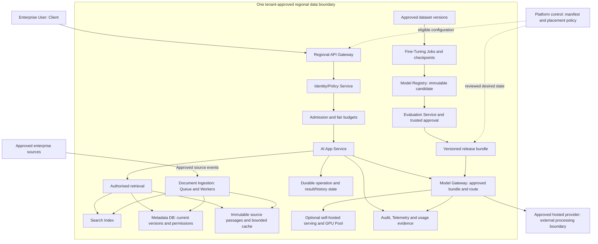
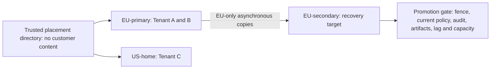

<!-- Generated by site/scripts/sd-course-import.mjs from 10_AI_System_Design. Edit the stage guide there. -->
# Enterprise use case and target architecture: learn and design

## The End-to-End Target Architecture

The destination has four connected paths: customer requests, enterprise document ingestion, quality/model changes, and platform/regional control. A component is a logical responsibility first. Several roles can share one application initially; the diagram does not prescribe a separate microservice, vendor, broker, or GPU deployment for every box.

Target diagram. Text alternative: an authenticated regional request passes current policy and admission, gathers authorised source evidence, calls an approved model through Model Gateway, and commits its result. Ingestion supplies versioned source/index state. Evaluation and optional training supply approved release identities. Platform control configures eligible regional execution; customer prompts stay out of the global control plane. A hosted provider is an approved external processing boundary whose geography and handling require separate checks.

The [offline architecture map](#lesson-the-end-to-end-target-architecture) shows the same four paths with selectable stage highlights. The full explanation remains visible without JavaScript. Read the customer request lane first, then inspect how the other lanes supply it.

## What Each Boundary Is Responsible For

| Boundary | Components | Why it exists and what it must not claim |
| --- | --- | --- |
| Identity and ingress | Client, API Gateway, Identity/Policy Service | Verify the caller and trusted tenant scope; a claimed tenant header or prompt is insufficient |
| Admission and execution | Bounded admission, fair scheduler, AI App Service | Protect finite request/token/slot capacity and execute the task; more app replicas do not remove downstream limits |
| Enterprise evidence | Document Ingestion, Queue, Workers, source objects, Metadata DB, Search Index, immutable cache | Turn source changes into retrievable passages while checking current versions, deletion, and access before disclosure |
| Model execution | Model Gateway, approved hosted adapter, optional self-hosted engine/GPU Pool | Resolve an approved compatible route and bounded request; spare GPUs do not authorise retrying unknown remote work |
| Durable outcomes | Operation records, saved results/history, job state | Persist identity and known completion; missing or processing state does not prove that an external call never happened |
| Quality and model lifecycle | Evaluation Service, release bundle, dataset versions, Fine-Tuning Jobs, Model Registry | Bind evidence to a specific candidate; successful training is not deployment approval |
| Operations | Audit, Telemetry, usage evidence | Trace decisions, detect failures, and reconcile spend; raw confidential prompts do not belong in unrestricted logs |
| Platform and regions | Versioned app manifests, placement policy, regional cells, migration controller | Reuse contracts and constrain placement/cutover; historical configuration is not current authorisation |

The Metadata DB is the logical relational authority for relevant state; this overview separates history and policy boxes to show different guarantees, not to require separate databases. Likewise, durable jobs can start with a database-backed queue. Later stages evaluate external services only when the requirement warrants them.

## Regions and Trust Boundaries

A regional cell contains the request and data services needed for assigned tenants. Tenant A and B have EU-primary and an eligible EU-secondary recovery target. Tenant C has US-home. A global directory carries only separately classified opaque placement information; it does not copy A/B prompts or documents into the US cell.

Regional diagram. Text alternative: A/B use EU cells and C uses its US cell. The EU secondary becomes a writer only after exclusive ownership and current eligibility are verified. Asynchronous copies can lose acknowledged operation evidence within the assumed recovery window; a missing copied row does not permit blind redispatch.

## Checkpoint: Does the Model Decide Access?

A restricted supplier pricing note is the best search hit. May the platform send it to the model and ask the model to hide it from Alice?

Reveal after answering

No. Trusted retrieval and current policy must stop the restricted content before model disclosure. Search relevance does not establish permission, and a model instruction cannot repair an unauthorised data transfer.

