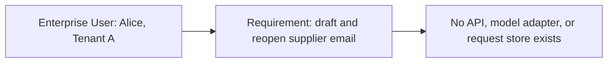

<!-- Generated by site/scripts/sd-course-import.mjs from 10_AI_System_Design. Edit the stage guide there. -->
# Build the MVP: understand the problem

Alice, a procurement analyst in Tenant A, wants to draft a supplier email from text she provides and reopen the saved answer. Build that request path before adding document search, background jobs, or a platform of separate services.

This is an educational design for a hypothetical customer. All workload, latency, quota, retention, and token figures below are illustrative assumptions. The executable lab verifies a local slice with fixture identity and a deterministic model. It does not deploy an enterprise service or call a hosted model.

Follow five learning phases: understand the problem, learn and design, observe and experiment, think like a Staff engineer, then validate and carry forward. The detailed material stays within the original MVP scope.

Before this lesson, read the [Stage 0 overview](../00_enterprise_overview/01_understand_the_problem.md) for the complete customer journey and target architecture. Then return here to build the first saved-draft path.

## 1. Before This Stage

No system exists. There is no previous stage to inherit, no benchmark, and no existing identity integration. Alice currently copies text into an unmanaged drafting tool and saves the result manually. That workflow is the hypothetical starting requirement, not observed customer research.

Before diagram. Text alternative: Alice has a requirement; the platform has no implemented components.

The smallest useful outcome has four properties. A trusted identity identifies Alice. A server submits approved text to a model. The server saves the completed answer before reporting success. A later read returns only Alice’s own saved request.

## 2. The Customer Contract

Ask what Alice will do with the answer. She reviews and sends the email herself. The application neither sends messages nor makes procurement decisions. There are no internal document connectors, so it must not claim to answer questions from company policy or cite unavailable sources.

Before the formal contract, picture five moments in Alice’s workflow:

| Supplier-email moment | Name for the idea | Guarantee and limit |
| --- | --- | --- |
| Alice proves which account she uses; Bob still cannot open her saved draft | Authentication identifies the caller; authorisation checks access | Trusted code checks tenant and user on every history read; model text cannot grant access |
| Alice is willing to wait about five seconds for a saved draft | Service-level objective (SLO) | A measured target for a defined request population; a fast example does not prove it |
| Saving the answer and its completed label must agree | Database transaction | Local changes commit together or roll back; the separate provider is not inside that transaction |
| Alice double-clicks Submit after a network pause | Idempotency | Reusing the same scoped key can return the existing result; it does not guarantee one provider execution after every possible crash |
| Alice sees “saved” and expects to reopen the answer | Acknowledgement boundary | Report completion after the answer commit; partial or unsaved text is not a completed saved draft |

The 95th percentile, or p95, is the latency threshold met by 95% of the measured requests. Counting timeouts and errors alongside latency prevents fast rejections from looking like success. The rest of the lesson makes these promises precise. Learn the consequence first, then use the formal term to explain your design.

| Requirement | Illustrative acceptance criterion | Design consequence |
| --- | --- | --- |
| Draft from supplied text | One authenticated POST returns an answer and request ID | Synchronous API with a model adapter |
| Reopen a draft | A committed completed answer can be read by its owner | Durable relational request history |
| Isolate history | Tenant B cannot list or fetch Tenant A requests | Trusted tenant/user predicates on every read |
| Stay responsive | Healthy pilot p95 below five seconds | Deadline hierarchy and measured latency breakdown |
| Bound spending | Expected 1,200 input and at most 300 output tokens | Provider token limits and usage counters in the real integration |
| Protect supplied text | Only approved non-sensitive pilot text; credentials stay on server | Explicit provider boundary, no prompt/token logging |
| Retain briefly | Proposed 30-day history policy | Deletion/backup policy must be implemented before a real pilot |

The five-second value is a proposed service-level objective (SLO), a target measured over a defined population. It is not a promise this lesson has demonstrated. Define the pilot SLI, or service-level indicator, as elapsed time for valid authorised draft requests from server receipt to final response, with timeouts counted as failures. Track rejection rate separately so rejecting requests cannot make latency look healthy. Include user-side latency to detect network delays outside the server measurement.

The scope is one active pilot user, 200 requests during an eight-hour workday, and a brief 0.5 requests per second peak. Tenant B is a negative-test fixture, not a second launched customer. Confirm real demand, provider text handling, deployment region, and identity requirements before a pilot.

## 3. Learning Contract

| Taught at mapped depth | Depth | What you should be able to do |
| --- | --- | --- |
| 1.1 Requirements and architecture methodology | D3 | Turn user outcomes into boundaries, alternatives, and failure tests |
| 1.2 Estimation and capacity planning | D3 | Compute demand and identify which limit the units describe |
| 2.1 Networking fundamentals | D2 | Locate DNS, connection, TLS, and HTTP failures on the path |
| 2.2 APIs and streaming protocols | D3 | Build/debug a request contract and defend JSON versus streaming |
| 6.1 Database architecture | D2 | Explain keys, indexes, transactions, and the external-call gap |
| 7.1 End-to-end AI application design | D3 | Implement the representative auth-to-model-to-history slice |

Those six rows are the entire first-teaching assignment for Stage 1, not a sample of it. “Taught at mapped depth” describes the authored lesson and exercise coverage; learner mastery still requires the exit gates. No modules are revisited here.

Nearby concepts have narrower treatment:

| Module | Treatment here | First-teaching stage and target depth |
| --- | --- | --- |
| 1.3 Design documentation and communication | Context only: use an ADR, without teaching a documentation portfolio | Stage 12, D3 |
| 2.3 Gateway and service communication | Context only: name an ingress role; do not teach service-to-service architecture | Stage 6, D3 |
| 13.1 Identity and access control | Context only: trusted caller scope and fixture checks | Stage 6, D3 |
| 4.3 Background execution systems | Deferred: no durable jobs or worker recovery | Stage 2, D3 |
| 8.1 Document ingestion and indexing | Deferred: supplied text only, no internal knowledge pipeline | Stage 3, D3 |

The other 50 modules keep their own first-teaching stages in the [curriculum map](https://github.com/Sourav692/Forward-Deployed-Engineer-Interview-Prep/blob/main/10_AI_System_Design/progress/curriculum-map.json). Context-only mentions do not increment completed coverage. [Coverage status](https://github.com/Sourav692/Forward-Deployed-Engineer-Interview-Prep/blob/main/10_AI_System_Design/progress/coverage-status.csv) separately records authored checks and unassessed learner status.

D3 means explaining, choosing, building a representative slice, observing failure, and mitigating it. D2 requires architectural explanation and a small design exercise. This integrated lesson is estimated at seven to nine study hours; it does not replace learner practice. There are no revisit modules in Stage 1.

Before starting, be able to read basic Python, JSON, SQL, and HTTP. Stop at the MVP boundary. Defer retrieval, durable workers, caches, Kubernetes, GPU hosting, and advanced tenant scheduling until a requirement motivates them.

## 4. First Walk Through the Failure

Suppose the server calls the model and immediately sends Alice the text, then tries to save it. The database write fails. Alice saw a success, but reopening the request yields nothing. A model response alone has failed the customer contract.

Reverse the acknowledgement boundary. First insert a `processing` row and commit it. Then call the provider without an open database write transaction. After generation, update the row to `completed` with its answer and commit. Only then return a successful answer. If the final write fails, return a storage error; the earlier row may remain `processing` and need investigation.

This ordering creates a visible ambiguity: the provider might have generated and charged for an answer that the database never recorded. A database transaction cannot atomically include an independent hosted-model API. Preserve the request ID, avoid automatic retries, and make this gap explicit. Stage 2 can later strengthen job recovery; this lesson does not claim exactly-once model execution.
