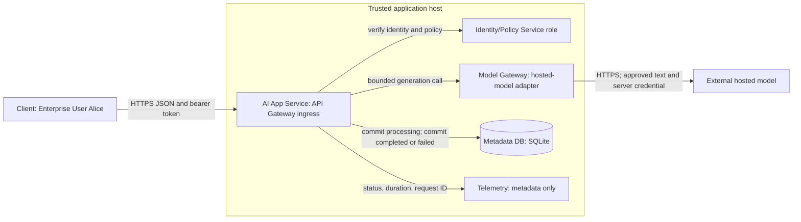

<!-- Generated by site/scripts/sd-course-import.mjs from 10_AI_System_Design. Edit the stage guide there. -->
# Build the MVP: learn and design

## 5. Choose the Smallest Architecture

| Option | Where it wins | Cost or failure boundary | Decision here |
| --- | --- | --- | --- |
| One API process, synchronous JSON, SQLite | One host, light writes, short requests, simple local learning | Host-local file, serial writes, no automatic failover | Choose for the baseline and executable slice |
| One API process with a managed relational server | Independent storage operations, backups, several app hosts | Network dependency and database administration/cost | Credible pilot alternative when durability/operations require it |
| Browser directly calls model and saves history later | Disposable personal experiments | Exposes provider credentials unless separately mediated; splits policy and persistence | Reject for the customer contract |
| Durable job API with queue and workers | Long tasks must survive worker loss | More states, delivery semantics, recovery operations | Defer until the next motivating requirement |

SQLite is a relational database embedded in the process. It avoids a separate database server for the exercise. Its serialised writes make short transactions important; it is not evidence that a multi-host deployment can share this file safely. [SQLite isolation documentation](https://www.sqlite.org/isolation.html) describes its writer/isolation behaviour. A real pilot needs a durable volume and tested restore; serverless ephemeral files do not satisfy the saved-history requirement.

The API Gateway, Identity/Policy Service, and Model Gateway names below are logical roles within the AI App Service. Deploying a separate service for every box would add network failure paths without helping this workload. Keep a boundary in code so a later stage can change implementation with an explicit decision.

### Checkpoint 1: Answer Before Revealing

Why is the model call outside the database write transaction? What problem would keeping that transaction open fail to solve?

<details>
<summary>Reveal the explanation after answering</summary>

<p>Keeping it open would extend database lock time while an external service responds. It would not make the hosted provider part of the local transaction. Commit the processing row first; then expose and handle the remaining external-call/commit gap.</p>

</details>

## 6. Architecture After the Change



After diagram. Text alternative: Client crosses the application boundary over HTTPS. The AI App Service checks trusted identity/policy, stores request state in Metadata DB, invokes the model through its adapter, and emits metadata-only telemetry. The hosted model is outside the application trust boundary. The lab replaces external identity and generation with local fixtures.

The Client is an API consumer in the executable; no production web client is built. The application owns request policy, response shape, and persistence. The model adapter owns provider-specific payload conversion and deadline/error translation. The Metadata DB owns request state. Telemetry is a design contract here; production traces and metrics exporters are not installed by the lab.

### Identity and Tenant Scope

Authentication establishes who made the request. Authorisation decides which resource that identity can use. Derive `(tenant_id, user_id)` from trusted identity, never from the request body or model output. Apply both fields to history queries. Return the same `404` for an absent request and another tenant’s request to avoid confirming its existence. This matches the server-side enforcement approach in the [OWASP authorisation guidance](https://cheatsheetseries.owasp.org/cheatsheets/Authorization_Cheat_Sheet.html).

The exercise maps public fixture bearer tokens `demo-a` and `demo-b` to identities; it does not implement login or OAuth. For deployment, use an identity provider and validate the token’s signature or introspection result, issuer, audience, expiry, and accepted algorithm according to that provider’s contract. Fail closed if identity cannot be established. Bearer tokens confer access to their holder, so protect them in transport and storage; see [RFC 6750](https://www.rfc-editor.org/rfc/rfc6750.html). The localhost HTTP exception is solely for the fixture lab.

### Networking on This Path

In deployment, the Client resolves the application hostname through the domain name system (DNS). A fresh HTTP/1.1 or HTTP/2 connection establishes TCP, then transport layer security (TLS), before carrying HTTP. Reused connections avoid repeating these setup costs. This lesson’s HTTP lab exercises loopback without DNS resolution or TLS; HTTP/3 is outside scope.

The application may separately resolve and connect to the hosted provider. Put connect, read, and total deadlines in the real adapter: a read timeout alone may not bound a slow stream of bytes. A DNS error, connection refusal, TLS certificate error, HTTP `401`, and HTTP `504` indicate different failed boundaries. Do not retry them all as if the model were slow. Inspect phase timings and dependency status before changing the model.

Use this proposed deadline hierarchy: provider total four seconds, app budget 4.5 seconds, ingress 5.5 seconds, Client six seconds. Reserve time for identity and two database transactions before selecting the provider timeout. If the non-provider work exceeds its budget, shorten the provider allowance from the remaining deadline. Cancelling a local wait does not prove the provider stopped computing or billing.

## 7. API and Data Contracts

Choose a complete JSON response for T18.2. The Client needs a saved draft, and the illustrative healthy path fits the five-second target. The application can return `201` only once it has persisted the answer.

| Protocol | When to choose it | What changes in the failure contract |
| --- | --- | --- |
| Synchronous JSON over HTTP | Short, bounded request and final saved answer | One success boundary after answer commit |
| Server-sent events (SSE) | User benefits from progressive one-way text | Partial tokens can arrive before durable completion; explicit final saved event needed |
| WebSocket | Bidirectional, frequent live interaction | Connection lifecycle and application message/recovery protocol become your responsibility |

Streaming reduces perceived wait for the first text; it does not prove the final answer is saved or reduce the model’s total work. If added later, distinguish partial content from a final persisted request ID, and design disconnect recovery through history. HTTP request/response and status semantics are defined by [RFC 9110](https://www.rfc-editor.org/rfc/rfc9110.html); the particular idempotency policy below is our application contract.

```http
POST /requests HTTP/1.1
Authorization: Bearer demo-a
Content-Type: application/json
Idempotency-Key: supplier-draft-001

{"prompt":"Draft a short email asking our supplier to confirm the delivery date."}
```

Successful response shape, with an illustrative ID:

```json
{"id":"example-request-id","status":"completed","answer":"Draft: Please confirm the supplier delivery date before replying."}
```

| Operation or condition | Result | Caller action |
| --- | --- | --- |
| New valid request | `201`, committed ID and answer | Show saved draft |
| Same key, same prompt, already completed | `200`, same saved answer | Reuse result without a new model call |
| Same key, changed prompt | `409 key_conflict` | Choose a new key for an intentionally new operation |
| Same key still processing or failed | `409` with ID and state | Inspect history; no automatic generation retry |
| Invalid identity | `401` with bearer challenge | Re-establish identity; do not call provider |
| Invalid input or JSON | `400` | Correct request; no provider call |
| Encoded body above 20,000 bytes | `413` | Reduce body; no provider call |
| POST body is not application/json | `415` | Set the correct media type; no provider call |
| Provider timeout, failed state saved | `504` with request ID | Inspect failed history; provider outcome can be uncertain |
| Database unavailable | `503` | No completed success; inspect whether earlier row exists |
| `GET /requests/<id>` | Owner gets `200`; other tenant gets `404` | Show persisted state, not guessed model progress |
| `GET /requests` | Latest 50 own request IDs and states | Reopen one by ID; pagination is deferred |

Validate a request before creating its row or calling the model: require a JSON object, a non-blank prompt of at most 4,000 characters including surrounding whitespace, and a non-blank `Idempotency-Key` of at most 100 characters. Reject an encoded body above 20,000 bytes before parsing it, and require `application/json` for POST. The lab’s optional `mode` is restricted to `success` or `timeout` and exists only for fault injection. Extra body fields such as `tenant_id` never override trusted identity. These size rules are memory/input boundaries, not token-quota enforcement.

The key identifies an operation, not merely an HTTP connection. On network uncertainty, reuse the same key for the same prompt and inspect history. A new key intentionally permits a new provider attempt. Never turn a `503` or `504` into an automatic new-key retry. For this small pilot the API returns bounded error codes, not SQL errors, prompts, credentials, or provider internals.

The uniqueness key is `(tenant_id, user_id, request_key)`. This prevents a duplicate key from another tenant colliding with Alice’s request. Prompt equality is exact in the lab. In a real adapter, include every generation-affecting parameter in the equality/fingerprint contract. The test-only `mode` field selects fault injection and is deliberately outside business request identity.

### Schema and Transaction Boundaries

```sql
CREATE TABLE requests (
    id TEXT PRIMARY KEY,
    tenant_id TEXT NOT NULL,
    user_id TEXT NOT NULL,
    request_key TEXT NOT NULL,
    prompt TEXT NOT NULL,
    status TEXT NOT NULL CHECK(status IN ('processing','completed','failed')),
    answer TEXT,
    error TEXT,
    created_at REAL NOT NULL,
    UNIQUE(tenant_id, user_id, request_key)
);
CREATE INDEX history_scope ON requests(tenant_id, user_id, created_at DESC);
```

The primary key locates a request. The unique constraint arbitrates duplicate submissions atomically. The history index follows the equality filters and then the ordering field. An index trades write/storage overhead for less scanning on the access path; demonstrate the choice with `EXPLAIN QUERY PLAN` instead of adding indexes for every column.

Use parameterised SQL, where values are bound separately from the statement. The [Python sqlite3 documentation](https://docs.python.org/3/library/sqlite3.html) explains parameter binding and connection transaction handling. The runnable code uses one connection per operation, short committed transactions, and explicit tenant predicates.

A transaction makes the local set of changes commit or roll back together. Here, the insert is one transaction and the final state change is another; neither surrounds the external call. History reads the same database, so after a successful answer commit it can read that answer without a replica-lag assumption. Disk durability still depends on database settings, filesystem/storage, and operating procedures. There is no replication or disaster recovery claim.

Allowed application transitions are `processing → completed` or `processing → failed`. A crashed process may leave `processing` forever because this stage has no recovery worker. A stale row is evidence to investigate, not permission to blindly repeat a charged call. Before production, add a reconciliation policy and represent unknown outcomes explicitly if needed.

### Checkpoint 2: Answer Before Revealing

What goes wrong if the API returns HTTP 201 before the answer commit? What should the same key do after a completed response is lost?

<details>
<summary>Reveal the explanation after answering</summary>

<p>An early 201 tells Alice the draft is saved when the final write could still fail. A completed duplicate with the same key and prompt should return 200 with the stored answer and no new model call. A processing or failed duplicate returns 409 for inspection.</p>

</details>

## Key Takeaways

- The baseline is one API process with synchronous JSON and SQLite. Gateway, identity and model adapter stay as code boundaries inside one application, because separate services would add network failure paths without helping this workload.
- Derive `(tenant_id, user_id)` from trusted identity, never from the request body or model output, and apply both to every history query. Another tenant's request returns the same `404` as a missing one.
- The unique key `(tenant_id, user_id, request_key)` arbitrates duplicates. The same key and prompt after completion returns `200` with no new model call, a changed prompt returns `409 key_conflict`, and a processing or failed duplicate returns `409` for inspection.
- The deadline hierarchy is provider four seconds, app 4.5, ingress 5.5 and client six. Cancelling a local wait does not prove the provider stopped computing or billing.
