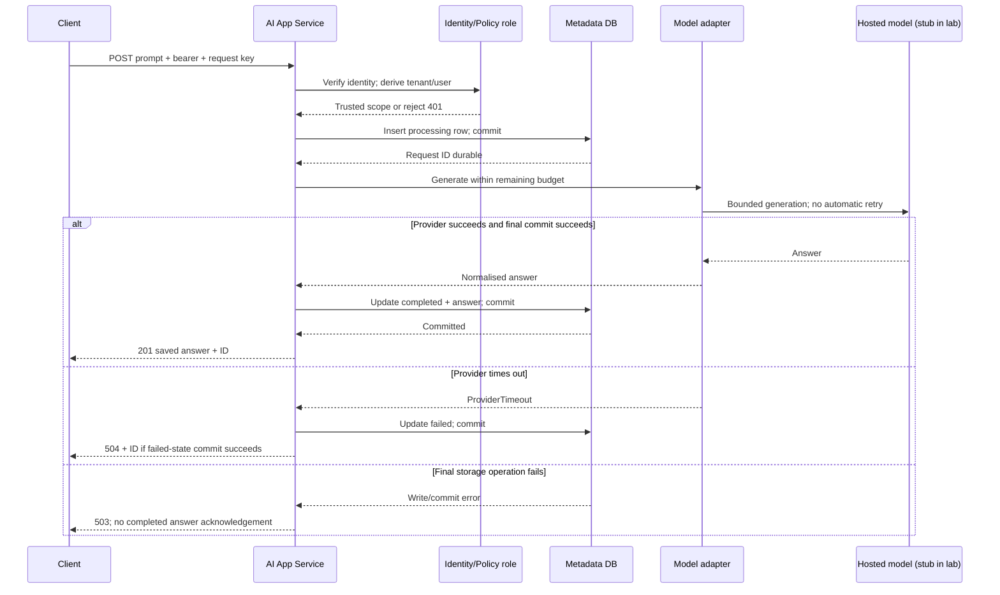

<!-- Generated by site/scripts/sd-course-import.mjs from 10_AI_System_Design. Edit the stage guide there. -->
# Build the MVP: observe and experiment

## 8. Trace One Request



Sequence diagram. Text alternative: Verify identity, commit a processing row, call the model, commit completed or failed state, then respond. If storage fails, report an error and preserve uncertainty. Invalid identity exits before persistence or generation. Duplicate keys are resolved before a new provider call.

Alice sends key `supplier-draft-001`. Her trusted scope is `(A, alice)`. The database reserves a new request ID. The adapter returns a deterministic supplier-email draft in the lab. The completed row commits before `201`. Alice then fetches the returned ID. Bob’s Tenant B token gets `404` for that ID and an empty history list.

### Request Lifecycle: Advance One Boundary at a Time

Open the [clickable request walkthrough](/labs/system-design/01_mvp/lab.html#request-walkthrough). Select a step or use Previous/Next, choose success, provider timeout, or final-write failure, and predict the visible state before advancing. This is a deterministic explanation of the application contract, not an execution trace or latency benchmark.

```lab
src: /labs/system-design/01_mvp/lab.html
title: Build the MVP: request walkthrough and lab
```

| Step and responsible component | Input | Output or durable state | Possible failure |
| --- | --- | --- | --- |
| 1. Client submits | Prompt, bearer token, scoped operation key | JSON request sent to API ingress | Invalid JSON, oversized body, wrong media type, or blank prompt is rejected before generation |
| 2. Identity/Policy role verifies | Bearer identity plus attempted resource | Trusted `(A, alice)` scope | Unknown identity returns 401; caller tenant claims cannot grant access |
| 3. Metadata DB inserts | Trusted scope, key, prompt, new request ID | Committed `processing` row | Insert failure returns 503; duplicate key resolves before another provider call |
| 4. Model adapter generates | Approved prompt and provider budget | Answer, or provider timeout | A timed-out wait does not prove remote work stopped; do not automatically repeat it |
| 5. Metadata DB commits final state | Answer or timeout outcome plus request ID | `completed` with answer, or `failed` with error | Final write failure leaves the earlier `processing` row and an uncertain remote outcome |
| 6. AI App Service responds to Client | Result of the final state write | 201 saved answer, 504 saved failure, or 503 storage error | A lost response requires inspection/reuse of the same key, not a blind new attempt |

Static branch results: success commits `completed` before `201`; provider timeout commits `failed` before `504`; final completed-write failure leaves `processing` and returns `503`. The walkthrough assumes identity and the initial insert succeed. Earlier validation, authentication, duplicate, and insert failures are explained at their owning steps but are not additional selectable simulation branches.

## 9. Work the Numbers Before Buying Capacity

These calculations use a hypothetical stationary approximation, not observed latency distributions. Request rate measures arrivals; concurrency measures simultaneous in-flight work; tokens measure provider workload. They are different limits.

| Quantity | Calculation | Interpretation |
| --- | --- | --- |
| Average arrival rate | `200 / (8 × 3,600) = 0.00694 requests/s` | Workday mean hides bursts |
| Illustrative peak | `0.5 requests/s = 30 requests/min` | Must check provider RPM separately |
| Mean in-flight work at peak | `L = λW = 0.5 × 2.62 = 1.31 requests` | Little’s-law estimate in a stable regime; not a safe hard concurrency limit |
| Expected tokens/request | `1,200 input + 300 output = 1,500 tokens` | Output cap does not cap arbitrary input |
| Peak token demand | `30 × 1,500 = 45,000 tokens/min` | If a provider counts combined tokens this way; confirm actual quota rules |
| Workday token demand | `200 × 1,500 = 300,000 tokens/day` | 240,000 input and 60,000 output |
| Thirty-day logical storage | `200 × 30 × 8 KiB = 46.875 MiB` | Expected row payload only; add indexes, file overhead, backups, and headroom |

For an illustrative 60 requests/min and 50,000 combined tokens/min quota, peak demand uses 50% of request quota and 90% of token quota. The token limit is tighter. These are invented planning quotas, not vendor limits. Variable text lengths and bursts can exceed them even when the mean fits. This is not an admission/fairness implementation; those controls are deferred.

If input price is `p_in` per million tokens and output price is `p_out`, expected daily model cost is `0.24 × p_in + 0.06 × p_out`. Add platform and storage cost separately. Failed or disconnected requests may still consume billed work. No current provider price is assumed.

The lab limits input to 4,000 characters as a simple memory/body bound. Characters are not tokens, and non-ASCII text can use multiple UTF-8 bytes. A real adapter needs model-specific token counting or conservative rejection plus the provider’s context/output limits. The 8 KiB storage estimate is an average planning assumption, not the maximum possible row size.

### Latency Budget

Use a deterministic healthy example: 50 ms network, 30 ms identity/app work, 20 ms request insert, 2,500 ms provider, and 20 ms answer update. Total: `50 + 30 + 20 + 2,500 + 20 = 2,620 ms`.

The non-provider budget is 120 ms. At a 4,000 ms provider deadline, a simulated late model produces `4,000 + 120 = 4,120 ms`, then a `504` if the failure-state write succeeds. A 4.5-second app budget has 380 ms remaining in this example. Real scheduling, network tails, authentication, and disk delay can consume it. Summing representative component times does not establish p95, and summing component p95 values does not generally give end-to-end p95.

## 10. Lab: Move the Deadline, Observe the Outcome

Open the [offline interactive lab](/labs/system-design/01_mvp/lab.html#lab). It varies provider duration (500–6,000 ms) and provider deadline (1,000–4,000 ms). Fixed overhead is 120 ms. These controls illustrate the latency/outcome trade-off without pretending to call a model.

The toy rule is: provider duration less than or equal to deadline completes; a larger duration times out. The equality case is an explicit modelling convention. Real deadline races require margins and integration tests.

| Scenario | Duration | Deadline | Client duration | Persisted state and response |
| --- | --- | --- | --- | --- |
| Healthy default | 2,500 ms | 4,000 ms | 2,620 ms | `completed`, `201` |
| Slow dependency | 5,000 ms | 4,000 ms | 4,120 ms | `failed`, `504` |
| Tight budget | 2,500 ms | 2,000 ms | 2,120 ms | `failed`, `504` |
| Boundary convention | 4,000 ms | 4,000 ms | 4,120 ms | `completed`, `201` in this toy model |

The visual lab assumes all database operations succeed, includes the state-write cost in the fixed overhead, and has no network variation, rate limits, or retries. It cannot prove the five-second SLO. A shorter deadline can reduce waiting while increasing failed requests; it does not make the provider faster. The same static worked cases remain readable without JavaScript.

### Build and Debug the Representative Slice

The [Python API](https://github.com/Sourav692/Forward-Deployed-Engineer-Interview-Prep/blob/main/10_AI_System_Design/stages/01-mvp/labs/mvp.py) uses standard-library HTTP and SQLite. The model and identity integrations are fixtures, while the HTTP requests and database commits are real. Read the adapter’s interface, request state transitions, and scoped queries before running it. Public fixture tokens authenticate local test identities only. Do not expose this server or treat it as a production identity stack.

## Run the code lab

Run this stage's Python lab in your terminal to see each idea in the stage hold. It needs Python 3.10 or later and nothing else: the standard library and SQLite only.

| File | What it is |
| --- | --- |
| [mvp.py](https://github.com/Sourav692/Forward-Deployed-Engineer-Interview-Prep/blob/main/10_AI_System_Design/stages/01-mvp/labs/mvp.py) | Lab code: read this first |
| [test_mvp.py](https://github.com/Sourav692/Forward-Deployed-Engineer-Interview-Prep/blob/main/10_AI_System_Design/stages/01-mvp/labs/test_mvp.py) | Tests: one test per behaviour this stage teaches |

From the root of your local clone of the repository, run:

```bash
python3 10_AI_System_Design/stages/01-mvp/labs/test_mvp.py -v
```

`-v` prints one line per test, and each test name states one behaviour. Read a test, change one value in the lab code, predict which test fails, and run it again.

In a separate terminal, use a fresh disposable database path:

```bash
python3 10_AI_System_Design/stages/01-mvp/labs/mvp.py --database /tmp/stage1-demo.sqlite --port 8767
```

Send one request:

```bash
curl -i http://127.0.0.1:8767/requests \
  -H 'Authorization: Bearer demo-a' \
  -H 'Content-Type: application/json' \
  -H 'Idempotency-Key: supplier-draft-001' \
  --data '{"prompt":"Draft a supplier email asking for the delivery date."}'
```

Expect `201` and an ID. Repeat the exact command: expect `200`, the same ID and answer, and no additional model call. Fetch history using `GET /requests` with the same token. Fetch `/requests/<returned-id>` with `demo-b`: expect `404`. These are tests of tenant scope, not a proof of enterprise isolation.

Inject the representative failure with a new key:

```bash
curl -i http://127.0.0.1:8767/requests \
  -H 'Authorization: Bearer demo-a' \
  -H 'Content-Type: application/json' \
  -H 'Idempotency-Key: supplier-timeout-001' \
  --data '{"prompt":"Draft a supplier email.","mode":"timeout"}'
```

Expect `504 provider_timeout`. A history read shows `failed`; repeating that key returns `409` without a second model call. The stub raises immediately; elapsed wall time here is not the 4,120 ms timing simulation.

The integration suite also creates a SQLite trigger that rejects the final completed update after generation. Expect `503 storage_unavailable`, a remaining `processing` row, and `409` for the same key. This reproduces the external-call/commit gap. Inspect the row and model call counter; deleting the row and repeating generation would conceal the ambiguity. Restarting the app against the same file preserves completed answers; the suite recreates the App object to verify persistence, without claiming an abrupt power-loss test.

For the design depth database exercise, inspect the scoped history query using `EXPLAIN QUERY PLAN`, explain why the compound index helps, and describe when a managed relational database would replace the file. For the build depth extension exercise, implement a real adapter only in an approved test environment; cap tokens, enforce total deadlines, validate its error mapping, and retain all ownership/idempotency tests.

### Checkpoint 3: Answer Before Revealing

Generation succeeded, the final update failed, and the row still says processing. Should you delete it and retry with a new key?

<details>
<summary>Reveal the explanation after answering</summary>

<p>No. The provider may already have generated and charged for the answer. A new key can repeat the work and hide the evidence. Keep the row, inspect storage and the request ID, and use an explicit reconciliation policy. Durable recovery is deferred to T17.3.</p>

</details>

## Key Takeaways

- Request rate, concurrency and tokens are different limits. At a 0.5 requests/second peak and 1,500 tokens per request, demand is 45,000 tokens a minute, which uses 90% of an illustrative 50,000 token quota but only 50% of a 60 requests/minute quota.
- Little's law gives about 1.31 requests in flight at 0.5 requests/second and 2.62 seconds each. That is a stable-regime mean, not a safe hard concurrency limit.
- A healthy request sums to 2,620 ms, and a late provider at a 4,000 ms deadline returns `504` at 4,120 ms. A shorter deadline can cut waiting while raising failures, and summing component p95 values does not give end-to-end p95.
- If generation succeeds but the final update fails, the row stays `processing` and the API returns `503`. Keep the row and inspect it, because deleting it and retrying with a new key can repeat charged work and hide the evidence.
