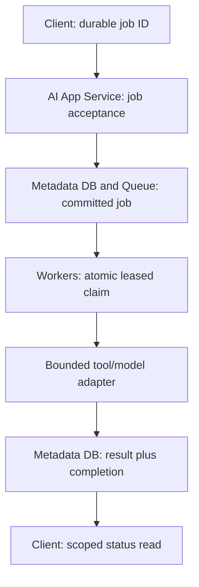

<!-- Generated by site/scripts/sd-course-import.mjs from 10_AI_System_Design. Edit the stage guide there. -->
# Distributed execution: learn and design

## Separate Acceptance From Execution

Create a new job path rather than silently changing `/requests`. The proposed `POST /jobs` facade validates an allowed job kind, a bounded payload/reference, and a scoped operation key. In one transaction it creates a `queued` row. Only after commit may it return `202` and a job ID with a status location. `202` means accepted for processing, not that generation finished; see [RFC 9110](https://www.rfc-editor.org/rfc/rfc9110.html). The executable tests the store behind this contract; it does not add an HTTP facade to Stage 1.

A status read uses trusted tenant and user from identity, never owner fields supplied in JSON. Proposed `GET /jobs/<id>` returns state, attempt count, and a saved result only when available. Unknown or out-of-scope IDs return the same not-found outcome. Keep public error codes bounded: invalid input `400`, unauthenticated `401`, conflicting key `409`, unavailable durable store `503`. The new route is a design contract, not a claim of executed HTTP tests for it.

The database-backed queue and job record are the same durable row here. No gap exists between saving a job and publishing to a separate broker. If a broker is introduced later, a transactionally recorded outbox can bridge database commit to publication, with duplicate-safe publication/consumption. Do not claim a database commit confirms broker delivery.

## Alternatives and Operational Cost

| Design                                                  | When it wins                                     | Failure or cost                                                       | Choice                                             |
| ------------------------------------------------------- | ------------------------------------------------ | --------------------------------------------------------------------- | -------------------------------------------------- |
| Thread or asynchronous coroutine inside web process     | Short overlapping network waits within a request | Restart loses unsaved work; no durable ownership                      | Not the durable job mechanism                      |
| SQLite job table, separate worker processes on one host | Small pilot with low claim/write rate            | Serial writer, polling load, shared host failure domain               | Choose for the representative slice                |
| Durable broker plus relational job state                | Independent worker fleet and delivery controls   | Two persistence boundaries; publication and acknowledgement recovery  | Credible next deployment choice, not required here |
| Append-only event log                                   | Independent consumers need replayable history    | Retention, offsets, partition ordering, and consumer state to operate | Defer; this workload needs work distribution first |

A queue distributes work among consumers; a replayable log stores an ordered history within its defined partitions for independently positioned consumers. Neither product name grants end-to-end exactly-once effects. Publisher confirmation concerns publication; consumer acknowledgement concerns delivery handling. Those are separate boundaries in [RabbitMQ’s acknowledgement documentation](https://www.rabbitmq.com/docs/confirms). Our local queue represents acknowledgement as the committed terminal state rather than a broker API call.

An asynchronous function yields while waiting for I/O; it does not create durable ownership. Threads can overlap blocking I/O. Multiple worker processes can use separate CPU cores, but all may still contend on the same database or provider quota. For CPU-heavy parsing, profile process execution; for provider waits, concurrency helps only while dependency and memory limits permit it. Do not hold a database write transaction for a 20-second task.

## Claim, Lease, and Completion

`claim(now)` starts `BEGIN IMMEDIATE`, finds one eligible row, increments its epoch and attempt count, sets a lease, and commits. That transaction prevents two workers from winning the same current claim in this SQLite exercise. SQLite serialises writers; it is not a shared-file solution for an arbitrary multi-host fleet. [SQLite isolation](https://www.sqlite.org/isolation.html) documents the local write boundary used here.

The epoch is a monotonically increasing ownership token. Completion must match job ID, epoch, active state, unexpired lease, and job deadline. If Worker 1 pauses, its lease expires, and Worker 2 claims epoch 2, Worker 1 cannot later overwrite Worker 2’s result using epoch 1. This fences database writes. It cannot stop Worker 1 from making an external call unless that external system also validates an appropriate key/token.

The local state machine is `queued → leased → completed`, with safe failure returning to `queued` after backoff. Attempts stop at three. Deadline expiry or exhausted safe attempts produces `dead`. The dead-letter area is a state in the same table, not a second broker. An expired lease marked as having started an external effect becomes `unknown` and is excluded from automatic retry. Reconciliation is a documented operator boundary, not an implemented provider lookup.

After diagram. API and worker roles are separated; SQLite remains one host-local durable store. Trusted identity still scopes acceptance/history. The hosted-model boundary remains external and stubbed; proposed Telemetry reports state transitions without raw prompts.

## Checkpoint 1: Choose the Acknowledgement Boundary

Should a worker acknowledge/remove a delivery before saving its output?

Answer before revealing

No. A crash after removal but before result commit can lose the result and the recovery signal. Commit the durable result first. If delivery acknowledgement can then be lost, redelivery must recognise the saved completion and avoid repeating work.

## The Bounded Agent Workflow

Alice’s document-preparation workflow can plan a small sequence: extract text, validate required supplier fields, and draft a review note. The model may suggest a next action, but trusted code checks an allowlist, parameter schema, tenant scope, remaining time, and a maximum of three tool steps. Store the next step and latest safe output durably. A restart reads that checkpoint instead of relying on a model’s conversation memory.

The exercise allows only `extract`, `validate`, and `draft`. `send_email` is rejected. The original customer requirement still says Alice reviews and sends the email herself. If later product scope adds an irreversible action, separate human approval, operation identity, and unknown-outcome reconciliation from the model’s proposed text. A checkpoint before an external call proves intent, not that the call did or did not execute.

For D3, implement/debug this control boundary: keep immutable job input, validate proposed tools outside the model, persist progress, reject an unapproved tool, and stop when step/time/attempt budgets expire. The fixture saves the latest tool output and step index; it is not a full agent engine or a complete transcript/event store. Rich tool-output retention and cancellation acknowledgement need explicit future design.
