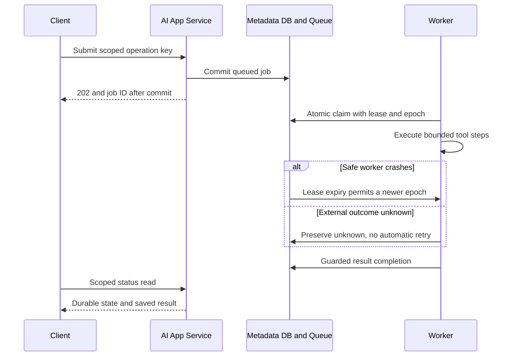

<!-- Generated by site/scripts/sd-course-import.mjs from 10_AI_System_Design. Edit the stage guide there. -->
# Distributed execution: observe and experiment

## Request Walkthrough

The [offline walkthrough](/labs/system-design/02_distributed_execution/lab.html#request-walkthrough) exposes success, worker crash before external effects, and unknown external outcome. At each step read the owner, input, durable output, and possible failure before advancing.

```lab
src: /labs/system-design/02_distributed_execution/lab.html
title: Distributed execution: request walkthrough and lab
```



Sequence diagram. Acceptance commits before `202`; completion is a later event. Redelivery never grants a stale worker authority to overwrite newer state.

| Step     | Input and responsible component                 | Output and possible failure                                            |
| -------- | ----------------------------------------------- | ---------------------------------------------------------------------- |
| Accept   | API receives trusted scope, key, and payload    | Queue row commits; unavailable DB means no acceptance success          |
| Claim    | Worker asks durable Queue for eligible work     | Epoch/lease commit; racing worker gets no active duplicate claim       |
| Execute  | Worker reads immutable input and budgets        | Bounded checkpoint/tool result; unsafe external ambiguity is preserved |
| Recover  | Queue examines expiry and external-start marker | Pure work may redeliver; started external work becomes unknown         |
| Complete | Worker submits result with current epoch        | Completed commit or rejection of stale/expired authority               |
| Inspect  | API reads scoped job state                      | Saved output or explicit queued/leased/dead/unknown state              |

## Calculate the Required Concurrency

At six jobs/minute and 20 seconds/job, arrival rate is `0.1 jobs/s`. The required average in-flight work in a stable regime is `λW = 0.1 × 20 = 2 jobs`. Two workers each able to finish one job in 20 seconds provide exactly six jobs/minute with no nominal headroom. Choose three for the illustrative discussion: capacity becomes nine jobs/minute and utilisation is about 67%, before dependency quotas or runtime variability. These are workload calculations, not measurements of the Python fixture.

If 12 jobs arrive together and three independent workers take exactly 20 seconds/job, four waves finish at 20, 40, 60, and 80 seconds. This ignores claim/commit overhead and external contention. A 90-second job deadline leaves only 10 seconds of margin for the last wave. A 30-second browser timeout should not govern this longer job’s lifetime; return the durable identifier and poll at a bounded interval with backoff instead.

Assuming five state writes per job, six jobs/minute yields about 30 writes/minute, or 0.5 writes/s, before polling and retries. One hundred clients polling every second would add 100 reads/s even when the worker throughput is small. Include polling load in capacity estimates; do not fix a status-query bottleneck by adding more generation workers.

## Lab: Crash Position Changes Recovery

Open the [lease experiment](/labs/system-design/02_distributed_execution/lab.html#lab). Its two controls are the lease interval (5–30 logical seconds) and crash position. A worker is assumed to stop at time zero; no real time elapses and no provider is called.

| Case              | Lease | Failure position            | Expected result                                                               |
| ----------------- | ----- | --------------------------- | ----------------------------------------------------------------------------- |
| Healthy           | 10 s  | None                        | Completed; no replacement attempt                                             |
| Recoverable crash | 10 s  | Before an external effect   | Earliest replacement at 10 s; pure work redelivers; stale completion rejected |
| Longer lease      | 30 s  | Before an external effect   | Earliest replacement at 30 s; slower failure recovery                         |
| Ambiguous call    | 10 s  | After external-start marker | Unknown; no new worker attempt authorised automatically                       |

An actual worker that lives longer than its lease needs a bounded heartbeat/renewal policy. This slice instead rejects expired completions and uses explicit logical-clock experiments. A shorter lease can improve recovery time but can create false takeovers during pauses. The epoch protects state writes, not duplicate billing.

## Run the code lab

Run this stage's Python lab in your terminal to see each idea in the stage hold. It needs Python 3.10 or later and nothing else: the standard library and SQLite only.

| File | What it is |
| --- | --- |
| [jobs.py](https://github.com/Sourav692/Forward-Deployed-Engineer-Interview-Prep/blob/main/10_AI_System_Design/stages/02-distributed-execution/labs/jobs.py) | Lab code: read this first |
| [test_jobs.py](https://github.com/Sourav692/Forward-Deployed-Engineer-Interview-Prep/blob/main/10_AI_System_Design/stages/02-distributed-execution/labs/test_jobs.py) | Tests: one test per behaviour this stage teaches |

From the root of your local clone of the repository, run:

```bash
python3 10_AI_System_Design/stages/02-distributed-execution/labs/test_jobs.py -v
```

`-v` prints one line per test, and each test name states one behaviour. Read a test, change one value in the lab code, predict which test fails, and run it again.

The tests create a temporary database, instantiate/recreate worker stores, race two claimers, expire a lease, attempt a stale completion, record an external start, exhaust safe retries, enforce a deadline, and reject an unapproved tool. They exercise real SQLite commits with a simulated clock. They do not start an HTTP job endpoint or run a network broker. Inspect [jobs.py](https://github.com/Sourav692/Forward-Deployed-Engineer-Interview-Prep/blob/main/10_AI_System_Design/stages/02-distributed-execution/labs/jobs.py), change a lease/deadline, and explain which test should fail before rerunning it.

## Checkpoint 2: Lease Expiry Is Not Proof of Failure

A model call started, its worker stopped answering, and its lease expired. May the replacement call the model immediately?

<details><summary>Answer before revealing</summary><p>No. A timeout or dead worker does not prove the provider stopped. The job enters unknown and requires reconciliation. Automatic redelivery is appropriate only for the defined safe portion of this exercise; an epoch fences local writes, not remote execution.</p></details>

## Key Takeaways

- At six jobs a minute and 20 seconds each, Little's law gives two jobs in flight. Two workers supply exactly six a minute with no headroom, while three give nine a minute at about 67% utilisation.
- Twelve simultaneous jobs on three workers finish in waves at 20, 40, 60 and 80 seconds, leaving 10 seconds of margin under a 90-second deadline. Return the job identifier and poll with backoff rather than tying the job to a 30-second browser timeout.
- Polling is load too. Five state writes per job give about 0.5 writes a second, but 100 clients polling every second add 100 reads a second, which more generation workers cannot fix.
- A shorter lease speeds recovery but risks false takeovers during pauses. A crash before an external effect allows redelivery once the lease expires, while a crash after the external-start marker leaves the job `unknown`.
