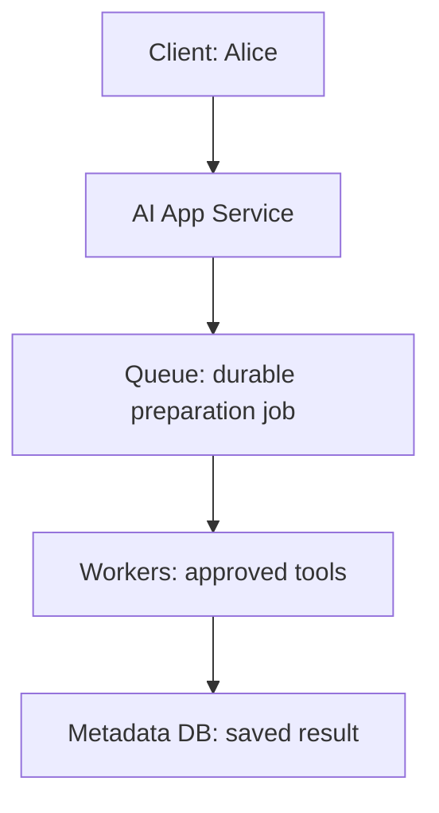

<!-- Generated by site/scripts/sd-course-import.mjs from 10_AI_System_Design. Edit the stage guide there. -->
# Enterprise knowledge: understand the problem

Alice in Tenant A asks, “What confirmation do we need before promising a supplier delivery date?” T17.2 could draft from supplied text. T17.3 could prepare a document asynchronously. Neither capability could find a current policy Alice was allowed to read. Add the path from a changing source document to authorised, versioned context before generating an answer.

The procurement customer remains hypothetical. All corpus sizes, timings, and capacity figures are illustrative. The executable uses text fixtures, SQLite FTS5, and current local metadata; no hosted model, embedding API, real document connector, or PDF parser is invoked. Estimated integrated study: six to eight hours; learner mastery is unassessed.

## Inherit the Real System

[T17.3](../02_distributed_execution/01_understand_the_problem.md) added durable acceptance, leased worker ownership, guarded completion, bounded tools, and explicit unknown external outcomes. [Its snapshot](https://github.com/Sourav692/Forward-Deployed-Engineer-Interview-Prep/blob/main/10_AI_System_Design/stages/02-distributed-execution/architecture-after.md) and [ADR-002](../architecture_decisions/adr_002_durable_execution.md) are the starting architecture. Retain the short draft API, saved history, trusted scope, Queue, Workers, model adapter, and proposed metadata-only Telemetry.

Before diagram. Work survives safe worker failure, but there is no connector/index/current-document retrieval path. Existing Identity/Policy and model roles are retained even when omitted from this focused drawing.

## The Failure Is an Untrustworthy Context

Imagine an initial shortcut: copy every supplier document into a search index and feed the top results to the model. Three things can now fail. A newer policy may replace the indexed paragraph. A deleted document may remain searchable. A highly relevant restricted pricing note may outrank Alice’s readable policy. Asking the model to hide a restricted paragraph after receiving it is already too late.

Alice needs a cited answer from the current supplier policy, or an honest refusal when no authorised evidence exists. The trusted retrieval path must decide which text may cross the hosted-model boundary. It cannot infer access from a relevant keyword or a model instruction.

| Concrete change | Formal term | Consequence |
| --- | --- | --- |
| Keep the exact bytes from each observed source version | Immutable object/version | Reproduce what was indexed; old bytes need retention/deletion policy |
| Split a policy into passages with source references | Chunking | Retrieval can choose passages; boundaries can lose surrounding meaning |
| Build a lookup structure rather than scan every document | Search index | Faster candidate discovery; publication/freshness becomes an operational boundary |
| Record that a document was deleted, including its newer version | Tombstone | A late older event cannot silently bring it back |
| Attach source, version, and passage to returned text | Provenance/citation | A reader can inspect the evidence; a citation alone does not prove the generated claim follows it |

## Coverage and Outcomes

| Module | Treatment | Assigned depth and stage evidence |
| --- | --- | --- |
| Object storage and data lifecycle | Taught here | Explain depth: immutable versions, publication pointers, retention and orphan trade-off |
| Document ingestion and indexing | Taught here | Build depth: versioned events, extraction/chunks, replay, update/delete and partial failure tests |
| Search architecture | Taught here | Build depth: lexical/semantic/hybrid choice, permission-filtered ranking, relevance fixture and context construction |
| Messaging and event streams | Revisited from T17.3 | Build depth: apply redelivery to idempotent version publication and out-of-order source events |
| Enterprise retrieval governance | Context only | T17.7, Build depth: baseline trusted filtering now; enterprise policy lifecycle later |
| Evaluation architecture | Deferred | T17.9, Build depth: a local relevance fixture is not a versioned production evaluation/release platform |

Outcomes: trace a connector event to published chunks; choose a search strategy; prove duplicate/old events do not corrupt the visible version; block restricted or revoked context; and return current citation identifiers. Prerequisites are T17.3’s durable jobs and T17.2’s trusted access rules.

## Key Takeaways

- Copying every supplier document into a search index and feeding the top hits to the model fails three ways. A newer policy may replace the indexed paragraph, a deleted document may stay searchable, and a restricted note may outrank the readable policy.
- Asking the model to hide a restricted paragraph after it receives the text is already too late. The trusted retrieval path decides which text may cross the hosted-model boundary.
- Alice needs a cited answer from the current authorised policy, or an honest refusal when no authorised evidence exists.
- A tombstone records a deletion with its newer version, so a late older event cannot bring the document back. A citation lets a reader inspect the evidence but does not prove the generated claim follows from it.
