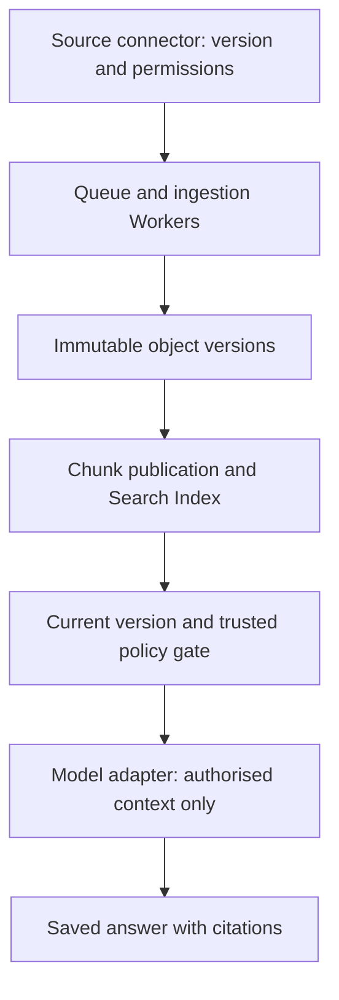

<!-- Generated by site/scripts/sd-course-import.mjs from 10_AI_System_Design. Edit the stage guide there. -->
# Enterprise knowledge: learn and design

## Ingestion Has Two Different Promises

A source connector emits an envelope such as `(tenant A, supplier-policy, version 2, operation upsert, source cursor)`. The source is trusted only through a connector identity and an approved source scope. User-supplied text is untrusted content. Validate content type/size and parser limits before extraction; isolate parser resource use. The fixture accepts already extracted text up to 20,000 characters, not arbitrary uploaded files.

First preserve immutable source bytes under a tenant/document/version identity. Then prepare passages and publish a consistent visible version. In a real object store plus search service these are separate systems. A failure after object storage but before index publication can leave an orphan object; it must not expose a half-built visible document. The local exercise models objects in a blob table, then atomically updates current metadata and FTS passages in a second transaction.

A repeated version with the same body is a no-op. Reusing the same immutable identity for different text is a conflict. An older source event cannot replace a newer published version or tombstone. The exercise uses monotonically increasing integer versions. Real connectors may provide opaque revision IDs/cursors; define a source-specific ordering rule instead of comparing arbitrary revision strings lexicographically.

Keep source permission state distinct from content version. A permission change can revoke Alice without changing document bytes. The local `policy_epoch` changes when readers change. A trusted live read checks that Alice is still allowed before context assembly. If the connector has not observed an upstream revocation, this local store cannot know it happened. State a freshness contract and fail closed for missing/expired policy information; immediate global revocation is not demonstrated.

## Passages, Parsing, and Publication

In production, extract text while preserving page/section offsets, parser version, source version, and chunk IDs. Choose boundaries that keep a supplier rule with its qualifier. Too-small chunks can separate “confirmation required” from the exception; too-large chunks waste context and reduce ranking precision. The teaching fixture splits on blank paragraphs and uses `(document, version, paragraph index)` as provenance. It does not claim those offsets are stable across parser changes.

Publish only after all required passages for the chosen version are ready. A new parser/chunking configuration needs a new index generation or equivalent key so old and new chunk identities cannot mix silently. Record failed extraction as a failed job, rather than indexing an empty document and calling ingestion successful. Retry safe extraction using T18.3’s job protocol. An embedding call, if later added, is an external dependency with its own ambiguity and cost; durable job state does not remove that boundary.

A delete event publishes a newer tombstone and removes visible search passages. Retain enough version metadata to reject a late upsert. Old object bytes, backups, and search-service replicas require a separate deletion/retention policy; removing a search hit is not a verified physical erase. Object lifecycle governance is introduced at explain depth here, not implemented as a production erasure service.

## Choose Search for This Corpus

| Choice | Strength | Cost or failure | Decision |
| --- | --- | --- | --- |
| Lexical full-text search with BM25-style ranking | Exact supplier names, identifiers, and explicit policy language | Misses paraphrases; corpus/tokenisation affect ranking | Choose SQLite FTS5 for this local baseline |
| Dense-vector semantic retrieval | Related meanings can match different wording | Embedding cost, model/index version, approximate search and permission design | Compare conceptually; no fake embeddings in executable |
| Hybrid lexical plus semantic candidates | Combine identifier and paraphrase recall | Fusion tuning, two failure paths, larger evaluation burden | Revisit when measured relevance requires it |
| Scan all source text per question | Very small disposable corpus | Repeated work grows with corpus; policy/version joins still needed | Reject for repeated enterprise retrieval |

A search engine finds candidate passages; an authoritative policy/version check decides whether each is usable. Restrict tenant, current version, deleted state, and allowed readers before choosing the final top-k contexts. Recheck current metadata before model context construction, and load stored text rather than trusting caller-supplied hit bodies. [OWASP’s authorisation guidance](https://cheatsheetseries.owasp.org/cheatsheets/Authorization_Cheat_Sheet.html) supports trusted request/resource checks; prompts cannot replace them.

SQLite FTS5 provides full-text query syntax and a BM25 ranking function; consult its [primary documentation](https://www.sqlite.org/fts5.html) for implementation semantics. Lower FTS5 BM25 scores sort first in this exercise. The code builds quoted word terms itself instead of accepting raw search-operator syntax. It applies scope/current-version/reader predicates in SQL before the result limit, so a set of restricted high-scoring hits cannot fill the entire final context list.

Semantic retrieval is a different representation, not automatic truth. For an implementation example of embedding/chunking version concerns see [Elastic’s semantic text documentation](https://www.elastic.co/docs/reference/elasticsearch/mapping-reference/semantic-text). No Elasticsearch service is required or installed. Choose a semantic system only after an authorised relevance set shows which lexical misses matter.

After diagram. Trusted connector/worker/metadata roles stay inside application control; documents are untrusted content. Only permitted current context crosses the external hosted-model boundary. The local fixture stores objects, metadata, and FTS in one SQLite file, while documenting where a real distributed deployment differs.

## Checkpoint 1: Filter Before the Model

The most relevant passage is a restricted supplier discount. Can we send it to the model with an instruction not to reveal it?

Answer before revealing

No. The text has already crossed the access boundary if the model receives it. Exclude unauthorised material in trusted retrieval/context code before generation. Relevance and permission are different decisions, and a prompt is not an access-control mechanism.

## Key Takeaways

- Ingestion makes two promises. Preserve immutable source bytes under a tenant, document and version identity, then publish a visible version only once every required passage is ready. A failure between them leaves an orphan object, never a half-built document.
- A repeated version with the same body is a no-op, and the same identity with different text is a conflict. An older event can never replace a newer published version or tombstone.
- Lexical full-text search (SQLite FTS5 with BM25 ranking) is the baseline because supplier names, identifiers and explicit policy wording matter. Semantic or hybrid retrieval waits until an authorised relevance set shows which lexical misses matter.
- Apply tenant, current-version, deleted-state and reader filters before the result limit, so restricted high-scoring hits cannot fill the final context. A prompt is not an access-control mechanism.
