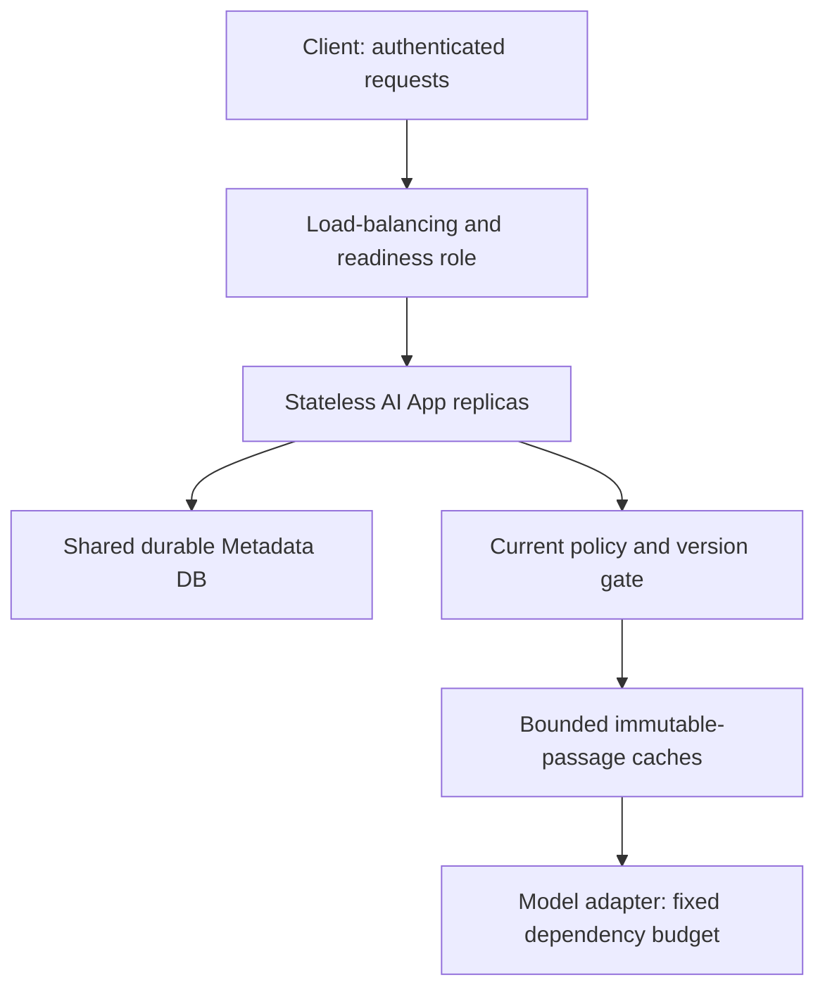

<!-- Generated by site/scripts/sd-course-import.mjs from 10_AI_System_Design. Edit the stage guide there. -->
# Scale the application: learn and design

## Move the Durable State, Not the User Session

Keep identity verification per request and durable requests/jobs/source metadata in a shared relational service. Load-balanced replicas must not rely on an in-memory session or a copied SQLite file to recognise a completed operation. Preserve tenant/user/key uniqueness and the existing API success/error contracts. Sticky routing can improve locality, but cannot be the only way Alice finds her history after a replica disappears.

For the educational migration, choose a separately operated relational database design such as PostgreSQL. This stage’s executable still uses a single SQLite file shared by two local application objects to test the invariant, not to claim SQLite is the production multi-host database. Concurrency/locking SQL must be ported and tested; SQLite `BEGIN IMMEDIATE` does not become PostgreSQL claim semantics by changing a connection string. [PostgreSQL’s locking documentation](https://www.postgresql.org/docs/current/explicit-locking.html) identifies the different transaction/row-lock boundary to review.

Migration plan: inventory requests/jobs/uniqueness and source version keys; prepare the target schema; test duplicate and lease predicates; pause or carefully reconcile writes during cutover; copy and verify counts/checksums; route all writers to one authority; then resume traffic and compare scoped reads. Avoid casual dual writes: conflicting authorities can break job ownership and operation deduplication. Keep rollback aligned with the chosen writer and copied state, not with an older independent file.

## Alternatives for Scaling and Caching

| Option | Where it helps | Cost or failure | Decision |
| --- | --- | --- | --- |
| Larger single app instance | Modest CPU/memory growth, simple operation | One failure domain and a finite vertical ceiling | Baseline alternative, not enough for the modelled peak |
| Stateless app replicas with shared durable state | Independent app CPU and replacement | DB pools, cold starts, load routing, shared dependency limits | Choose for application scaling |
| Per-replica immutable-passage cache | Repeated source bytes with simple local fallback | Duplicated memory, cold misses, does not remove live policy checks | Choose a bounded local cache |
| Distributed cache | Shared hit pool and larger central capacity | Network dependency, key isolation, outage/stampede operation | Defer until measured locality/memory justify it |
| Cache final answers by question alone | Looks fast in an unsafe demo | Cross-tenant leaks, stale policy, user-specific and model-version mismatch | Reject |

A cache stores a reusable value under a key. For exact passage bytes choose `(tenant, document, source version, chunk)`. Do not cache a mutable “latest policy” pointer as if it were immutable. The current policy/version/tombstone check still runs before returning cached text. Changing content creates a new key; deleting or revoking the document makes the old entry unusable even while its bytes remain in memory.

The local cache holds at most two entries for easy inspection and expires each after 30 logical seconds. It uses least recently used (LRU) eviction: a touched entry moves to the recent end and the oldest is removed when capacity is exceeded. Production bounds should include bytes as well as entry count because passage sizes vary. Time-to-live (TTL) bounds reuse/memory freshness, not authorisation; a one-second-old entry can already be forbidden.

Cache only immutable body data in this slice. Do not cache authentication, permission decisions, candidate ranking, or final answers. Another user may share the same permitted immutable bytes after their own live gate, but tenant identity always remains in the content key. If cache service is unavailable, bypass it and use the authoritative store with the same policy check. If authority itself is unavailable, do not turn the cache into an access decision fallback.

The application checks the cache, fetches on a miss, and fills the entry: this is cache-aside. A read-through cache service hides that fetch behind its own interface, adding a service boundary. Write-through updates cache and source together, while write-behind delays the source write; neither should weaken the saved-history commit contract. Immutable body entries need no in-place write propagation because a new content version uses a new key. A negative-result cache would need its own scope/freshness policy and is not implemented here.

HTTP/browser caches are a separate layer from the application content cache. Preserve `Cache-Control: no-store` for the fixture’s sensitive request/history responses. [RFC 9111](https://www.rfc-editor.org/rfc/rfc9111.html) defines HTTP cache behaviour; an application-level passage entry is not automatically governed by those response headers.

After diagram. Each replica retains identity/policy and source-context boundaries. The managed DB/load balancer are proposed deployment roles; local tests exercise multiple objects on one host. Queue/Workers, source ingestion, Search Index, and exact citations are retained outside this focused interactive request path.

## Checkpoint 1: Warm Is Not Authorised

Alice loaded a passage one second ago. Her access is then revoked. Does a 30-second cache TTL allow using it for another 29 seconds?

Answer before revealing

No. Current trusted policy is checked on every cache use. TTL is not a grant of access. The entry may remain physically cached, but the gate blocks its return after the revocation is observed by authority.

## Scale-Out Is a Control Loop With Delay

Use readiness to keep new replicas out of routing until dependencies/configuration are usable. Liveness detects an irrecoverably stuck process, not every downstream timeout. Warming caches and establishing database pools create extra demand. A cold replica can initially be slower than a warm one; scaling too aggressively can amplify DB misses and connections.

An illustrative trigger is sustained app utilisation above 70% with rising admitted-request latency, while DB and provider budgets have headroom. Scale out gradually, cap replica/connection totals, observe warmup, and use a slower scale-in stabilisation window. On scale-in, remove readiness for new requests, drain bounded in-flight requests, and leave durable jobs recoverable through their lease protocol. Never assume killing a pod cancels a charged provider call.

A controller cannot react before observation, decision, scheduling, and warmup complete. Keep baseline headroom for bursts shorter than that delay. CPU-only autoscaling misses provider-wait saturation; queue age alone can ask for more workers even when the provider is already limiting throughput. [Kubernetes HPA documentation](https://kubernetes.io/docs/concepts/workloads/autoscaling/horizontal-pod-autoscale/) is a primary example of metric-driven scaling, not a requirement to install Kubernetes here. No actual autoscaler is shipped.
