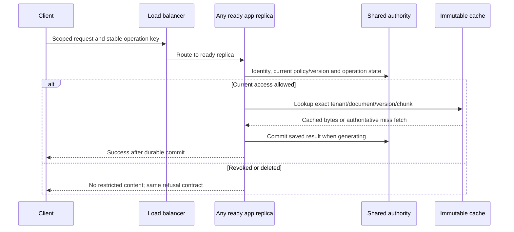

<!-- Generated by site/scripts/sd-course-import.mjs from 10_AI_System_Design. Edit the stage guide there. -->
# Scale the application: observe and experiment

## Request Walkthrough

Use the [offline walkthrough](/labs/system-design/04_application_scaling/lab.html#request-walkthrough) to compare a healthy shared-state request, revoked access with a warm cache, and a cold replacement replica. It retains the full static contracts below.

```lab
src: /labs/system-design/04_application_scaling/lab.html
title: Scale the application: request walkthrough and lab
```



Sequence diagram. Cache reuse changes byte-fetch cost, not the source of permission or the commit-before-success boundary. Authority may change after a read; this stage does not claim a globally instantaneous revocation barrier.

| Step | Input and owner | Output and possible failure |
| --- | --- | --- |
| Route | Load balancer sees healthy-ready replica set | Request selects a ready instance; failed instances are drained |
| Establish scope | App verifies caller and operation identity | Trusted scope; sticky state is not required for history |
| Read authority | App reads current source/policy and durable operation state | Forbidden/stale evidence rejected even if cached |
| Reuse bytes | Cache looks up immutable scoped passage key | Warm hit or trusted-store miss; outage bypasses cache only |
| Persist | App shares authoritative requests/jobs database | Committed saved result across replicas; no independent local DB fork |
| Respond | App returns saved answer or original scoped refusal/error | Lost response reuses the same key; it is not a new operation |

## Calculate Three Budgets in the Same Units

Assume one app core and 25 ms CPU/request. Raw idealised CPU capacity is `1 / 0.025 = 40 RPS`. At 70% planned utilisation that becomes `28 RPS/replica`. Four replicas provide `112 planned RPS` before DB/provider limits. Serving an illustrative 100 RPS needs at least `ceil(100 / 28) = 4` replicas under those assumptions, without claiming a measured p95.

Now assume two authoritative checks plus four passage body fetches/request. Without caching, 100 RPS demands 600 queries/second in this deliberately simplified query-count model. At an illustrative 500-query/second database budget, the DB permits about `500 / 6 = 83.33 RPS`. Adding app replicas alone cannot remove it.

With an assumed 80% passage hit rate, expected reads/request are `2 + 4 × (1 − 0.8) = 2.8`. Demand becomes 280 queries/second, and the same modelled DB budget allows `500 / 2.8 ≈ 178.57 RPS`. The two trusted checks are never multiplied by hit rate. This model groups database work into equal-cost queries; the actual FTS/policy fixture uses a different query shape and does not validate that performance assumption.

Choose a modelled provider capacity of 120 RPS for the healthy comparison: minimum of app 112, DB 178.57, provider 120 is 112 planned RPS. Lower provider capacity to 60 and the minimum becomes 60 regardless of more app replicas. These provider budgets are new hypothetical inputs for a larger rollout, not verified vendor quotas or an automatic expansion of T17.2’s illustrative quota.

Request counts also hide token demand. At 1,500 expected tokens/request and 100 RPS, expected demand is 150,000 tokens/second or nine million tokens/minute before retries. Real quotas, cost, variable lengths, and concurrent generation limits must be checked separately. T17.6 will make admission/fair scheduling explicit rather than treating the provider as an unlimited sink.

A pool of 20 database connections per replica grows to 160 at eight replicas. Include workers, migrations, and spare connections in the server budget. More connections are not inherently more throughput; they can increase contention. Use pool wait/transaction latency and dependency timings to test that diagnosis.

## Lab: Moving the Bottleneck

Open the [capacity experiment](/labs/system-design/04_application_scaling/lab.html#lab). Adjust replicas (1–8), passage hit rate (0–100%), offered request rate (20–200 RPS), and provider capacity (30–120 RPS). The model uses fixed 25 ms CPU, 70% app target, and a 500-query/second DB budget. It contains no stochastic arrival distribution, actual autoscaler, or measured service latency.

| Case | Inputs | Planned capacity | Meaning |
| --- | --- | --- | --- |
| Single app | 1 replica, 0% hits, 100 offered, 120 provider | 28 RPS; 72 unserved | App budget limits first |
| More replicas only | 4 replicas, 0% hits, 100 offered, 120 provider | 83.33 RPS; 16.67 unserved | Database becomes the limit |
| Reuse immutable bytes | 4 replicas, 80% hits, 100 offered, 120 provider | 112 RPS; 0 unserved | Modelled demand fits the planned budgets |
| Provider ceiling | 8 replicas, 80% hits, 100 offered, 60 provider | 60 RPS; 40 unserved | More app CPU cannot create provider capacity |

“Unserved offered rate” is `max(0, offered − planned capacity)`. It is a fluid demand shortfall, not a simulated latency percentile or an implemented rejection count. If all excess were queued indefinitely, that rate would grow backlog until a finite limit intervenes. Do not present the model as a production load test.

## Run the code lab

Run this stage's Python lab in your terminal to see each idea in the stage hold. It needs Python 3.10 or later and nothing else: the standard library and SQLite only.

| File | What it is |
| --- | --- |
| [scaling.py](https://github.com/Sourav692/Forward-Deployed-Engineer-Interview-Prep/blob/main/10_AI_System_Design/stages/04-application-scaling/labs/scaling.py) | Lab code: read this first |
| [test_scaling.py](https://github.com/Sourav692/Forward-Deployed-Engineer-Interview-Prep/blob/main/10_AI_System_Design/stages/04-application-scaling/labs/test_scaling.py) | Tests: one test per behaviour this stage teaches |

From the root of your local clone of the repository, run:

```bash
python3 10_AI_System_Design/stages/04-application-scaling/labs/test_scaling.py -v
```

`-v` prints one line per test, and each test name states one behaviour. Read a test, change one value in the lab code, predict which test fails, and run it again.

[scaling.py](https://github.com/Sourav692/Forward-Deployed-Engineer-Interview-Prep/blob/main/10_AI_System_Design/stages/04-application-scaling/labs/scaling.py) adds bounded cache behaviour and independent capacity arithmetic. Tests instantiate the actual T17.2 application against a shared SQLite file to verify cross-replica history and key replay, then use the actual T17.4 store to test warm policy checks, update/delete/revocation, tenant key separation, TTL/eviction/cache outage, and bottleneck boundaries. These are integration/invariant tests across local objects, not a benchmark or managed-database migration test.

For build depth practice, instrument offered versus completed requests and dependency time under a controlled local load without paid model calls. Predict the limiting budget before the run. Replace a warm replica with a cold one and record misses/DB calls; distinguish a measured result from this worksheet’s assumed capacity. For design depth caching, explain which property comes from the key, the live gate, TTL, and eviction separately.

## Checkpoint 2: Scale What Is Saturated

Eight app replicas are mostly waiting on a provider capped at 60 RPS. Incoming traffic is 100 RPS. Should you double app replicas to recover the missing 40 RPS?

<details><summary>Answer before revealing</summary><p>No. The dependency cap remains 60 RPS. Extra replicas can increase waiting, connections, and retries without increasing completions. Preserve bounded demand now, then use explicit admission and dependency-capacity decisions rather than calling more idle app CPU a fix.</p></details>

## Key Takeaways

- At 25 ms CPU and a 70% utilisation target, a replica plans for 28 RPS. Serving 100 RPS needs `ceil(100 / 28) = 4` replicas, giving 112 planned RPS before database and provider limits.
- With two authoritative checks and four passage fetches a request, a 500-query/second database permits about 83.33 RPS. An 80% passage hit rate cuts reads to 2.8 a request and lifts that to about 178.57 RPS. The trusted checks never shrink with hit rate.
- Planned capacity is the minimum of the app, database and provider budgets in the same units. With the provider at 60 RPS, capacity stays 60 however many replicas run, and extra replicas only add waiting, connections and retries.
- Request counts hide token demand. At 1,500 tokens a request and 100 RPS, demand reaches 150,000 tokens a second, or nine million a minute, before retries.
