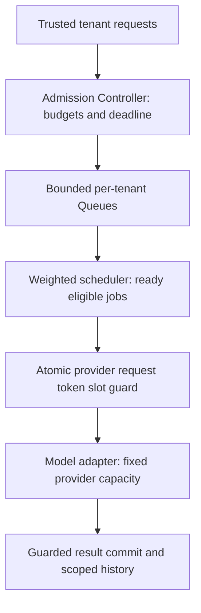

<!-- Generated by site/scripts/sd-course-import.mjs from 10_AI_System_Design. Edit the stage guide there. -->
# Handle overload and fair scheduling: learn and design

## Put Safety Limits Before the Expensive Boundary

Authenticate and validate the caller, request size, operation identity, estimated input/output budget, and deadline before expensive generation. For a short interactive route, reject if its remaining waiting/execution budget cannot fit. For a durable job route, commit acceptance only into an explicitly bounded waiting policy, then reserve actual provider resources before dispatch. Preserve the difference between durable `202` acceptance and saved-answer completion.

Use a tenant request limit to stop one noisy caller, a global request limit to protect shared endpoints, a token budget for variable model work, and a concurrency cap for simultaneous provider occupancy. The executable guard reserves those last-hop budgets transactionally before a simulated provider call. Only a fresh `accepted` reservation authorises a new call; `duplicate:active`, `duplicate:completed`, and `conflict` do not.

A proposed HTTP facade returns `429` for caller/tenant rate or budget rejection, with a bounded reason and optional `Retry-After` guidance. Global unavailability can use the established `503` contract. Neither response implies acceptance or a later completion. `Retry-After` is guidance, not a promise that capacity is reserved at that instant. [RFC 6585](https://www.rfc-editor.org/rfc/rfc6585.html) defines the `429` status. The local guard returns policy outcomes, not a new implemented HTTP server.

## Token Buckets and Slots Use Different Units

Imagine a bowl that holds up to `b` request credits and refills at `r` credits/second. A request spends one credit; it is rejected when no credit is available. This is a token bucket. It permits a bounded burst and a sustained average rate; fixed windows are simpler but can permit a double burst at adjacent window edges. A sliding window follows recent traffic more closely at greater state/update cost.

Use separate buckets for request counts and model tokens. Reserve known input plus an upper bound on output tokens before generation, not just one credit per request. If a prompt can exceed that bound, reject or reduce it before calling the provider. A real adapter must count/tokenise appropriately and reconcile usage according to actual provider quota rules. The fixture accepts a supplied positive integer estimate, conservatively spends it, and does not implement a tokenizer or refund protocol.

A semaphore-like concurrency budget counts calls that may still be running. Release a slot when termination is known, not when an app stops waiting. Unknown external outcomes retain a reservation in the fixture and require reconciliation; this favours safety over automatic capacity recovery. A stale local timeout does not prove a provider stopped computing or billing.

The guard’s database transaction reads existing operation state, checks concurrency and all bucket balances, then spends credits and records the reservation together. Rejected requests do not partially spend another budget. Production replicas must share a consistent authority/configuration; per-instance counters would multiply the limit as T18.5 scales out. The SQLite exercise demonstrates serialised local reservations, not a distributed quota algorithm or a vendor’s exact token accounting.

## Queue Bounds, Deadlines, and Backpressure

Choose finite per-tenant queues, not only a global memory cap. Store metadata/references rather than full document bodies in the hot queue. Expire unstarted work whose deadline has passed; dispatching it would consume scarce service for a caller that can no longer use the result. Carry one overall deadline through waiting and execution instead of restarting a full timeout at every hop.

For durable ingestion, reduce the rate of new source-job admission or pause consumption within source cursor/retention constraints when downstream capacity is unavailable. Bound worker prefetch/in-flight claims so a single worker cannot privately hoard all queued jobs. [RabbitMQ consumer prefetch](https://www.rabbitmq.com/docs/consumer-prefetch) is a primary example of limiting outstanding deliveries; it is not the same as a global provider-concurrency guard.

If callers blindly retry rejection, backpressure becomes amplification. Preserve the same operation key, cap attempts, respect remaining deadline, and use backoff with jitter for failures known safe to retry. Retry at a controlled layer, not independently at every nested hop. Never auto-retry the T18.3 unknown external region. [AWS’s retry guidance](https://aws.amazon.com/builders-library/timeouts-retries-and-backoff-with-jitter/) explains the load and side-effect risks; the fixture uses deterministic logical time instead of claiming to test a production jitter distribution.

[Google SRE’s overload chapter](https://sre.google/sre-book/handling-overload/) motivates explicit resource restrictions and rejection/degradation. Degradation here may reduce optional context/output work while preserving citations and authorisation, or return a clear refusal. It must not bypass current policy/version checks, reveal another tenant’s cached answer, or silently weaken saved-success semantics.

## Choose How to Share Existing Service

| Policy | How it chooses | When it helps | Failure/trade-off |
| --- | --- | --- | --- |
| FIFO | Oldest accepted arrival first | Simple within one workload/class | A large earlier burst can occupy everyone’s waiting window |
| Strict priority | Highest class first, FIFO within class | Explicit urgent/control work | Sustained higher-priority demand can starve lower classes |
| Round-robin (RR) | One eligible job per tenant turn | Equal request-count shares for equal-cost work | Equal job counts are not equal token/compute shares |
| Weighted round-robin (WRR) | Repeated tenant turns according to weight | Contracted relative shares | More policy/configuration; still not cost-fair for variable jobs |

Choose bounded tenant queues and WRR for the equal-cost teaching workload, with weights A:B:C = 2:1:1. When all are continuously backlogged, expected dispatch proportions are 50%, 25%, and 25%. When a tenant is idle, skip its empty queue and let others use service; this is work-conserving. Weights are explicit hypothetical entitlements, not evidence A deserves arbitrary priority because it is noisy.

For unequal token/duration work, request-count fairness can be misleading. A tenant getting one 20,000-token job per turn can consume far more than one getting a 200-token job. Compare estimated-cost credits, deficit round-robin, per-class concurrency, and token reservations before promising token-normalised shares. Deficit scheduling carries unused credit across turns so a larger job can eventually fit. This design depth comparison does not implement a GPU scheduler or prove latency guarantees under arbitrary job sizes.

After diagram. Identity/current-policy gates, cache safety, shared authority, source ingestion and worker epochs are retained. The admission/scheduler are logical trusted roles; the executable has a local reservation store and separate deterministic queue model, not a fully deployed distributed dispatcher.

## Checkpoint 1: A Queue Is Not Capacity

At ten arrivals/second and six completions/second, does increasing a queue from 12 to 1,200 jobs make the system stable?

Answer before revealing

No. In the simple sustained model backlog still grows by four jobs/second. A larger queue increases how long overload can hide and often how long callers wait. Reduce admitted work, increase real downstream service, or change the workload; apply a deadline/rejection policy rather than treating stored backlog as throughput.

## Key Takeaways

- Keep separate budgets for tenant requests, global requests, model tokens and concurrent provider calls. The guard checks them all and records the reservation in one transaction, and only a fresh `accepted` reservation authorises a provider call.
- Reserve known input plus an upper bound on output tokens before generation. Release a concurrency slot only when termination is known, because a local timeout does not prove the provider stopped computing or billing.
- Bound each tenant's queue, expire unstarted work past its deadline and carry one overall deadline through every hop. Retries keep the same operation key and a capped attempt count, with jittered backoff at one controlled layer.
- Weighted round-robin at 2:1:1 gives continuously backlogged tenants 50%, 25% and 25% of dispatches and skips empty queues. Equal job counts are not equal token shares when job sizes vary.
