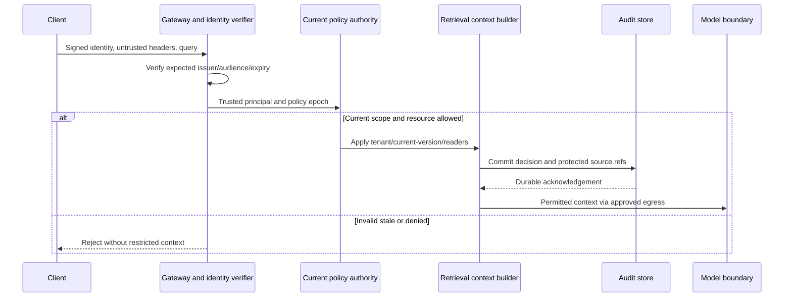

<!-- Generated by site/scripts/sd-course-import.mjs from 10_AI_System_Design. Edit the stage guide there. -->
# Enterprise security: observe and experiment

## Request Walkthrough

The [offline walkthrough](/labs/system-design/06_enterprise_security/lab.html#request-walkthrough) compares a permitted retrieval, a spoofed tenant header, and stale policy. The static path makes every disclosure boundary visible.

```lab
src: /labs/system-design/06_enterprise_security/lab.html
title: Enterprise security: request walkthrough and lab
```



Sequence diagram. Audit commitment is required before the chosen disclosure response. It does not prove an external model call executed, nor create an atomic transaction with it.

| Step | Owner and input | Output and possible failure |
| --- | --- | --- |
| Verify | Gateway validates signed identity for this audience | Principal or rejection; a decoded payload/header is not enough |
| Bind | Identity/Policy maps subject to active tenant membership | Trusted scope and epoch; caller tenant claims cannot replace it |
| Govern | Policy authority checks freshness/action | Current decision or fail-closed denial; source observation lag still matters |
| Resolve | Retrieval reloads current permitted source text | Exact cited passages; revoked/deleted/stale/forged hits drop |
| Audit | Protected sink commits metadata decision/references | Acknowledged record before disclosure; write failure blocks output |
| Egress | Trusted adapter checks provider and secret reference | Approved context path only; model text cannot widen capability |

## Quantify Freshness and Audit Cost

Assume source permission polling can lag 20 seconds, local publication adds five seconds, and a membership snapshot may be reused for 30 seconds without an independent current-source recheck. A crude worst-case observation-plus-reuse delay can approach 55 seconds, not 30. This is an illustrative bound under sequential worst-case assumptions; overlapping work or a live source authority changes it. Test actual timestamps before promising a revocation service objective.

At an assumed 100 protected retrievals/second and a 400-byte audit event, raw event payload is `100 × 400 × 86,400 = 3.456 billion bytes/day`, about 3.22 GiB before indexes, replicas and retention overhead. A 30-day raw window would be about 96.6 GiB. Do not casually log full prompts to improve incident visibility; that would enlarge both storage and sensitive-data exposure.

If identity, policy and audit each add illustrative 2 ms, 5 ms and 3 ms on a sequential local path, the budget contribution is 10 ms. These are assumed worksheet values, not measured security overhead. Tail latency and authority availability require real measurement. An audit-before-disclosure policy makes audit availability part of this route’s availability; a durable outbox is a possible alternative only with a clearly defined acknowledgement/retention contract.

## Lab: Identity and Policy Are Independent Gates

Open the [identity/freshness experiment](/labs/system-design/06_enterprise_security/lab.html#lab). One control selects valid or invalid identity; another selects policy age from 0 to 60 seconds. The toy policy expires at age 30 exactly. It assumes the document itself is current/readable and audit succeeds; other cases are in the Python tests.

| Case | Inputs | Expected result |
| --- | --- | --- |
| Valid current | Valid identity, policy age 0 | One permitted passage; durable decision required |
| Identity rejected | Invalid identity, policy age 0 | No context; authentication rejection, no model call |
| Policy boundary | Valid identity, age 30 | No context; stale policy denied |
| Old policy | Valid identity, age 60 | Same denial; a valid signature does not refresh membership |

The experiment does not verify actual corporate token signatures, source polling or network routes. It demonstrates independent gates. The runnable exercise checks additional signature/scope behaviour using the explicitly public signed-envelope fixture.

## Run the code lab

Run this stage's Python lab in your terminal to see each idea in the stage hold. It needs Python 3.10 or later and nothing else: the standard library and SQLite only.

| File | What it is |
| --- | --- |
| [security.py](https://github.com/Sourav692/Forward-Deployed-Engineer-Interview-Prep/blob/main/10_AI_System_Design/stages/06-enterprise-security/labs/security.py) | Lab code: read this first |
| [test_security.py](https://github.com/Sourav692/Forward-Deployed-Engineer-Interview-Prep/blob/main/10_AI_System_Design/stages/06-enterprise-security/labs/test_security.py) | Tests: one test per behaviour this stage teaches |

From the root of your local clone of the repository, run:

```bash
python3 10_AI_System_Design/stages/06-enterprise-security/labs/test_security.py -v
```

`-v` prints one line per test, and each test name states one behaviour. Read a test, change one value in the lab code, predict which test fails, and run it again.

[security.py](https://github.com/Sourav692/Forward-Deployed-Engineer-Interview-Prep/blob/main/10_AI_System_Design/stages/06-enterprise-security/labs/security.py) reuses the actual T18.4 Knowledge store. Ten tests verify header spoof resistance, signature tampering, issuer/audience/expiry/not-before, rotation/retirement, cross-tenant citation resolution, document revocation, membership age/epoch, worker capability bounds, audit failure/redaction and scoped egress references. The audit contains protected source IDs and decision metadata, never bearer tokens or passage bodies.

For build depth practice, change one boundary at a time: retire a fixture key, change the audience, revoke a document, advance membership age, and fail the audit insert. Predict whether denial occurs before any context leaves trusted code. Then design a real deployment test plan for key discovery, mTLS service identities, restricted egress and privileged tenant operations. Those integrations are not silently considered complete because local tests pass.

## Checkpoint 2: Audit Availability Is a Policy Choice

The context is authorised, but the mandatory audit write fails. May the handler return the text and log later from memory?

<details><summary>Answer before revealing</summary><p>Not under this stage’s audit-before-disclosure contract. An in-memory later write can disappear. Fail the protected operation or adopt a separately designed durable buffering/outbox contract with explicit acknowledgement semantics; do not silently weaken the requirement during an outage.</p></details>

## Key Takeaways

- Audit must commit before disclosure. That commitment records the decision and protected source references, but it does not prove the model call ran and is not atomic with it.
- Revocation delay adds up across steps. With 20 seconds of source polling lag, five seconds of publication and 30 seconds of snapshot reuse, the worst case can approach 55 seconds, not 30.
- At 100 protected retrievals a second and 400-byte events, raw audit payload is about 3.22 GiB a day and 96.6 GiB over 30 days. Logging full prompts would enlarge both storage and sensitive-data exposure.
- Identity and policy are independent gates. At a policy age of 30 seconds the toy policy expires and a valid signature still gets no context, and audit-before-disclosure makes audit availability part of the route's availability.
