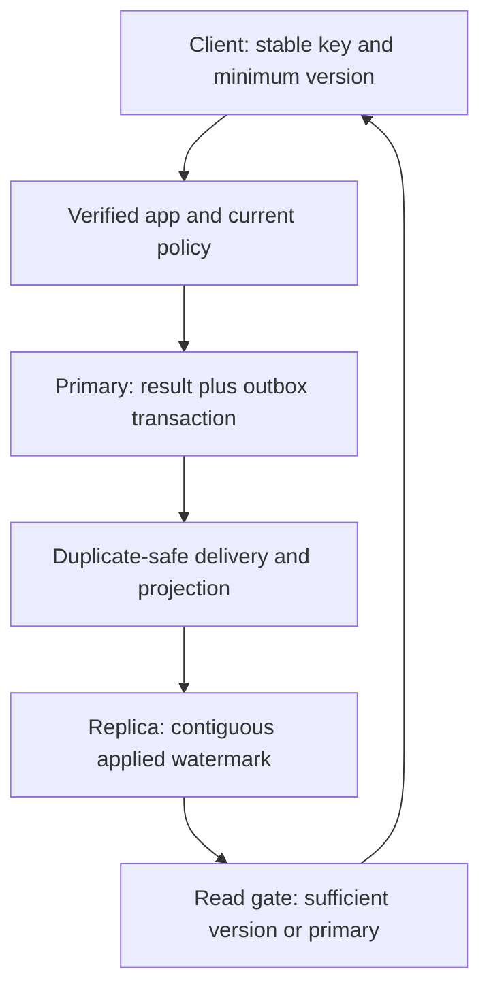

<!-- Generated by site/scripts/sd-course-import.mjs from 10_AI_System_Design. Edit the stage guide there. -->
# Reliability and consistency: learn and design

## Choose Consistency by Consequence

| Data class | Required observation | Failure policy |
| --- | --- | --- |
| Membership, permission, current tombstone/version authority | Current authoritative decision within the declared freshness contract | No stale allow fallback during authority outage |
| Provider budgets and worker ownership | Atomic shared reservation/conditional ownership | Do not create a second authority or release unknown effects blindly |
| Just-completed saved history | At least the acknowledged result version | Use primary or a replica proven past the minimum; retain auth/audit checks |
| Search/projections | May be derived asynchronously | Recheck current versions/policy before context; disclose freshness appropriately |
| Immutable passage bodies | Exact named version | Reuse bytes only after the current trusted gate |
| Audit decision | Durable acknowledgement required by T17.7 | Block disclosure or use a separately designed durable buffer contract |

A primary is the authorised writer, not merely the machine called “primary.” Replication copies committed changes to another node. With asynchronous acknowledgement, a primary loss can strand acknowledged changes not yet replicated. Synchronous replication can wait for a specified durable remote acknowledgement at extra latency/availability cost. [PostgreSQL standby documentation](https://www.postgresql.org/docs/current/warm-standby.html) describes concrete replication choices; this fixture implements none of that transport.

During a network partition, separate sides may be alive but unable to coordinate. If two sides both accept conflicting writes without a reconciliation/ownership protocol, operation keys, quotas and permissions can diverge. For protected current authority, choose to reject when authoritative coordination is unavailable rather than claim both unrestricted availability and the same consistency. “CAP means pick any two all the time” is not a useful operational contract; the relevant conflict occurs under partition with specified consistency/availability meanings.

For three voting nodes a majority is two. Intersecting majorities are useful for leader/commit protocols, but a quorum count alone does not implement linearizability: epochs, ordering, durable acknowledgement and the read protocol matter. Do not build a home-made consensus service for this lesson. Understand which managed authority/protocol your deployment relies on and which failures it actually tolerates.

## Preserve One Operation Across a Lost Response

Keep tenant/user/key uniqueness and immutable request intent. If a result commit succeeds but its response is lost, retrying the same key can return the saved answer without a new result or notification intent. If no durable result exists after an external call, that absence does not prove the call never happened. Preserve the earlier unknown-outcome rule rather than making the API look available by repeating generation.

The fixture saves a computed result and an outbox row in one local transaction. Injecting failure before commit rolls both back. Injecting failure after commit loses the response but leaves both durable. The function does not call a model: replay-safe result persistence is not exactly-once model execution. [AWS's transactional outbox guidance](https://docs.aws.amazon.com/prescriptive-guidance/latest/cloud-design-patterns/transactional-outbox.html) describes the dual-write problem and duplicate-consumer boundary.

A delivery process can publish an outbox event twice after a lost acknowledgement. The consumer records event identity and updates its projection in one transaction. For this ordered fixture, a watermark means every event up to that sequence has been applied, not just the largest sequence observed. Receiving event 2 before event 1 must not declare catch-up to 2. Missing events should be reconciled, not hidden by manually advancing the watermark. Pruning/checkpoint seeding is an additional operational protocol, not implemented here.

Local database transactions protect local invariants; they do not enlist a hosted provider. Conditional updates/uniqueness prevent lost ownership or duplicate local operation identities. Snapshot isolation does not automatically enforce every multi-row business rule: two concurrent decisions can each observe a permissive snapshot. Use the database's documented constraints/locks/isolation and test the actual invariant. Cross-service two-phase commit introduces coordination/blocking costs; a saga needs business-defined compensations. “Undo the email” or “refund a model computation” is not a generic rollback action.

## Alternatives and Recovery Trade-Offs

| Choice | Benefit | Cost or limit | Decision |
| --- | --- | --- | --- |
| Always read protected results from primary | Simple freshness boundary | Primary load and outage dependence | Valid baseline; preserve for unknown minimum-version cases |
| Replica reads with minimum-version fallback | Offload eligible reads while preserving read-your-write | Version tracking and primary fallback load | Demonstrate for saved-history data leg |
| Serve stale authorisation during outage | Apparently higher response rate | Can disclose revoked/foreign resources | Reject |
| Local result plus outbox and duplicate-safe consumer | Atomic local intent, recoverable async propagation | Delivery lag/replay and retention operations | Choose representative slice |
| Blind retry/failover of an uncertain provider call | May produce an answer eventually | Duplicate work/billing/effects | Reject without a documented safe provider contract |

The minimum history version comes from the trusted acknowledged write, not an untrusted client permission claim. A just-completed item lookup without a usable minimum must use authority rather than silently weaken the original saved-answer promise. A stale read leg never bypasses the separate current T17.7 identity/resource/audit requirements. The simulator isolates the data-read decision; it is not a whole-request authorisation implementation.

After diagram. Add explicit projection/version and recovery policies while retaining every security, quota and external-ambiguity boundary. The two local files represent controlled state copies, not actual failover or independently writable leaders.

## Checkpoint 1: A Large Sequence Can Hide a Gap

A projection has received event 2 but not event 1. May it claim watermark 2 and serve every minimum-version-2 history request?

Answer before revealing

No. The watermark must represent a contiguous applied prefix under this protocol. Record the out-of-order event, keep the watermark at zero, and advance it only when the missing predecessor is applied. A maximum observed sequence is not evidence all earlier state is present.

## Bound Failure Recovery and Latency

Use one remaining deadline across queue wait, identity/policy, retrieval, provider work and commit/audit. A timeout on each hop that restarts the full budget can exceed the user's overall limit. Reserve time for the final required persistence/audit before dispatch. If no useful allowance remains, reject/expire before a new provider call.

Retry known-safe transient failures only within the shared attempt/deadline budget; use backoff/jitter and preserve operation identity. A circuit breaker stops ordinary attempts after failures, waits a cooldown, then admits bounded probes. The local breaker allows one half-open probe per object and protects that choice with a lock. It is a basic logical-state fixture, not a production SDK handling arbitrary overlapping/late result generations or a distributed breaker shared across replicas. T17.6 budgets remain authoritative even if a replica's breaker resets.

Bulkheads keep one dependency or tenant from consuming every worker/thread/connection; T17.6 queue/slot bounds already provide part of that isolation. A fallback must be semantically acceptable: smaller approved context or explicit refusal can fit, while stale permission and blind alternate-provider replay cannot. Cancellation of a local wait is not proof of remote cancellation.

## Key Takeaways

- Consistency is chosen per data class. Membership and permissions need current authority with no stale allow fallback, saved history needs at least the acknowledged version, and search projections may lag behind a current-version gate.
- With asynchronous acknowledgement, losing the primary can strand acknowledged writes. For three voting nodes a majority is two, but a quorum count alone does not give linearizability without epochs, ordering, durable acknowledgement and the read protocol.
- The result and its outbox row commit in one local transaction, which is not exactly-once model execution. A watermark covers only a contiguous applied prefix, so event 2 arriving before event 1 leaves it at zero.
- One remaining deadline spans queue wait, policy, retrieval, provider work and commit, with time reserved for final persistence and audit. Retries stay inside that budget, and the breaker admits one half-open probe after its cooldown.
