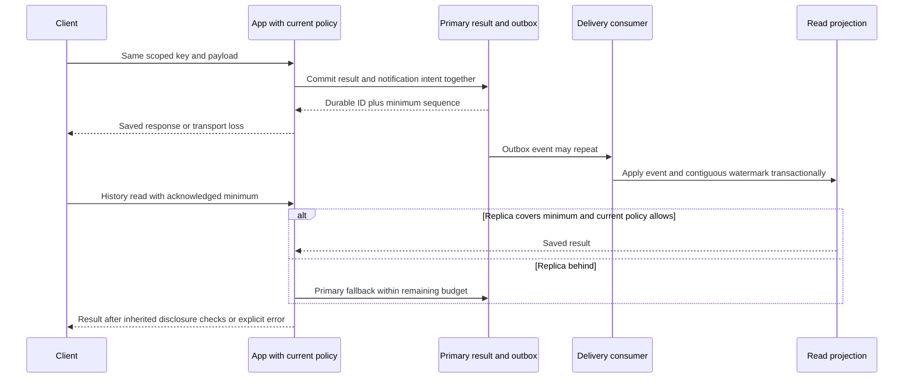

<!-- Generated by site/scripts/sd-course-import.mjs from 10_AI_System_Design. Edit the stage guide there. -->
# Reliability and consistency: observe and experiment

## Request Walkthrough

The [offline walkthrough](/labs/system-design/07_reliability_consistency/lab.html#request-walkthrough) follows commit, lost-response handling, delayed projection and a freshness-aware read. Branches expose normal catch-up, lag requiring primary, and unavailable current authority.

```lab
src: /labs/system-design/07_reliability_consistency/lab.html
title: Reliability and consistency: request walkthrough and lab
```



Sequence diagram. A lost response never grants a new provider attempt automatically. Primary unavailability cannot be solved by substituting a stale policy snapshot.

| Step | Responsible input | Output and possible failure |
| --- | --- | --- |
| Verify authority | App checks identity/current policy/audit prerequisites | Current decision or deny; history replica is not policy authority |
| Commit | Primary receives stable scoped operation and computed result | Result and outbox intent commit together or both roll back |
| Acknowledge | App returns durable ID/minimum sequence | Lost response leaves uncertainty to inspect under the same key |
| Deliver | Consumer receives potentially repeated/out-of-order events | Projection and applied identity commit; gaps cannot fake catch-up |
| Read | Read gate compares required minimum with contiguous watermark | Eligible replica or primary fallback, bounded by remaining time |
| Recover | Operator/controller inspects failures and evidence | Reconcile/restore without deleting unknown effects or widening policy |

## Worked Latency and Reliability Budgets

Assume a serial illustrative path: identity/policy 20 ms, retrieval 80 ms, cache/body work 10 ms, queue wait 500 ms, provider 600 ms, final commit/audit 10 ms. Total is 1,220 ms. Queue wait exceeds retrieval work by more than six times; changing the database index may not address the observed dominant delay. These are modelled span values, not measured service timings.

For independent parallel subtasks, the critical path is closer to the maximum branch duration plus join overhead, not the sum of every overlapping span. Component p95 values also cannot simply be summed into end-to-end p95. Correlate actual per-request spans and inspect the tail population. [OpenTelemetry traces](https://opentelemetry.io/docs/concepts/signals/traces/) describes spans/context propagation; this stage does not deploy a collector.

An illustrative 99.9% successful eligible-request objective allows 1,000 failures in a million eligible requests. A time-based 99.9% objective over 30 days allows 43.2 minutes, but that is a different indicator/population. Define valid requests, dependency errors, timeouts and policy denials explicitly; do not hide overload by excluding all rejected traffic from customer-impact reporting. Maintain separate safety/security and quota-rejection indicators.

If observed error fraction is 1%, a 0.1% error allowance is burning at ten times the sustainable rate for that window. Short windows detect spikes, while longer windows check persistence and avoid reacting to a tiny sample alone. [Google SRE's SLO guidance](https://sre.google/workbook/implementing-slos/) provides the objective/error-budget framework. Alert thresholds and paging policy still need real workload calibration.

For failover, distinguish recovery time objective (how long recovery may take) from recovery point objective (how much committed data may be lost). An async replica can lose unreplicated acknowledged writes on promotion. A claimed zero-loss recovery needs the actual acknowledgement/storage/quorum protocol and tested failure conditions, not merely a standby box. The local projection exercise measures neither objective.

## Lab: Select the Right Read and Remaining Budget

Open the [consistency/deadline experiment](/labs/system-design/07_reliability_consistency/lab.html#lab). Choose saved history versus current authority, replica lag (0–10 logical seconds) and remaining overall time (0–5,000 ms). The model reserves 200 ms for inherited required work. It assumes a reachable primary; outage branches are exercised separately in Python/the walkthrough.

| Case | Inputs | Expected decision |
| --- | --- | --- |
| Caught up history | History, lag 0, remaining 1,000 ms | Replica covers minimum; 800 ms dependency allowance |
| Lagged history | History, lag 5, remaining 1,000 ms | Primary fallback; same 800 ms allowance |
| Authority | Authority, lag 0 or 10, remaining 1,000 ms | Primary current authority only |
| Exhausted | Either class, remaining 200 ms | No new read/generation; zero dependency allowance |

Lag zero stands for a proven minimum version in this toy model, not a real method of measuring replication freshness from wall time alone. The read decision is a data leg; protected disclosure still requires Stage 6's current access and audit gates. A primary authority outage denies protected access even when historical bytes exist elsewhere.

## Run the code lab

Run this stage's Python lab in your terminal to see each idea in the stage hold. It needs Python 3.10 or later and nothing else: the standard library and SQLite only.

| File | What it is |
| --- | --- |
| [reliability.py](https://github.com/Sourav692/Forward-Deployed-Engineer-Interview-Prep/blob/main/10_AI_System_Design/stages/07-reliability-consistency/labs/reliability.py) | Lab code: read this first |
| [test_reliability.py](https://github.com/Sourav692/Forward-Deployed-Engineer-Interview-Prep/blob/main/10_AI_System_Design/stages/07-reliability-consistency/labs/test_reliability.py) | Tests: one test per behaviour this stage teaches |

From the root of your local clone of the repository, run:

```bash
python3 10_AI_System_Design/stages/07-reliability-consistency/labs/test_reliability.py -v
```

`-v` prints one line per test, and each test name states one behaviour. Read a test, change one value in the lab code, predict which test fails, and run it again.

[reliability.py](https://github.com/Sourav692/Forward-Deployed-Engineer-Interview-Prep/blob/main/10_AI_System_Design/stages/07-reliability-consistency/labs/reliability.py) creates separate primary/projection files, explicit event delivery and a logical breaker. Twelve tests cover rollback/outbox atomicity, lost acknowledgement/replay, payload conflict/tenant scope, lag fallback, duplicate and out-of-order projection, unavailable authority/fallback, durable object recreation, breaker opening/recovery, failed probe and concurrent probe limits. No hosted model runs. The saved result is a provided fixture, so no test should be described as exactly-once provider generation.

For D3 practice, fail before commit, after commit and between delivery/apply acknowledgement. Preserve the same operation key and inspect result/outbox/projection separately. Introduce a missing sequence and show why manual watermark advancement is unsafe. Then write a deployment experiment for actual database promotion, backup restore and provider reconciliation; those are still missing evidence.

## Checkpoint 2: Availability Without Authority

The membership primary is unavailable, but the replica says Alice was allowed five minutes ago. May the app use that value to keep its success rate high?

<details><summary>Answer before revealing</summary><p>No. This protected path requires current authority within its declared freshness contract. A stale allow cannot replace it. Report the authority failure without restricted disclosure; fix the availability architecture without quietly changing the security guarantee.</p></details>
