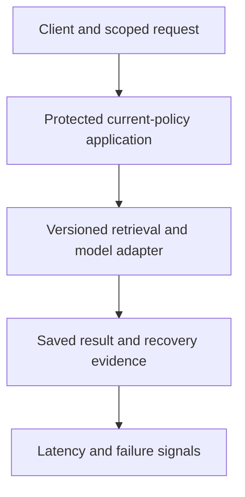

<!-- Generated by site/scripts/sd-course-import.mjs from 10_AI_System_Design. Edit the stage guide there. -->
# Production AI quality and releases: understand the problem

Alice's supplier-policy answer remains fast and available after a model or retrieval change, but now gives the wrong confirmation rule. Another candidate answers a foreign tenant's question instead of refusing. Infrastructure health alone cannot detect those regressions. Version what changed, evaluate the right slices, and make release/rollback decisions without weakening the platform's existing safety contracts.

This remains the same hypothetical procurement system. The runnable evaluator scores precomputed fixture outputs against eight authored cases. Latency and cost values are synthetic labels, not measured model performance or prices. A passed report permits only the teaching release exercise, never production approval. Estimated integrated study: six to eight hours; learner mastery remains unassessed.

## Inherit a Recoverable, Protected Platform

[Stage 7](../07_reliability_consistency/01_understand_the_problem.md), [its snapshot](https://github.com/Sourav692/Forward-Deployed-Engineer-Interview-Prep/blob/main/10_AI_System_Design/stages/07-reliability-consistency/architecture-after.md) and [ADR-007](../architecture_decisions/adr_007_consistency_and_recovery.md) establish data-class consistency, result/outbox atomicity, projection freshness, bounded recovery and diagnostic contracts. Retain current identity/policy/audit, approved egress, source citations, immutable-cache safety, worker epochs, stable operation identity and fair provider budgets.

Before diagram. We can diagnose an outage or lost acknowledgement, but have not established a versioned quality-evaluation and release decision path. A successful HTTP response is not evidence the answer follows the current supplier rule.

## Why One Average Score Is Insufficient

The candidate answers five ordinary supplier questions correctly and refuses an unsupported one, but discloses one foreign-tenant case. A high aggregate can hide that known violation. Likewise, an apparently better answer score can come from longer prompts, larger output budgets or a different dataset, making cost and latency comparisons invalid.

| Engineering question | Formal idea | Limit |
| --- | --- | --- |
| Can we reproduce the exact change and its evidence? | Version bundle and evaluation manifest | A model name alone omits prompt, retrieval, source and evaluator versions |
| Which customer cases got worse? | Dataset slices | An overall mean can hide access/refusal or tenant-specific failure |
| Should a candidate receive any customer traffic? | Release gate | A passing small fixture is not proof of general safety |
| Can a small eligible group try the change first? | Canary | Exposure is controlled, not risk-free or necessarily statistically decisive |
| Can we compare without using candidate business actions? | Shadow | Extra inference still costs resources and requires authorised data handling |

## Coverage and Outcomes

| Module | Treatment | Assigned depth and evidence |
| --- | --- | --- |
| 14.1 Evaluation architecture | Taught at mapped depth | D3: versioned cases, rubric/slices, coverage binding, quality/safety/latency/cost gates and tests |
| 14.2 Release management and experimentation | Taught at mapped depth | D3: approved bundles, sticky eligible canaries, shadow contract, CAS promotion and rollback |
| 15.1 Observability systems | Taught at mapped depth | D3: version/cohort telemetry schema, metrics/logs/traces, privacy/cardinality and release diagnosis |
| 3.2 Distributed state and transactions | Revisited from Stage 7 | D3: atomic generation-checked release pointer; rollback preserves durable result identity |
| 7.1 End-to-end AI application design | Revisited from Stage 1 | D3: bind prompt/retrieval/model and source context into one reproducible outcome |
| 7.3 Agentic application system architecture | Revisited from Stage 2 | D3: shadow/evaluation cannot perform live business side effects |
| 13.2 Enterprise AI security | Revisited from Stage 6 | D3: known safety cases gate release separately; logs and shadows retain data boundaries |
| 15.3 Performance and incident diagnosis | Revisited from Stage 7 | D3: compare version/cohort and retrieval/generation failure rather than global health alone |
| 14.3 Model and data lifecycle infrastructure | Context only | Stage 10, D2: use immutable IDs now; broader training/registry lifecycle follows |
| 17.3 Architecture economics | Deferred | Stage 12, D3: no unrelated total-cost platform programme |

Outcomes: execute a reproducible fixture evaluation; inspect slice failures; block known safety/cost/latency regressions; control a release pointer without stale writes; and diagnose/roll back without rewriting saved operations. The [curriculum](https://github.com/Sourav692/Forward-Deployed-Engineer-Interview-Prep/blob/main/10_AI_System_Design/progress/curriculum-map.json) defines scope. Exit gates assess the learner separately from artifact verification.
