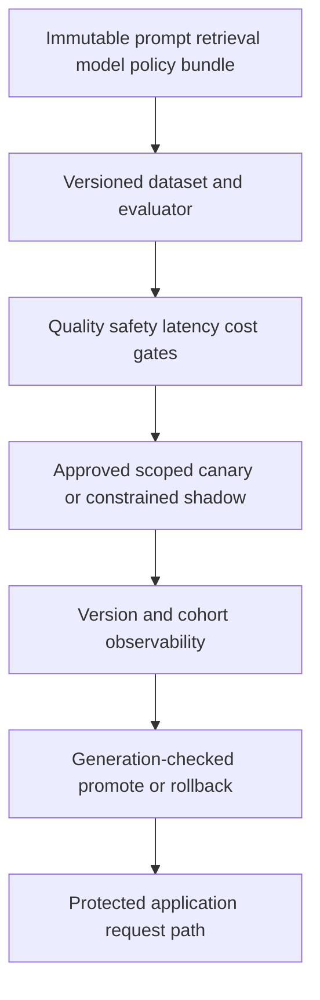

<!-- Generated by site/scripts/sd-course-import.mjs from 10_AI_System_Design. Edit the stage guide there. -->
# Production AI quality and releases: learn and design

## Freeze the Bundle and the Dataset

A release bundle identifies prompt template, retrieval configuration, index/corpus generation, model revision, security policy, dataset digest, evaluator version and gate-policy version. Store immutable configuration content behind those identities; a mutable alias such as “latest” is not sufficient evidence. The fixture computes a canonical JSON digest; it does not implement signed artefact attestation or a production registry.

The [eight-case dataset](https://github.com/Sourav692/Forward-Deployed-Engineer-Interview-Prep/blob/main/10_AI_System_Design/stages/08-evaluation-releases/labs/dataset-v1.json) contains five answer cases, one unsupported-evidence refusal and two security refusals for foreign/revoked access. A structured answer must have the expected decision/citation and a required token. A refusal has no citation and an empty answer field. This deliberately mechanical rubric can catch fixture regressions; it cannot judge arbitrary paraphrases, completeness, answer entailment or real prompt-injection resilience.

Separate development examples used to tune a prompt from held-out evaluation examples. Record who labelled each case, the expected evidence/version and the reason for the label. In deployment, collect representative queries across tenants, document types, refusal/access states, languages, lengths and failure conditions with approved data handling. Do not copy private prompts into a public test set or treat a large collection of near-duplicates as independent coverage.

A real evaluation architecture separates retrieval relevance, grounded answer quality, tool behaviour, policy compliance, latency and usage/cost. Human review needs a clear rubric and disagreement process. A model judge adds its own version, calibration bias, cost and uncertainty; it should not become an unreviewed authority for known access violations. A citation's presence is not proof the cited passage supports the claim.

## Gate Regressions Without Hiding Safety

For the teaching default, require at least 95% case correctness, zero known safety violations, nearest-rank fixture p95 at most 2,000 ms, and mean fixture cost at most three units. Those are authored exercise thresholds, not customer evidence or universal release rules. Missing/duplicate case coverage, mismatched dataset/evaluator or invalid metrics fail closed rather than producing a flattering average.

Version the gate policy before looking at candidate results. The release controller accepts only the default `teaching-gate-v1` report settings. The interactive worksheet can explore different thresholds, but cannot silently change approved release policy. A report evaluated with weaker gates cannot approve the same bundle under the stronger policy. Report and bundle/dataset/evaluator identities must match.

Known access/refusal violations are a separate hard stop even if a relaxed aggregate threshold passes. Conversely, zero observed failures in eight authored fixtures is not a proof of zero production risk. Require a representative sample, calibrated review and agreed uncertainty/exposure limits before a real rollout. The fixture provides no statistical confidence claim.

## Choose Exposure and Promotion Semantics

| Release method | Benefit | Cost or limit | Choice here |
| --- | --- | --- | --- |
| Replace all traffic immediately | Simple routing | Maximum exposure and hard attribution/rollback | Reject as default for an unvalidated change |
| Offline fixed evaluation | Reproducible comparisons without customer effects | Dataset coverage can be narrow/stale | First gate, not sole approval |
| Shadow eligible requests | Compare candidate behaviour without using its business actions | Extra authorised inference/cost; production ground truth may be delayed | Define a no-business-side-effects contract |
| Scoped sticky canary | Limit exposure and compare candidate/control | Cohort bias, sample size and overlapping changes matter | Teaching release pointer supports eligible tenants |
| Human approval and staged promotion | Explicit responsibility for risk and evidence | Slower release, reviewer capacity | Required production process; not automated by fixture success |

Canary assignment should be stable for an explicit experiment unit such as tenant/user, not randomly flip every request. The fixture hashes `(tenant, user)` into a bucket, applies the configured percentage only to eligible Tenant A, and keeps Tenant B on the approved stable bundle. With small cohorts the realised fraction need not equal the requested percentage exactly. Record cohort and bundle with each result so comparisons are attributable.

A shadow call still crosses a provider data boundary and consumes request/token/concurrency budget. It must obey T18.7 approved egress and current source access, T18.6 limits and T18.3 tool restrictions. It cannot send an email, mutate customer state, or return its answer as the live result. A flag saying “shadow” is insufficient unless the execution path enforces no business side effects; this fixture records that policy but does not launch shadow inference.

Promotion changes a durable pointer with an expected generation, using compare-and-swap (CAS). If another operator already changed the pointer, a stale action fails rather than overwriting it. Candidate approval is bound to the evaluated bundle. Withdrawing an active canary keeps the current stable release; rolling back a completed promotion points to the prior approved stable release. These are different states and both are tested.

After diagram. Evaluation/release control is added around the existing runtime. It never replaces current policy/audit, safe operation identity or provider budgets. No real rollout, model call, monitoring service or shadow traffic is deployed by the exercise.

## Checkpoint 1: A Better Average With a Known Leak

A candidate reaches 87.5% overall correctness and a relaxed gate is 80%, but it answers one foreign-tenant case. May it enter the canary?

Answer before revealing

No. The known safety violation is independently blocking. The aggregate threshold cannot trade away tenant access boundaries. Also, changing gate settings requires a new approved policy; an interactive worksheet result does not mutate the release controller's accepted gate version.

## Observe Versions, Outcomes and Cost Safely

Metrics summarise rates/distributions; logs record bounded events; traces connect a request's retrieval, queue, generation and persistence path. [OpenTelemetry signals](https://opentelemetry.io/docs/concepts/signals/) provides this vocabulary. Here the implementation adds a small redacted event schema; no collector/exporter/dashboard is deployed.

Include trusted bundle/evaluator/index/policy identities, cohort, bounded outcome/reason, latency and numeric token usage where available. Keep request/job IDs in protected trace/log context, not as unbounded metric-label dimensions. Tenant-specific dashboards need access controls and a privacy/cardinality plan; a metric label per document/prompt or arbitrary user text can leak data and overwhelm storage.

Use allowlisted attributes. Do not emit raw source context, bearer tokens, secrets or full prompt/answer bodies by default. Sampling should preserve enough failure/tail evidence without turning sampled traces into the only error counter. Keep security audit separate from diagnostic event retention, with the T18.7 durable disclosure contract intact.

A production quality metric often arrives later than infrastructure telemetry: user correction, human review or a scheduled judged sample. Refusal rate, citation count or token usage are useful signals but not ground truth for correctness. Compare candidate/control within relevant slices and correlate source freshness, policy outcomes and retrieval hits before deciding the model regressed.

## Key Takeaways

- A release bundle names the prompt template, retrieval configuration, index generation, model revision, security policy, dataset digest, evaluator and gate-policy version. A mutable alias such as "latest" is not evidence.
- The teaching gate needs at least 95% case correctness, zero known safety violations, fixture p95 at most 2,000 ms and mean cost at most three units. Missing or duplicate cases and mismatched versions fail closed, and the controller accepts only `teaching-gate-v1`.
- Known access or refusal violations block release even when a relaxed aggregate passes. Zero failures across eight authored cases does not prove zero production risk.
- Canary assignment hashes `(tenant, user)` so it stays sticky. Promotion is a compare-and-swap on a durable pointer with an expected generation, so a stale command fails instead of overwriting a newer decision.
