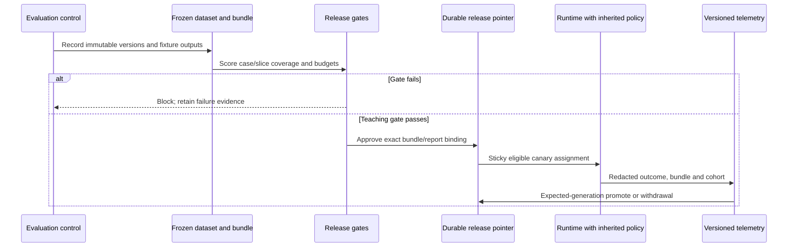

<!-- Generated by site/scripts/sd-course-import.mjs from 10_AI_System_Design. Edit the stage guide there. -->
# Production AI quality and releases: observe and experiment

## Request Walkthrough

The [offline walkthrough](/labs/system-design/08_evaluation_releases/lab.html#request-walkthrough) freezes evidence, evaluates, gates, exposes eligible traffic, observes and safely changes routing. Branches show an eligible candidate, a known safety failure and a canary regression requiring withdrawal.

```lab
src: /labs/system-design/08_evaluation_releases/lab.html
title: Production AI quality and releases: request walkthrough and lab
```



Sequence diagram. Evaluation cannot authorise data access or override live budget/identity rules. Runtime saved results keep their original operation/bundle identity when routing changes.

| Step | Responsible input | Output and failure boundary |
| --- | --- | --- |
| Freeze | Evaluation control records bundle/dataset/evaluator/gates | Reproducible inputs; mismatched IDs block |
| Run | Evaluator receives all structured fixture outputs | Per-case/slice scores; missing/duplicate/invalid data is not a pass |
| Gate | Release policy checks quality and separate safety/budgets | Known violation or unacceptable cost/latency blocks |
| Assign | Trusted control chooses approved bundle/eligible units | Sticky canary; unapproved tenants remain stable |
| Observe | Runtime emits redacted version/cohort signals | Comparable evidence; labels alone are not correctness ground truth |
| Decide | Operator/control uses expected pointer generation | Promote/withdraw or reject a stale command |
| Preserve | Result store retains committed answers and operation keys | Rollback changes future routing, not prior facts or unknown effects |

## Work a Reproducible Release Decision

Eight correct fixture outputs yield 100% correctness, zero known safety violations, p95 1,000 ms and mean cost two units. One incorrect normal answer gives `7/8 × 100 = 87.5%` and fails the default 95% gate. One foreign-tenant answer also gives 87.5%, but remains blocked even if quality is relaxed to 80%, because its safety count is one.

One 3,000 ms label among seven 1,000 ms labels has nearest-rank p95 at rank `ceil(0.95×8)=8`, so the reported value is 3,000 ms. This tiny-set maximum is not a production latency SLO. If every label costs five units, the mean is five and fails the three-unit gate. These values are deliberately authored fixtures; evaluation execution does not make their timing or cost empirical model measurements.

For a separate planning example, 100 live requests/second split 5% canary and 95% stable still produce 100 live calls/second. A 10% independent shadow adds about ten more, for 110 total before retries. Under the earlier hypothetical 120-RPS provider budget that leaves little request headroom, and token/concurrency limits may bind first. Shadow experimentation cannot bypass admission merely because the response is not shown to a customer.

[Google SRE's canary guidance](https://sre.google/workbook/canarying-releases/) describes limited exposure and evaluation. Real thresholds need a minimum representative sample and observation window, stable assignment, consistent runtime versions and a rollback owner. A small fixture pass is a reason to continue controlled validation, not evidence to promote globally.

## Lab: Separate the Release Gates

Open the [release experiment](/labs/system-design/08_evaluation_releases/lab.html#lab). Select good, wrong-rule, known-leak, slow or costly fixture output. Vary the quality threshold (80–100%), fixture latency maximum (1,000–4,000 ms) and mean cost maximum (1–8 units). The default policy is 95%, 2,000 ms and three units; the separate known-safety gate cannot be disabled.

| Case | Inputs | Expected result |
| --- | --- | --- |
| Good fixture | Defaults | Eligible for teaching canary; 100%, no known violations |
| Wrong rule | Defaults | Block quality at 87.5% |
| Known leak | Quality threshold 80% | Still blocked by one safety violation |
| Slow label | Defaults | Block p95 3,000 ms above the 2,000 ms maximum |
| Costly labels | Defaults | Block mean five units above the maximum three |

The experiment computes deterministic arithmetic only. It does not query an LLM judge, send traffic, approve a production release or update the actual fixture controller's gate policy. Its outputs remain readable as static cases without JavaScript.

## Run the code lab

Run this stage's Python lab in your terminal to see each idea in the stage hold. It needs Python 3.10 or later and nothing else: the standard library and SQLite only.

| File | What it is |
| --- | --- |
| [evaluation.py](https://github.com/Sourav692/Forward-Deployed-Engineer-Interview-Prep/blob/main/10_AI_System_Design/stages/08-evaluation-releases/labs/evaluation.py) | Lab code: read this first |
| [releases.py](https://github.com/Sourav692/Forward-Deployed-Engineer-Interview-Prep/blob/main/10_AI_System_Design/stages/08-evaluation-releases/labs/releases.py) | Lab code: read this first |
| [test_releases.py](https://github.com/Sourav692/Forward-Deployed-Engineer-Interview-Prep/blob/main/10_AI_System_Design/stages/08-evaluation-releases/labs/test_releases.py) | Tests: one test per behaviour this stage teaches |

From the root of your local clone of the repository, run:

```bash
python3 10_AI_System_Design/stages/08-evaluation-releases/labs/test_releases.py -v
```

`-v` prints one line per test, and each test name states one behaviour. Read a test, change one value in the lab code, predict which test fails, and run it again.

[evaluation.py](https://github.com/Sourav692/Forward-Deployed-Engineer-Interview-Prep/blob/main/10_AI_System_Design/stages/08-evaluation-releases/labs/evaluation.py) loads the JSON cases, validates coverage/metrics, scores the rubric and binds a report to versions. [releases.py](https://github.com/Sourav692/Forward-Deployed-Engineer-Interview-Prep/blob/main/10_AI_System_Design/stages/08-evaluation-releases/labs/releases.py) reuses T18.8's transaction helper for approval and a generation-checked pointer. Fourteen tests cover good/sliced scoring, quality/safety/latency/cost, missing/duplicate/invalid data, dataset/report binding, stale CAS, eligible sticky cohorts, rollback with an actual T18.8 saved result, shadow policy, telemetry redaction, refusal labels hiding answer text, weakened gate settings and withdrawing a later canary without reverting the current stable bundle.

For build depth practice, add a new labelled refusal or retrieval case and observe the dataset digest change. An old report must not approve the changed bundle. Then stage two conflicting promotion commands and explain which succeeds. Inspect the stored result before/after rollback: it must keep its original ID and answer rather than being regenerated to match the new route.

## Checkpoint 2: Routing Rollback Is Not Data Rollback

A canary answer was already committed under a stable operation key. The release is withdrawn. Should the system erase that result and rerun the operation with the old model?

<details><summary>Answer before revealing</summary><p>No. Routing rollback controls future requests; it does not rewrite prior committed outcomes or authorise duplicate external work. Preserve result provenance and operation identity. Corrective action, customer communication or a deliberate new operation needs its own policy and evidence.</p></details>

## Key Takeaways

- One wrong normal answer gives `7/8 × 100 = 87.5%` and fails the 95% gate. One foreign-tenant answer gives the same score but stays blocked at an 80% threshold because its safety count is one.
- With one 3,000 ms label among seven 1,000 ms labels, nearest-rank p95 is rank `ceil(0.95×8)=8` and reports 3,000 ms. On so small a set p95 is the maximum, not a latency SLO.
- Splitting 100 live requests a second between canary and stable still makes 100 calls. A 10% independent shadow adds about ten more, giving 110 before retries against the hypothetical 120-RPS provider budget.
- Routing rollback controls future requests only. A committed canary answer keeps its original operation identity and is not erased or rerun with the old model.
