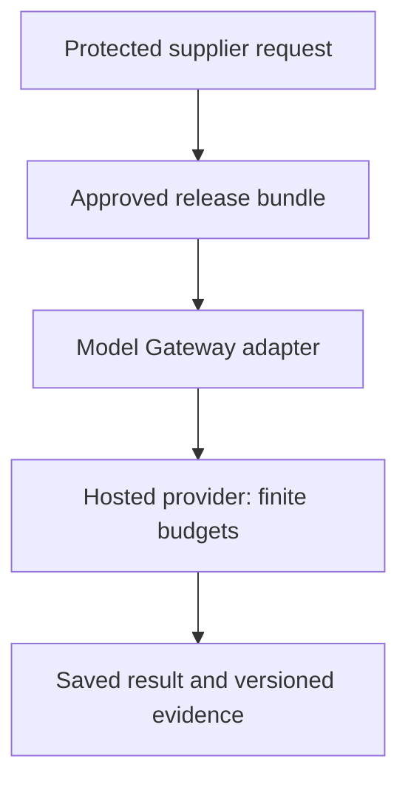

<!-- Generated by site/scripts/sd-course-import.mjs from 10_AI_System_Design. Edit the stage guide there. -->
# Inference and GPU infrastructure: understand the problem

Alice's supplier workflow now has an approved behaviour/release process, but hosted generation cost, queueing and data-path constraints motivate a comparison with self-hosted inference. Keep the Model Gateway responsible for approved routes and stable operations. Do not replace an uncertain hosted call with an automatic second call merely because another GPU or endpoint is available.

This is the same hypothetical platform. The gateway executes injected fixture transport while composing actual T18.6 budget, T18.7 security and T18.9 release code. The GPU worksheet performs memory arithmetic only. No model, GPU, tokeniser, container cluster or real provider runs. All architecture sizes, utilisation and costs are assumptions, not benchmarks or current prices. Estimated integrated study: six to eight hours; mastery remains unassessed.

## Inherit the Approved Runtime

[T18.9](../08_evaluation_releases/01_understand_the_problem.md), [its snapshot](https://github.com/Sourav692/Forward-Deployed-Engineer-Interview-Prep/blob/main/10_AI_System_Design/stages/08-evaluation-releases/architecture-after.md) and [ADR-008](../architecture_decisions/adr_008_versioned_quality_releases.md) bind behaviour to evaluated bundles and controlled release pointers. Retain current identity/resource policy, audit/egress, durable saved result identity, read consistency, unknown remote outcomes, fair queues/quotas, versioned retrieval and safe immutable caches.

Before diagram. A hosted dependency exists as a logical boundary; no real provider performance has been established by earlier fixtures. Approval and current data policy remain separate decisions.

## Identify the Real Pressure

An enterprise may require a particular network/data-handling path or a reproducible model revision. A busy period may increase time to first token while average request rate remains unchanged. A self-hosted model may fit its weights on a GPU but fail when several long contexts fill the remaining memory. These are different reasons to change architecture and need different evidence.

| Concrete observation | Term | What it does not prove |
| --- | --- | --- |
| Read the input once before generating | Prefill | It is not the whole request duration |
| Produce the next token using prior attention state | Decode | Equal token counts do not imply identical latency on every workload |
| Keep attention key/value state for active tokens | KV cache | This is inference state, not an authorisation/content cache |
| Wait until visible generation starts | Time to first token (TTFT) | Good first-token timing does not prove total completion or saved success |
| Time between generated tokens | Inter-token latency (ITL) | High aggregate throughput can coexist with poor per-user token latency |
| Split or replicate a serving model | Inference parallelism | More devices do not guarantee proportional speed or automatic safe memory sharding |

## Coverage by Required Depth

| Module | Treatment | Assigned depth and scope |
| --- | --- | --- |
| AI gateway and provider management | Taught here | Build depth: approved route policy, envelopes, budgets, durable replay and unknown/commit-failure tests |
| LLM execution and inference fundamentals | Taught here | Design depth: prefill/decode, tokens, TTFT/ITL and peak context/memory exercise |
| Model serving architecture | Taught here | Design depth: gateway/engine separation, readiness, batching and deployment alternatives |
| Inference performance optimisation | Taught here | Explain depth: quantisation/batching/prefix-cache implications and profiling boundary, not kernel tuning |
| GPU architecture fundamentals | Taught here | Explain depth: VRAM versus bandwidth/compute and practical memory accounting |
| Distributed GPU execution | Taught here | Explain depth: replicas versus tensor/pipeline sharding and communication cost |
| GPU infrastructure and scheduling | Taught here | Explain depth: placement, memory reservations, sharing/isolation and finite capacity |
| Container and orchestration architecture | Taught here | Design depth: image/model identity, startup/readiness/drain, device resources and lifecycle exercise |
| Estimation and capacity planning | Revisited from T18.2 | Build depth: inference memory, tokens, utilisation and conditional economics |
| Gateway and service communication | Revisited from T18.7 | Build depth: provider/private-route constraints remain trusted policy |
| Concurrency fundamentals | Revisited from T18.3 | Build depth: active sequences and remote calls are bounded independently of app replicas |
| Admission; 5.2 queueing; 5.3 backpressure; 5.4 fair scheduling; 5.5 AI workload management | Revisited from T18.6 | Build depth/design depth/build depth/design depth/Build depth: apply token/slot/queue/share budgets to inference; do not repeat those tutorials |
| Search architecture | Revisited from T18.4 | Build depth: retrieved context changes token/memory demand while access and provenance remain mandatory |
| Latency and performance | Revisited from T18.8 | Build depth: separate queue, prefill, decode and final persistence in the critical path |
| Release management and experimentation | Revisited from T18.9 | Build depth: only approved bundles enter eligible routes; preserve saved operations on change |
| Observability systems | Revisited from T18.9 | Build depth: correlate model/engine/bundle, token phases and redacted outcomes |
| Fine-tuning fundamentals | Deferred | T18.11, Design depth: no training, adapters or optimisation research added here |

Outcomes: defend a hosted/self-hosted boundary; build/debug an approved gateway slice; estimate peak memory without claiming speed; explain deployment and parallelism trade-offs at the assigned depth. Explain depth topics need working boundary knowledge, not a GPU-internals course.

## Key Takeaways

- A required data path, a reproducible model revision, rising time to first token at an unchanged request rate and long contexts filling memory are different reasons to change architecture. Each needs its own evidence.
- Prefill reads the input once and decode produces each next token from prior attention state. The KV cache holds that key/value state and is inference state, never an authorisation or content cache.
- Time to first token (TTFT) and inter-token latency (ITL) measure different things. Good first-token timing does not prove a saved success, and high aggregate throughput can coexist with poor per-user token latency.
- The Model Gateway stays responsible for approved routes. An uncertain hosted call is never replaced with an automatic second call because another GPU or endpoint is free.
