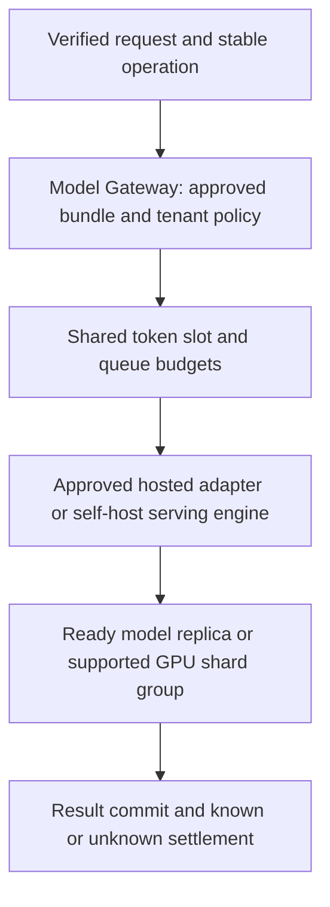

<!-- Generated by site/scripts/sd-course-import.mjs from 10_AI_System_Design. Edit the stage guide there. -->
# Inference and GPU infrastructure: learn and design

## Keep Gateway Policy Separate From the Serving Engine

The gateway binds trusted principal, operation key, current source policy, approved bundle and provider profile. The serving engine runs generation for a specific model revision. A production profile must identify supported context/output bounds, model/engine versions, readiness, approved network/data path, credential reference and quota scope. An unregistered or unapproved route must not become a destination from user/model-supplied text.

For Tenant A the fixture requires a private-approved profile as trusted configuration, not a request flag the caller can downgrade. The boolean tests policy composition only; it does not prove any network endpoint is private. The same current T18.7 retrieval/audit gate runs before new disclosure, and secret references/provider allowlists remain scoped. The gateway accepts a supplied token estimate to demonstrate budgeting; real adapters must count/tokenise under the actual model/provider rules.

Validate input plus requested output against model context, and requested output against the profile's output maximum. Reserve shared request/token/concurrency budgets before transport. App replicas, ready GPU processes and an approved model do not eliminate those budgets. Only a fresh grant permits a new provider attempt; a duplicate grant is inspection/replay, not permission to call again.

For a completed same-key operation, return the original saved result and bundle after checking its original source references under current access. Do not select a new model just because the release pointer changed. The fixture refuses replay if the original evidence is now forbidden; this is an explicit protected-grounded-result choice, not a new rule for the separate general drafting endpoint. Conflicting input/output parameters require a deliberate new operation identity.

If a transport outcome is unknown, persist uncertainty and retain the conservative reservation rather than auto-fallback. A final write failure cannot return completed success. Claim/grant/dispatch/result/settlement are still separate boundaries: an incomplete `prepared`/`dispatching` record requires inspection, and can strand capacity until reconciliation. The fixture's typed unknown response is handled explicitly; other transport/storage failures propagate with durable incomplete evidence, never an automatic second route.

## Choose Hosted Versus Self-Hosted for a Reason

| Design | Benefit | Operational cost or failure | Decision criterion |
| --- | --- | --- | --- |
| Approved hosted model | Managed engine/hardware operations, quick capacity access | Provider quotas, data/network constraints, usage price and opaque performance changes | Retain when approved policy and measured service meet needs |
| Self-hosted approved model | Control model/engine/placement and potentially data path | GPU idle cost, capacity/availability, warmup, patching, model quality and on-call burden | Add only with quality, policy and utilisation evidence |
| Multiple approved providers | Dependency diversity and workload routing options | Semantic/version differences, duplicated budgets and uncertainty on fallback | Select before dispatch under explicit policy; no blind retry after unknown effects |
| One replica per model on a single GPU | Simpler serving when peak memory fits | One failure domain and finite active context | Useful baseline to profile, not a throughput guarantee |
| Model sharded over several GPUs | Fit larger models or change execution profile | Communication/topology, rollout and failure coordination | Use only after model/engine support and profiling justify it |

A lower per-token price is not enough to justify migration. Include quality/refusal behaviour, source handling, tenant policy, burst headroom, staff operations and actual utilisation. A self-hosted route is a new evaluated bundle, not a drop-in endpoint alias. T18.9 gates still apply, and an older hosted result remains its original operation.

## Understand Execution Without Studying Kernels

Prefill consumes the supplied input tokens and establishes attention state. Decode generates tokens incrementally and reuses key/value state. A long retrieved context can increase prefill work and KV memory; long output grows cached sequence length and occupies a slot longer. The model's context window is an upper interface bound, not a performance promise at that limit.

TTFT includes queue/scheduling and prefill before the first output; ITL describes subsequent token timing. Total user latency also includes verification/retrieval, queueing, generation and final save/audit. Streaming can improve perceived progress while leaving commit-before-saved-success unchanged. A disconnected stream still needs stable operation inspection; it does not prove generation stopped.

Batching combines eligible work for engine efficiency. Static batches can make short requests wait for long ones; continuous batching can admit/remove sequences as others finish, but engine policy and memory constraints matter. Larger batches may improve throughput while worsening user latency. Prefix/KV reuse requires compatible model/tokenisation/engine state and an approved isolation policy; it is not T18.5's immutable-body cache and never grants document access. [vLLM's paged-attention design](https://docs.vllm.ai/en/latest/design/paged_attention/) is a primary implementation reference, not an installed dependency.

At explain depth optimisation depth, know the decision boundaries: weight quantisation may reduce weight memory while changing quality and hardware compatibility; KV quantisation is a separate choice; cache management/batching can reduce waste but cannot create physical bandwidth or unlimited active context. [Transformers optimisation guidance](https://huggingface.co/docs/transformers/main/en/llm_optims) gives implementation examples. Profile the approved model/dtype/engine/workload instead of copying a speed claim from another setup.

## GPU Memory, Parallelism and Placement

VRAM holds weights, KV state, activations/workspaces and runtime allocations. Memory capacity determines whether a configuration may fit; memory bandwidth, compute, scheduling and communication affect speed. A capacity calculation cannot establish achieved FLOPS, tokens/second, TTFT or p95. Keep decimal bytes versus binary GiB explicit.

A data-parallel serving replica usually loads another copy of the model to serve independent work. Tensor parallelism splits selected tensor computation/storage across devices and adds communication; pipeline parallelism places layer stages on different devices and adds stage/queue coordination. Actual KV partitioning depends on model attention layout and engine implementation. Do not divide every memory component by GPU count automatically. [vLLM parallelism/scaling documentation](https://docs.vllm.ai/en/latest/serving/parallelism_scaling/) describes concrete serving choices.

Placement must account for model/dtype compatibility, peak memory, interconnect/topology when sharded, ready warm capacity and tenant/workload isolation. Time-sharing or a shared process is not automatically strong isolation. Hardware partitioning/virtualisation may offer different boundaries depending on the platform; neither is demonstrated here. T18.6 admission/fair queues still limit active work and service shares before device scheduling.

After diagram. Self-hosting is a proposed serving option behind existing protected gates, not a new permission authority. The executable replaces both hosted/self-host transport with a fixture and performs no GPU allocation.

## Checkpoint 1: Weight Fit Is Not Request Fit

The raw FP16 weights fit in an assumed 24 GiB allocation. Can you admit any number of 8,192-token active sequences?

Answer before revealing

No. KV state grows with total cached tokens and active sequences, and workspaces/runtime also need memory. Bound the context/output envelope and concurrency using the actual model/engine layout, then profile. Weight fit alone proves neither full-request memory fit nor useful latency.

## Container and Serving Lifecycle at design depth

Package the tested engine/runtime and pin model artefact identity; do not fetch an arbitrary mutable model revision at startup. Resolve secrets through runtime identity, restrict artefact/egress access and validate driver/runtime compatibility. Container resource declarations must match schedulable devices and placement constraints. [Kubernetes GPU scheduling documentation](https://kubernetes.io/docs/tasks/manage-gpus/scheduling-gpus/) is an orchestration example, not a requirement or a deployment made here.

Startup is not readiness. Weights may be loading, kernels/cache warming or dependencies unavailable after a process starts. A readiness check should reflect the intended model revision and supported request envelope before the gateway routes work; liveness should not repeatedly kill a healthy but slow model load. Use a startup budget and admission headroom for cold replicas.

On replacement/scale-in, stop new routing, drain bounded active requests and preserve unknown external outcomes. A new warm replica needs its own capacity and cached-state assumptions. Multi-device groups require compatible versions and coordinated readiness; one missing shard can make the logical model unavailable. The deployment exercise is to specify image/model IDs, device limits, startup/readiness/drain conditions, network/secret policy and a canary plan, not to run an unreviewed cluster manifest.

## Key Takeaways

- The gateway binds trusted principal, operation key, source policy, approved bundle and provider profile before dispatch. The serving engine only runs generation, and an unregistered route never becomes a destination from user or model text.
- Validate input plus requested output against the model context and the profile's output maximum, then reserve shared token, request and concurrency budgets before transport. Only a fresh grant permits a new provider attempt.
- A lower per-token price does not justify self-hosting. Weigh quality, tenant policy, burst headroom, operations and actual utilisation, and treat a self-hosted route as a new evaluated bundle rather than an endpoint alias.
- Weight fit is not request fit, because KV state grows with cached tokens and active sequences. A started process is not ready until the intended model revision and supported request envelope are, so route work only then.
