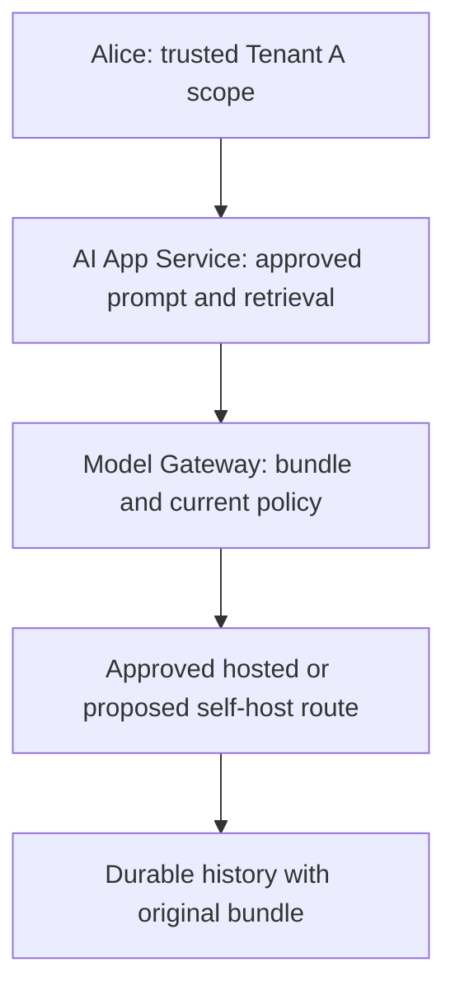

<!-- Generated by site/scripts/sd-course-import.mjs from 10_AI_System_Design. Edit the stage guide there. -->
# Fine-tuning and model customisation: understand the problem

Alice in Tenant A needs supplier drafts with predictable fields and escalation language. The current approved model sometimes produces valid facts in the wrong structure. A new model must improve that behaviour without absorbing restricted supplier documents or bypassing the existing serving gate.

All workloads, costs, and acceptance counts below are illustrative. The local exercise checks lifecycle metadata and approvals. It never trains or runs a model. Estimated integrated study: four to six hours. Learner mastery remains unassessed.

## Inherit the Actual Runtime

[T17.10](../09_inference_gpu/01_understand_the_problem.md) and [ADR-009](../architecture_decisions/adr_009_approved_inference_boundaries.md) already separate the Model Gateway from a proposed serving engine. Current resource access, mandatory audit, private-approved routes, versioned retrieval/cache, fair request/token/concurrency budgets, and durable operation identity remain mandatory. Short drafting and grounded supplier-policy answering remain distinct routes. An unknown provider result still requires reconciliation; a new adapter cannot justify regeneration under the old key.

Before diagram. The accepted architecture supports an approved model identity, not governed creation of a tenant-specific model. The local inference fixture uses injected transport.

## Define the Behaviour Requirement

Keep the supplier case throughout. Assume 10,000 approved training examples, 1,000 validation examples used during development, and 200 test examples frozen before experiments. The target response has `supplier_id`, `requested_action`, and `escalation_reason`. Schema-valid JSON alone does not establish correct escalation or permitted disclosure. Require at least 196/200 schema passes, zero known safety violations, and separate human review of critical escalation cases before any production approval.

First compare the approved prompt, schema-constrained generation where the route supports it, and prompt examples. Keep retrieval for changing supplier policy and citations. Only trial fine-tuning if repeated behaviour misses survive those cheaper interventions. A lower training loss cannot establish the customer acceptance gate.

| Module | Treatment | Depth, evidence, and boundary |
| --- | --- | --- |
| Background execution systems | Revisited from [T17.3](../02_distributed_execution/01_understand_the_problem.md) | Build depth: training intent/checkpoint recovery differs from unknown provider outcomes |
| Object storage and data lifecycle | Revisited from [T17.4](../03_enterprise_knowledge/01_understand_the_problem.md) | Explain depth: training snapshots and derived artefacts need retention and deletion lineage |
| GPU architecture fundamentals | Revisited from [T17.10](../09_inference_gpu/01_understand_the_problem.md) | Explain depth: training memory includes gradients, activations and optimiser state |
| Distributed GPU execution | Revisited from [T17.10](../09_inference_gpu/01_understand_the_problem.md) | Explain depth: replicated versus sharded state is contextual, not a distributed trainer |
| GPU infrastructure and scheduling | Revisited from [T17.10](../09_inference_gpu/01_understand_the_problem.md) | Explain depth: reserve a bounded training pool without consuming serving headroom |
| Fine-tuning fundamentals | Taught here | Design depth: behaviour versus knowledge, prompt/retrieval/adapter alternatives, holdout design and acceptance exercise |
| Fine-tuning platform architecture | Taught here | Explain depth: job, tracking, checkpoint, registry and approval boundaries; no trainer service |
| Distributed training infrastructure | Context only; awareness depth deferred specialisation | Awareness depth: six-sentence orientation only; distributed optimiser implementation deferred |
| Evaluation architecture | Revisited from [T17.9](../08_evaluation_releases/01_understand_the_problem.md) | Build depth: supplier holdout and safety slices now bind the adapter identity |
| Release management and experimentation | Revisited from [T17.9](../08_evaluation_releases/01_understand_the_problem.md) | Build depth: new custom models still use approved immutable release bundles |
| Model and data lifecycle infrastructure | Taught here | Design depth: immutable lineage, retirement, deletion and promotion checks |
| Container and orchestration architecture | Revisited from [T17.10](../09_inference_gpu/01_understand_the_problem.md) | Design depth: pin training image/recipe and drain or restart at verified checkpoints |

Outcomes: choose a justified customisation path, explain dataset-to-release lineage, evaluate a frozen holdout, and block a candidate with unsafe or mismatched evidence. Revisited topics apply to new model artefacts rather than repeat their original tutorials.

## Key Takeaways

- The trigger is behaviour, not facts. The approved model produces valid facts in the wrong structure, and any new model must fix that without absorbing restricted supplier documents or bypassing the serving gate.
- The illustrative trial has 10,000 training examples, 1,000 validation examples and 200 test examples frozen before experiments. Production approval needs at least 196/200 schema passes, zero known safety violations and human review of critical escalation cases.
- Try the approved prompt, schema-constrained generation and prompt examples first, and keep retrieval for changing supplier policy and citations. Fine-tune only if repeated behaviour misses survive those cheaper steps, since lower training loss cannot meet the acceptance gate.
