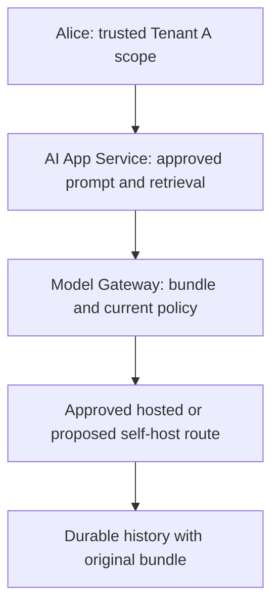

<!-- Generated by site/scripts/sd-course-import.mjs from 10_AI_System_Design. Edit the stage guide there. -->
# Fine-tuning and model customisation: understand the problem

Alice in Tenant A needs supplier drafts with predictable fields and escalation language. The current approved model sometimes produces valid facts in the wrong structure. A new model must improve that behaviour without absorbing restricted supplier documents or bypassing the existing serving gate.

All workloads, costs, and acceptance counts below are illustrative. The local exercise checks lifecycle metadata and approvals. It never trains or runs a model. Estimated integrated study: four to six hours. Learner mastery remains unassessed.

## Inherit the Actual Runtime

[Stage 9](../09_inference_gpu/01_understand_the_problem.md), [its state](https://github.com/Sourav692/Forward-Deployed-Engineer-Interview-Prep/blob/main/10_AI_System_Design/stages/09-inference-gpu/stage-state.json), and [ADR-009](https://github.com/Sourav692/Forward-Deployed-Engineer-Interview-Prep/blob/main/10_AI_System_Design/architecture/decisions/ADR-009-approved-inference-boundaries.md) already separate the Model Gateway from a proposed serving engine. Current resource access, mandatory audit, private-approved routes, versioned retrieval/cache, fair request/token/concurrency budgets, and durable operation identity remain mandatory. Short drafting and grounded supplier-policy answering remain distinct routes. An unknown provider result still requires reconciliation; a new adapter cannot justify regeneration under the old key.

Before diagram. The accepted architecture supports an approved model identity, not governed creation of a tenant-specific model. The local inference fixture uses injected transport.

## Define the Behaviour Requirement

Keep the supplier case throughout. Assume 10,000 approved training examples, 1,000 validation examples used during development, and 200 test examples frozen before experiments. The target response has `supplier_id`, `requested_action`, and `escalation_reason`. Schema-valid JSON alone does not establish correct escalation or permitted disclosure. Require at least 196/200 schema passes, zero known safety violations, and separate human review of critical escalation cases before any production approval.

First compare the approved prompt, schema-constrained generation where the route supports it, and prompt examples. Keep retrieval for changing supplier policy and citations. Only trial fine-tuning if repeated behaviour misses survive those cheaper interventions. A lower training loss cannot establish the customer acceptance gate.

| Module | Treatment | Depth, evidence, and boundary |
| --- | --- | --- |
| 4.3 Background execution systems | Revisited from [Stage 2](../02_distributed_execution/01_understand_the_problem.md) | D3: training intent/checkpoint recovery differs from unknown provider outcomes |
| 6.3 Object storage and data lifecycle | Revisited from [Stage 3](../03_enterprise_knowledge/01_understand_the_problem.md) | D1: training snapshots and derived artifacts need retention and deletion lineage |
| 10.1 GPU architecture fundamentals | Revisited from [Stage 9](../09_inference_gpu/01_understand_the_problem.md) | D1: training memory includes gradients, activations and optimiser state |
| 10.2 Distributed GPU execution | Revisited from [Stage 9](../09_inference_gpu/01_understand_the_problem.md) | D1: replicated versus sharded state is contextual, not a distributed trainer |
| 10.3 GPU infrastructure and scheduling | Revisited from [Stage 9](../09_inference_gpu/01_understand_the_problem.md) | D1: reserve a bounded training pool without consuming serving headroom |
| 11.1 Fine-tuning fundamentals | Taught at mapped depth | D2: behaviour versus knowledge, prompt/retrieval/adapter alternatives, holdout design and acceptance exercise |
| 11.2 Fine-tuning platform architecture | Taught at mapped depth | D1: job, tracking, checkpoint, registry and approval boundaries; no trainer service |
| 11.3 Distributed training infrastructure | Context only; D0 deferred specialisation | D0: six-sentence orientation only; distributed optimiser implementation deferred |
| 14.1 Evaluation architecture | Revisited from [Stage 8](../08_evaluation_releases/01_understand_the_problem.md) | D3: supplier holdout and safety slices now bind the adapter identity |
| 14.2 Release management and experimentation | Revisited from [Stage 8](../08_evaluation_releases/01_understand_the_problem.md) | D3: new custom models still use approved immutable release bundles |
| 14.3 Model and data lifecycle infrastructure | Taught at mapped depth | D2: immutable lineage, retirement, deletion and promotion checks |
| 16.1 Container and orchestration architecture | Revisited from [Stage 9](../09_inference_gpu/01_understand_the_problem.md) | D2: pin training image/recipe and drain or restart at verified checkpoints |

Outcomes: choose a justified customisation path, explain dataset-to-release lineage, evaluate a frozen holdout, and block a candidate with unsafe or mismatched evidence. Revisited topics apply to new model artifacts rather than repeat their original tutorials.
