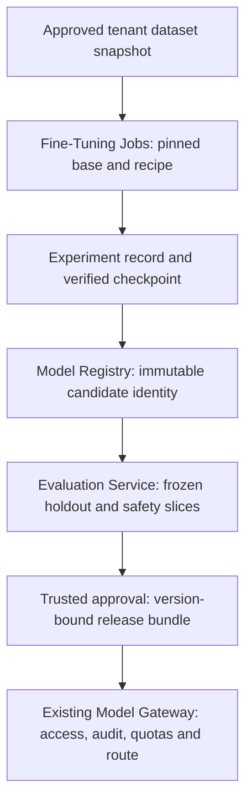

<!-- Generated by site/scripts/sd-course-import.mjs from 10_AI_System_Design. Edit the stage guide there. -->
# Fine-tuning and model customisation: learn and design

## Teach Behaviour Without Making Weights an Access System

Changing examples in a request can change formatting immediately. This is prompting: the base model remains unchanged, but examples consume context and may behave inconsistently. Retrieval supplies authorised current text at request time; it has source and access boundaries and can fail through stale indexing or poor ranking. Use it for the current supplier rule, even after customisation.

Fine-tuning adjusts model parameters using examples. Supervised fine-tuning teaches input/output behaviour by comparing generated predictions with target tokens during training. Training loss measures fit to the training objective; held-out task success measures whether the required behaviour transfers. Overfitting occurs when the candidate memorises training patterns and fails on new suppliers. Validation data guides experiment choices; test data must remain outside that loop.

An adapter stores a smaller learned update associated with a pinned base model. Low-rank adaptation (LoRA) learns low-rank parameter updates rather than changing every base parameter. That can reduce trainable state, but does not eliminate base weights, activations, data handling, or serving compatibility checks. The [PEFT conceptual guide](https://huggingface.co/docs/peft/main/en/conceptual_guides/lora) describes that mechanism. This lesson specifies no library version or GPU sizing promise.

| Option | When it wins | Cost and failure | Decision for this trial |
| --- | --- | --- | --- |
| Prompt plus structured output validation | Behaviour can be expressed with instructions and a few examples | More input tokens; unsupported constraints or semantic mistakes still need checking | Baseline and first experiment |
| Retrieval plus prompt | Facts change or answers need document-level permission and citation | Index freshness, authorised ranking and context budget | Retain for supplier policy |
| Base model plus tenant adapter | Repeated stable behaviour misses remain with sufficient licensed approved examples | Training, evaluation, adapter/base compatibility and extra model lifecycle | Bounded challenger experiment only |
| Full parameter fine-tuning | Measured adapter limits justify broader changes and available compute | More trainable state, longer iteration and larger artefact lifecycle | Defer pending evidence |

Choose a bounded adapter trial, conditional on documented baseline failures. ADR-010 accepts the governance path, not an unsupported quality gain. Do not place confidential current supplier facts into the training corpus merely because the original user could retrieve them. Training approval is a separate purpose and scope. Model weights cannot implement per-document revocation.

## Design the Artefact Chain

A dataset version is an immutable manifest of example IDs, supplier groups, split, content checksums, consent/purpose, provenance, and retention class. Group all examples from the same supplier/thread into one split before freezing it. Otherwise near-duplicates can inflate held-out scores. Deduplicate before splitting, inspect representative labels, scrub secrets and personal data, and document who can approve reuse. The three-row local fixture only demonstrates split checks; it is not the assumed training corpus.

A training job pins dataset digest, base model digest, training image, recipe, seed, hyperparameters, tokeniser, and budget. Experiment tracking records those inputs plus metrics, duration, resource use, and output identities. A checkpoint saves recoverable progress; production resume also needs compatible optimiser/scheduler/random state and a verified input position. A finished model artefact becomes a candidate in the Model Registry, where versions and lineage are durable records. A mutable friendly alias is a pointer, not immutable evidence; [MLflow documents this distinction](https://mlflow.org/docs/latest/ml/model-registry/workflow).

After diagram. Training data, checkpoints, logs, and adapters stay inside the tenant-approved boundary. Evaluation is a gate before runtime selection. The registry does not grant access to documents or deployment destinations.

For a production `POST /v1/fine-tuning/jobs`, propose a maximum 16 KiB metadata body and a 128-character operation key, not uploaded raw training text. Require a verified training-operator capability and server-derived tenant/user scope. Validate allowlisted base/recipe IDs, approved immutable dataset reference, region, and maximum compute budget. Scope uniqueness to tenant, subject, endpoint, and key; hash canonical immutable request parameters. Commit durable queued intent before `202 {job_id,state,dataset_digest}`. Same key and payload returns the existing job; changed payload returns `409`. Invalid shape is `400`, denied permission `403`, absent or invisible resource `404`, bounded admission `429`, and unavailable authority `503`. Retry with the same key after inspecting status. `202` promises persisted intent, never training or approval. The Python library models only trusted tenant/job scope; it has no HTTP facade, user authentication, queue, durable store, or actual budget enforcement.

A proposed job moves queued, training, evaluating, candidate, approved, deployed, or failed/cancelled. Approval and deployment are separate. Cancellation stops new work; it cannot prove every remote accelerator stopped. Keep last verified checkpoint and reconcile remote state before submitting another billed run.

## Checkpoint 1: A Better Mean Score

The candidate passes 199/200 schema checks but exposes one restricted supplier name. Can an approver promote it?

Reveal after answering

No. The known safety violation blocks the gate independently of aggregate quality. Quarantine the candidate and trace whether the training data, retrieval, or output handling caused the disclosure. Increasing the schema threshold does not repair tenant isolation.

## Distributed Training at awareness depth

A larger training job may need more than one accelerator. Data parallel training processes different examples on replicas and synchronises updates. Sharded training distributes selected parameter, gradient, or optimiser state, depending on the framework. Communication and checkpoint coordination can erase the expected gain. These choices require measured memory, throughput, topology, and recovery evidence. At awareness depth, identify that specialist boundary and request a training-infrastructure review; do not implement distributed optimisers in this course.

## Key Takeaways

- Prompting changes behaviour without touching the model, retrieval supplies authorised current text, and fine-tuning adjusts parameters. A LoRA adapter learns low-rank updates on a pinned base model but still needs base weights, data handling and serving compatibility checks.
- Model weights cannot implement per-document revocation. Never put confidential supplier facts into a training corpus because the user could retrieve them, since training approval is a separate purpose and scope.
- A dataset version is an immutable manifest, and all examples from one supplier or thread go into one split before freezing. A mutable registry alias is a pointer, not evidence, and approval and deployment are separate states.
- A 199/200 schema score cannot promote a candidate that exposes one restricted supplier name. The known safety violation blocks the gate on its own, and a `202` for a job promises persisted intent, never training or approval.
