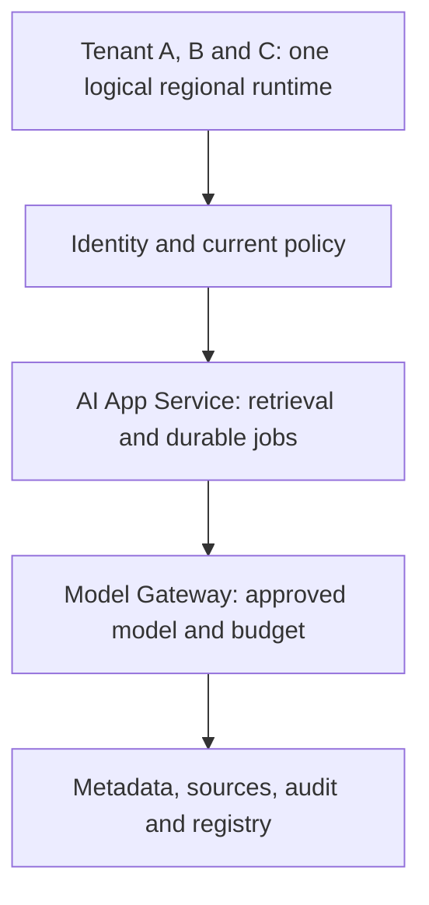

<!-- Generated by site/scripts/sd-course-import.mjs from 10_AI_System_Design. Edit the stage guide there. -->
# Global multi-region platform: understand the problem

Alice in Tenant A now needs supplier content to stay within approved EU regions. A regional outage must not send her documents to the nearest healthy US endpoint. Tenant B has the same residency constraint. Tenant C has a separate US home. Recovery needs authorised data, current policy, one proven writer, and ready model capacity in the allowed geography.

These are hypothetical customer requirements, not legal advice or cloud guarantees. Every time, rate, and dollar amount is a planning assumption. The local lab computes recovery eligibility, capacity, and usage economics; no regional services run. Estimated integrated study: six to eight hours.

## Carry Forward Model and Data Lineage

Read [T17.11](../10_fine_tuning/01_understand_the_problem.md) and [its snapshot](https://github.com/Sourav692/Forward-Deployed-Engineer-Interview-Prep/blob/main/10_AI_System_Design/stages/10-fine-tuning/architecture-after.md) before designing the change. Dataset versions, training jobs, checkpoints, candidate registry, evaluation, and approval now exist as architecture roles. The executable lifecycle fixture checks metadata only. T17.10's runtime still requires current source access, mandatory audit, approved model/route, finite budgets, and commit-before-saved-success. Durable jobs, tombstones, immutable caches, and unknown external outcomes remain intact.

Before diagram. One logical region has no demonstrated cross-region recovery. Its internal availability and previous local SQLite tests do not prove survival of a regional loss.

## Walk the Failure Before Adding Regions

Suppose EU-primary stops responding after accepting Alice's operation. A global load balancer selects US because it is healthy. The request may violate placement policy, lack the exact approved adapter, read stale permission, or generate a second answer for an already charged operation. A health check cannot decide those questions.

Data residency means an approved placement constraint on specified data classes and processing. Here A/B content, source bodies, embeddings/indexes, prompts, outputs, training snapshots, adapters, and protected logs/backups stay in EU-primary or EU-secondary. A global directory contains opaque tenant handles and placement revisions only; authentication and access checks remain regional. Location of an HTTP endpoint does not establish the location of provider processing, logs, backups, or support access.

Two questions decide every recovery. How much recently saved work may Alice lose, and how long may she wait? As in [T17.8](../07_reliability_consistency/03_observe_and_experiment.md#lesson-worked-latency-and-reliability-budgets), the recovery point objective (RPO) bounds the first: the maximum acceptable data-loss window. The recovery time objective (RTO) bounds the second: the maximum time from incident start to validated customer success. Disaster recovery (DR) is the plan that meets both after a regional loss. Assume asynchronous result/source replication targets RPO ≤60 seconds and the RTO is 600 seconds. [AWS's recovery guidance](https://docs.aws.amazon.com/whitepapers/latest/disaster-recovery-workloads-on-aws/disaster-recovery-options-in-the-cloud.html) describes DR strategy trade-offs; our timings are independent illustrative budgets.

| Module | Treatment | Depth, evidence, and boundary |
| --- | --- | --- |
| Estimation and capacity planning | Revisited from [T17.2](../01_mvp/01_understand_the_problem.md) | Build depth: separate RPS, tokens/minute, concurrency, and recovery timing |
| Networking fundamentals | Revisited from [T17.2](../01_mvp/01_understand_the_problem.md) | Design depth: DNS caching, ingress reachability, TLS and private endpoint boundaries |
| Distributed system fundamentals | Revisited from [T17.8](../07_reliability_consistency/01_understand_the_problem.md) | Build depth: one writer per tenant through a quorum lease and epoch fencing |
| Rate limiting and admission control | Revisited from [T17.6](../05_overload_fairness/01_understand_the_problem.md) | Build depth: admission follows the surviving regional dependency budget |
| Fair scheduling and workload prioritisation | Revisited from [T17.6](../05_overload_fairness/01_understand_the_problem.md) | Design depth: retain tenant shares under degraded capacity |
| AI workload management | Revisited from [T17.6](../05_overload_fairness/01_understand_the_problem.md) | Build depth: reserve token and slot capacity, not just app replicas |
| AI gateway and provider management | Revisited from [T17.10](../09_inference_gpu/01_understand_the_problem.md) | Build depth: route only to eligible regional provider profiles before dispatch |
| Document ingestion and indexing | Revisited from [T17.4](../03_enterprise_knowledge/01_understand_the_problem.md) | Build depth: rebuild indexes from source copies checked against quorum-held versions and tombstones |
| Enterprise retrieval governance | Revisited from [T17.7](../06_enterprise_security/01_understand_the_problem.md) | Build depth: current policy authority remains required during recovery |
| LLM execution and inference fundamentals | Revisited from [T17.10](../09_inference_gpu/01_understand_the_problem.md) | Design depth: token phases and context mix affect regional slots |
| Model serving architecture | Revisited from [T17.10](../09_inference_gpu/01_understand_the_problem.md) | Design depth: warm model readiness differs from a running VM |
| Inference performance optimisation | Revisited from [T17.10](../09_inference_gpu/01_understand_the_problem.md) | Explain depth: optimisation changes require measured local evidence |
| GPU infrastructure and scheduling | Revisited from [T17.10](../09_inference_gpu/01_understand_the_problem.md) | Explain depth: reserve accelerator availability within allowed geography |
| Scaling and traffic engineering | Revisited from [T17.5](../04_application_scaling/01_understand_the_problem.md) | Build depth: app headroom cannot hide provider bottlenecks |
| Resilience and fault tolerance | Revisited from [T17.8](../07_reliability_consistency/01_understand_the_problem.md) | Build depth: RPO/RTO runbook and explicit fail-closed cases |
| Enterprise AI security | Revisited from [T17.7](../06_enterprise_security/01_understand_the_problem.md) | Build depth: datasets, models, telemetry and egress follow residency policy |
| Multi-tenant platform design | Revisited from [T17.7](../06_enterprise_security/01_understand_the_problem.md) | Build depth: trusted per-tenant home/allowed-region policy |
| SRE and production operations | Revisited from [T17.8](../07_reliability_consistency/01_understand_the_problem.md) | Build depth: incident roles, promotion evidence and failback |
| Performance and incident diagnosis | Revisited from [T17.8](../07_reliability_consistency/01_understand_the_problem.md) | Build depth: separate route, authority, replica and model readiness failures |
| Container and orchestration architecture | Revisited from [T17.10](../09_inference_gpu/01_understand_the_problem.md) | Design depth: regional image/artefact pinning, readiness and drain |
| Cloud networking and deployment | Taught here | Design depth: residency hostnames, regional ingress, private routes, entry and deployment alternatives, and a request-trace design task |
| AI unit economics | Taught here | Build depth: cost per successful workflow derived from attempts, tokens and rate, before and after a failover retry, with an attempt-keyed usage ledger |
| Infrastructure capacity planning | Taught here | Design depth: regional peak and recovery capacity by app, tokens and slots; sizing alternatives and a quota sizing task |

Outcomes: choose a regional boundary, quantify recovery and cost, diagnose an ineligible failover, and reconcile usage without equating retries to new customer value.

## Key Takeaways

- Residency is an approved placement constraint on named data classes and processing. Tenant A and B content, embeddings, prompts, outputs, adapters, logs and backups stay in EU-primary or EU-secondary, and an endpoint's location proves nothing about where a provider processes or logs.
- A healthy US endpoint picked by a global load balancer may break placement, lack the approved adapter, read stale permission or generate a second charged answer. A health check cannot decide those questions.
- The recovery point objective (RPO) bounds how much saved work may be lost, here 60 seconds or less. The recovery time objective (RTO) bounds incident start to validated customer success, here 600 seconds.
- Recovery needs authorised data, current policy, one proven writer and ready model capacity in the allowed geography. The global directory holds only opaque tenant handles and placement revisions, and access checks stay regional.
