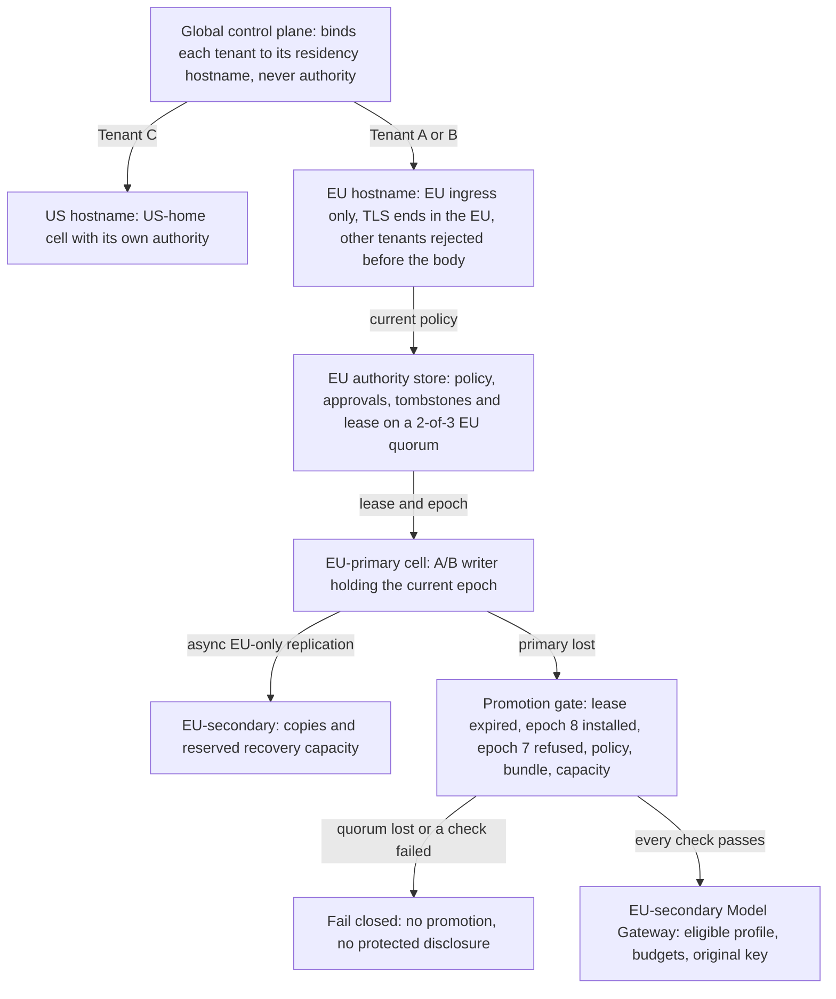

<!-- Generated by site/scripts/sd-course-import.mjs from 10_AI_System_Design. Edit the stage guide there. -->
# Global multi-region platform: learn and design

## Compare Placement and Recovery Options

| Option | Benefit | Cost or failure | Fit for this requirement |
| --- | --- | --- | --- |
| One region plus backups | Lowest live duplication | Restore and capacity acquisition may miss recovery target | Baseline if customers accept longer outage |
| Tenant home region with same-geography warm secondary | Local writes and policy boundary; recovery capacity partly running | Replication lag, reserved capacity and promotion runbook | Choose for EU A/B |
| Every region writes every tenant | Local writes in more locations | Conflict resolution, global identity/budgets, residency and split-writer risk | Reject without a demonstrated requirement |
| Synchronous cross-region replication of tenant data | Less acknowledged-state loss when a quorum survives | Write latency on every request, partition availability and permitted-region constraints | Reject for bulk data; apply only to the small authority class below |

A cell is a regional failure boundary containing enough application and data services to serve its assigned tenants. Tenant home placement chooses one writer region for that tenant. Different tenants can be active in different cells; that is not concurrent global writing of Alice's operation. Add EU-secondary as a warm recovery target with verified artefact and quota reservations. Tenant C continues in US-home. There is no permitted US failover for A/B under this scenario.

## Place Writer Authority Where It Survives

Suppose EU-primary is cut off but still running. If EU-secondary also starts accepting Alice's writes, two regions change the same tenant's records and charge for the same operation. Recovery must prove that the old writer can no longer change anything before the new one starts. That proof is called fencing. Three tools from [T17.3](../02_distributed_execution/02_learn_and_design.md#lesson-claim-lease-and-completion) and [T17.8](../07_reliability_consistency/02_learn_and_design.md#lesson-choose-consistency-by-consequence) make it concrete:

- A lease is time-limited writer ownership. The writer renews it every 5 seconds here and loses it 20 seconds after the last renewal.
- An epoch is a number that increases with every new lease. It is the fencing token: each write carries it, and a store rejects any write whose epoch is older than the newest it has seen.
- A quorum is a majority of voters, here 2 of 3. Any two majorities share a voter, so two live leases cannot be granted at once.

[ADR-013](../architecture_decisions/adr_013_regional_authority_and_route_generations.md) amends ADR-011's cell design to place this authority. Tenant A/B policy, membership, model approval, deletion tombstone, source-version and writer-ownership records sit in an EU-only authority store. It is consensus-replicated across EU-primary, EU-secondary and a small EU witness location that holds votes, not content. Losing EU-primary leaves 2 of 3 voters in the EU. Tenant C has the equivalent store in its US-home cell. No authority record leaves its tenant's region. The global control plane holds only opaque placement and is never authority.

Promotion runs four steps in order. A clock-drift margin is the allowance for two machines' clocks disagreeing about when 20 seconds have passed.

1. Wait until epoch 7's lease has expired plus the drift margin. A correct old writer stops acknowledging writes at its own lease expiry.
2. The quorum grants EU-secondary a new lease, epoch 8.
3. EU-secondary installs epoch 8 as the minimum accepted epoch in every store it will use: its database, object store, job workers and the Model Gateway's billable-usage write path. Each must then refuse a probe write carrying epoch 7. A store cannot reject epoch 7 until it has seen epoch 8, so the install comes first.
4. EU-primary's own stores cannot be reached, so they are not probed. They are quarantined: nothing they accept after isolation becomes authority, and failback rebuilds them from the new authority. Provider calls the old writer sends after lease expiry rely on its self-stop and on unknown-outcome reconciliation, not on epoch rejection.

An unreachable writer is not a fenced writer, so network reachability or a health check never counts as fencing.

If the quorum itself is lost, the design fails closed. EU-secondary does not promote, makes no protected disclosure, and reports that authority is unavailable, even when that misses the RTO. Treating the async copy as authority is the unsafe shortcut.

After diagram. Placement binds Tenant C to the US hostname and A/B to the EU hostname, whose TLS ends only in EU ingress. EU-primary replicates asynchronously to EU-secondary inside the EU. On primary loss, the promotion gate either passes every check or fails closed. The US cell is a sibling destination for C, never a replica of A/B content. Directory configuration cannot substitute for actual private networking or provider processing policy.

## Specify the Network and Control Boundaries

Alice's request crosses several network edges before a model sees it. Each edge can leak content or deliver it to the wrong region. Five terms name those edges; TLS and mutual TLS return from [T17.2](../01_mvp/02_learn_and_design.md#lesson-6-architecture-after-the-change) and [T17.7](../06_enterprise_security/02_learn_and_design.md#lesson-protect-the-model-and-network-boundary):

- Ingress is the regional entry point that accepts client traffic. Egress is any outbound path, such as a call to a model provider.
- Transport Layer Security (TLS) encrypts a connection and proves the server's identity with a certificate. Mutual TLS also proves the client's identity.
- A private endpoint exposes a service only on the cloud provider's internal network, with no public address.

Follow the request in order:

1. After sign-in, the trusted placement directory binds Tenant A to the EU hostname. That host resolves only to EU ingress, and its TLS key exists only there, so Alice reaches the EU wherever she is. The Domain Name System (DNS) then chooses only between EU-primary and EU-secondary ingress. Resolvers cache that answer for its time to live (TTL), so a switch reaches some clients late.
2. EU ingress terminates TLS and strips caller-supplied identity headers.
3. Ingress authenticates from the headers and resolves trusted placement before reading the body. A tenant not placed at this ingress is rejected. No body goes into redirects, URLs or edge logs.
4. Inside the cell, services call each other over authenticated paths with scoped credentials. Private endpoints, firewall rules, private DNS, routes and controlled egress must agree. Private connectivity reduces exposure; it does not authorise a resource.
5. Before dispatch, the Model Gateway checks the provider profile's processing and storage geography and the model's approval.

Deployment pins image and model digests, then tests readiness, connections, secrets and drain (stopping new work to an instance while its in-flight work finishes) in each cell. A machine accepting TCP connections is not evidence that an adapter is loaded.

The global control plane publishes placement and approved templates. It stays off each prompt's critical path and never holds authority. A signed, bounded-age regional snapshot can serve placement discovery but grants no document access. On control-plane loss, freeze placement changes. Existing authorised work continues only while the regional authority quorum, audit and budgets are available.

## Choose Regional Entry and Deployment

| Decision | Option | When it wins | Cost or failure |
| --- | --- | --- | --- |
| Regional entry | Residency hostnames: the EU host resolves only to EU ingress; DNS chooses within the EU | The endpoint enforces residency: the EU key exists only in EU ingress, wherever the user is | Clients must use their host; cached answers delay an EU-primary to EU-secondary switch by up to the TTL |
| Regional entry | DNS geo-routing on one shared hostname | Lowest latency for users near their home region | Picks by the resolver's location, not the tenant: an A/B user resolving from the US reaches US ingress, where TLS ends. Nothing at entry enforces residency |
| Regional entry | Anycast load balancer (one address announced from many edges; the network picks a nearby one) with EU-only edges for the EU host | One fixed address per residency and a switch without DNS caching | The provider's edge set and key placement enforce residency, so both need continuous audit; global configuration is a shared failure point |
| Service exposure | Private endpoints for the Model Gateway, stores and provider | Default for cell-internal and provider paths | Private DNS and routes in every cell; harder to debug |
| Service exposure | Public endpoint with mutual TLS | A partner that cannot join the private network | Internet-reachable; certificate rotation and allow-lists become the boundary |
| Regional deployment | Rolling update within a cell | Small, backward-compatible changes | Old and new versions serve together; rollback is gradual |
| Regional deployment | Blue/green within a cell | Model Gateway or adapter changes that need a clean cut-over | Double capacity during the switch; the recovery reserve must cover both |

Choose residency hostnames, private endpoints, and blue/green for Model Gateway changes, one cell at a time. Anycast with EU-only edges also enforces residency and wins when a customer needs one fixed address; it loses here because residency would rest on a provider's edge configuration. Geo-routing on a shared hostname is rejected, because user location would decide where A/B content is decrypted.

**Design task.** Trace Alice's request from the EU hostname to the EU-secondary Model Gateway after failover. Mark where content may be logged and where a request at the wrong ingress is rejected. Choose a DNS TTL against the 30-second route-convergence budget, assuming the record update itself takes 5 seconds. Then choose how to ship a Model Gateway image change to EU-secondary.

Reveal after answering

The EU hostname now resolves to EU-secondary ingress; it never resolves outside the EU. TLS ends there, and edge logs hold metadata only. Authentication and placement run on the headers. A Tenant C user at this ingress, or an A/B client misconfigured to call the US host, is rejected at that ingress before the body is read. The app service calls the Model Gateway over a private endpoint, which dispatches to an EU provider profile. Content is written only to the protected EU operation and audit stores.

For the TTL, 5 seconds of update plus a 20-second TTL leaves 5 seconds of margin inside 30 seconds; a 60-second TTL misses the budget. A 20-second TTL triples DNS lookups compared with 60, and some resolvers ignore it, so measure convergence from client success. Ship the image blue/green inside EU-secondary, keeping the old version until readiness and approval checks pass.

## Assign Consistency by Data Class

| Data class | Replication and recovery choice | Unsafe shortcut |
| --- | --- | --- |
| Policy, membership, writer lease and epoch, budget grants, model approval/withdrawal, release-bundle generation, alias-to-digest bindings, deletion tombstones and current source versions | EU authority store on the 2-of-3 EU quorum; promotion needs a new lease and a refused old epoch | Trusting a lagging copy for revocation, deletion, quota or a withdrawn adapter |
| Committed result/history and operation keys | Async ordered log; loss bounded at isolation by last renewal + lease − watermark; inspect ambiguous operations | Treating missing post-failover row as proof no remote work happened |
| Immutable source bodies, datasets, adapters and checkpoints | Copy by digest within geography; verify complete manifest before readiness | Loading a registry alias whose artefact is absent |
| Index and immutable caches | Rebuild from source copies checked against the quorum's current versions and tombstones; keep live gates | Serving old search hits to bypass unavailable authority |
| Usage and audit | Protected regional evidence keyed by tenant, operation and attempt; classification-aware aggregates | Counting a redelivered attempt twice or dropping failed-attempt spend |

T17.11's approval and alias records are mutable trusted state, so they sit in the authority row. An adapter copied by digest may have been withdrawn after the copy. Restore therefore verifies the current approved generation from the authority store, not only the artefact digest. Tombstones and current versions sit there too, as [T17.8](../07_reliability_consistency/02_learn_and_design.md#lesson-choose-consistency-by-consequence) required, so a deletion acknowledged inside the lag window survives promotion. Every delete pays quorum latency.

Because async replication can lose acknowledged operation records within RPO, automatic redispatch after failover is unsafe for the uncertain interval. Keep a recovery hold on affected operations and reconcile provider/external status using original identities. A stronger zero-loss operation journal would need its own synchronous durability design and latency cost. This stage does not claim to implement that journal or the consensus protocol behind the authority store.

## Checkpoint 1: Authority Quorum Lost

EU-primary is down, and EU-secondary cannot reach the EU witness either, so it sees 1 of 3 authority voters. It has the model and result copies. May it promote itself and answer Alice's grounded supplier request to meet the RTO?

Reveal after answering

No. With 1 of 3 votes it cannot obtain a lease or read current policy. From EU-secondary, a dead primary and a live primary that still holds a majority with the witness look the same. Do not promote, make no protected disclosure, and report that authority is unavailable. A copied result, search index, or dataset cannot establish current access. Restore a quorum first, even if the RTO is missed.

## Key Takeaways

- Each tenant has one home writer cell with a warm same-geography secondary. Every-region writes and synchronous replication of bulk tenant data are rejected, and Tenants A and B have no permitted US failover.
- Writer authority, policy, approvals and deletion tombstones sit in an EU-only authority store on a 2-of-3 quorum. A lease lapses 20 seconds after its last renewal, and each new lease raises the epoch, the fencing token stores use to reject older writes.
- Promotion waits out epoch 7's lease plus a drift margin, takes epoch 8, installs it in every store and confirms each refuses an epoch 7 probe. An unreachable writer is not a fenced writer, and a lost quorum fails closed even past the RTO.
- The EU residency hostname resolves only to EU ingress, where its TLS key lives. Geo-routing on a shared hostname is rejected because user location would decide where A/B content is decrypted, and a 20-second TTL plus a 5-second update fits the 30-second convergence budget.
