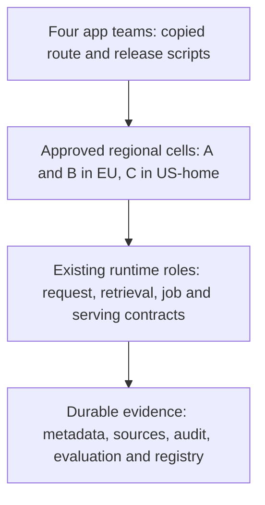

<!-- Generated by site/scripts/sd-course-import.mjs from 10_AI_System_Design. Edit the stage guide there. -->
# Staff-level platform architecture: understand the problem

Four internal teams now copy Alice's supplier workflow, each with its own route configuration and rollout scripts. One copy omits the EU placement pre-check. T18.12's destination admission still rejects its requests at runtime, so no data leaves the EU, but the team debugs at runtime a failure that a shared deploy-time check would have caught. Another copy changes the model alias without binding evaluation evidence. The platform team needs shared contracts and a migration path that keeps tenant guarantees while application teams keep control of supplier behaviour.

The team counts, hours, costs, thresholds and schedules are illustrative design inputs. This capstone builds on the authored T18.2–T18.12 and their local test boundaries. It does not turn those fixtures into a deployed platform. Estimated integrated study: eight to ten hours. Learner mastery remains unassessed.

## Start From the Actual T18.12 System

Read [T18.12](../11_multi_region/01_understand_the_problem.md) and [snapshot](https://github.com/Sourav692/Forward-Deployed-Engineer-Interview-Prep/blob/main/10_AI_System_Design/stages/11-multi-region/architecture-after.md). Alice and Tenant B use approved EU cells; Tenant C uses its US-home cell. Home-cell ownership, fenced promotion, current policy and audit, approved model artefacts, finite capacity and uncertain-operation recovery govern regional service. The regional worksheet is not a network deployment.

Carry these guarantees forward unchanged:

- **Request path:** authenticated API roles, bounded fair admission, approved egress, and gateway and model envelopes.
- **Data:** durable results and history, authorised ingestion and search, current version and tombstone checks, immutable caches, and consistency chosen per data class.
- **Execution and release:** durable jobs with worker epochs, evaluation and release bundles, and dataset-to-model lineage.
- **Regional:** home-cell ownership, fenced promotion, each region's authority store, and cost per successful workflow.

Keep short drafting distinct from grounded policy answering. Centralising the platform cannot make prompt text enforce access or repair an unknown provider result.

Before diagram. The existing capabilities remain useful. Their ownership and integration contracts are duplicated; no evidence justifies replacing every component with a new service.

## Turn the Incident Into Requirements

Assume each of four teams spends 30 engineering hours a month maintaining duplicated infrastructure logic. An adoption candidate is a tenant-scoped application with a named owner, approved cell, evaluated bundle, request budget, retention policy and observable outcome. Success means a new supplier app can follow a supported workflow without editing shared runtime code, and an emergency rollback cannot restore a forbidden model or the wrong region.

Acceptance criteria. These are design and test criteria, not production measurements:

- every onboarded app has an accountable owner and a versioned manifest;
- every seeded cross-tenant, residency or approval violation rejects;
- a lost cutover acknowledgement leaves inspectable state;
- an injected pre-commit failure changes neither route nor generation;
- a pilot reconciles per-success cost and shadow outcomes before rollout.

A one-day onboarding objective would need a later measured pilot.

| Module | Treatment | Depth, evidence, and boundary |
| --- | --- | --- |
| Requirements and architecture methodology | Revisited from [T18.2](../01_mvp/01_understand_the_problem.md) | Build depth: translate supplier and tenant constraints into platform acceptance criteria |
| Design documentation and communication | Taught here | Build depth: one-page decision record with evidence ledger and change record, plus a memo section for a named reader |
| Distributed architecture patterns | Taught here | Design depth: modular service, cell, event, and control-plane versus data-plane patterns with failure boundaries |
| Fine-tuning fundamentals | Revisited from [T18.11](../10_fine_tuning/01_understand_the_problem.md) | Design depth: an adapter stays conditional on behaviour evidence |
| Fine-tuning platform architecture | Revisited from [T18.11](../10_fine_tuning/01_understand_the_problem.md) | Explain depth: model creation is a separate governed workflow behind the platform contract |
| Distributed training infrastructure | Revisited from [T18.11](../10_fine_tuning/01_understand_the_problem.md) | Awareness depth: reminder only; training specialisation remains deferred |
| Evaluation architecture | Revisited from [T18.9](../08_evaluation_releases/01_understand_the_problem.md) | Build depth: contract and outcome gates accompany migration comparisons |
| Model and data lifecycle infrastructure | Revisited from [T18.11](../10_fine_tuning/01_understand_the_problem.md) | Design depth: the manifest pins model and data lineage; retirement follows descendants |
| Site reliability engineering (SRE) and production operations | Revisited from [T18.8](../07_reliability_consistency/01_understand_the_problem.md) | Build depth: regional service level objective (SLO) and runbook ownership continue after centralisation |
| Cloud networking and deployment | Revisited from [T18.12](../11_multi_region/01_understand_the_problem.md) | Design depth: deployment targets respect T18.12 cell and network boundaries |
| Internal AI developer platforms | Taught here | Build depth: versioned app contract, paved workflow, per-cell route authority and a durable migration-controller slice |
| AI unit economics | Revisited from [T18.12](../11_multi_region/01_understand_the_problem.md) | Build depth: per-success cost persists in showback and platform adoption |
| Infrastructure capacity planning | Revisited from [T18.12](../11_multi_region/01_understand_the_problem.md) | Design depth: cell capacity is planned independently of developer onboarding |
| Architecture economics | Taught here | Build depth: three-year total cost of ownership (TCO) with dual-run overlap, break-even and sensitivity; opportunity value stays qualitative |
| Architecture decision-making | Taught here | Build depth: weighted options, hard-constraint veto, architecture decision record (ADR) and reversal triggers |
| Platform evolution and migration | Taught here | Build depth: inventory, bound shadow evidence, single-writer cutover, rollback with history, and retirement, with fault tests |
| Technical leadership through system design | Taught here | Build depth: ownership, review, incident authority, disagreement resolution and a scored capstone defence |

Outcomes: write and defend a decision record, defend platform boundaries, test a migration controller, compare TCO with uncertainty, and lead an adoption review using evidence rather than technology preference.

## Key Takeaways

- Four teams copying route configuration and rollout scripts caused the problem. One copy skipped the EU placement pre-check and another changed the model alias without binding evaluation evidence.
- The platform needs shared contracts and a migration path, not a replacement of every component. Every existing guarantee carries forward unchanged, and centralising cannot make prompt text enforce access or repair an unknown provider result.
- An adoption candidate needs a named owner, approved cell, evaluated bundle, request budget, retention policy and observable outcome. Success means a new app follows a supported workflow without editing shared runtime code, and rollback cannot restore a forbidden model or the wrong region.
- Acceptance requires every seeded cross-tenant, residency or approval violation to reject, a lost cutover acknowledgement to leave inspectable state, and an injected pre-commit failure to change neither route nor generation.
