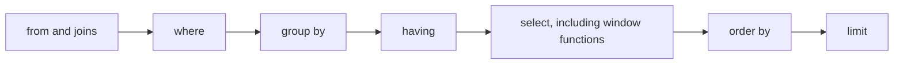

## Start with the fanned-out total

Selby Retail, a fictional online retailer, asked a new analyst for October revenue by region. The analyst joined customers to orders, orders to shipments to keep only shipped orders, and summed the order totals by region.

The report showed £3.6 million. The finance ledger showed £2.6 million. The report was 38% too high, and it had gone to the board pack before anyone compared the two.

Many orders shipped in two or three parcels. Each parcel became a row in the join, and each row carried the full order total. An order of £60 in two parcels was counted as £120. The query ran without error and every number in it was real. Call this **the fanned-out total**.

> **What you'll learn**
>
> - How to fix the grain of a question before writing SQL.
> - Which rows each kind of join keeps and drops.
> - How to aggregate without double counting.
> - How common table expressions and window functions answer ranking and trend questions.
> - How to check an answer before you send it.

## Fix the grain first

The **grain** of a table is what one row represents. Before writing a line of SQL, write down the grain of each table you will touch and the grain of the answer.

| Table or result | One row is | Selby example |
| --- | --- | --- |
| `customers` | A customer | C1, region North |
| `orders` | An order, with its total | O2, customer C1, £60 |
| `order_items` | One product line on an order | O2, toaster, £45 |
| `shipments` | One parcel for an order | O2, parcel 1 of 2 |
| The answer | A region in a month | North, October, £150 |

*Table 1: Grain of Selby's tables and of the requested answer. A join to a finer grain multiplies the rows of a coarser one.*

The rule follows from the table. When you join a table to one with a finer grain, each row of the coarser table repeats once per matching row. Its numbers repeat with it. Orders joined to shipments have the grain of shipments, and summing order totals at that grain counts orders more than once.

## Joins: which rows survive

A join decides which rows reach the next step. Name the rows each join keeps and drops before you rely on it.

| Join | Keeps | Drops | Business use |
| --- | --- | --- | --- |
| Inner join | Rows with a match on both sides | Unmatched rows on either side | Orders with their customer |
| Left join | Every row on the left, with nulls where the right has no match | Unmatched rows on the right | Every region, including those with no orders |
| Anti join (`not exists`, or left join where the right key is null) | Left rows with no match | Everything matched | Customers who have never ordered |
| Semi join (`exists`) | Left rows with at least one match, once each | Duplicates from multiple matches | Orders that shipped, without the fan-out |

*Table 2: Join types by what they keep. The semi join answers Selby's "shipped orders" filter without multiplying rows.*

Selby's analyst needed "orders that shipped", which is a filter, not a join to every parcel. A semi join with `exists` keeps each shipped order once. That one change fixes the fanned-out total.

Watch the left join's nulls. A filter on the right table's column in the `where` clause, such as `where o.ordered_at >= '2026-10-01'`, discards the null rows and turns a left join into an inner join. Put that condition in the join's `on` clause instead, and regions with no October orders survive with a revenue of null, which `coalesce` can turn into zero.

## Aggregation without double counting

Aggregation collapses many rows into one per group. Four rules prevent most errors:

- **`where` filters rows before grouping. `having` filters groups after.** "Orders over £100" is a `where`. "Regions with more than 1,000 orders" is a `having`.
- **Know what each count counts.** `count(*)` counts rows. `count(column)` skips nulls. `count(distinct o.id)` counts orders even when a join has repeated them.
- **Nulls disappear from sums and averages.** An average of discounts ignores orders with no discount recorded. Decide whether that means zero, and write it.
- **Aggregate before you join.** When two child tables both multiply a parent, sum each child to the parent's grain first, then join the summaries.

The last rule is the general fix. To report revenue and parcel count per region, first build one row per order with its parcel count, then join that to customers and sum. Each order appears once, whatever its number of parcels.

The order in which a database evaluates a query explains several of these rules. Figure 1 shows the logical order.

*Figure 1: The logical order of a query. Filters in `where` run before grouping, window functions run after it, and `order by` comes almost last. The database may execute it differently, but the result must match this order.*

The figure explains two common surprises. You cannot use a window function in `where`, because windows are computed later. You can sort by an alias defined in `select`, because sorting comes after it.

## Common table expressions and window functions

A **common table expression** (CTE) is a named step written with `with`, such as `with order_revenue as (...)`. Later steps read it like a table. CTEs turn one dense query into a sequence you can read, test and explain step by step.

A **window function** computes a value across related rows without collapsing them. `sum(revenue) over (partition by region order by month)` gives a running total per region while keeping every month's row. Three families answer most business questions:

- **Ranking:** `row_number`, `rank` and `dense_rank`, for "top product per category".
- **Offsets:** `lag` and `lead`, for "change since last month".
- **Running aggregates:** `sum` or `avg` over an ordered window, for "year to date" or "rolling seven days".

The walkthrough builds Selby's question "best-selling product in each category in September, and how it changed from August" one step at a time.

Selby wants the top product by revenue in each category for September, with its change from August. Each step is one named step of the query.

<button type="button" data-step="0" aria-pressed="false" aria-controls="win-step-0">1. Monthly</button><button type="button" data-step="1" aria-pressed="false" aria-controls="win-step-1">2. Lag</button><button type="button" data-step="2" aria-pressed="false" aria-controls="win-step-2">3. Rank</button><button type="button" data-step="3" aria-pressed="false" aria-controls="win-step-3">4. Filter</button>

<section id="win-step-0" class="step-panel" aria-labelledby="win-heading-0"><h4 id="win-heading-0">1. Revenue per product per month</h4><dl><dt>Step</dt><dd>A CTE groups order items by category, product and month and sums line totals.</dd><dt>Rows out</dt><dd>One per product per month. Kitchen: kettle August £8,000, September £9,200. Toaster August £7,500, September £6,900.</dd><dt>Grain</dt><dd>Product and month. Order items are summed, so no fan-out.</dd></dl></section><section id="win-step-1" class="step-panel" aria-labelledby="win-heading-1"><h4 id="win-heading-1">2. Add last month's revenue</h4><dl><dt>Step</dt><dd><code>lag(revenue) over (partition by product order by month)</code> adds the previous month's revenue to each row.</dd><dt>Rows out</dt><dd>Kettle September: £9,200, previous £8,000, change +15%. Toaster September: £6,900, previous £7,500, change −8%.</dd><dt>Grain</dt><dd>Unchanged. The window adds a column without removing rows.</dd></dl></section><section id="win-step-2" class="step-panel" aria-labelledby="win-heading-2"><h4 id="win-heading-2">3. Rank within each category</h4><dl><dt>Step</dt><dd><code>rank() over (partition by category, month order by revenue desc)</code> numbers products within each category and month.</dd><dt>Rows out</dt><dd>Kitchen, September: kettle rank 1, toaster rank 2.</dd><dt>Grain</dt><dd>Unchanged. Ties share a rank, and both are kept.</dd></dl></section><section id="win-step-3" class="step-panel" aria-labelledby="win-heading-3"><h4 id="win-heading-3">4. Keep the top row per category</h4><dl><dt>Step</dt><dd>A final step keeps rows where rank is 1 and the month is September.</dd><dt>Rows out</dt><dd>Kitchen: kettle, £9,200, +15% on August. One row per category.</dd><dt>Why a separate step</dt><dd>Window functions run after <code>where</code>, so their results can only be filtered in a later step.</dd></dl></section>

<button type="button" data-walk="previous">Previous</button>

<button type="button" data-walk="next">Next step</button>

The walkthrough uses illustrative figures. The kettle's change is (9,200 − 8,000) ÷ 8,000 = 15%, and the toaster's is (6,900 − 7,500) ÷ 7,500 = −8%.

Choose the ranking function on purpose. `row_number` picks one row even when two products tie, and which one it picks is arbitrary unless the ordering includes a tie-breaker. `rank` keeps both tied products and then skips a number. `dense_rank` keeps both without skipping.

## Check the answer before you send it

A query that runs is not an answer that is right. Before sending numbers to a customer:

1. **Reconcile to a trusted total.** Compare the grand total with the ledger, the dashboard or last month's report. Selby's 38% gap would have shown at once.
2. **Count rows at each step.** If a CTE that should hold one row per order holds more rows than the orders table, a join has fanned out.
3. **Probe the edges.** Nulls, refunds, cancelled orders, test accounts and duplicate customers. Ask how the business wants each treated.
4. **Pin down time.** "October" in which time zone, by order date or ship date? A midnight boundary in the wrong zone moves a day of sales.
5. **Write the definitions next to the number.** "Revenue: shipped orders, excluding refunds, by order date in UK time."

## Limits of this lesson

- **Syntax varies.** The functions here exist in PostgreSQL and most modern databases, but date handling and some function names differ between products.
- **Performance is a separate question.** A correct query can still be slow. [Indexes and query plans](03_Indexes_and_Query_Plans.md) covers that.
- **Fictional data.** Selby Retail and its figures are illustrative.

## Interview angle

Each answer is an outline to say in about two minutes. Open each question and try it aloud before reading.

Interview question 1. A customer asks a business question that needs data from several tables. How do you get from the question to a trustworthy SQL answer?

- **Answer:** Restate the question with definitions agreed: which measure, which filter, which time zone. Write down each table's grain and the answer's grain. Choose joins by the rows they keep, using `exists` for filters so child tables do not multiply parents. Aggregate children to the parent's grain before joining. Build it as named CTE steps and count rows after each. Reconcile the total with a trusted figure, and send the definitions with the number.
- **Trade-off:** Checking adds time to a request that looks quick. A wrong number in a board pack costs far more.
- **Follow-up to expect:** "There is no trusted total." Cross-check two independent routes, such as order totals against summed line items.

Interview question 2. Using customers, orders and order items, report revenue and order count per region for last month, including regions with no orders.

- **Answer:** Start from regions, so none is lost. Build a CTE of one row per order for last month, with revenue summed from its items. Left join customers to that CTE, putting the date condition in the CTE, not in a `where` on the joined side. Group by region. Use `count(distinct order_id)` for orders and `coalesce(sum(revenue), 0)` for revenue. Check the grand total against the orders table for the same month.
- **Trade-off:** Summing items gives revenue after line discounts. Using the order total is simpler but may include shipping. Agree which the customer means.
- **Follow-up to expect:** "Why did your left join lose empty regions?" A `where` on the right table's column removed the null rows.

## References

1. PostgreSQL, [Table expressions: joins](https://www.postgresql.org/docs/current/queries-table-expressions.html), accessed 17 November 2026. Inner, outer and lateral joins, and where and having clauses.
2. PostgreSQL, [WITH queries (common table expressions)](https://www.postgresql.org/docs/current/queries-with.html), accessed 17 November 2026. Named steps within a query.
3. PostgreSQL, [Window functions tutorial](https://www.postgresql.org/docs/current/tutorial-window.html), accessed 17 November 2026. Partitions, ordering and the difference from aggregates.
4. PostgreSQL, [Aggregate functions tutorial](https://www.postgresql.org/docs/current/tutorial-agg.html), accessed 17 November 2026. Where against having, and grouping.

## Key takeaways

- Write down the grain of every table and of the answer before writing SQL.
- A join to a finer grain repeats the coarser rows and their numbers.
- Use `exists` for filters, and aggregate child tables before joining them.
- CTEs make a query a sequence of checkable steps. Window functions add ranks and trends without collapsing rows.
- Reconcile to a trusted total and send the definitions with the number.

## Check yourself

1. Why did Selby's report overstate revenue by 38%?

Joining orders to shipments created one row per parcel, and each row carried the full order total. Orders in several parcels were summed several times.

2. Why must the "rank is 1" filter sit in a later step than the rank?

Window functions are computed after `where`, so a `where` in the same step cannot see the rank.

3. A left join from regions to orders drops regions with no orders. What is the likely cause?

A condition on an orders column in `where` removes the rows where those columns are null. Move it into the join condition or a CTE.

