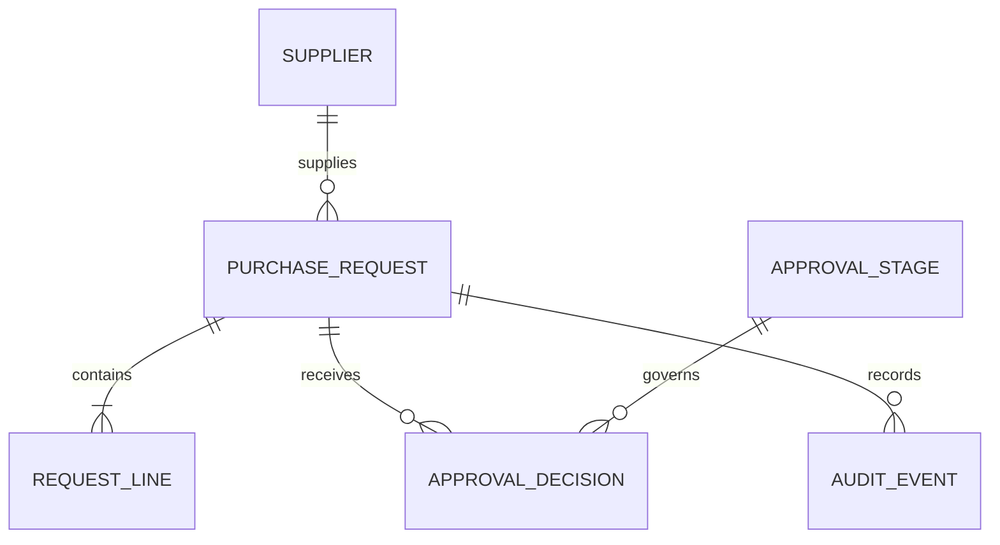

## Start with the overwritten approval

Ulverston Mills, a fictional textile manufacturer, built a purchasing tool. Any purchase over £10,000 needed two approvals: first the department head, then finance. The `purchase_requests` table had a `status` column and an `approved_by` column.

When the department head approved, the tool set `status` to "head approved" and `approved_by` to the head. When finance approved, it set `status` to "approved" and wrote the finance officer into `approved_by`. The head's name was gone.

At the year-end audit, the auditor picked a £48,000 order for dyes and asked who had approved it at the first stage, and when. Nobody could say. The tool had kept the current state and thrown away how it got there. Call this **the overwritten approval**.

> **What you'll learn**
>
> - How to pick entities, keys and relationships.
> - How far to normalise, and when to copy data on purpose.
> - Which constraints to declare in the database.
> - How to model multi-stage approvals with a full audit history.

## Entities, keys and relationships

Start with the nouns the business uses and the facts it records about each. At Ulverston: suppliers, purchase requests, request lines, approval stages and approval decisions. Each becomes a table. Each fact becomes a column in the table it describes.

Every table needs a **primary key**: a column or set of columns that identifies one row and never changes.

| Key type | What it is | Strength | Risk |
| --- | --- | --- | --- |
| Surrogate | A generated number or UUID with no business meaning | Never changes, compact, simple joins | Allows duplicates of the real thing unless a unique constraint also guards the natural key |
| Natural | A business identifier, such as a supplier's VAT number | Meaningful, prevents duplicates | Businesses do change them, and some are missing or reused |
| Composite | Several columns together, such as request and line number | Matches the grain of child rows | Wider joins and foreign keys |

*Table 1: Primary key choices. A common pattern is a surrogate primary key plus a unique constraint on the natural key.*

Relationships become **foreign keys**: a request line holds the identifier of its request, and the database refuses a line whose request does not exist. Many-to-many relationships, such as suppliers and the product categories they serve, need a joining table with one row per pair.

## How far to normalise

**Normalisation** means storing each fact once, in the table whose key it depends on. The classic normal forms reduce to three plain checks:

- **One value per cell.** No comma-separated lists of approvers in one column. A list becomes rows in a child table.
- **Each column depends on the whole key.** On a request line keyed by request and line number, the supplier's name depends on the request alone. It belongs on the request, or better, on the supplier.
- **Each column depends on nothing but the key.** A supplier's address stored on every request repeats a fact about the supplier. Change it once and the copies disagree.

Normalised data is easy to change correctly. It needs joins to read. Copy data on purpose in three cases:

- **A fact at a moment.** The unit price on a request line is the price agreed that day, not the supplier's current price. Storing it on the line is not duplication. It is a different fact.
- **Reporting tables.** A summary table rebuilt each night trades freshness for fast reads, and nobody edits it by hand.
- **Highly variable attributes.** Technical specifications that differ by product type can sit in a JSON column, accepting that the database checks less of their structure.

## Constraints: the database's last line

Application code validates input, but several services, scripts and people write to the same database over the years. **Constraints** are rules the database enforces on every write, whoever makes it.

| Constraint | Rule | Ulverston example |
| --- | --- | --- |
| `not null` | The value must be present | Every request has a requester and an amount |
| `unique` | No two rows share the value | One supplier per VAT number |
| `check` | A condition on the row | Amount greater than zero |
| Foreign key | The referenced row must exist | A decision refers to a real request |
| Primary key | Unique and not null | Request identifier |

*Table 2: Constraints in Ulverston's schema. PostgreSQL supports all of these, plus exclusion constraints for rules such as non-overlapping date ranges.*

A rule enforced only in the application holds until the first data fix, import script or second service. A rule in the database holds for all of them. Put every rule the data must never break into a constraint, and keep the friendly error message in the application.

## Approval stages as data

The overwritten approval came from storing a process as two columns on one row. Model it as rows instead.

- **Policy as data.** An `approval_stages` table lists, per amount band, each stage's number and the role that approves it: stage 1 department head, stage 2 finance. Changing the policy means changing rows, not code.
- **One row per decision.** An `approval_decisions` table records request, stage, decision (approved or rejected), who decided, when and why. A unique constraint on request and stage stops a stage being decided twice.
- **Separation of duties.** A rule that the requester cannot approve their own request, and one person cannot approve two stages, compares several rows. Enforce it in the service inside the same transaction as the insert, and test it.
- **Current state derived or guarded.** The request's status can be computed from its decisions, or stored for speed and updated in the same transaction as each decision.

The switcher compares the two models on the dyes order.

Request PR-3307 for £48,000 of dyes. Priya, the department head, approves on 3 March. Owen, in finance, approves on 5 March. The auditor asks about stage 1.

<button type="button" data-mode="columns" aria-pressed="false" aria-controls="columns-result">Status columns</button>
<button type="button" data-mode="rows" aria-pressed="false" aria-controls="rows-result">Decision rows</button>

<section id="columns-result" class="mode-panel" data-announcement="Status columns selected. Stage 1 approver lost."><h4>Status columns</h4><ul><li>After 3 March: status "head approved", approved_by Priya.</li><li>After 5 March: status "approved", approved_by Owen.</li><li>The auditor's question has no answer. Priya's decision and its date were overwritten.</li></ul>
A third stage would need new columns and a code change.
</section>
<section id="rows-result" class="mode-panel" data-announcement="Decision rows selected. Both decisions kept."><h4>Decision rows</h4><ul><li>Row 1: PR-3307, stage 1, approved, Priya, 3 March, "within budget".</li><li>Row 2: PR-3307, stage 2, approved, Owen, 5 March, "supplier on approved list".</li><li>The auditor gets both decisions, their dates and reasons in one query.</li></ul>
A third stage is a new row in the policy table.
</section>

Figure 1 shows the resulting model.

*Figure 1: Ulverston's purchasing model. Decisions are rows linked to a request and a stage, and every change also writes an audit event.*

## Audit history that cannot be rewritten

Decision rows answer "who approved". Auditors also ask "who changed the amount after approval?" That needs a history of every change, not only decisions.

| Approach | How it works | Fits when |
| --- | --- | --- |
| Audit event table | Each change inserts a row: entity, field, old value, new value, who, when, why | You need a readable trail of business changes |
| History table by trigger | A database trigger copies the old row to a history table on every update | Every change must be caught, including direct database edits |
| Event log as the source | State is rebuilt from an ordered log of events | The history is the product, as in ledgers |

*Table 3: Three ways to keep history. Many systems combine an audit event table with triggers on the most sensitive tables.*

Martin Fowler's audit log pattern describes the first approach. Whichever you choose, make the history append-only. Grant the application insert and select on the audit table, never update or delete, and record the acting user from the request, not a shared service account. A history anyone can edit proves nothing.

Ulverston added one more rule: changing the amount of an approved request resets it to stage 1. The audit table shows the change, and the decisions table shows the fresh approvals.

## Limits of this lesson

- **Schemas evolve.** Migrations, backfills and renaming columns without downtime are separate skills not covered here.
- **Cross-row rules need code.** Separation of duties and stage order span several rows, which simple constraints cannot express. Test them as carefully as any constraint.
- **Fictional data.** Ulverston Mills, its people and figures are illustrative.

## Interview angle

Each answer is an outline to say in about two minutes. Open each question and try it aloud before reading.

Interview question 1. You are modelling a new business domain in a relational database. How do you choose tables, keys, normalisation and constraints?

- **Answer:** List the business nouns and the facts recorded about each, and make each noun a table with a clear grain. Use a surrogate primary key plus a unique constraint on any natural key. Express relationships as foreign keys, and many-to-many as a joining table. Normalise so each fact lives once, then copy deliberately for facts fixed at a moment, such as an agreed price, and for reporting tables. Declare not null, unique, check and foreign key constraints for every rule the data must never break. Model processes and history as rows, not overwritten columns.
- **Trade-off:** Strict normalisation and constraints make writes safe and reads need joins. Denormalised tables read fast and drift.
- **Follow-up to expect:** "Why not validate in the application?" Several writers touch the data over its life. Only the database sees them all.

## References

1. PostgreSQL, [Constraints](https://www.postgresql.org/docs/current/ddl-constraints.html), accessed 17 November 2026. Check, not null, unique, primary key, foreign key and exclusion constraints.
2. Wikipedia, [Database normalization](https://en.wikipedia.org/wiki/Database_normalization), accessed 17 November 2026. The normal forms and their purpose.
3. Martin Fowler, [Audit Log](https://martinfowler.com/eaaDev/AuditLog.html), accessed 17 November 2026. Recording changes as a simple log of events.

## Key takeaways

- Make each business noun a table with a clear grain and a key that never changes.
- Store each fact once, and copy deliberately only for facts fixed at a moment or for reporting.
- Put every rule the data must never break into a database constraint.
- Model approval stages as policy rows and one decision row per stage.
- Keep an append-only audit history that the application cannot edit.

## Check yourself

1. Why is storing the unit price on a request line not a normalisation mistake?

It records the price agreed on that day, which is a different fact from the supplier's current price and must not change when the catalogue does.

2. What does the unique constraint on request and stage prevent?

A stage being decided twice for the same request, for example by a double submission or by two approvers acting at once.

3. Why should the application not be granted update on the audit table?

A history that can be edited cannot prove what happened. Insert-only access keeps it trustworthy.

