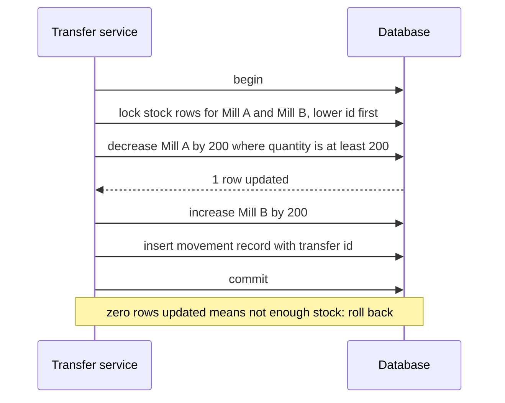

## Start with the last item sold twice

Selby Retail, a fictional online retailer, ran a flash sale on a limited-edition coat. Near the end, one coat was left. Two customers pressed "Buy" 30 milliseconds apart.

Each request read the stock level and saw 1. Each checked that 1 was enough. Each wrote the new level and created an order. Both customers received a confirmation email. The next morning the warehouse found one coat and two orders, and one customer received an apology instead of a coat.

Across the sale, 64 items were sold that did not exist. Every request had followed the rules: read, check, write. The rules were correct one at a time and wrong when two ran together. Call this **the last item sold twice**.

> **What you'll learn**
>
> - What a transaction guarantees, and what it does not.
> - Three ways to stop the read-check-write race.
> - What each isolation level protects against.
> - How to move stock between locations safely, without deadlocks.
> - Why a pool can run out of connections when every query is fast.

## What a transaction guarantees

A **transaction** groups statements so they succeed or fail together. It starts, runs its statements and either commits, making all changes permanent, or rolls back, leaving no trace. The guarantees are often summarised as ACID:

- **Atomic:** all of the changes happen, or none do.
- **Consistent:** constraints hold before and after.
- **Isolated:** concurrent transactions do not see each other's half-finished work, to the degree the isolation level promises.
- **Durable:** once committed, the change survives a crash.

The first and last are absolute. Isolation is not. Under PostgreSQL's default level, two transactions can both read the same row before either writes it, and that is exactly what happened at Selby. A transaction alone did not stop the oversell.

## The read-check-write race

The race needs no bug in any single request. It needs two requests interleaved:

| Time | Buyer A | Buyer B | Stock |
| --- | --- | --- | --- |
| 0 ms | Reads stock: 1 | | 1 |
| 30 ms | | Reads stock: 1 | 1 |
| 35 ms | Checks 1 ≥ 1: pass. Writes stock 0, creates order | | 0 |
| 60 ms | | Checks 1 ≥ 1: pass. Writes stock 0, creates order | 0 |

*Table 1: The lost update at Selby. B's check used a value that A had already changed. One coat, two orders.*

B decided using a value it read before A's write. Three fixes close the race, and the switcher shows what each does to Buyer B.

One coat left. Buyer A and Buyer B try to buy it 30 milliseconds apart. A's request reaches the stock row first.

<button type="button" data-mode="conditional" aria-pressed="false" aria-controls="conditional-result">Conditional update</button>
<button type="button" data-mode="lock" aria-pressed="false" aria-controls="lock-result">Lock the row</button>
<button type="button" data-mode="constraint" aria-pressed="false" aria-controls="constraint-result">Constraint</button>

<section id="conditional-result" class="mode-panel" data-announcement="Conditional update selected. B updates zero rows and is told it sold out."><h4>Conditional update</h4><ul><li>Each request runs one statement: decrease stock by 1 where the product matches and stock is at least 1.</li><li>A's update changes 1 row. Stock becomes 0.</li><li>B's update waits for A's row lock, then re-checks the condition, finds stock 0 and changes 0 rows. B is told the coat sold out.</li></ul>
One statement, no separate read. The usual first choice.
</section>
<section id="lock-result" class="mode-panel" data-announcement="Lock the row selected. B waits, then reads 0."><h4>Lock the row</h4><ul><li>Each request reads the stock with <code>select ... for update</code>, which locks the row.</li><li>A locks it, reads 1, writes 0 and commits.</li><li>B waits on the lock, then reads 0 and stops.</li></ul>
Fits when the check needs several reads or rules. Hold the lock for milliseconds, never across a network call.
</section>
<section id="constraint-result" class="mode-panel" data-announcement="Constraint selected. B's write fails the check constraint."><h4>Constraint</h4><ul><li>The stock table has <code>check (quantity >= 0)</code>.</li><li>Both requests decrease stock by 1 without a condition. A's succeeds and stock becomes 0.</li><li>B's would make stock −1. The database rejects it and B's transaction rolls back.</li></ul>
A backstop that catches any code path that forgot the other fixes. Pair it with one of them.
</section>

In PostgreSQL, the conditional update works at the default isolation level because an update that finds its row locked waits, then re-evaluates its condition against the committed new value. Check the rows-affected count every time. Zero means sold out, not success.

## Isolation levels

The **isolation level** decides what a transaction can see of others running at the same time. PostgreSQL offers three in practice:

| Level | Each statement or transaction sees | Prevents | You must handle |
| --- | --- | --- | --- |
| Read committed (PostgreSQL's default) | Data committed before each statement began | Reading uncommitted changes | Lost updates in read-check-write code |
| Repeatable read | One snapshot for the whole transaction | Rows changing between two reads | Serialisation errors when another transaction changed a row you update |
| Serialisable | A result as if transactions ran one at a time | All the anomalies above, including subtle write skew | Serialisation errors, which the application must retry |

*Table 2: PostgreSQL's isolation levels. Stronger levels prevent more anomalies and abort more transactions, which the application must retry.*

A stronger level is not a free fix. Under the serialisable level, Selby's original read-check-write code would be safe, but Buyer B's transaction would fail with a serialisation error, and the code must catch it and retry the whole transaction. Many teams stay at read committed and use conditional updates and row locks for the few places that need them.

## Transfers between locations

Ulverston Mills, a fictional textile manufacturer, moves yarn between its two mills. A transfer of 200 cones from Mill A to Mill B is three changes: decrease A, increase B and record the movement. If the process crashes after the first, 200 cones vanish from the books. Put all three in one transaction.

Two transfers in opposite directions can then **deadlock**. Transfer 1 locks Mill A's row and waits for Mill B's. Transfer 2 locks Mill B's row and waits for Mill A's. Neither can proceed. PostgreSQL detects this and aborts one of them, but the cleaner fix is to prevent it. The PostgreSQL documentation recommends acquiring locks on multiple objects in a consistent order. Always lock the lower location identifier first, whichever direction the transfer goes.

Figure 1 shows one transfer done this way.

*Figure 1: A stock transfer as one transaction. Locks are taken in a fixed order, the decrease is conditional, and the movement record commits with the stock changes.*

Give the transfer an identifier with a unique constraint on the movement record. A retried transfer then fails cleanly instead of moving the yarn twice.

## Connection pools

Every transaction runs on a database connection, and connections are scarce. In PostgreSQL each one is a separate server process with its own memory. Opening one takes time, and a database serves thousands of connections poorly. Applications keep a **connection pool**: a small set of open connections that requests borrow and return.

Size the pool for the work, not the traffic. The HikariCP project's guidance suggests starting near twice the database's CPU core count, then testing. A database with 8 cores might serve its best throughput with around 20 active connections. The count you need follows from Little's law: connections in use equal request rate multiplied by how long each request holds a connection.

The trap is holding a connection while doing something slow. Selby's checkout handler opened a transaction, reserved stock, called the payment provider and then committed:

- **Fast queries alone:** 300 checkouts a second × 0.02 seconds of queries = 6 connections in use.
- **Transaction held across the payment call:** 300 × 1.5 seconds = 450 connections needed. The pool held 40.

Every query took milliseconds, and requests still queued for a connection and timed out. Fixes, in order of effect:

1. **Never hold a transaction across a network call.** Reserve stock and commit, call the provider, then record the result in a second short transaction.
2. **Set timeouts**: how long a request may wait for a connection, and how long a session may sit idle inside a transaction.
3. **Count across instances.** Twenty application instances with pools of 40 can open 800 connections. A pooler such as PgBouncer in transaction mode lets many clients share a few server connections.

## Limits of this lesson

- **PostgreSQL behaviour.** Other databases name levels the same way but implement them differently. Check the documentation for yours.
- **One database only.** Transactions across several services or databases need different tools, such as sagas and outbox tables.
- **Fictional data.** Selby Retail, Ulverston Mills and their figures are illustrative.

## Interview angle

Each answer is an outline to say in about two minutes. Open each question and try it aloud before reading.

Interview question 1. Explain transactions, isolation levels and connection pools, and how they interact in a busy service.

- **Answer:** A transaction makes several changes all-or-nothing. The isolation level decides what concurrent transactions see: read committed, the PostgreSQL default, sees committed data per statement, so read-check-write code needs conditional updates or row locks. Repeatable read and serialisable prevent more anomalies and abort more transactions, which the code must retry. Every transaction holds a pooled connection until it ends. Keep transactions short, never across network calls, and size the pool by request rate times hold time, within what the database can serve.
- **Trade-off:** Stronger isolation means simpler reasoning and more retries. Weaker isolation means fewer aborts and more care in code.
- **Follow-up to expect:** "What happens if the pool is too big?" The database thrashes on too many active processes, and everything slows.

Interview question 2. Two customers buy the last ticket for an event at the same moment, and both get confirmations. Why, and how do you fix it?

- **Answer:** Each request read "1 left" before either wrote, so both passed the check. That is a lost update under the default isolation level. Replace read-then-write with one conditional update that decreases availability only where it is at least 1, and treat zero rows updated as sold out. Add a check constraint that availability never goes below zero as a backstop. Use a row lock instead when the decision needs several reads.
- **Trade-off:** Row locks serialise buyers on a hot item, which limits throughput during a rush. A conditional update holds its lock for less time.
- **Follow-up to expect:** "Ten thousand people want 500 tickets." Put a queue or reservation step in front, so the database does not absorb the whole rush.

## References

1. PostgreSQL, [Transaction isolation](https://www.postgresql.org/docs/current/transaction-iso.html), accessed 17 November 2026. Isolation levels, read committed as the default, and serialisation failures.
2. PostgreSQL, [Explicit locking](https://www.postgresql.org/docs/current/explicit-locking.html), accessed 17 November 2026. Row locks and avoiding deadlocks by locking in a consistent order.
3. HikariCP, [About pool sizing](https://github.com/brettwooldridge/HikariCP/wiki/About-Pool-Sizing), accessed 17 November 2026. Why small pools outperform large ones, and a starting formula.
4. PgBouncer, [Features](https://www.pgbouncer.org/features.html), accessed 17 November 2026. Session, transaction and statement pooling modes.

## Key takeaways

- A transaction is all-or-nothing, but at the default level it does not stop read-check-write races.
- Use a conditional update and check rows affected, lock the row when the check is complex, and add a constraint as a backstop.
- Stronger isolation prevents more anomalies and needs retry code.
- Transfers belong in one transaction, with locks taken in a consistent order.
- Size pools by request rate times hold time, and never hold a transaction across a network call.

## Check yourself

1. Why did Selby's transactions not prevent the oversell?

At read committed, both transactions could read stock 1 before either wrote. The transaction made each buyer's changes atomic, but did not stop B acting on an old value.

2. Why lock the lower location identifier first in every transfer?

If every transaction takes locks in the same order, no two can each hold a lock the other is waiting for, so deadlocks between transfers cannot form.

3. How can a pool run out when every query takes 20 milliseconds?

Connections are held for the whole transaction, not each query. A transaction kept open across a 1.5-second network call holds its connection that long.

