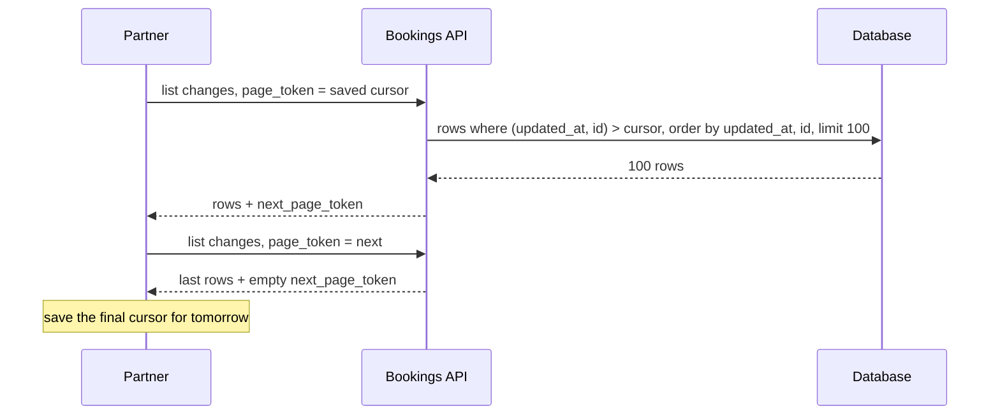

## Start with the shifting page

Vane Travel, a fictional travel company, exposed its bookings to a reporting partner through a list endpoint. The partner pulled every booking each night, 100 at a time, newest first, by asking for `offset=0`, then `offset=100`, then `offset=200`, and so on for about 400 pages.

The sync took 20 minutes. During those minutes customers kept booking, about 15 a minute, and some cancelled. Each new booking landed at the top of the list and pushed every later row down by one place. Each cancelled booking, hidden from the list, pulled rows up by one. When the partner reconciled a month later, 296 bookings had arrived twice and 38 had never arrived at all.

Nothing crashed. Every page returned 100 valid rows. The page boundaries moved while the partner walked across them. Call this **the shifting page**.

> **What you'll learn**
>
> - Why offset pagination fails on changing data, and how a cursor fixes it.
> - How to build a cursor token that is safe to hand to clients.
> - Which filters to accept, and how to validate them.
> - Which changes break clients, and how to version around them.

## Offset against cursor

There are two common ways to page through a list.

**Offset pagination** says "skip N rows, then give me 100". The database sorts the matching rows, walks past the first N and returns the next 100. Page numbers map onto it directly, which suits a screen with numbered pages.

**Cursor pagination**, also called keyset pagination, says "give me the 100 rows that come after this one". The server remembers the sort key of the last row it returned and starts the next page after that row, using a condition such as `(created_at, id) < (last_created_at, last_id)`.

| Property | Offset | Cursor |
| --- | --- | --- |
| Request | `limit=100&offset=300` | `page_size=100&page_token=…` |
| Rows inserted above the read position | Shift later pages: duplicates | No effect on the next page |
| Rows removed above the read position | Shift later pages: skips | No effect on the next page |
| Cost of a deep page | Grows with the offset, because skipped rows are still read | Constant, if an index matches the sort |
| Jump to page 37 | Yes | No, only next (and sometimes previous) |
| Needs a unique sort key | No | Yes, add a tie-breaker such as `id` |

*Table 1: Offset and cursor pagination compared. The cursor fixes the shifting page, at the cost of random access.*

The cost row matters as tables grow. Markus Winand's *Use The Index, Luke* explains that the database still fetches and orders the skipped rows before discarding them. Page 400 does far more work than page 1.

The switcher replays the first two pages of Vane's sync, with three bookings arriving between them.

Page 1 returns bookings B10000 down to B9901, newest first. Before page 2 is requested, three new bookings arrive: B10001, B10002 and B10003.

<button type="button" data-mode="offset" aria-pressed="false" aria-controls="offset-result">Offset</button>
<button type="button" data-mode="cursor" aria-pressed="false" aria-controls="cursor-result">Cursor</button>

<section id="offset-result" class="mode-panel" data-announcement="Offset selected. Page 2 repeats three bookings."><h4>Offset</h4><ul><li>Page 2 asks for <code>offset=100</code>.</li><li>The three new bookings now hold positions 1 to 3, so position 101 is B9903.</li><li>Page 2 returns B9903 down to B9804. B9903, B9902 and B9901 were already on page 1.</li></ul>
Three duplicates on one page. Across 400 pages and 300 new bookings, the duplicates add up.
</section>
<section id="cursor-result" class="mode-panel" data-announcement="Cursor selected. Page 2 starts after B9901 with no repeats."><h4>Cursor</h4><ul><li>Page 1 ends with a token that encodes the sort key of B9901.</li><li>Page 2 asks for bookings older than B9901, whatever arrived in between.</li><li>Page 2 returns B9900 down to B9801. No booking repeats.</li></ul>
The three new bookings are not in this pass. The next sync finds them, as the change feed section shows.
</section>

## Making a cursor safe to hand out

A cursor is state that the client carries back to you. Treat it as untrusted input.

- **Make it opaque.** Encode the last sort values and a version number, then base64 the result. Clients should never build or edit tokens, which leaves you free to change the format later. Sign or encrypt it if the sort values are sensitive.
- **Make the sort unique.** Two bookings created in the same millisecond would let a page boundary fall between them and lose one. Sort by `created_at` and then `id`, and encode both.
- **Bind it to the query.** Google's API design guidance (AIP-158) requires every other request parameter to match the call that produced the token. Store a hash of the filters in the token and reject a token used with different filters.
- **Signal the end clearly.** Return an empty `next_page_token` on the last page. Do not make clients infer the end from a short page.
- **Do not promise a total.** An exact count over a large, changing table is expensive and is wrong a second later. Offer an estimate, or nothing.

For a sync like Vane's, sort by a change timestamp instead of creation time. A **change feed** returns rows ordered by `updated_at` then `id`, and the partner stores the last cursor it saw. Each night it asks for everything changed since then. New bookings, edits and cancellations all appear, because a cancellation is an update. Deletions need a **tombstone**, a row that records "booking B9950 was removed", or the partner never learns about them.

Figure 1 shows the change-feed loop.

*Figure 1: A change feed with cursor pagination. The partner saves the last cursor and resumes from it. Inserts, edits and cancellations arrive exactly where they happened.*

## Filtering you can serve

Clients will ask to filter: bookings for one agent, one status, a date range. Every filter you accept is a promise to answer it quickly and correctly.

- **Keep an allow-list.** Name the fields clients may filter on and the operators each supports. A booking list might accept `status` (equals, in a list), `agent_id` (equals) and `departure_date` (range). Reject anything else with a clear error.
- **Validate types and ranges.** A date that does not parse, a status that does not exist or a range wider than a year is a 400 response that names the field. The same schema discipline as the request body applies, as [Define the API Contract With Typed Schemas](03_Define_the_API_Contract_With_Typed_Schemas.md) explains.
- **Index for the filters you allow.** Each supported combination needs an index that serves it, or one popular filter becomes a table scan. [Indexes and query plans](../SQL_and_Data_Modelling/03_Indexes_and_Query_Plans.md) covers how to choose them.
- **Apply authorisation before filtering.** The caller's scope is a filter the client cannot remove. A list endpoint that filters by tenant only when asked leaks every tenant's rows. [Authorise Every Object](09_Authorise_Every_Object.md) covers this.
- **Cap the page size.** Set a default, such as 50, and a maximum, such as 500. Without a cap, `page_size=1000000` becomes a bulk export through the front door.

A free-text filter language, where clients send an expression such as `status = "confirmed" AND agent = "A12"`, is powerful but needs a grammar, a parser and limits on cost. AIP-160 describes one. Start with named parameters and add a language only when clients need combinations you cannot list.

## Versioning without breaking clients

An API in production has clients you do not control. The first question about any change is whether it breaks them.

| Change | Breaks existing clients? |
| --- | --- |
| Add an optional request field | No |
| Add a field to a response | Usually no, if clients ignore unknown fields |
| Add a new value to an enum in a response | Often yes: strict clients reject unknown values |
| Rename or remove a field | Yes |
| Make an optional field required | Yes |
| Change a field's type or meaning | Yes, and a change of meaning is the hardest to detect |
| Change default sort or page size | Yes, for clients that rely on it |

*Table 2: Common API changes and whether they break clients. When unsure, treat a change as breaking.*

When a change breaks clients, give it a new version and run both. The common strategies differ in where the version lives:

- **In the path**, such as `/v1/bookings` and `/v2/bookings`. Visible in every log line and easy to route. A version covers the whole API, and small changes can force large migrations.
- **In a header or media type.** Keeps URLs stable, but the version is invisible in a pasted link and easy to forget in a test.
- **Dated versions pinned per client.** Each client is pinned to the version current when it first integrated, and upgrades on purpose. The server keeps small translation layers between dates. Flexible, but each layer is code you maintain.

Whichever you pick, publish a deprecation policy. Announce the end date, return the `Sunset` header defined in RFC 8594 on the old version, watch which clients still call it, and contact them before the date. Removing a version that a large customer still uses is a support incident, not a cleanup.

## Limits of this lesson

- **Cursors are not snapshots.** A cursor avoids duplicates and skips caused by the read position moving. It does not freeze the data. A booking edited during the walk can appear with its old values on one page and be changed by the time you finish.
- **Version strategy is a team choice.** The trade-offs above are real, but consistency across one company's APIs matters more than the choice.
- **Fictional data.** Vane Travel and its figures are illustrative.

## Interview angle

Each answer is an outline to say in about two minutes. Open each question and try it aloud before reading.

Interview question 1. You are designing a list endpoint for a large, busy table. How do you handle pagination, filtering and versioning?

- **Answer:** Cursor pagination, sorted by a unique key such as `created_at` plus `id`, with an opaque token bound to the filters and an empty token on the last page. A default and maximum page size. Filters from an allow-list, validated, each backed by an index, with the caller's scope applied first. Version in the path, with additive changes in place and breaking ones in a new version that runs alongside the old one until a published sunset date.
- **Trade-off:** Cursors lose random page access. Offsets keep it but break on changing data and slow down on deep pages.
- **Follow-up to expect:** "The UI needs numbered pages." Use offsets for the screen on small result sets, and cursors for exports and sync.

Interview question 2. A partner pages through orders with offsets while new orders arrive, and reports duplicates and gaps. What is happening, and what do you change?

- **Answer:** Each new row at the top pushes later rows down, so the next offset repeats rows already read. Each removed row pulls rows up, so one is skipped. Switch the partner to cursor pagination over a change feed sorted by `updated_at` and `id`, have them store the last cursor, and add tombstones for deletions. Give them a one-off full resync to repair the history.
- **Trade-off:** A change feed needs an index on the change timestamp and a tombstone table. Offsets need neither and stay wrong.
- **Follow-up to expect:** "Two rows share a timestamp." That is why the sort includes `id` as a tie-breaker.

Interview question 3. How do you design resources, request schemas, validation and error responses for a new REST API?

- **Answer:** Model nouns as resources with stable identifiers, such as `/bookings/{id}` and `/bookings/{id}/travellers`, and use methods for verbs. Define typed request and response schemas and validate at the door: types, required fields, ranges and sizes, before any expensive work. Return one error shape everywhere, such as the problem details format in RFC 9457, with a machine-readable type, a message and the failing field. Use status codes consistently: 400 for invalid input, 401 and 403 for identity and permission, 404, 409 for conflicts, 422 for a valid shape that breaks a rule.
- **Trade-off:** Strict validation rejects some clients early. Loose validation lets bad data reach the database and the model.
- **Follow-up to expect:** "How do clients tell one error from another?" By the error type, never by parsing the message.
- **Go deeper:** [Define the API Contract With Typed Schemas](03_Define_the_API_Contract_With_Typed_Schemas.md).

## References

1. Google, [AIP-158: Pagination](https://google.aip.dev/158), accessed 17 November 2026. Page tokens, page size and matching request parameters.
2. Google, [AIP-160: Filtering](https://google.aip.dev/160), accessed 17 November 2026. A filter grammar for list methods.
3. Markus Winand, [Use The Index, Luke: paging without offset](https://use-the-index-luke.com/no-offset), accessed 17 November 2026. Why offsets slow down and how keyset paging works.
4. IETF, [RFC 8594: The Sunset HTTP Header Field](https://www.rfc-editor.org/rfc/rfc8594), accessed 17 November 2026. Announcing when an endpoint will stop responding.
5. IETF, [RFC 9457: Problem Details for HTTP APIs](https://www.rfc-editor.org/rfc/rfc9457), accessed 17 November 2026. A standard error response format.

## Key takeaways

- Offsets shift when rows are added or removed above the read position. Cursors do not.
- Make cursors opaque, sorted by a unique key and bound to the filters that produced them.
- For sync, page a change feed by `updated_at` and `id`, with tombstones for deletions.
- Accept filters from an allow-list, validate them, index them and apply the caller's scope first.
- Additive changes ship in place. Breaking changes get a new version and a published sunset date.

## Check yourself

1. Why does adding a booking during the sync cause a duplicate under offsets but not under a cursor?

The offset counts positions, and the new row moves every row down one position. The cursor names the last row seen, and the next page starts after that row wherever it now sits.

2. Why must a cursor sort include a unique tie-breaker?

Without one, rows with the same sort value have no fixed order. A page boundary can fall between them, and one can be skipped or repeated.

3. Is adding a new enum value to a response a safe change?

Not always. Clients that reject unknown values will fail on it. Treat it as breaking unless you know every client tolerates unknown values.

