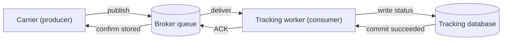

## Start with the early acknowledgement

Skelwith Freight, a fictional freight forwarder, receives parcel status updates from a carrier partner. The carrier posts each update to a queue that Skelwith runs. A worker reads each message and writes the new status to the tracking database that customers see.

The worker's client library acknowledged each message the moment the worker received it. One Tuesday a database failover took 40 seconds. During it, the worker received 312 messages, acknowledged them, failed to write them and moved on. The broker had deleted all 312, because the worker had told it they were done.

For the next two days, 312 delivered parcels showed "out for delivery". Customers phoned. The carrier's logs showed every update sent and accepted. Nothing had failed loudly. Call this **the early acknowledgement**.

> **What you'll learn**
>
> - What producers, brokers, consumers and acknowledgements each do.
> - Why a broker belongs between two organisations.
> - When to use a work queue and when to use publish-subscribe.
> - Where the acknowledgement goes, and what each choice guarantees.

## Four parts that work as one set

A message system has four parts. Learn them together, because each one's job depends on the others.

- **Producer:** the system that creates a message and hands it over. At Skelwith, the carrier.
- **Broker:** the service that stores messages until a consumer has dealt with them. RabbitMQ, Apache Kafka and Amazon Simple Queue Service (SQS) are brokers.
- **Consumer:** the system that reads a message and acts on it. At Skelwith, the tracking worker.
- **Acknowledgement (ACK):** the consumer's signal to the broker that a message is finished. Until the broker receives it, the message stays the broker's problem. After it, the message is the consumer's problem, or gone.

The ACK is the hand-off of responsibility. A broker that never hears an ACK delivers the message again, to the same consumer or another. RabbitMQ requeues deliveries that were not acknowledged when a consumer's channel closes. Amazon SQS hides a received message for a **visibility timeout** and makes it visible again if the consumer has not deleted it by then.

There is a matching hand-off on the producer side. A producer should treat a message as sent only when the broker confirms it has stored it. RabbitMQ calls this a publisher confirm.

## Why a broker sits between two organisations

Skelwith could have let the carrier call its tracking API directly. Inside one team that is often fine. Between two organisations, a broker earns its place for four reasons.

1. **Availability is decoupled.** The carrier can send while Skelwith is deploying or failing over. Messages wait in the broker instead of being lost after the carrier's last retry.
2. **Rate is decoupled.** The carrier sends 2,000 updates a minute at the evening peak. Skelwith's worker can drain them at its own pace and catch up overnight.
3. **The boundary is clear.** The broker is where one organisation's responsibility ends and the other's begins. When updates go missing, both sides can check the broker's counts instead of arguing over logs.
4. **Deploys stop being joint events.** Either side can change its software without the other in the room.

Figure 1 shows the arrangement, with each confirmation on the path.

*Figure 1: A broker between two organisations. The producer counts a message as sent after the broker confirms it. The consumer sends its ACK only after its own write commits.*

The broker is not free. It is one more system to run, secure and watch, and it adds latency. If the partner needs an answer in the same request, such as a price or a booking reference, use a synchronous API for that call and a broker for the events that follow.

## Work queues and publish-subscribe

Brokers offer two delivery shapes. Pick by asking who needs each message.

| Shape | Who receives a message | Use it when | Example at Skelwith |
| --- | --- | --- | --- |
| **Work queue** (point-to-point) | Exactly one of the competing consumers | Each message is a job that should be done once | Generate a proof-of-delivery PDF for each parcel |
| **Publish-subscribe** (a topic) | Every subscriber gets its own copy | Several independent teams react to the same event | A "delivered" event feeds tracking, billing and the customer notification service |

*Table 1: Work queue against publish-subscribe. One answers "who does this job?", the other "who needs to know?".*

In publish-subscribe, each subscriber reads at its own pace and acknowledges for itself. Billing being slow does not delay tracking. A new subscriber can join later without the carrier changing anything. In Kafka a topic keeps messages for a retention period, and each consumer group tracks its own position, called an offset, in place of a per-message ACK.

Mixing the shapes up causes quiet bugs. If billing and tracking share one work queue, each message goes to one of them. Half the parcels are never billed and half never show as delivered.

## When to acknowledge

The ACK's position decides what a crash does. The switcher replays Skelwith's 40-second failover under three choices.

The worker receives a "delivered" update. The database is failing over, so the write fails. Then the worker process restarts.

<button type="button" data-mode="receipt" aria-pressed="false" aria-controls="receipt-result">ACK on receipt</button>
<button type="button" data-mode="after" aria-pressed="false" aria-controls="after-result">ACK after commit</button>
<button type="button" data-mode="dedupe" aria-pressed="false" aria-controls="dedupe-result">ACK after commit, with dedupe</button>

<section id="receipt-result" class="mode-panel" data-announcement="ACK on receipt selected. The update is lost."><h4>ACK on receipt</h4><ul><li>The worker acknowledges, then tries the write.</li><li>The write fails. The broker has already deleted the message.</li><li>After the restart, nothing redelivers it. The parcel stays "out for delivery".</li></ul>
At-most-once. Each message is processed once or never.
</section>
<section id="after-result" class="mode-panel" data-announcement="ACK after commit selected. The update is redelivered."><h4>ACK after commit</h4><ul><li>The worker writes first and acknowledges only after the commit succeeds.</li><li>The write fails, so no ACK is sent. The broker redelivers the message after the restart.</li><li>Risk: a crash after the commit but before the ACK also redelivers it, so the write can run twice.</li></ul>
At-least-once. Nothing is lost, and duplicates are possible.
</section>
<section id="dedupe-result" class="mode-panel" data-announcement="ACK after commit with dedupe selected. The update is applied once."><h4>ACK after commit, with dedupe</h4><ul><li>The worker records the message ID in the same transaction as the status write.</li><li>A redelivered copy finds its ID already recorded. The worker skips the write and acknowledges.</li><li>Every update takes effect once, however many times it arrives.</li></ul>
Exactly-once effect, built from at-least-once delivery and idempotent processing.
</section>

Skelwith's fix was to turn off automatic acknowledgement and ACK after commit. Then it added the message-ID check, because the carrier's own retries already produced duplicates.

## Delivery guarantees

The three outcomes in the switcher have names. Use them precisely, because interviewers listen for it.

- **At-most-once:** no message is processed twice, and some may be lost. Acceptable for data that is soon replaced, such as a vehicle's position every five seconds.
- **At-least-once:** no message is lost, and some may be processed twice. The usual default for anything that matters.
- **Exactly-once effect:** each message changes state once. Over an unreliable network, a broker cannot promise exactly-once delivery to an arbitrary consumer, because an ACK can itself be lost. What you can build is at-least-once delivery into a consumer that makes repeats harmless.

Some brokers offer exactly-once within their own boundary. Kafka's transactions cover reading from and writing to Kafka topics. The guarantee stops when your consumer writes to an outside database or calls a partner's API. Ask "exactly once between which two points?" whenever someone claims it.

The lessons after this one build on the guarantee. [Duplicates in both directions](02_Duplicates_in_Both_Directions.md) makes repeats harmless. Go deeper on the mechanics of idempotent steps in [durability and idempotency](../T3.7_Agentic_Workflow_Platforms/04_Durability_and_Idempotency.md), on bounded retries in [retries and fallbacks](../T3.5_Robust_Agents/02_Retries_and_Fallbacks.md), and on dead-letter queues in [reliability and failure handling](../../../07_Last_Day_Revision/module-12-reliability-and-failure-handling.md).

## Limits of this lesson

- **Broker detail varies.** Acknowledgement modes, visibility timeouts and offset commits differ between RabbitMQ, Kafka, SQS and cloud event services. Read your broker's documentation before relying on a default.
- **System level, not agent level.** Durable agent runs are taught in the agentic workflow platforms module.
- **Fictional data.** Skelwith Freight, its carrier and its figures are illustrative.

## Interview angle

Each answer is an outline to say in about two minutes. Open each question and try it aloud before reading.

Interview question 1. A logistics partner wants to call your API directly for every shipment event. When would you put a broker in between instead?

- **Answer:** When the partner's sending must not depend on our uptime, when its rate can exceed what we process, or when several of our services need the same events. A broker stores messages while we deploy or fail over, lets us drain a peak at our own pace and gives both organisations one place to count what was sent and received. If the partner needs an immediate answer, such as a booking reference, that call stays synchronous and the follow-up events go through the broker.
- **Trade-off:** The broker adds a system to run, secure and monitor, plus some latency.
- **Follow-up to expect:** "Who runs the broker?" Usually the receiving side, so it controls retention and access. Agree the message contract and retention in writing.

Interview question 2. Explain work queues and publish-subscribe, and give a case where using the wrong one loses data.

- **Answer:** A work queue gives each message to one of several competing consumers, which suits jobs done once. Publish-subscribe gives every subscriber its own copy, which suits events several teams react to. If billing and tracking share one work queue, each event reaches one of them, so some parcels are never billed and others never show as delivered. Each team needs its own subscription to a topic.
- **Trade-off:** Publish-subscribe multiplies storage and processing by the number of subscribers, and each needs its own monitoring.
- **Follow-up to expect:** "How does a new team get last month's events?" Only if the topic's retention covers them. Otherwise it needs a backfill from the source.

Interview question 3. A consumer crashes after receiving a message. What happens next, and what does that tell you about delivery guarantees?

- **Answer:** It depends on where the ACK sits. If the consumer acknowledged on receipt, the broker has deleted the message and it is lost: at-most-once. If it acknowledges after its write commits, the broker redelivers the message after a visibility timeout or channel close: at-least-once. A crash after commit and before the ACK also redelivers, so the write runs twice unless the consumer deduplicates. Exactly-once effect comes from at-least-once delivery plus idempotent processing.
- **Trade-off:** ACK after commit needs idempotent processing. ACK on receipt is simpler and loses data.
- **Follow-up to expect:** "Kafka says exactly-once." Within Kafka's own reads and writes. It does not cover a write to an outside database.

## References

1. Enterprise Integration Patterns, [Publish-subscribe channel](https://www.enterpriseintegrationpatterns.com/patterns/messaging/PublishSubscribeChannel.html) and [Point-to-point channel](https://www.enterpriseintegrationpatterns.com/patterns/messaging/PointToPointChannel.html), accessed 17 November 2026. The two delivery shapes.
2. RabbitMQ, [Consumer acknowledgements and publisher confirms](https://www.rabbitmq.com/docs/confirms), accessed 17 November 2026. Manual and automatic acknowledgement, requeueing, and publisher confirms.
3. Amazon Web Services, [Amazon SQS visibility timeout](https://docs.aws.amazon.com/AWSSimpleQueueService/latest/SQSDeveloperGuide/sqs-visibility-timeout.html), accessed 17 November 2026. How a received message is hidden and becomes visible again.
4. Apache Kafka, [Introduction](https://kafka.apache.org/intro), accessed 17 November 2026. Topics, partitions, retention and consumer positions.

## Key takeaways

- Producer, broker, consumer and ACK work as one set. The ACK hands responsibility from broker to consumer.
- A broker between two organisations decouples their availability, rate and deploys, and gives both one place to count.
- A work queue gives each message to one consumer. Publish-subscribe gives every subscriber a copy.
- Acknowledge after the write commits, never on receipt, for anything that matters.
- Exactly-once effect is at-least-once delivery plus idempotent processing.

## Check yourself

1. Why did the carrier's logs show nothing wrong at Skelwith?

The carrier published every update and the broker confirmed each one. The loss happened after Skelwith's worker acknowledged messages it had not yet written.

2. Three teams need every "delivered" event. Which shape do you choose?

Publish-subscribe, with one subscription per team, so each gets its own copy and reads at its own pace.

3. A worker acknowledges after commit. What can still go wrong?

A crash between the commit and the ACK makes the broker redeliver a message already applied. The consumer needs a duplicate check to keep the effect single.

