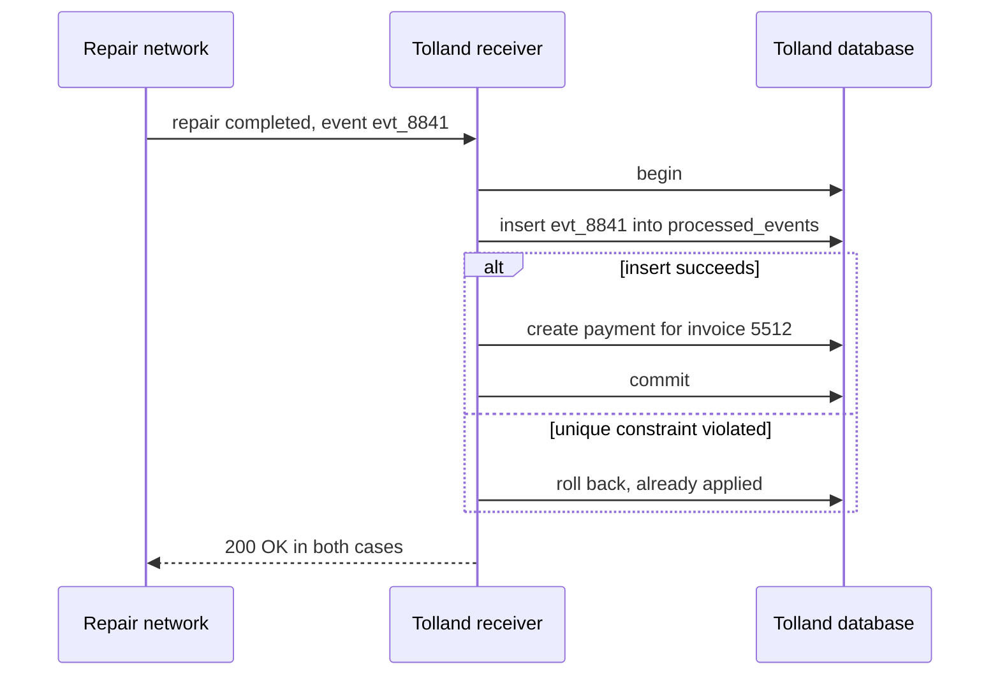

## Start with the echo in both directions

Tolland Insurance, a fictional home insurer, works with a repair network. When a claim is approved, Tolland calls the network's API to book a repair job. When the repair is finished, the network sends Tolland a "repair completed" webhook, and Tolland pays the invoice.

In one week, two things happened. Tolland's call to book a job for a burst pipe timed out after 10 seconds. Tolland's code retried, and the network created a second job. Two plumbers arrived at the same house. Later that week, Tolland's webhook receiver was slow during a deploy. The network's sender gave up waiting after 5 seconds and sent the "repair completed" event again. Tolland paid 46 invoices twice, £38,000 in all.

Both systems behaved as designed. Each retried a request whose outcome it could not see. Call this **the echo in both directions**.

> **What you'll learn**
>
> - Where duplicates come from, on each side of a partner boundary.
> - How to deduplicate inbound events by event ID.
> - How to make outbound writes safe to retry with an idempotency key.
> - What to do when a partner offers neither.

## Where duplicates come from

A duplicate is a second copy of a request or event that the sender believes may not have arrived. The sender cannot tell "lost on the way" from "arrived, but the answer was lost". Retrying is the only safe move for the sender, so the receiver must make repeats harmless.

| Source | Direction at Tolland | Why it repeats |
| --- | --- | --- |
| Sender retries after a timeout | Inbound webhooks | The network did not see a success status in time |
| Broker redelivery | Inbound queue | A consumer crashed after its write and before its ACK (acknowledgement) |
| Your own retries | Outbound API calls | Tolland's call timed out, though the job had been created |
| Replays and backfills | Both | An operator re-ran a day of events after a fix |
| People | Outbound | An adjuster pressed "Book repair" twice |

*Table 1: Sources of duplicates. Every row is normal behaviour. None of them is a bug in the sender.*

Two different mechanisms handle the two directions. Inbound, you control the receiver, so you remember what you have already applied. Outbound, the partner controls the receiver, so you give it what it needs to recognise your repeat.

## Inbound: deduplicate by event ID

A well-designed sender gives each event a stable **event ID** that stays the same on every retry. Stripe's webhook documentation, for example, tells receivers to log the event IDs they have processed and skip ones already seen.

Record the ID in the same transaction as the effect it guards. Figure 1 shows the order.

*Figure 1: Inbound deduplication. The event ID and the payment commit together, and a repeat finds the ID already taken.*

Four details make this hold:

- **Use a unique constraint, not a lookup.** "Check if seen, then insert" lets two copies arriving at once both pass the check. A unique key on the event ID lets the database reject the second.
- **Commit the ID with the effect.** If the ID is stored in one transaction and the payment in another, a crash between them either loses the payment or blocks its retry.
- **Answer success to a duplicate.** A receiver that returns an error for a repeat makes the sender retry it again.
- **Keep IDs for longer than the sender retries.** If the network retries for three days, keep IDs for at least seven. Delete older ones on a schedule.

Some partners send no event ID. Build a key from fields that identify the change, such as partner, record ID and the record's version or modified time. Do not hash the whole payload. Partners often add a delivery timestamp to each attempt, so two copies of one event hash differently.

## Outbound: send an idempotency key on every write

When you call a partner, you are the sender. A timeout leaves you not knowing whether the job exists. An **idempotency key** is a unique value you attach to a write so the partner can recognise a repeat and return the first result instead of acting again. Stripe accepts one on every write request. An Internet Engineering Task Force (IETF) draft standardises it as the `Idempotency-Key` HTTP header.

The rules are about when the key is created:

1. **One key per intended operation, not per attempt.** "Book a repair for claim 7734" gets one key. Every retry of that booking reuses it.
2. **Create and store the key before the first attempt.** If you create it inside the retry loop, each attempt has a new key and the partner sees two different requests.
3. **Never reuse a key for a different operation.** Stripe rejects a reused key whose parameters differ from the first request.
4. **Know the partner's retention.** Stripe may remove keys once they are at least 24 hours old. A retry after that looks new. Retries for a write must stop well inside the partner's window.

The switcher shows Tolland's timed-out booking under each choice.

Tolland calls the repair network to book a job for claim 7734. The network creates the job, but Tolland's call times out before the response arrives. Tolland retries.

<button type="button" data-mode="nokey" aria-pressed="false" aria-controls="nokey-result">No key</button>
<button type="button" data-mode="newkey" aria-pressed="false" aria-controls="newkey-result">New key per attempt</button>
<button type="button" data-mode="storedkey" aria-pressed="false" aria-controls="storedkey-result">Stored key, reused</button>

<section id="nokey-result" class="mode-panel" data-announcement="No key selected. Two jobs are created."><h4>No key</h4><ul><li>The retry is a new request to the network.</li><li>The network creates a second job.</li><li>Two plumbers are dispatched to one house.</li></ul>
The original failure.
</section>
<section id="newkey-result" class="mode-panel" data-announcement="New key per attempt selected. Two jobs are still created."><h4>New key per attempt</h4><ul><li>The key is generated inside the retry loop.</li><li>The second attempt carries a different key, so the network treats it as a different booking.</li><li>Two jobs again, now with a false sense of safety.</li></ul>
A key only works if it survives the retry.
</section>
<section id="storedkey-result" class="mode-panel" data-announcement="Stored key selected. One job is created."><h4>Stored key, reused</h4><ul><li>Tolland saves a booking row with key <code>claim-7734-book-1</code> before calling.</li><li>The retry sends the same key. The network finds it and returns the first job's reference.</li><li>Tolland records the reference on the booking row. One job, one plumber.</li></ul>
The key lives in Tolland's database, not in memory.
</section>

## When the partner supports neither

Many enterprise APIs accept no idempotency key. Three fallbacks, in order of preference:

- **Send your own reference and look it up before retrying.** Most systems have a field for an external or client reference. Put the booking key there. After a timeout, search for that reference before sending again.
- **Use a natural unique field.** If the partner rejects a second job for the same claim number, the duplicate fails cleanly. Confirm this in its documentation or a test environment, not by assumption.
- **Stop and reconcile.** Mark the operation "outcome unknown", do not retry, and let a scheduled check or a person resolve it. Slower, and correct for money and dispatches.

Tolland's network had a client reference field. Tolland now searches it after every timeout and retries only if no job carries the key.

## Two records, one discipline

The two directions need two stores:

| Store | Holds | Kept for |
| --- | --- | --- |
| Processed events | Inbound event IDs, with the time applied | Longer than the longest sender retry period |
| Outbound operations | Key, operation, status, partner reference | Longer than your own retries, and long enough to answer "did we book this?" |

*Table 2: The inbound and outbound records. The first stops you applying a repeat. The second stops you causing one.*

Ordering is a separate problem. A repeated event and an out-of-order event need different fixes. [Recovering half-finished work](../../../05_FDE_Delivery_and_Scoping/FDE_Track/fde-deploying-in-the-estate/reliability-performance-and-cost/01_Recovering_Half_Finished_Work.md) covers version checks, and the next lesson covers ordering per entity. Webhook signatures and freshness checks are in [the webhook receiver](../../../05_FDE_Delivery_and_Scoping/FDE_Track/enterprise-integration/receiving-webhooks-safely/01_The_Webhook_Receiver.md).

Go deeper on idempotency keys inside one workflow in [durability and idempotency](../T3.7_Agentic_Workflow_Platforms/04_Durability_and_Idempotency.md), and on a scoped key for an API's own clients in [build the MVP: learn and design](../../AI_System_Design_Course/01_mvp/02_learn_and_design.md). When to retry at all is in [retries and fallbacks](../T3.5_Robust_Agents/02_Retries_and_Fallbacks.md).

## Limits of this lesson

- **Partner behaviour varies.** Event ID formats, retry periods and key retention differ by vendor and change over time. Read the current documentation.
- **Effects outside your database.** A dedupe record cannot undo an email or a payment already sent by a step that ran before the check. Put the check first.
- **Fictional data.** Tolland Insurance, its repair network and the figures are illustrative.

## Interview angle

Each answer is an outline to say in about two minutes. Open each question and try it aloud before reading.

Interview question 1. A partner's webhooks sometimes arrive twice, and you paid some invoices twice. How do you fix the receiver?

- **Answer:** Deduplicate by the partner's event ID. Insert the ID into a table with a unique constraint in the same transaction as the payment. If the insert fails, the event was applied, so roll back and return success, because an error makes the sender retry again. Keep IDs longer than the partner's retry period. If the partner sends no ID, build a key from partner, record ID and version, never from a hash of the payload.
- **Trade-off:** The ID table grows with traffic and needs a retention job. Without it, duplicates cost money.
- **Follow-up to expect:** "Two copies arrive in the same millisecond." The unique constraint rejects the second insert, which a read-then-insert check would not.

Interview question 2. Your call to create an order in a supplier's API times out. Do you retry?

- **Answer:** Only if the retry cannot create a second order. Create an idempotency key for the order before the first attempt, store it with the order row, and send the same key on every retry, so the supplier returns the first result. Stop retrying well inside the supplier's key retention window. If the supplier has no key support, put our key in a client reference field and search for it before retrying. If neither exists, mark the order "outcome unknown" and reconcile.
- **Trade-off:** Lookup-before-retry adds a read per timeout and depends on the partner's search being current.
- **Follow-up to expect:** "Where is the key generated?" Outside the retry loop and saved first, or every attempt gets a new key.

## References

1. Stripe, [Idempotent requests](https://docs.stripe.com/api/idempotent_requests), accessed 17 November 2026. Keys on write requests, rejection of mismatched reuse and removal after at least 24 hours.
2. Stripe, [Receive events in your webhook endpoint](https://docs.stripe.com/webhooks), accessed 17 November 2026. Duplicate deliveries and logging processed event IDs.
3. IETF, [The Idempotency-Key HTTP header field](https://datatracker.ietf.org/doc/draft-ietf-httpapi-idempotency-key-header/), accessed 17 November 2026. A draft standard for the header.
4. Enterprise Integration Patterns, [Idempotent receiver](https://www.enterpriseintegrationpatterns.com/patterns/messaging/IdempotentReceiver.html), accessed 17 November 2026. Receivers that discard duplicate messages.

## Key takeaways

- A sender cannot tell a lost request from a lost answer, so duplicates are normal.
- Inbound: record the event ID under a unique constraint in the same transaction as the effect, and answer success to repeats.
- Outbound: one stored idempotency key per intended operation, reused on every retry.
- Without key support, send your own reference and look it up before retrying, or stop and reconcile.
- Keep both records for longer than anyone retries.

## Check yourself

1. Why did Tolland's network send the "repair completed" event twice?

Tolland's receiver was slow, so the network did not see a success status within 5 seconds and retried, as webhook senders do.

2. Why does a key generated inside the retry loop fail?

Each attempt carries a different key, so the partner treats each attempt as a new operation.

3. Why not deduplicate by hashing the payload?

Senders often add attempt-specific fields such as a delivery timestamp, so two copies of the same event can hash differently.

