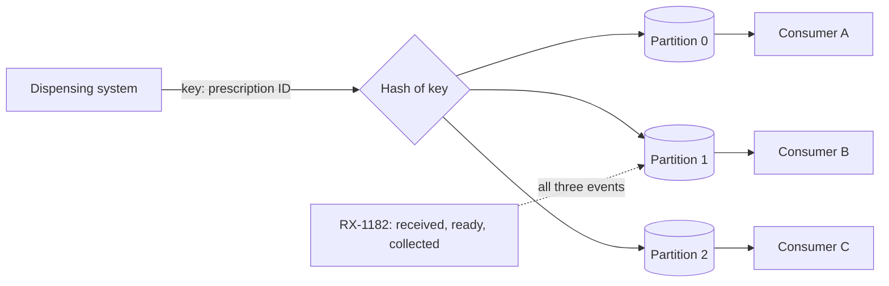

## Start with the replay that texted the past

Hartside Pharmacy, a fictional chain of 60 pharmacies, sends patients a text when a prescription changes status: received, ready to collect, collected. The dispensing system publishes each change to a queue, and a notification service reads it.

To cope with the Monday rush, the team raised the service from one consumer to eight. Within a day, some patients collected a prescription and then received "Your prescription is ready to collect". Two events for one prescription had gone to two consumers, and the slower one finished last.

A schema change the same week sent 4,100 messages to the dead-letter queue (DLQ), where messages that keep failing are parked. An engineer fixed the parser and replayed all of them at once. The replay sent 1,900 "ready to collect" texts for prescriptions collected days earlier. It also hit the text provider's rate limit, which delayed that afternoon's new texts by 40 minutes. Call this **the replay that texted the past**.

> **What you'll learn**
>
> - Why ordering per entity is enough, and global ordering is rarely worth its cost.
> - How partitioning by the entity's ID keeps each entity in order.
> - What a DLQ replay tool needs beyond a "replay all" button.
> - Which signals show a pipeline falling behind.

## Order per entity, not for everything

**Global ordering** means every message is processed in the order it was sent. It needs one consumer, or a lock that makes many consumers behave like one. Throughput is then capped at what one consumer can do.

Hartside did not need global ordering. It did not matter whether Mrs Shah's prescription was processed before Mr Price's. It mattered that each prescription's own events ran in order. That is **ordering per entity**: events about the same thing, such as one prescription, one order or one account, are processed in sequence, and events about different things run in parallel.

Ask the business which entity's history must stay in sequence. The answer is almost always a record, rarely the whole stream.

## Partition by the entity's ID

Brokers provide ordering per entity through partitions or groups:

- **Apache Kafka:** a producer sends each event with a key. Events with the same key go to the same partition, and Kafka delivers a partition's events to its consumer in order.
- **Amazon Simple Queue Service (SQS) FIFO (first in, first out) queues:** each message carries a message group ID. Messages in one group are delivered in order, and different groups are processed in parallel.

Hartside set the key to the prescription ID. Figure 1 shows the effect.

*Figure 1: Partitioning by prescription ID. Every event for RX-1182 lands in partition 1 and is read by one consumer in order, while other prescriptions run in parallel.*

Three costs come with it:

- **One failing message blocks its partition.** A consumer that retries a bad event holds up every event behind it, for other prescriptions too. Retry a few times with a short limit, then move the event aside to the DLQ and record that its entity has a gap.
- **Hot keys.** One busy entity, such as a care home with 300 repeat prescriptions under one account key, loads a single partition. Choose the key at the level that needs ordering, here the prescription, not the account.
- **Changing the partition count moves keys.** Most brokers map a key to a partition by hashing it against the partition count. Add partitions and some keys move, so for a while two consumers can hold events for one entity. Add partitions in a quiet period, or drain first.

Partitioning orders delivery. It cannot fix events that left the producer out of order. A version number on each event, applied only when newer than the stored one, is the backstop. [Recovering half-finished work](../../../05_FDE_Delivery_and_Scoping/FDE_Track/fde-deploying-in-the-estate/reliability-performance-and-cost/01_Recovering_Half_Finished_Work.md) covers version checks.

## A replay tool, not a replay button

A DLQ holds messages that failed after their retries, so one bad message does not block the rest. The basics, including why a DLQ needs an owner, are in [reliability and failure handling](../../../07_Last_Day_Revision/module-12-reliability-and-failure-handling.md). The hard part comes after the fix: putting the messages back.

A replay tool needs five things:

1. **Filters.** Select by error type, time range, entity and message type. Replay only what the fix addressed.
2. **A dry run.** Show how many messages match, grouped by error, before anything moves.
3. **A staleness check.** Before sending each message, compare it with the entity's current state. A "ready to collect" event for a collected prescription is dropped and logged.
4. **A rate cap.** Replay at a set rate, below what downstream systems and partner limits allow, so live traffic keeps flowing. Amazon SQS's redrive lets you set a maximum rate in messages per second.
5. **An audit trail.** Record who replayed what, when, why, with which filter, and how many succeeded, were skipped or failed again.

The replay must go through the normal consumer, with its duplicate check and version check. A separate "replay script" that writes to the database directly skips the protections the consumer has.

The walkthrough shows how Hartside's 4,100 messages should have gone back.

4,100 status events sit in Hartside's DLQ after a schema change. The parser is fixed. Each step shows the action, the control and what it catches.

<button type="button" data-step="0" aria-pressed="false" aria-controls="replay-step-0">1. Group</button><button type="button" data-step="1" aria-pressed="false" aria-controls="replay-step-1">2. Select</button><button type="button" data-step="2" aria-pressed="false" aria-controls="replay-step-2">3. Replay</button><button type="button" data-step="3" aria-pressed="false" aria-controls="replay-step-3">4. Record</button>

<section id="replay-step-0" class="step-panel" aria-labelledby="replay-heading-0"><h4 id="replay-heading-0">1. Group by error</h4><dl><dt>Action</dt><dd>Count the DLQ by error type and message version.</dd><dt>Control</dt><dd>Grouping before any replay.</dd><dt>Catches</dt><dd>4,020 parse errors from the schema change and 80 unrelated errors with a different cause, which stay parked.</dd></dl></section><section id="replay-step-1" class="step-panel" aria-labelledby="replay-heading-1"><h4 id="replay-heading-1">2. Select and dry run</h4><dl><dt>Action</dt><dd>Filter to parse errors from the affected two days and run the staleness check without sending.</dd><dt>Control</dt><dd>Filters and a dry run.</dd><dt>Catches</dt><dd>1,900 "ready" events whose prescriptions are already collected. They are marked stale, not sent.</dd></dl></section><section id="replay-step-2" class="step-panel" aria-labelledby="replay-heading-2"><h4 id="replay-heading-2">3. Replay at a cap</h4><dl><dt>Action</dt><dd>Replay the other 2,120 through the normal consumer at 5 messages a second.</dd><dt>Control</dt><dd>Rate cap and the consumer's duplicate and version checks.</dd><dt>Catches</dt><dd>Contention with live texts. At 5 a second the replay takes about 7 minutes and stays under the provider's limit.</dd></dl></section><section id="replay-step-3" class="step-panel" aria-labelledby="replay-heading-3"><h4 id="replay-heading-3">4. Record and close</h4><dl><dt>Action</dt><dd>Write the audit entry: operator, reason, filter, and counts sent, skipped and failed again.</dd><dt>Control</dt><dd>Audit trail.</dd><dt>Catches</dt><dd>Questions from the pharmacy team a week later, answered from the record instead of memory.</dd></dl></section>

<button type="button" data-walk="previous">Previous</button>

<button type="button" data-walk="next">Next step</button>

The walkthrough is a scripted illustration. Check its arithmetic: 4,020 − 1,900 = 2,120 messages, and 2,120 ÷ 5 = 424 seconds, about 7 minutes.

## Signals that a pipeline is falling behind

A pipeline can look healthy while it quietly falls behind. Watch four signals and alert on trends, not single spikes.

| Signal | What it tells you | Hartside's alert |
| --- | --- | --- |
| Consumer lag (messages not yet processed) | Whether consumers keep up with producers | Lag growing for 10 minutes in a row |
| Age of the oldest unprocessed message | How late the slowest patient's text will be | Over 5 minutes |
| DLQ inflow rate | Whether a new kind of failure has started | More than 20 messages in 15 minutes |
| Redelivery count | Messages failing and coming back, often a poison message | Any message delivered more than 5 times |

*Table 1: Pipeline health signals. Age of the oldest message is the one patients feel.*

Lag in messages can mislead, because 10,000 small messages may clear in seconds. Age of the oldest message measures the delay that people experience, so make it the main alert.

## Limits of this lesson

- **Broker details differ.** Partition assignment, FIFO group limits and redrive features vary by broker and version. Check your broker's documentation.
- **Retries and breakers are taught elsewhere.** Go deeper in [retries, circuit breakers and bulkheads](../T4.6_Scaling_and_Reliability/04_Retries_Circuit_Breakers_and_Bulkheads.md) and [retries and fallbacks](../T3.5_Robust_Agents/02_Retries_and_Fallbacks.md).
- **Fictional data.** Hartside Pharmacy, its patients and the figures are illustrative.

## Interview angle

Each answer is an outline to say in about two minutes. Open each question and try it aloud before reading.

Interview question 1. You scale a consumer from one instance to eight and events for the same order start arriving out of order. What do you do?

- **Answer:** Keep order per order, not globally. Publish each event with the order ID as its partition key, or as the message group ID on an SQS FIFO queue, so all events for one order go to one consumer in sequence while other orders run in parallel. Add a version on each event and apply it only if newer than the stored version, as a backstop against producer-side reordering. Check for hot keys and choose the key at the level that needs ordering.
- **Trade-off:** One stuck message now blocks its partition, so retries need a short limit before the message moves to the DLQ.
- **Follow-up to expect:** "We need to add partitions." Keys move when the count changes. Do it in a quiet window or drain first.

Interview question 2. Design the tool your team uses to replay messages from a dead-letter queue.

- **Answer:** Five parts. Filters by error type, time range, entity and message type. A dry run that shows counts by error before anything moves. A staleness check against current state, so outdated events are skipped and logged. A rate cap below downstream and partner limits. An audit record of who replayed what, why, with which filter, and the outcome counts. Replay through the normal consumer so its duplicate and version checks apply, never through a script that writes directly.
- **Trade-off:** The tool takes days to build. A raw "replay all" takes minutes and can do more damage than the original failure.
- **Follow-up to expect:** "Who may run it?" A small named group, with the audit record reviewed in the incident follow-up.

Interview question 3. Which metrics tell you a message pipeline is unhealthy before customers notice?

- **Answer:** Age of the oldest unprocessed message first, because it is the delay customers feel. Consumer lag trend, to see whether consumers keep up. DLQ inflow rate, to catch a new failure type. Redelivery count, to find poison messages. Alert on sustained trends, such as lag growing for 10 minutes, not single spikes.
- **Trade-off:** Tight thresholds catch problems early and page people for harmless bursts.
- **Follow-up to expect:** "Lag is high but age is low." A burst of small messages that is clearing. Watch it, do not page.

## References

1. Apache Kafka, [Introduction](https://kafka.apache.org/intro), accessed 17 November 2026. Events with the same key go to the same partition and are read in order.
2. Amazon Web Services, [Using the message group ID with Amazon SQS FIFO queues](https://docs.aws.amazon.com/AWSSimpleQueueService/latest/SQSDeveloperGuide/using-messagegroupid-property.html), accessed 17 November 2026. Ordering within a message group.
3. Amazon Web Services, [Using dead-letter queues in Amazon SQS](https://docs.aws.amazon.com/AWSSimpleQueueService/latest/SQSDeveloperGuide/sqs-dead-letter-queues.html) and [Configure a dead-letter queue redrive](https://docs.aws.amazon.com/AWSSimpleQueueService/latest/SQSDeveloperGuide/sqs-configure-dead-letter-queue-redrive.html), accessed 17 November 2026. Moving failed messages aside and redriving them at a set rate.
4. The author's own field experience, the basis for the replay tool's five parts and the alert thresholds.

## Key takeaways

- Ask which entity's history must stay in order. That is the partition key.
- Partitioning orders delivery per entity, and a version check guards against producer-side reordering.
- A message that keeps failing blocks its partition, so retry briefly, then move it to the DLQ.
- Replay with filters, a dry run, a staleness check, a rate cap and an audit trail, through the normal consumer.
- Alert first on the age of the oldest unprocessed message.

## Check yourself

1. Why did eight consumers send "ready to collect" after collection?

Events for one prescription went to different consumers, and the "ready" event finished after the "collected" event.

2. Why should a replay go through the normal consumer?

So the duplicate check, version check and validation apply to replayed messages as they do to live ones.

3. At 5 messages a second, how long do 2,120 messages take to replay?

424 seconds, about 7 minutes.

