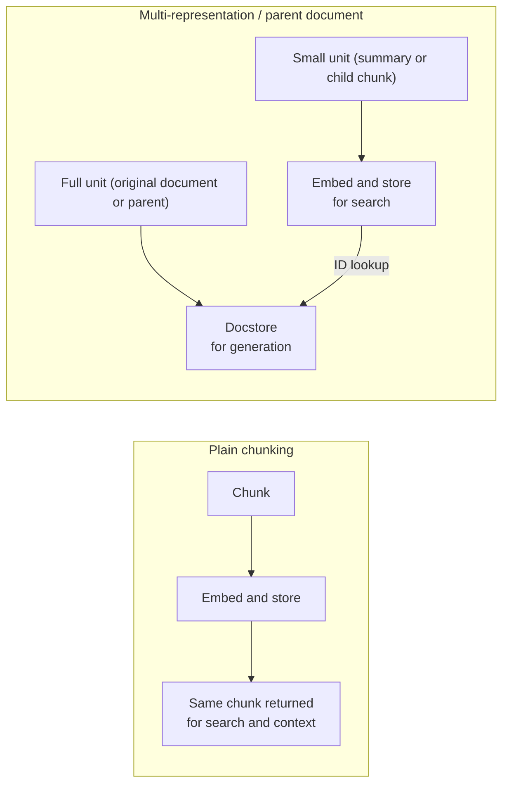

# Retrieve Small, Return Large

*Searching small units keeps vectors sharp and returning large units keeps answers grounded, but decoupling them adds a second store that must stay in sync.*

◷ 8 min

When the best unit to search and the best unit to read disagree in size, stop compromising on one chunk size and decouple them. This lesson covers parent document retrieval and its relatives, which resolve the size dial from [Why Retrieval Needs Chunks](01_Why_Retrieval_Needs_Chunks.md) instead of tuning it.

**Objectives:**

- explain the "small-to-big" pattern and why it beats one chunk size;
- choose between child-only and two-splitter parent retrieval;
- describe the docstore and how it differs from the vector index;
- compare multi-representation indexing, the context enrichment window, and contextual retrieval;
- avoid the duplicate-parent and store-drift failures.

---

## Decouple the Search Unit From the Generation Unit

Standard RAG has one dial that fights itself. Small chunks make search precise but give the model little context. Large chunks give context but blur the vector. Parent document retrieval breaks that coupling. It indexes small **child** chunks for search, then returns each hit's **parent**, a larger chunk or the whole document, to the model.

A large chunk's vector averages across topics, so recall drops for any single-topic query. A small child gives a sharp vector, and the swap to its parent restores context only after the match is found. Search runs against child vectors. Each hit is then replaced by its parent through a lookup keyed by an id stored in the child's metadata.

The only link between the search store and the generation store is the id lookup.

This also helps latency indirectly. Small children keep search fast, while the model still receives full context. The parent swap itself costs one key-value lookup, which the parent document tutorial calls sub-millisecond and small beside embedding and search.

## Bound the Parent Size

The pattern runs in two modes.

| Mode | Parent is | Costs | Buys | Pick when |
|---|---|---|---|---|
| Child-only | The whole original document | Unbounded parent size | No context loss | Sources are already short |
| Two-splitter | A medium chunk cut by a parent splitter, then split again into children | Some context cut at the parent boundary | Bounded, predictable prompt size | Sources are long, such as manuals and contracts |

Child-only mode is fine until someone uploads a 200-page PDF. Then the "parent" floods the context window. Two-splitter mode caps the parent; the source notebook used 400-character children and 2,000-character parents. The child must be smaller than the parent. LangChain checks this when the retriever is built. A document already shorter than the child size is returned unchanged as one chunk.

Size the two independently. Choose the child size for embedding precision. Choose the parent size from the model's context budget divided by the expected number of results, k. Generation cost then scales with parent size times k, while ingestion cost scales with the number of children embedded.

## Keep Parents in a Separate Key-Value Store

The parents live in a **docstore**: a plain key-value store from id to document. It is never embedded or searched. It is written at indexing time and read by id after a child wins the search.

Keeping it separate is what makes the design flexible. The vector index can be Chroma or pgvector while the docstore lives in memory, Postgres, or Redis. Each is a separate persistence decision behind a stable interface. An in-memory docstore is a demo default: it is wiped on restart and cannot be shared between processes. Anything past a demo needs a persistent store. If both stores are Postgres, there is one database to run.

> **Warning: the two stores can drift out of sync.** Indexing writes the vector index and the docstore in separate calls. A crash between them, or a delete on one side only, leaves a child whose parent id finds nothing. Treat indexing and deletion as one operation, and never edit either store alone in production. Use content-derived ids. Without them, indexing the same content twice creates new random ids and duplicate parents pile up.

## Deduplicate Parents After Retrieval

Two children from the same parent can both score highly. The retriever then returns the same parent twice. One notebook asked for two results and got one document twice.

Fix it in code: deduplicate by parent id after retrieval, before the model sees anything. For an agent this matters more. A duplicated parent can lead the model to claim that "a second source confirms this" when there is only one source.

## Know the Relatives of Small-to-Big

Several techniques share the same idea: search one representation, return another.

| Technique | What is searched | What is returned | Extra cost |
|---|---|---|---|
| Parent document retrieval | Small child chunks | The parent chunk or document | A docstore to keep in sync |
| Multi-representation indexing | A summary or hypothetical questions generated per document | The original document | An LLM call per document at indexing time |
| Context enrichment window | Small chunks with a sequential index | The hit plus its n neighbours before and after, stitched together | None beyond storing the index; works only for linear documents |
| Contextual retrieval | Each chunk with an LLM-written 3 to 4 sentence context prepended | The same enriched chunk | One LLM call per chunk at indexing time, scaling with corpus size |

Multi-representation indexing generalises parent retrieval. Parent-child is the special case where the searched representation is a smaller piece of the same text. The context enrichment window is parent retrieval without a docstore. Neighbours are found by position, which is simpler but needs one linear source document.

Contextual retrieval solves a different problem. A chunk read alone often loses what made it findable: "the model" means nothing without knowing which paper it came from. So an LLM reads the whole document and the chunk, and writes a short situating context that is embedded with the chunk. The FDE Handbook's title-and-section prefix from [Why Retrieval Needs Chunks](01_Why_Retrieval_Needs_Chunks.md) is the free version of the same idea. Contextual retrieval moves cost from never to once per chunk at indexing time. A nightly re-index of 50,000 documents pays that bill every night, so batch or cache context generation per document and measure the lift first.

## Fit the Returned Context Into the Prompt

Larger returned units put pressure on the prompt. The simplest chain "stuffs" every retrieved document into one prompt. That is the cheapest option, one call, and fine for a few bounded parents. Once k times parent size cannot fit the context window, cap k or move to strategies that summarise in several calls, such as map-reduce or refine.

There is a quality risk too. Recall@K can improve while answers on one query type get worse, because irrelevant text inside large parents distracts the model. Test a compression step or a smaller parent before assuming the retriever is wrong.

## Worked Example: Support Articles With Bounded Parents

A support agent answers from about 5,000 internal articles growing by 20 a day, with a p95 budget of 2 seconds.

Use two-splitter parent retrieval. Children of about 300 to 400 characters match short support-question phrasing precisely. Parents of about 1,500 to 2,000 characters bound the worst-case prompt. Store vectors in pgvector and parents in a Postgres table keyed by a hash of the article id and its last-modified time, so the daily job writes idempotently. Deduplicate by parent id and cap k at 3 or 4.

The parent document tutorial's latency budget then adds up. Query embedding takes about 100 to 150 ms, HNSW search about 50 to 100 ms, and the docstore lookup about 20 to 50 ms. That leaves about 1.5 seconds for generation, the dominant cost and worth streaming. Below a similarity threshold, the agent says it has no confident answer rather than forcing one. The small-to-big split is what lets both precise matching and bounded prompts hold at once.

---

## Key Takeaways

- Index small children for sharp search and return their parents for context; an id in each child's metadata links them.
- Child-only mode returns whole documents; two-splitter mode bounds parent size and suits long sources.
- The docstore is a plain key-value store, separate from the vector index, and should be persistent past a demo.
- Deduplicate parents by id in code, and treat writes to both stores as one operation with content-derived ids.
- Multi-representation indexing, the context enrichment window, and contextual retrieval vary what is searched and what is returned.
- Once k times parent size outgrows the context window, cap k or switch to a multi-call strategy.

## Check Yourself

1. **Why index small chunks but return large ones?**
   A large chunk's vector blurs across topics and hurts recall. Small children give sharp vectors, and swapping in the parent restores context after the match.

2. **A retriever returned five results but only two unique documents. Why, and what is the fix?**
   Several children from the same parent scored highly. Deduplicate by parent id after retrieval, before the model sees the results.

3. **How does the context enrichment window differ from parent document retrieval?**
   It finds neighbours by a stored sequential position instead of a docstore lookup. That is simpler but works only for chunks from one linear document.

## References

**Sources:** `parent_document_retrieval_INTERVIEW_TUTORIAL.md`: §1 "Core concepts" (1.1 to 1.6), §2 "Gotchas", §3 "Tradeoffs", the cost and sizing answers in §5, and the §6 mock system design, rewritten in our own words. `04_rag_and_retrieval_INTERVIEW_TUTORIAL.md`: §1.13 "Multi-representation and parent document indexing", §1.14 "Contextual retrieval", the contextual-retrieval cost gotcha, and the matching trade-offs. `08_advanced_rag_techniques_INTERVIEW_TUTORIAL.md`: §1.11 "Context enrichment window". `02_Chunking_Retrieval_Fusion.md` (FDE Handbook): rule 3, the title-and-section prefix.
