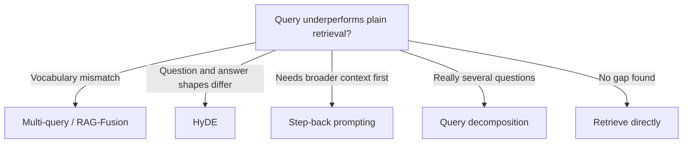

# Query Transformation

*Reshaping a question before search closes the gap between how users ask and how documents answer, but every rewrite costs a model call and can add assumptions the user never made.*

◷ 10 min

The user's question is only one guess at a search string, and often a poor one. Rewrite, expand, split or route it before retrieval, but only when [Measuring and Diagnosing Retrieval](01_Measuring_and_Diagnosing_Retrieval.md) shows the wording gap is the real bottleneck.

**Objectives:**

- rewrite a vague or follow-up question into a self-contained one, and bound the cost;
- choose between multi-query, step-back, HyDE, HyPE and decomposition by the mismatch each fixes;
- route a query to the right retriever, and turn constraints like "after 2020" into metadata filters.

---

## Name the Gap Before Rewriting

A user types "cancel my subscription". The document says "terminate your account membership". Another user asks "why is my data not showing up?", and the runbook says "commit lag". No words overlap, so keyword search fails, and even embeddings may land apart. That is a vocabulary mismatch.

Other gaps look different. "What is the limit?" could mean an API rate limit, a credit limit or a file size limit. Its embedding is blurry, so chunks from unrelated topics come back and the model picks a meaning at random. "Why did ingest stall?" looks nothing like its answer, "the compaction queue saturated at 08:47". Questions and answers are written differently. And "why did they lose data and what does their contract promise?" is two questions; no single chunk answers it.

Each gap has its own fix. Pick by the gap.

Read the tree from the symptom, not from the technique, and note that "retrieve directly" is a valid branch.

| Symptom | Fix |
|---|---|
| Follow-ups with "it" or "that"; informal or vague wording | Rewrite with conversation context |
| User and corpus use different words | Multi-query (RAG-Fusion) |
| Needs broader background first | Step-back prompting |
| Short question, long answer-shaped chunks | HyDE, or HyPE at index time |
| Really several questions | Decomposition |
| Different questions belong in different indexes | Routing |
| "Filter by date, author or type" | Self-query retrieval |
| Wording already matches the corpus | No rewriting; retrieve directly |

## Rewrite Follow-Ups Into Self-Contained Questions

An LLM rewrite is one of the highest-impact, lowest-effort improvements, according to the RAG fundamentals guide. Give the model the chat history and the latest question. Ask it to make the question specific and self-contained, without answering it. Send the result to the retriever.

The guide names five kinds of rewrite. Contextualisation turns "what about the second option?" into "what are the pricing details for the Standard plan?". Expansion turns one query into three to five variants. Decomposition turns "what are the pricing and cancellation policy?" into two retrievals. Formalisation turns "how do I get my money back?" into "what is the refund process?". Specificity turns "tell me about the update" into "tell me about the March 2024 product update".

A rewrite adds one model call, about 200 to 500 ms. Use a small, fast model and cache repeated rewrites. The model may over-interpret, so add an instruction such as "Do not add assumptions. Only clarify and expand." When there is no history to resolve the ambiguity, ask instead: "Do you mean standard or enterprise accounts?". Ask too when the top chunks span very different topics with similar scores. A controlled vocabulary of domain synonyms is a cheaper complement to all of this.

## Fan Out Paraphrases and Fuse Them

Multi-query asks the model for several phrasings, searches each, and merges the results. Merged by reciprocal rank fusion, as in [Hybrid Search and Rank Fusion](02_Hybrid_Search_and_Rank_Fusion.md), the technique is marketed as RAG-Fusion. It is the same thing under two names.

It buys recall at a price: one extra model call plus N searches instead of one. The searches are independent, so run them concurrently. The source notebooks run them one after another, which a production system must fix.

Parse the rewrites as structured output, not by splitting the model's text on new lines. A numbered list or a preamble line otherwise becomes a "query" that returns junk. In fusion the junk does more than add noise: it still votes in the ranking.

Step-back prompting goes the other way. It asks a more general question first, to pull in background the specific question needs.

## Search With a Hypothetical Answer

HyDE, hypothetical document embeddings, closes the question-and-answer gap. A nine-word question and a 400-token answer chunk do not land near each other, even when the chunk is correct. So ask the model to write a plausible answer, embed that, and search with it. A fake answer looks far more like a real answer than a question does.

The invented answer is a search probe only. It is never shown to the user and is discarded after the search. The FDE Handbook anchors it by searching with the original question as well. One notebook sizes the hypothetical document to match the chunk size. HyDE works best on dense technical prose and helps less over structured or tabular data.

HyDE always needs two models doing two jobs. The language model writes the hypothetical answer and never sees the documents. The embedding model turns text into vectors and never writes. The same embedding model must embed both the hypothetical answer and the corpus.

> **Warning: a mismatched embedding model breaks HyDE silently.** In one framework, an embedding client created without a model name still defaults to a legacy model. Embed the corpus with a newer model and the hypothetical answer with the default, and the two vectors are not comparable. Scores turn uniformly poor while the printed hypothetical answer looks fine. Pin one embedding model and use it for the corpus and every query-time embedding.

HyDE has a second failure. On a question the corpus cannot answer, the model invents a fluent wrong answer. Retrieval then finds real chunks that resemble the fabrication, and they reinforce it. HyDE can also hurt on highly technical or rare-term queries, where the model cannot write a plausible answer at all. Pair it with a relevance check on what comes back, as in [Retrieval Control Loops](05_Retrieval_Control_Loops.md).

## Move the Model Call to Index Time With HyPE

HyPE, hypothetical prompt embeddings, moves the same idea to indexing. For each chunk, the model writes the questions that chunk answers. Each question is embedded and points back at the chunk. A real user question then matches a generated question directly.

| Option | Cost | Buys | Pick when |
|---|---|---|---|
| HyDE | One model call per query | Adapts at once to a changed corpus | The corpus updates often and query volume is moderate |
| HyPE | One batched model call per chunk at ingestion | No model cost per query | Query volume is high and the corpus is fairly static |

HyPE is only as good as the questions it generates. A chunk that gets two generic questions instead of six specific ones is under-indexed. It will not surface for many real phrasings. Sample-check the generated questions per chunk before full ingestion. For dense, high-information content, raise the chunk size or the target question count.

## Split Multi-Hop Questions

Some questions need facts from several places. Decomposition asks the model to split the question into two to four simpler sub-questions. Retrieve for each, then compose one answer. That turns a multi-hop question into several single-hop ones a vector index can answer. In the FDE Handbook it is the `plan` step of the query pipeline. Not every question needs it. Adaptive RAG, in [Retrieval Control Loops](05_Retrieval_Control_Loops.md), decides per query whether a question is analytical enough to decompose.

## Route Queries and Extract Filters

Routing sends each query to one of several retrievers or prompts. One way is a model classifier with structured output. The other is semantic routing: embed a description of each route once, then send the query to the most similar description. Semantic routing needs no model call, so it is cheaper and faster when the routes are stable. Route per turn, not once per session, when query types change during a conversation.

Similarity search has no notion of "greater than". "Rated above 4.5" or "published after 2020" are facts in metadata, not meaning in text. Self-query retrieval asks a model to split the question into a semantic search string and a structured filter. A schema describes each metadata field. "Papers by Vaswani after 2019 about attention" becomes the filter `author == "Vaswani" AND year > 2019` and the search string "attention".

| Option | Cost | Buys | Pick when |
|---|---|---|---|
| Filter after retrieval | May drop the only good hits if k was small | Simple, no extra model call | Filters are rare or simple equality checks |
| Self-query | One model call and a maintained field schema | Ranges, comparisons and constraints typed in free text | Users type "above 4.5" instead of clicking a filter |

## Worked Example: "Why Is My Data Not Showing Up?"

A user asks the FDE Handbook's platform why their data is not showing up. The runbook says "commit lag", so neither search matches the literal words. Multi-query writes three rewrites: "ingest pipeline dropping metrics", "MRD-5031 backpressure" and "gaps in dashboards after ingestion". Each rewrite, plus the original, is searched. RRF merges the four lists, and the backpressure guide rises because several lists agree on it.

The platform's dense search uses all the rewrites and a HyDE probe. Its BM25 search uses only the original question and any sub-questions, because paraphrases dilute rare identifiers. If the model is unavailable, the rewrite step degrades to the original question alone, as [Production Retrieval Pipelines](06_Production_Retrieval_Pipelines.md) shows. The example cashes out the lesson: each rewrite targets one named gap, and each is optional when that gap is absent.

---

## Key Takeaways

- Name the gap first: vagueness, vocabulary mismatch, question-and-answer shape, multi-hop or a hidden filter.
- Rewrite follow-ups into self-contained questions with a small model, a cache and a "no assumptions" instruction.
- Multi-query with fusion is RAG-Fusion; run the searches concurrently and parse rewrites as structured output.
- HyDE searches with a fake answer and needs one pinned embedding model; pair it with a relevance check.
- HyPE moves the model call to index time; pick it for high query volume over a stable corpus.
- Decompose multi-hop questions into sub-questions.
- Route by classifier or by embedding similarity, and use self-query to turn typed constraints into filters.

## Check Yourself

1. **What one configuration detail silently breaks HyDE?**
   Embedding the hypothetical answer and the corpus with different embedding models. The vectors are then not in the same space.

2. **When is HyPE a better choice than HyDE?**
   When query volume is high and the corpus changes rarely, so paying the model cost once per chunk beats paying it on every query.

3. **Why does a bad parser hurt RAG-Fusion more than a single-query pipeline?**
   A junk line becomes a query, and its results still vote in the fused ranking, corrupting the merge.

## References

**Sources:** `Module_01_RAG_Fundamentals_Core_Components.md` (GenAI Engineering Modules): Topic 6 "Query Expansion" and Topic 7 "How do vague or underspecified questions hurt retrieval". `02_Chunking_Retrieval_Fusion.md` (FDE Handbook): "Multi-Query", "HyDE" and "Decomposition". `04_Retrieval_Hybrid_Rerank.md` (FDE Handbook): "The six strategies" and "The enterprise strategy is deliberately asymmetric". `04_rag_and_retrieval_INTERVIEW_TUTORIAL.md`: §1.2 deep dive on the default embedding model, §1.7 "Query rewriting", §1.8 "Query decomposition and routing", §1.9 "Self-querying retrieval", §2 gotchas on HyDE and free-text parsing, §3 tradeoff tables and §5.2 answers on concurrency and per-turn routing. `08_advanced_rag_techniques_INTERVIEW_TUTORIAL.md`: §1.4 "Query rewriting, step-back, and decomposition", §1.5 "HyDE" with its deep dive, §1.6 "HyPE", §2 HyDE and HyPE gotchas, §3 "HyDE vs. HyPE" and §5.1 on when HyDE hurts. `rag_retrieval_strategies.md`: §3 "Multi-Query", §4 "Self-Query" and §8 "HyDE".
