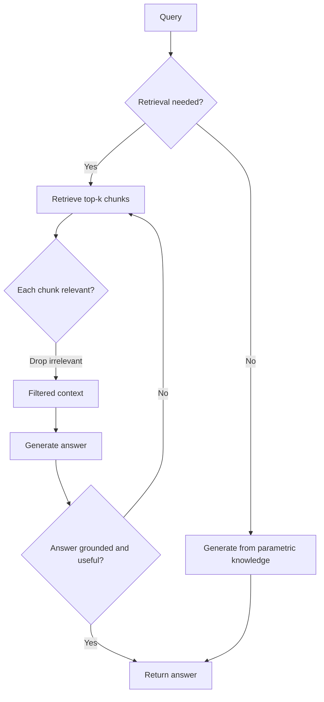
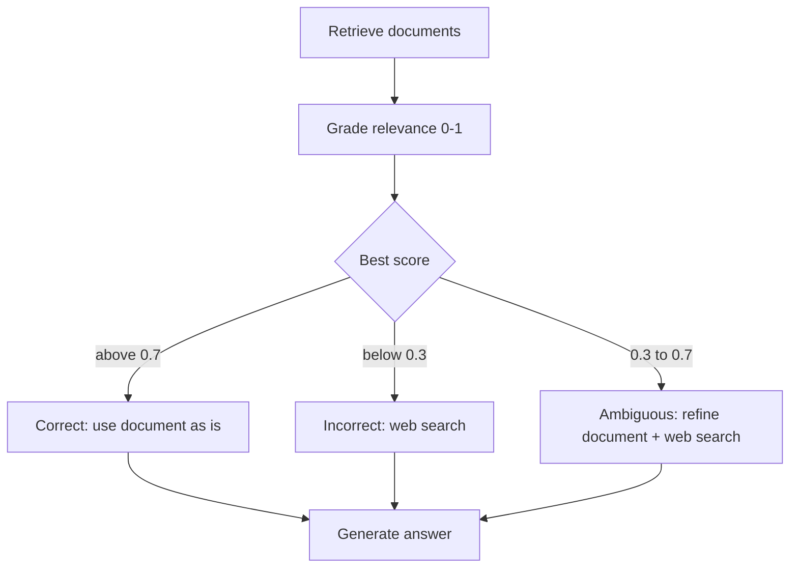
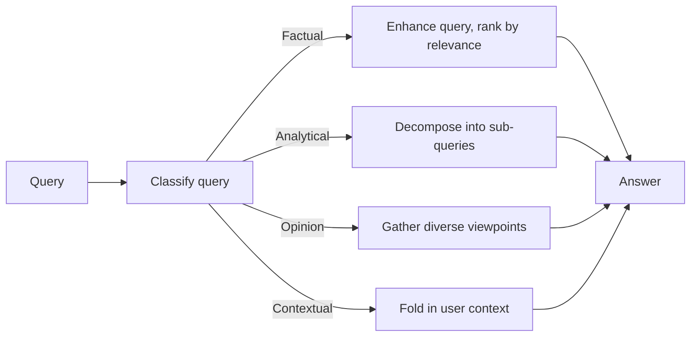

# Retrieval Control Loops

*Wrapping retrieval in checks and decisions catches bad context before it becomes a bad answer, but each check is another model call that adds latency and its own way to fail.*

◷ 10 min

Plain RAG trusts whatever retrieval returns. Wrap a control loop around retrieval only when it fixes a failure the system actually has, because stacking loops by default just stacks latency.

**Objectives:**

- describe Self-RAG, Corrective RAG and Adaptive RAG, and match each to the failure it fixes;
- explain what makes agentic RAG "agentic" when the retriever itself does not change;
- bound every loop so it terminates, fails safely and stays debuggable.

---

## Match the Loop to the Failure

Plain RAG retrieves, then generates, with nothing in between. That is cheapest and simplest to debug. It is right when the corpus reliably covers the questions. Each control loop adds model calls to catch a specific failure.

| Loop | Extra cost | What it buys | Pick when |
|---|---|---|---|
| Plain RAG | Nothing | Lowest latency, easiest debugging | The corpus covers the query domain |
| Self-RAG | 3 to 4 sequential model calls per query | Skips needless retrieval, drops irrelevant hits, grades the answer | Coverage is uneven and hallucination matters most |
| Corrective RAG (CRAG) | One grading call plus a conditional fallback search | An escape hatch when the corpus lacks the answer | The corpus is known to be incomplete |
| Adaptive RAG | One classification call and four strategy code paths | Retrieval tailored to the question type | Question types truly need different retrieval logic |

Coverage gaps want Corrective RAG. Hallucination wants Self-RAG. A mismatch between question types wants Adaptive RAG.

## Grade Each Step With Self-RAG

Self-RAG wraps three yes-or-no checks around retrieval. Should the system retrieve at all? Is each retrieved chunk relevant? Is the final answer grounded in the context and useful? Each check is its own small structured-output model call.

The first check lets the system answer simple questions without retrieval. The second drops irrelevant chunks before generation. The third catches hallucination added during generation, not only during retrieval. That third check is what Self-RAG adds over grading documents alone. A failed answer check can loop back to retrieval.

Each diamond is one small model call, so a full pass adds three calls.

The checks need a fallback. If every chunk is graded irrelevant, the system should answer from its own knowledge with a caveat, or say "I don't know". It should not re-retrieve forever.

## Fall Back When the Corpus Lacks the Answer

Corrective RAG treats the corpus as fallible. It grades each retrieved document from 0 to 1 and branches on the best score. Above 0.7, the document is used as is. Below 0.3, the document is discarded and a live web search runs instead. In between, the system refines the best document and adds a web search.

All three branches end in the same generation step; only the evidence differs.

| Best relevance score | Action |
|---|---|
| Above 0.7 (correct) | Use the document as is |
| Between 0.3 and 0.7 (ambiguous) | Refine the document and add a web search |
| Below 0.3 (incorrect) | Discard it and run a web search |

The fallback need not be public. For internal data, one source design sends low-confidence cases to a human queue instead, with the retrieved context attached. If the web search itself fails, return the best low-confidence document with an explicit flag rather than crash the run.

> **Warning: one hard threshold turns noise into a different action.** Model-generated relevance scores are not calibrated near a boundary. Two nearly identical documents can score 0.69 and 0.71 and take opposite paths: web search for one, use as is for the other. Calibrate the thresholds per corpus on a held-out labelled set. Better still, use a relative signal such as the gap between the top score and the runner-up.

A fallback that never fires is also a signal. Run Corrective RAG beside plain RAG on live traffic and count how often the fallback triggers. A rate of zero means the threshold or the corpus assumption is wrong. A rising rate flags a growing coverage gap before customers see bad answers.

## Classify the Question With Adaptive RAG

Different questions need different retrieval. Adaptive RAG classifies each query as factual, analytical, opinion or contextual, then sends it to a strategy built for that type. A factual question gets an enhanced query and relevance ranking. An analytical one is decomposed into sub-questions. An opinion question gathers diverse viewpoints. A contextual one folds in the user's context.

Everything to the right of the classifier depends on one upfront decision.

One upfront classification decides the whole pipeline for that query. That single point of failure is what a strong answer flags. Nothing downstream checks whether the chosen strategy is working. Log the query, category, retrieved documents and answer for every request, and audit misclassifications. For low-confidence classifications, run two strategies and keep the better result. Whether a 15% misclassification rate is acceptable depends on that trade: the cost of a wrong strategy against the cost of always running two.

## Hand Retrieval to the Model as a Tool

Agentic RAG is not a new retrieval technique. The retriever is wrapped as a tool and given to a tool-calling model. On each turn the model decides whether to search and how many times. The retrieval underneath is unchanged; the decision of whether and when to call it moves to the model. The loop is the same one described in [the tool-calling loop](/learn/agentic-systems/the-tool-calling-loop).

The same pattern unifies scattered data. Give the agent one retrieval tool per source, such as SAP, Salesforce and a Postgres warehouse, and let it query each in its native shape. Unify only at the answer layer, with a thin mapping of shared identifiers. That avoids a long schema-migration project.

A router agent is a fixed-path variant. One source support agent runs two independent classifiers. A category, such as billing, appointments, records or insurance, picks which slice of the knowledge base to search through a metadata filter. A sentiment score, from positive to distress, decides whether a human should step in at all. Those are separate axes. A router is worse than one agent with every knowledge base as a tool when the categories overlap heavily. Its hard split then forces a wrong choice on ambiguous queries.

## Bound Every Loop

A loop that can repeat must be capped. The model will not stop itself reliably.

- **Cap calls outside the model.** One source agent stops optimising a query after 2 attempts. Without a cap, a query that never becomes relevant enough loops forever. Enforce the cap in code, not in a prompt instruction, and keep it separate from the overall step budget.
- **Return structured empty results.** On a timeout or zero hits, the retrieval tool should return a result the model can reason about, such as "no results, try rephrasing". An unhandled exception kills the run.
- **Use constrained outputs for gates.** One Self-RAG notebook compared the model's reply to the exact string "yes". "Yes." or "Yes, retrieval is necessary" then fell silently into the wrong branch. Constrain the output to an enumerated `yes` or `no`, so a non-conforming reply raises an error.
- **Normalise filter values.** The router's metadata filter matched "billing" exactly and missed "Billing". Lowercase category strings at ingestion and at classification.
- **Log every retrieval call.** Record the query, the strategy, the chunk IDs and scores returned, and which chunks reached the prompt, tied to a run ID.
- **Keep the escalation state.** When a distressed customer is sent to a human, the original query and category must survive the hand-off. The interrupt happens before any final response is generated.

## Learn From Feedback Over Time

A feedback loop stores user ratings of past answers, such as relevance and quality from 1 to 5. Before re-ranking, a model checks whether a stored entry is relevant to the current query. Periodically, the system re-embeds the corpus with the best past question-and-answer pairs added. The notebook keeps pairs scoring at least 4 on both relevance and quality. The human signal never blocks a live answer; it only shapes future indexing.

## Worked Example: Support Search With Coverage Gaps

A software company's support search covers a help-centre wiki, tickets with exact error codes, and release notes. New error codes appear before anyone documents them. The real failure is a coverage gap, not hallucination from a rich corpus. So the source design picks Corrective RAG-style grading over Self-RAG.

The top hit is graded. Below the threshold, the case goes to a human queue with the low-confidence context attached, since this is internal data. No public web search is used. The fallback rate is tracked as a live signal. When it rises, a new class of undocumented errors has appeared. The loop was chosen by the failure, and its own metric tells the team when the corpus needs work.

---

## Key Takeaways

- Add a control loop only for the failure it fixes: Corrective RAG for coverage gaps, Self-RAG for hallucination, Adaptive RAG for mixed question types.
- Self-RAG grades the need to retrieve, each chunk, and the final answer.
- Corrective RAG branches on a graded score; calibrate its thresholds and watch how often the fallback fires.
- Adaptive RAG's single upfront classification is a single point of failure; log and audit it.
- Agentic RAG hands an unchanged retriever to a tool-calling loop; a router is the fixed-path variant.
- Cap loops in code, return structured empty results, constrain gate outputs and log every call.
- A feedback loop improves future indexing without blocking live answers.

## Check Yourself

1. **What does Self-RAG add on top of Corrective RAG's document grading?**
   A check on the generated answer itself, so hallucination introduced during generation is caught, not only bad retrieval.

2. **The Corrective RAG fallback keeps firing on documents that look fine. What is the fix?**
   Calibrate the thresholds per corpus on a held-out labelled set, or use the gap between the top two scores instead of a fixed cutoff.

3. **What stops a retrieval-as-tool agent from searching in an endless loop?**
   Nothing in the model. Add a call cap enforced in code, separate from the overall step budget.

## References

**Sources:** `08_advanced_rag_techniques_INTERVIEW_TUTORIAL.md`: §1.15 "Self-RAG", §1.16 "Corrective RAG" with its deep dive, §1.17 "Adaptive RAG", §1.18 "Agentic RAG", §1.19 "Router agentic RAG", §1.21 "Retrieval with a feedback loop", §2 gotchas on Self-RAG gates, the threshold, classification and the router filter, §3 "Choosing a retrieval-control loop", §5.1 and §5.2 role-track answers, and §6 worked answer, all rewritten in our own words. §4 questions 7, 9 and 10 (which cite the Exponent and DataCamp guides) inform the sections on per-source tools, Self-RAG and agentic RAG, summarised in our own words. `04_rag_and_retrieval_INTERVIEW_TUTORIAL.md`: §5.2 answers on timeouts, call caps and logging.
