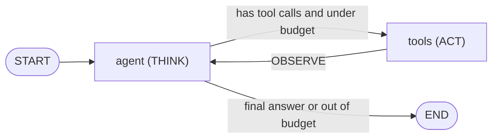
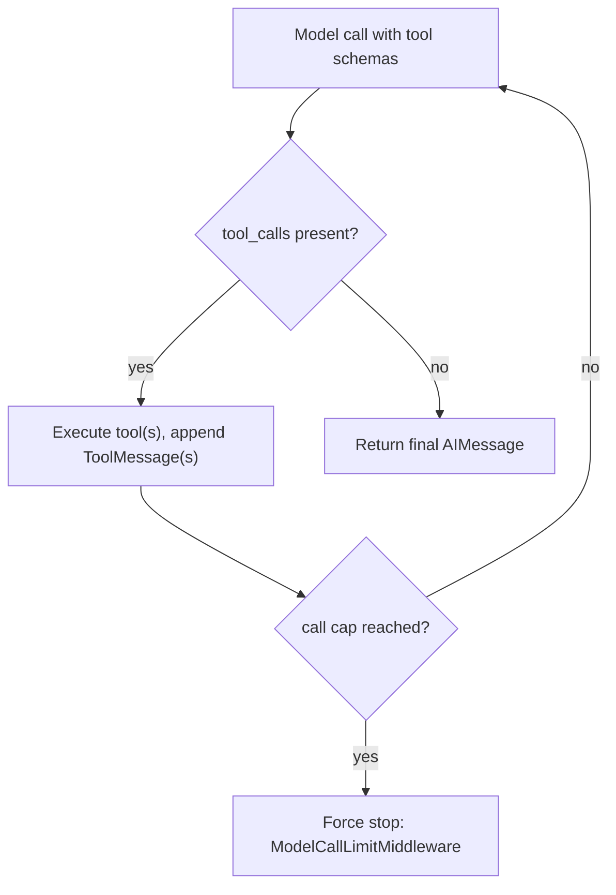

# The Tool-Calling Loop in LangGraph

*Expressing the agent loop as a graph gives native message shapes and free checkpointing, but the budget and the safety policy are still code the framework will never write.*

◷ 7 min

The framework version of an agent is not a different algorithm. It is the same think, act and observe loop taught in [T3.1 The tool-calling loop](/learn/agentic-systems/the-tool-calling-loop), mapped onto two nodes and one conditional edge, using the primitives from [Modelling Workflows as State Graphs](04_Modelling_Workflows_as_State_Graphs.md).

**Objectives:**

- map each part of a from-scratch agent loop onto a LangGraph node or edge;
- write the guard that ends the loop;
- keep tool failures inside the conversation, and bound a prebuilt agent with middleware.

---

## Map the Loop Onto Two Nodes

The FDE Handbook builds one agent twice over the same tools, decision logic, robustness and observability code. Only orchestration differs, so every piece maps.



The `agent` node is THINK. The `tools` node is ACT. The edge from `tools` back to `agent` is OBSERVE. The conditional edge out of `agent` is the guard and the final-answer exit together.

| Concept | From scratch | LangGraph |
|---|---|---|
| Working memory within a run | A list of `(tool, result)` observations | `state["messages"]`: human, AI and tool messages |
| Step counter | A local `iterations` | `state["iterations"]`, overwritten, no reducer |
| THINK | `brain.decide(...)` inside the `while` | `agent_node` calls `brain.decide(...)` |
| Tool request | `Decision(tool=..., args=...)` | `AIMessage(tool_calls=[{name, args, id}])` |
| Final answer | `Decision(final=...)` | `AIMessage(content=...)` with no tool calls |
| ACT | `execute_tool(...)` in the loop body | `tools_node` calls `execute_tool(...)` |
| OBSERVE | Append to observations | `ToolMessage` appended through `add_messages` |
| Guard and exit | `while iterations < max` and `if is_final` | `should_continue` returns `"tools"` or `END` |
| Confirmation needed | Raise and pause the run | `ToolMessage` saying `needs_confirmation`, and continue |
| Cross-turn state | `Session` | `Session`, plus checkpointers for durability |

## Speak the Model's Message Format

The graph carries a conversation, not a list of tuples. A `HumanMessage` holds the query. An `AIMessage` holds each decision. A `ToolMessage` holds each result. That is the shape a real model with bound tools produces natively.

So the `agent` node translates a decision into a message. A final answer becomes an `AIMessage` with content and no `tool_calls`. A tool request becomes an `AIMessage` with empty content and a `tool_calls` list. That is the exact shape a tool-bound chat model returns, which is why swapping the offline decision logic for a real model is a one-line change. The counter increments on the decision to call a tool, not on execution, which matches the from-scratch accounting.

The `tools` node loops over `last.tool_calls`, because a model can request several tools in one message. It runs each through the same safe executor, with the same confirmation gate, memo and retry, and returns one `ToolMessage` per call, matched by `tool_call_id`.

## Write the Guard Yourself

```python
def should_continue(state: AgentState) -> str:
    last = state["messages"][-1]
    has_calls = isinstance(last, AIMessage) and bool(getattr(last, "tool_calls", None))
    if has_calls and state["iterations"] < max_iterations:
        return "tools"
    return END          # final answer, or out of budget
```

This one function is the from-scratch `while` condition and its `if is_final` check combined. There are two ways to reach `END`: the last message has no tool calls, or the budget is spent. Delete the second clause and LangGraph will run forever.

```python
g.add_conditional_edges("agent", should_continue, {"tools": "tools", END: END})
g.add_edge("tools", "agent")          # observe -> think again
```

## Keep Tool Failures in the Conversation

A tool that raises kills the graph run. A tool that catches its own exception and returns a descriptive string turns the failure into one more message the model can react to. The LangGraph notebooks show this with a `divide` tool that returns `"Error: division by zero"` rather than raising.

The Handbook's graph does the same with risky tools. A `ConfirmationRequired` becomes a `ToolMessage` carrying an error, and the run continues; the model sees the refusal as an observation. The from-scratch loop instead pauses with `blocked_on`. Both designs are legitimate, and the Handbook names the explicit pause as the better production shape. LangGraph supports it through `interrupt_before` and a checkpointer, covered in [Checkpoints, Interrupts, and Human Approval](06_Checkpoints_Interrupts_and_Human_Approval.md).

> **Warning: termination is the model's call unless you bound it.** The loop ends when the model returns a message with no tool calls. Nothing stops a model that keeps calling tools. Bound it externally with a step budget in the guard, or a call-limit middleware on a prebuilt agent.

## Bound a Prebuilt Agent With Middleware

LangChain's `create_agent` compiles this same loop as a prebuilt graph. It returns a compiled LangGraph runnable, not an object with a `.middleware` attribute; to see what is wired in, inspect `agent.get_graph().nodes`. Tool arguments are model-generated JSON driven by the tool schema. The notebooks prove it with the typo "New Yourk", which the model still resolves to the right city.

Middleware hooks run before or after each model call, which is where cross-cutting production controls belong.



The call cap is the second exit; without it, the only exit is the model choosing to stop.

| Middleware | What it does | The trap |
|---|---|---|
| `ModelCallLimitMiddleware` | Caps model calls | `run_limit` caps one invocation; `thread_limit` caps a whole thread. Set both for multi-turn agents |
| `SummarizationMiddleware` | Compresses history when a trigger fires, keeping the most recent `keep` verbatim | The only signal it fired is the message count dropping |
| `PIIMiddleware` | Redacts one PII type | Does nothing to model input unless `apply_to_input=True` |
| `HumanInTheLoopMiddleware` | Pauses before named tools for approve, edit or reject | Needs a checkpointer to resume |
| Custom `AgentMiddleware` | `before_model` and `after_model` hooks | Write it for timing, logging or custom limits |

The summarisation trigger takes three units. A message count, such as `("messages", 10)`, is cheapest and blind to message length. A token count, such as `("tokens", 550)`, tracks real cost but needs a tokeniser. A context fraction, such as `("fraction", 0.005)`, about 640 tokens of a 128k window, is the only one that scales across models without re-tuning.

## Worked Example: Answering "Why LangGraph?"

An interviewer has just watched the from-scratch loop and asks why anyone would use LangGraph. Walk the mapping table. The local observation list became `state["messages"]`, so the graph already speaks the model's tool-call format. The `while` condition became `should_continue`. The counter became an overwrite field.

Then name what did not move. The step budget is still a clause in `should_continue`. The confirmation policy is still in `execute_tool`. The retry and fallback logic and the destructive flag are unchanged. What the graph added is declared state, the native message shape, and checkpointing for pause and resume. That answer shows the candidate knows exactly what the framework does, so it can never surprise them.

---

## Key Takeaways

- The agent loop maps onto an `agent` node, a `tools` node, a back edge and one conditional edge that is both guard and exit.
- Messages replace observations, so a real model with bound tools slots in with a one-line change.
- `should_continue` must check both "no tool calls" and "budget spent"; without the second, the graph never stops.
- Tools should return errors as messages; risky tools are better paused with an interrupt than answered with a refusal.
- `create_agent` compiles the same loop; middleware adds call caps, summarisation, PII redaction and approval gates, each with a configuration trap.

## Check Yourself

1. **Where is the max-iteration guard in the graph version, and what happens without it?**
   In `should_continue`, as the `iterations < max_iterations` clause. Without it the graph keeps routing to `tools` for as long as the model requests tools.

2. **Why does the `agent` node emit an `AIMessage` with `tool_calls` instead of returning the decision object?**
   That is the shape a real tool-bound model returns, so the graph speaks the model's language and a real model can replace the offline logic in one line.

3. **An agent's per-call cap looks right, but one long conversation ran up a large bill. Why?**
   Only `run_limit` was set. It caps one invocation; `thread_limit` caps the cumulative calls across a thread.

## References

**Sources:** `05_Same_Loop_In_LangGraph.md` (FDE Handbook): "The graph", "State", "The nodes", "The conditional edge", "Wiring", "Scratch ↔ LangGraph, side by side", "What the framework buys you", "Interview lens" and "Checkpoint". `03_langgraph_fundamentals_INTERVIEW_TUTORIAL.md`: §1.8 "The tool-calling loop, and letting tools fail gracefully". `01_langchain_foundations_INTERVIEW_TUTORIAL.md`: §1.13 "Agents", §1.14 "Middleware" with its trigger deep dive, §2 gotchas on `create_agent`, `PIIMiddleware` and `ModelCallLimitMiddleware`, and §3 "Message-count vs. token-count vs. context-fraction summarization triggers".
