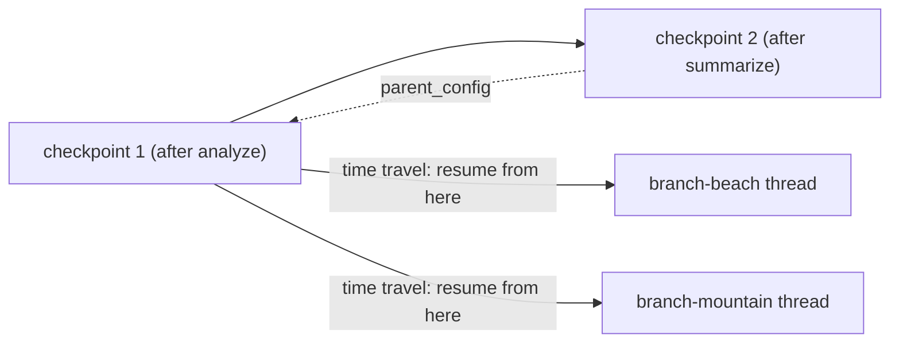
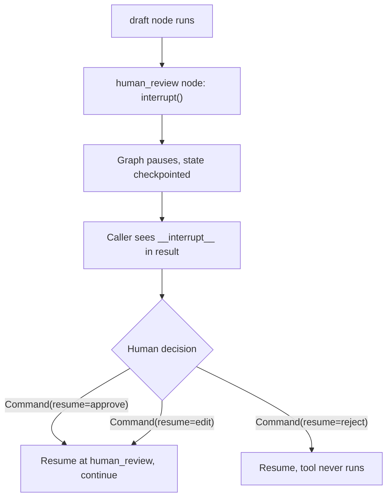
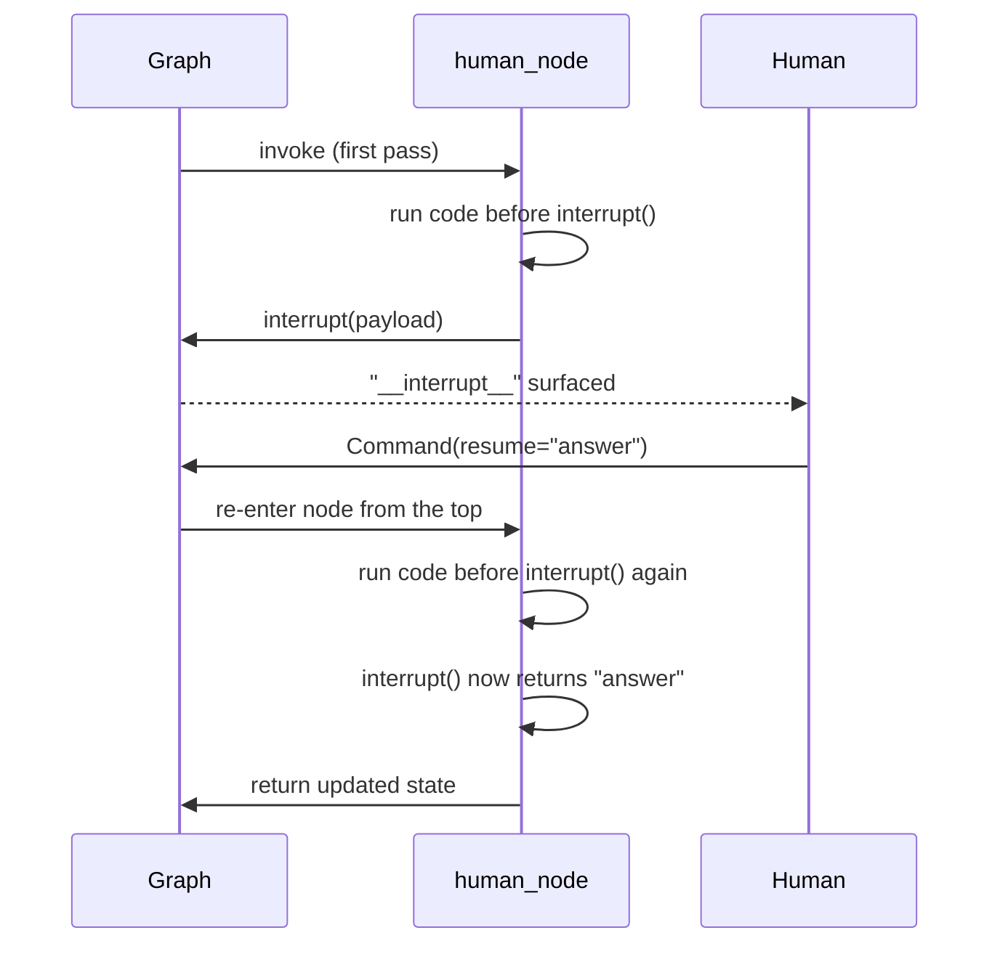

# Checkpoints, Interrupts, and Human Approval

*Saving state after every step lets a run pause for a human and survive a crash, but a resumed run can repeat any side effect that was not made safe to repeat.*

◷ 9 min

A pause is only as good as the state it can resume from. A checkpointer lets a graph stop, wait for a person or a restart, and continue. This lesson applies it to the graphs from [Modelling Workflows as State Graphs](04_Modelling_Workflows_as_State_Graphs.md) and [The Tool-Calling Loop in LangGraph](05_The_Tool_Calling_Loop_in_LangGraph.md).

**Objectives:**

- explain what a checkpoint holds and how a thread scopes it;
- pause a graph for human approval and resume it correctly;
- keep a resumed run from repeating a side effect.

---

## Save State After Every Step

A checkpointer saves a full snapshot of state after every node. A thread, named by `thread_id` in the call's configuration, decides which snapshots belong to the same conversation. Two calls with the same `thread_id` share history. Different thread ids are fully independent.

```python
app = graph.compile(checkpointer=saver)
config = {"configurable": {"thread_id": "persistent-user"}}
app.invoke({"messages": [HumanMessage("Remember: code ALPHA-7")]}, config)
```

Any graph becomes stateful at `compile`. `MemorySaver` is fast. It vanishes when the process exits. `SqliteSaver` and `PostgresSaver` implement the same interface and survive restarts, so moving to a durable store is a one-line change. In the LangGraph notebooks, a brand-new `SqliteSaver` session against the same database file still recalled the planted code.

| Checkpointer | Costs | Buys | Pick when |
|---|---|---|---|
| `MemorySaver` | Wiped on restart; single process only | Zero setup, fastest iteration | Local development, tests, demos |
| `SqliteSaver` or `PostgresSaver` | A real datastore to run | Survives restarts; shared across processes | Anything a user will resume tomorrow |

The checkpointer is short-term, within-thread memory: resume this exact run. Remembering a user across conversations is a different store, covered in [T11.2 Memory and state](/learn/agentic-systems/memory-and-state).

## Read a Checkpoint Like a Linked List

`app.get_state(config)` returns the latest snapshot. `app.get_state_history(config)` walks every snapshot, newest first. Each snapshot answers six questions.

| Question | Field |
|---|---|
| What is the data now? | `values` |
| Which node runs next? `()` means finished | `next` |
| Which snapshot is this? | `config`: the `thread_id` plus a `checkpoint_id` |
| What came before? | `parent_config` |
| Which node wrote it, at which step? | `metadata` |
| When was it saved? | `created_at` |

Because `parent_config` links each snapshot to the previous one, time travel is just resuming from an older `checkpoint_id`. Branching copies one snapshot's values into a new thread with `update_state`, and the threads then evolve independently. Snapshots are saved before the first node, after every node, and at interrupt points. That last one is what human approval is built on.



Both branch threads start from the same older checkpoint and then evolve on their own.

## Pause for a Human With an Interrupt

`interrupt(payload)` pauses execution from inside a node and hands the payload to the caller under `"__interrupt__"`. The checkpointer holds the paused state. The caller resumes with `Command(resume=value)` on the same `thread_id`, and inside the node `interrupt()` now returns that value.



Approve and edit continue the run. Reject resumes it, but the tool never runs.

```python
def human_node(state: State):
    value = interrupt({"text_to_revise": state["some_text"]})  # pauses here
    return {"some_text": value}                                 # runs on resume

final = graph.invoke(Command(resume="Edited text"), config)
```

Without a checkpointer there is no saved state to resume from, so a pause would be lost. A node can also call `interrupt()` in a loop to re-prompt until the human gives valid input.

The compile-time alternative is `interrupt_before=[...]` or `interrupt_after=[...]`, which pauses between whole nodes with no code change inside them. Use it for a fixed approval gate. Use `interrupt()` only when the decision to pause depends on something the node just computed.

## Apply the Same Pause at Three Points

The notebooks show three approval patterns, all built from one primitive. Pause before a whole turn with `interrupt_before=["assistant"]`. Edit state while paused with `graph.update_state(thread, {...})`, so the agent answers the corrected message instead of the original. Or wrap one tool's body in `interrupt()` so only that action is gated.

Gate the tools that cannot be undone, not the ones that can. A pause adds a checkpointer requirement and a human in the latency path. Pay that only for irreversible actions: sending money, sending an email, deleting data. A read-only lookup needs no gate. LangChain's `HumanInTheLoopMiddleware` wraps this primitive for named tools, with approve, edit and reject decisions.

## Make Resume Safe to Repeat

On resume, the whole interrupted node re-runs from the top, not just the code after `interrupt()`. In the notebooks, a counting node printed its "started" line twice: once on the first pass and again on resume. Any side effect before the interrupt runs twice for one logical pass.



The second "run code before interrupt()" line is the side effect that runs twice.

Keep everything before an `interrupt()` read-only or idempotent. Move side-effecting work after the interrupt or into its own node. Checkpoints recover state, not actions already sent to the outside world. A refund keyed on `ticket_id` plus action type, and checked before executing, cannot be sent twice by a resumed run.

> **Warning: re-sending the original request does not resume a run.** A thread holds one pending interrupt at a time. Re-invoking the original request on a paused thread starts a second run, and the next approval can resolve the wrong pending decision or re-attempt the side effect. Resume only with `Command(resume=...)`, and give each independent test its own fresh `thread_id`.

## Keep Conversation History Outside the Process

The same durability rule applies to chat memory in plain LangChain. A model has no memory between calls, so every "memory" strategy is a choice of what to re-send. The two sources describe it with different class names: the GenAI Engineering notes use the older `ConversationBufferMemory` family, while the LangChain tutorial uses `RunnableWithMessageHistory` and `trim_messages`.

| Strategy | Keeps | Cost |
|---|---|---|
| Whole buffer | Every turn | Grows until it overflows the context window |
| Window | Last k turns | Forgets abruptly at the boundary |
| Trim by tokens | As many turns as fit a token budget | Same abrupt loss, token-precise |
| Summary | A running summary of old turns | One extra model call per compression |
| Summary plus buffer | Recent turns verbatim, older ones summarised | The best balance for long chats |

A chat retrieval chain should also rewrite the question with history first, so "What is the price?" becomes "What is the price of the Pro plan?" before search. In production, store history in Redis or a database, not in Python objects. It then survives restarts and works across servers; `SQLChatMessageHistory` persists where `InMemoryChatMessageHistory` does not.

## Worked Example: Refunds That Survive a Restart

A support agent must get human approval for any refund, keep that approval through a pod restart, and never send a refund twice. Use `PostgresSaver` with `thread_id` set to the ticket id, so a restarted pod resumes the ticket exactly where it paused, even mid-approval.

Put `interrupt()` inside the refund tool, immediately before the payment call, not before the assistant's whole turn. Read-only steps such as looking up order history then never pause. Key the refund on ticket id plus action type and check that key before executing. On resume the tool's node re-runs from the top, finds no prior refund for the key, and the human's decision is applied once. Each requirement in the prompt maps to one mechanism: durable checkpointer, interrupt placement, idempotency key.

---

## Key Takeaways

- A checkpointer snapshots state after every node; `thread_id` scopes a conversation; durable savers share the in-memory saver's interface.
- Snapshots link through `parent_config`, which makes time travel and branching cheap.
- `interrupt()` pauses inside a node and resumes on `Command(resume=...)`; compile-time interrupts suit fixed gates.
- Gate only irreversible tools, at the point of the action.
- The interrupted node re-runs from the top on resume, so code before the interrupt must be idempotent and side effects need keys.
- Conversation history must be trimmed, windowed or summarised, and stored outside the process.

## Check Yourself

1. **A human-review node calls a paid API before `interrupt()`. What happens on resume, and what is the fix?**
   The whole node re-runs, so the API is called twice. Move the call after the interrupt or into its own node, or make it idempotent.

2. **Compliance forbids in-memory checkpoints for an approval workflow. What changes in the code?**
   Only the `compile(checkpointer=...)` argument, swapping in `PostgresSaver` or `SqliteSaver`. Graph and node code stay the same.

3. **When is `interrupt_before` a better choice than calling `interrupt()` in the node?**
   When the pause point is always "before this node", a fixed gate. `interrupt()` is for pauses that depend on data computed inside the node.

## References

**Sources:** `03_langgraph_fundamentals_INTERVIEW_TUTORIAL.md`: §1.9 "Checkpointing" with its anatomy deep dive, §1.10 "Human-in-the-loop" with "why the whole node re-runs on resume", §1.11 "HITL applied patterns", §2 interrupt gotcha, §3 checkpointer and interrupt-style tradeoffs, and §6 "Mock system design". `01_langchain_foundations_INTERVIEW_TUTORIAL.md`: §1.12 "Conversation memory strategies", §1.15 "Human-in-the-loop" with the parked-thread deep dive, and §3 tradeoffs on memory and human gating. `Module_02_RAG_Frameworks_Tools_Implementation.md`: Topic 1 "How does LangChain remember the conversation in a chat-style RAG app?". `05_Same_Loop_In_LangGraph.md` (FDE Handbook): "What the framework buys you".
