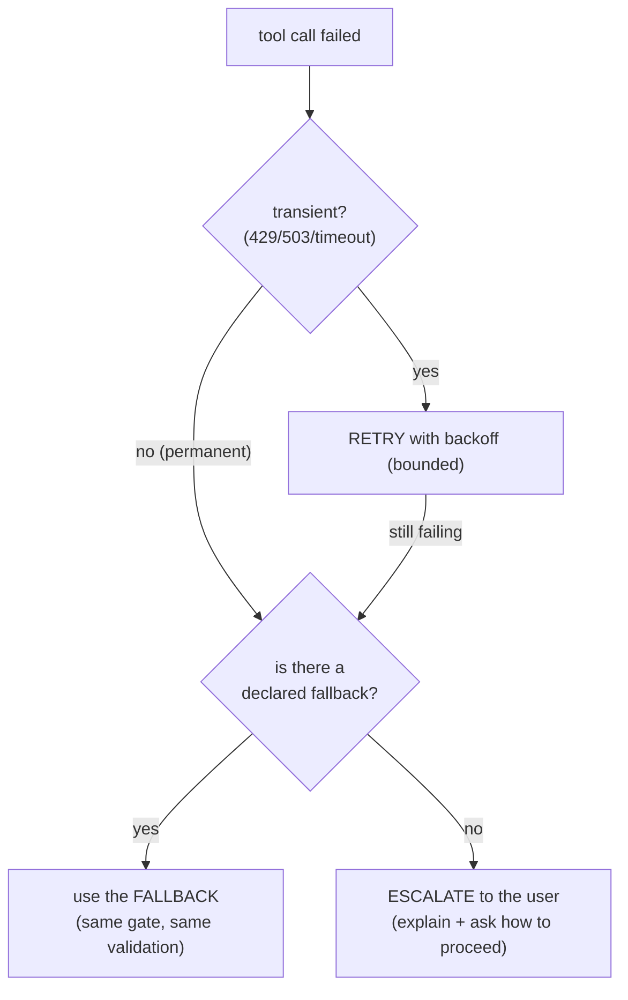

# Retries and Fallbacks

*Retrying absorbs a brief outage, but retrying the wrong failure, or retrying without a bound, turns a blip into a storm against a dependency that is already down.*

◷ 8 min

A failed tool call is not one kind of event. Classify the failure first, retry only what is transient and only a bounded number of times, then fall back or escalate; [The Confirmation Gate and Memoization](01_The_Confirmation_Gate_and_Memoization.md) covers the checks that run before any of this.

**Objectives:**

- tell a retryable failure from a permanent one and say what to do with each;
- explain why the retry budget and the growing delay both exist;
- describe what a fallback must and must not be allowed to bypass.

---

## Classify the Failure Before Reacting

The executor decides what to do from the type of the exception, not from its message.

```python
def is_retryable(exc) -> bool:
    return isinstance(exc, TransientError)
```

The tools declare two failure types, and each has one response.

| Exception | Meaning | On failure |
|---|---|---|
| `TransientError` | A network blip, a 503, a rate limit: the call was fine, the moment was not | **Retry** with backoff, up to `retries` attempts |
| `NotFoundError`, or anything else | The call itself cannot succeed: no such record, a bad request | **Do not retry.** Raise at once; the caller decides on fallback or escalation |

A permanent failure will fail the same way every time. Retrying it wastes time and hammers a dependency that is telling you clearly what is wrong.

## Bound the Retries and Grow the Delay

The retry section of the executor runs the tool, logs each attempt, and tries again only while the failure is transient and the budget remains.

```python
attempt = 0
while True:
    try:
        result = tool(**args)
        logger.log(tool.name, args, status="ok", result=result, ms=ms)
        return result
    except Exception as exc:
        if is_retryable(exc) and retries > attempt:
            attempt += 1
            logger.log(tool.name, args, status="retry", error=str(exc))
            time.sleep(0.01 * attempt)        # tiny backoff (real code: + jitter)
            continue
        logger.log(tool.name, args, status="error", error=str(exc))
        raise
```

Two controls work together. The budget, `retries=3`, stops a long outage from becoming a tight loop. The growing delay, `0.01 * attempt` in the demo plus jitter in production, spreads the attempts out. Together they absorb a short outage without amplifying a long one.

The Handbook's test `test_retry_on_flaky_tool` proves the behaviour. It wraps search to fail twice, then asserts two `retry` records and one `ok`.

## Scope Framework Retries to the Failures That Pass

A retry cannot fix a call that fails the same way every time. Frameworks make retries a one-line setting, which makes it easy to retry the wrong thing.

LangGraph wraps a node in `RetryPolicy`. On a matching exception it re-runs the node up to `max_attempts` times, waiting `initial_interval * backoff_factor^n` up to `max_interval`, with jitter so many callers do not retry at the same instant. The interview tutorial's hotel-booking notebook shows the before and after. A node that fails at random crashes the run, then succeeds once `RetryPolicy(max_attempts=5)` is attached.

The trap is the exception filter. `retry_on` has a default set of retryable types, and a plain `Exception` may or may not match it. A logic bug fails five times in a row, burning latency and calls before the traceback appears. The symptom is an error rate that looks the same with retries on and off. Pass an explicit `retry_on` for infrastructure failures such as timeouts and connection errors. Send malformed tool calls and failed validation to a re-plan or a human, because the model would only repeat the same bad arguments. [Retries, Fan-Out, and Streaming](../T2.5_LangChain_and_LangGraph/07_Retries_Fan_Out_and_Streaming.md) covers the framework settings.

## Route Permanent Failures to a Declared Fallback

When the primary fails for good, because retries ran out or the error was not retryable, route to a declared alternative. Examples are an archival source instead of the live one, or a search instead of a direct lookup.

```python
def with_fallback(primary, fallback, args, *, adapt=None, logger, **kwargs):
    try:
        return execute_tool(primary, args, logger=logger, **kwargs)
    except ConfirmationRequired:
        raise                                   # a pause is not an error to fall back on
    except Exception:
        fb_args = adapt(args) if adapt else args
        logger.log(primary.name, args, status="error", error=f"falling back to {fallback.name}")
        return execute_tool(fallback, fb_args, logger=logger, **kwargs)
```

`adapt` remaps the arguments when the fallback has a different signature. In the Handbook's test, `get_ticket("NOPE")` raises `NotFoundError`, so the fallback searches for "login" and returns TKT-3.

The cross-cutting guard material describes the same idea at a larger scale. A fallback is the tool-level version of multi-provider failover: a degraded but useful answer from a cheaper, smaller or cached backend.

## Send the Fallback Through the Same Checks

A fallback cannot be safer than the checks it skips. Two rules in the code enforce that.

**A confirmation pause is not a failure.** `ConfirmationRequired` is re-raised, never treated as a reason to try another tool. Otherwise a blocked destructive call could be "fixed" by falling back to a tool that was not blocked.

**The fallback goes through `execute_tool` too.** It gets the same gate, the same cache and the same retry. The eight-check pipeline adds argument validation to that list. A fallback is a real tool call, not a free pass.

> **Warning: never auto-retry a destructive call without re-checking the confirmation.** A retry loop that reuses an earlier approval can repeat a refund the human approved once. Every attempt at a destructive action goes back through the gate.

## Follow the Failure Policy as One Decision

Put together, every failed tool call follows one path:



Two rules never bend. Never silently swallow a failure inside an agent loop: recover, or surface it so a human or the next turn can decide. And never auto-retry a destructive call without re-checking the confirmation.

## Worked Example: A 503 Four Times in a Row

The search tool returns a 503 on every attempt, and a fallback to an archival search is declared.

Attempt one fails with a `TransientError`. The executor logs `retry`, sleeps briefly, and tries again. Attempts two and three fail the same way, each logged as `retry`, each with a slightly longer delay. Attempt four fails, and the budget of three retries is spent. The executor logs `error` and raises.

`with_fallback` catches the exception. It logs `error` with "falling back to" the archival tool, adapts the arguments, and calls `execute_tool` again. The archival search passes the gate, misses the cache, and returns a result. The user gets a slightly older answer instead of an outage.

If no fallback had been declared, the policy would end at escalation: tell the user what failed and ask how to proceed. Either way, nothing failed silently.

---

## Key Takeaways

- Classify every failure first: transient errors are retried, permanent errors are raised at once.
- A retry budget and a growing delay together absorb short outages without hammering a dead dependency.
- A framework retry policy needs an explicit exception filter, or it retries deterministic bugs.
- A permanent failure routes to a declared fallback, with arguments adapted if the signature differs.
- A fallback goes through the same gate, cache, retry and validation, and a confirmation pause is never treated as a failure.
- The policy is one decision path: retry, then fallback, then escalate, and never swallow a failure silently.

## Check Yourself

1. **What is the difference between `TransientError` and `NotFoundError` in the retry policy?**
   A `TransientError` means the call was fine but the moment was not, so it is retried with backoff up to the budget. A `NotFoundError` means the call cannot succeed, so it is raised immediately for the caller to fall back or escalate.

2. **Why does `with_fallback` re-raise `ConfirmationRequired` instead of falling back?**
   A confirmation pause is not an error. Falling back on it would let a blocked destructive call be replaced by a tool that was not blocked, routing around the gate.

3. **What are the two rules of the failure policy that never bend?**
   Never silently swallow a failure inside an agent loop, and never auto-retry a destructive call without re-checking the confirmation.

4. **An agent's error rate is the same with node retries on and off. What is the likely cause?**
   The retry policy is retrying a deterministic failure, such as a logic bug or a malformed tool call. Narrow `retry_on` to transient infrastructure errors, and route bad arguments to a re-plan instead.

## References

**Sources:** `01_Retry_Fallback_Memo_Confirm.md` (FDE Handbook, Robust Agents): "The composed executor", "3 · Retry — and what is retryable", "4 · Fallback", "The failure policy, as a decision" and "Checkpoint". `05_The_Eight_Guard_Checks.md`: "5 · Retry with fallback — the subtlety". `05-guarding-tool-calls.md` (Production and Platform Judgment): "5. Retry with fallback". `agent_fundamentals_and_advanced_agentic_systems_INTERVIEW_TUTORIAL.md`: §1.11 "Retries and node-level failure containment", the §2 gotcha "RetryPolicy silently doesn't fire on the exception you expect", and §7 question 2.
