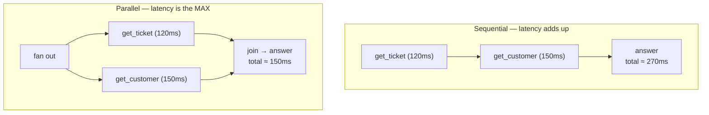

# Parallel and Sequential Tool Calls

*Running independent calls at once cuts latency to the slowest call, but it also concentrates load on rate limits and makes failures harder to handle.*

◷ 5 min

Parallelism is a decision the system makes, not one the model makes alone. Fan out only independent reads, keep dependent steps and writes sequential, and route every branch through the executor from [Retries and Fallbacks](02_Retries_and_Fallbacks.md).

**Objectives:**

- compute the latency of a sequential and a parallel set of calls;
- say which calls may run in parallel and which must not;
- name the three things a fan-out policy checks before it runs.

---

## Add Latencies Only When You Must

Sometimes the agent needs several independent facts before it can answer, such as a ticket's details and the customer's plan. The two calls do not depend on each other. Running them one after another adds their latencies together for no reason.

| | Sequential | Parallel |
|---|---|---|
| Latency | Sum of all calls | Maximum of the calls |
| Use when | Later calls **depend on** earlier results (search, then close) | Calls are **independent** |
| Cost | Same total work | Same total work, but watch **rate limits**: N calls at once |
| Complexity | Trivial | Fan-out and fan-in, error aggregation |

Parallelism saves time, not work. The same calls run either way.

## Keep Dependent Steps and Writes Sequential

A step cannot use a result that does not exist yet. A ticket cannot be closed before it has been found, so the Handbook's `close_by_topic` plan is two steps by nature.

Independent reads can go parallel with an async gather, a thread pool, or a graph fan-out. In the Handbook's graph version of the agent, the tools node already iterates over every tool call in one model message. Making that loop concurrent is the natural place to add parallelism.

Writes are different. Two writes racing each other is how a customer gets a double refund. Never parallelise destructive calls casually. The Handbook's workflow orchestrator takes an exclusivity lock on the target entity for exactly this reason.

## Share One Rate Limiter Across the Fan-Out

N calls at once hit a rate limit N times as hard. Coordinate every branch through the same token bucket, so a burst does not trigger throttling.

The interaction with retries makes this worse. A 429 is a `TransientError`, so each throttled branch retries. An uncoordinated fan-out can set off a wave of retries that deepens the throttling it caused.

> **Warning: a fan-out without a shared limiter can attack your own dependency.** Ten parallel calls that all get a 429 become ten retry loops at once. Route every branch through one rate limiter, and count the fan-out against the same budget as the retries.

## Give the Join a Timeout

If one parallel branch is slow, the whole response waits for it. Keep a latency budget: give the join a timeout and return a partial answer rather than blocking. The Handbook points to the same idea in a flight-search example, where slow suppliers get a timeout and the user gets a partial result.

## Let the System Hold the Final Say

A model can emit several tool calls in one turn. That is a useful signal: the model is saying "these are independent". It is still a proposal. Before running calls in parallel, the system should check three things. None of the calls is destructive. The combined rate-limit cost fits the budget. A join timeout exists.

## Worked Example: A Ticket and a Customer Plan

A customer writes in about ticket TKT-3. To answer, the agent needs the ticket's details and the customer's plan. It proposes `get_ticket` and `get_customer` in one turn.

The fan-out policy checks the pair. Both are reads, so neither is destructive. Two calls fit within the shared token bucket. A join timeout is set. The calls run together. `get_ticket` takes 120 ms and `get_customer` takes 150 ms, so the agent waits about 150 ms instead of 270 ms.

Now suppose the customer service is slow and passes the join timeout. The agent answers from the ticket alone and says the plan details are unavailable. It does not block the whole response.

Later the user asks the agent to close the ticket. That is a write, so it runs on its own, after the gate, with no other call racing it.

Reads fanned out, the write stayed sequential, and a slow branch degraded the answer instead of blocking it. That is the rule in one line: parallelise what is independent and safe, and nothing else.

---

## Key Takeaways

- Sequential latency is the sum of the calls; parallel latency is the maximum, for the same total work.
- Dependent steps and destructive writes stay sequential; only independent reads fan out.
- Every branch of a fan-out shares one rate limiter, because a 429 is retryable and uncoordinated retries compound.
- A join timeout turns a slow branch into a partial answer instead of a blocked response.
- The model's parallel proposal is a signal; the system checks destructiveness, rate-limit cost and a join timeout before running it.

## Check Yourself

1. **Give one example each of calls that should and should not be parallelised, from the ticket domain.**
   Fetching a ticket's details and the customer's plan can run in parallel because they are independent reads. Searching for a ticket and then closing it must stay sequential, because the close depends on the search and is destructive.

2. **Why does parallelism interact badly with retry policies under rate limits?**
   A burst of parallel calls can trigger many 429 responses at once. A 429 is a `TransientError`, so each branch retries, producing a wave of retries that worsens the throttling.

3. **What is a join timeout, and what does it buy you?**
   A limit on how long the fan-in waits for parallel branches. It lets the agent return a partial answer when one branch is slow, instead of blocking the whole response.

## References

**Sources:** `03_Parallel_vs_Sequential.md` (FDE Handbook, Robust Agents): "Why this matters", "The latency arithmetic", "Rules of thumb", "Who decides?" and "Interview lens".
