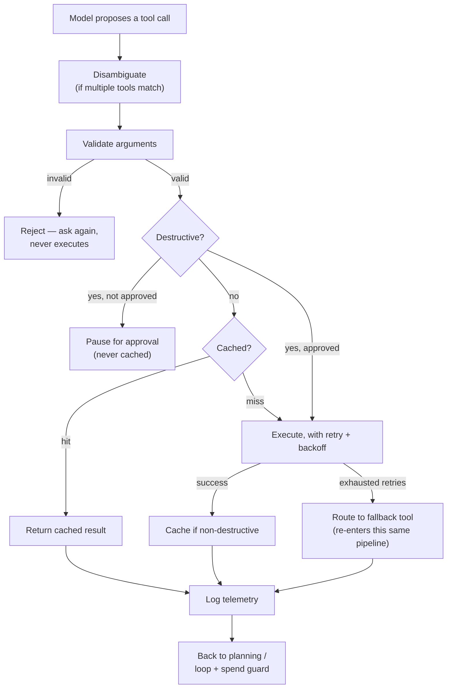

# The Eight Guard Checks

*One big gate is simpler to describe, but each failure mode needs its own check, and none of them covers for another.*

◷ 7 min

A model deciding to call a tool is a proposal, never an authorisation. Check every proposed call at several independent points in one pipeline, then use [Practise Robust Agent Interview Questions](06_Practise_Robust_Agent_Interview_Questions.md) to say it out loud.

**Objectives:**

- name all eight checks and the failure each prevents;
- place each check in one pipeline, in order;
- explain why no check can be dropped because another seems to cover it.

---

## Treat Every Tool Call as a Proposal

The model can suggest an action. Something else has to decide whether it is allowed, whether it is worth re-doing, and whether it needs a fallback. Eight checks do that work.

| # | Check | Protects against | If skipped |
|---|---|---|---|
| 1 | **Argument validation** | A malformed or hallucinated argument reaching a real system | A typo'd ID or wrong-typed field silently corrupts a downstream call instead of failing fast |
| 2 | **Destructive-action gate** | An irreversible action executing without authorisation | A refund, delete or send fired because the model was "pretty sure" |
| 3 | **Step or loop guard** | A run that never terminates | A planning-execution cycle repeats until someone notices the bill |
| 4 | **Spend or cost guard** | One action spending more than it should | A single call commits real money or quota past what the run was allowed |
| 5 | **Retry with fallback** | A transient failure killing the whole run | One flaky dependency becomes a full outage instead of a graceful degrade |
| 6 | **Memoization** | Redundant, wasted re-execution | The same read re-run, re-billed and re-waited every time it is asked again |
| 7 | **Disambiguation** | Silent, undebuggable tool selection | Two tools could satisfy the intent, and which runs depends on undocumented model whim |
| 8 | **Per-call telemetry** | Nobody being able to answer "what actually happened" | A bad outcome with no record of which tool ran, with what, for how long, or whether it was cached, retried or replaced |

## Separate Run Guards From Call Guards

The eight split into two groups. Checks 2, 3 and 4, the **guardrail trio**, operate on the whole run. They are the heart of a workflow platform's guardrail engine: approvals, step budgets and spend caps per tenant. Checks 1, 5, 6, 7 and 8 live around an individual tool call.

Earlier lessons built four of them: the gate and memoization in [The Confirmation Gate and Memoization](01_The_Confirmation_Gate_and_Memoization.md), retry with fallback in [Retries and Fallbacks](02_Retries_and_Fallbacks.md), and telemetry in [Observability for Tool Calls](04_Observability_for_Tool_Calls.md). The basic agent loop already carries a step guard. Two checks remain to describe.

## Validate Arguments Before Anything Executes

A downstream system cannot defend against a value it has already accepted. So a tool call's arguments are checked against a strict shape first: required fields present, correct types, and values within declared constraints.

This is the "constrained schema, not free text" instinct applied to the model's tool-call arguments. A typed signature is checked before execution in the same way a citation is checked before it is shown. It must be a separate, explicit step because a model can be very confident about an argument that is still wrong-shaped. Examples are a ticket ID that does not match the expected pattern, or an amount sent as a string. Caught here, the failure is "invalid input, try again", which is cheap and safe.

## Resolve Overlapping Tools Deterministically

Sometimes two registered tools could satisfy the same intent. A primary search and an archival fallback both "search for X". A user who says "find and close" could match `search_tickets` or `close_ticket`. Leaving the choice to the model makes tool selection silent and unrepeatable.

The Handbook's demo resolves it with a priority tuple: safety first, then word overlap with the description.

```python
def disambiguate(candidates: List[Tool], query: str) -> Tool:
    """Prefer a NON-destructive tool, then the one whose description shares the most words with the query."""
    words = set(query.lower().split())
    def score(t):
        overlap = len(words & set(t.description.lower().split()))
        return (0 if t.destructive else 1, overlap)     # safe tools win ties
    return max(candidates, key=score)
```

Production systems typically carry a declared priority per tool instead. Either way, selection becomes auditable and reproducible. The same intent always resolves to the same tool. If the wrong one is picked, the fix is changing a declared number, not debugging the model's mood. One rule never bends: never silently run a destructive tool on a tie.

## Declare Destructiveness on the Tool Itself

The gate is only as reliable as the flag it reads. The destructive or non-destructive property must be declared on the tool, tagged once at registration. The call-time check is "is this one of the tagged ones?", never a fresh judgement about whether this call looks risky. The same applies to a fallback: it is a real tool call and needs the same validation and destructive check as the primary.

## Run the Checks as One Pipeline

Every check sits at a different point in the same pipeline:



Read it top to bottom. It is the executor from the first lesson, with disambiguation and validation added in front and the run-level guards closing the loop at the bottom. Validation catches bad input. The gate catches unauthorised action. The cache catches redundant work. Retry and fallback catch transient failure. Telemetry catches "we need to know this happened at all". Skipping one is not caught by the others.

> **Warning: "the gate covers it" is how a check gets dropped.** A malformed argument to a non-destructive tool never meets the gate. A cached read never meets the retry policy. Each check closes a gap the rest do not, so removing one reopens exactly that gap.

## Know Where Each Check Lives

The Handbook builds the checks twice: in a small tool-calling demo and in a full workflow platform.

| Check | Tool-calling demo | Workflow platform |
|---|---|---|
| 1 Argument validation | — | `tools.py::validate_args()` |
| 2 Destructive gate | `robustness.execute_tool` (confirmation policy) | `guardrails.py` (role-gated approval, autonomous allow-list) |
| 3 Step guard | `Agent.run` `while` bound | `guardrails.py::authorize_step()` (max steps) |
| 4 Spend guard | — | `guardrails.py::authorize_step()` (spend cap at every status) |
| 5 Retry and fallback | `execute_tool`, `with_fallback` | Idempotent step retry in `orchestrator.py` |
| 6 Memoization | `execute_tool` and `Session.memo` | — |
| 7 Disambiguation | `robustness.disambiguate` | `routing.py` priority ordering, for workflows |
| 8 Per-call telemetry | `observability.ToolCallLogger` | `observability.py` run store |

The workflow-platform side of the guardrail trio is taught in full under Agentic workflow platforms, in the lesson on approvals and spend caps.

## Worked Example: A Destructive Call With a Malformed Argument

The model proposes `close_ticket` with `ticket_id` set to `"TKT 3"`, which does not match the expected pattern.

Disambiguation runs first, but only one tool matches, so it passes. Validation runs next and finds the ID wrong-shaped. The call is rejected with "invalid input, try again". It never reaches the destructive gate, the cache or the ticket system.

On the next turn the model proposes `close_ticket` with `"TKT-3"`. Validation passes. The tool is tagged destructive and nobody has approved it, so the gate pauses the run for approval. The result is never cached. Telemetry records both the rejection and the pause.

Validation stopped the bad argument, and the gate stopped the unapproved write. Neither check could have done the other's job.

---

## Key Takeaways

- A tool call is a proposal; eight checks decide whether it is allowed, worth re-doing, or needs a fallback.
- The guardrail trio of gate, step guard and spend guard covers the run; the other five surround each call.
- Argument validation rejects wrong-shaped input before anything downstream sees it.
- Disambiguation makes tool selection deterministic and auditable, and never runs a destructive tool on a tie.
- Destructiveness is declared at registration, and a fallback faces the same checks as the primary.
- The checks form one pipeline, and no check substitutes for another.

## Check Yourself

1. **Which three checks operate on the whole run rather than one call?**
   The destructive-action gate, the step or loop guard, and the spend or cost guard. In the Handbook's workflow platform they live in `guardrails.py::authorize_step()`.

2. **Why must disambiguation prefer non-destructive tools on a tie?**
   A tie means the system cannot tell which tool the user meant. Picking the destructive one would run an irreversible action on a guess, so safe tools win ties and a destructive tool never runs silently on one.

3. **Argue, in one sentence, why no check can be dropped on the grounds that another covers it.**
   Each check sits at a different point and catches a different failure, so removing any one leaves that specific gap open and no other check sees it.

## References

**Sources:** `05_The_Eight_Guard_Checks.md` (FDE Handbook, Robust Agents): "Why this matters", "The eight", "1 · Argument validation", "2–4 · The guardrail trio", "5 · Retry with fallback", "7 · Disambiguation between overlapping tools", "The pipeline, in order" and "Where each check lives across the handbook". `05-guarding-tool-calls.md` (Production and Platform Judgment): "The eight checks", "1. Argument validation", "2–4. The guardrail trio", "7. Disambiguation between overlapping tools" and "The pipeline, in order".
