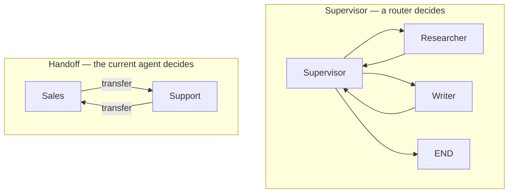
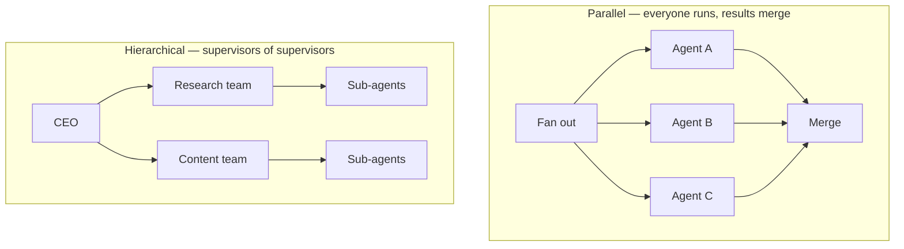
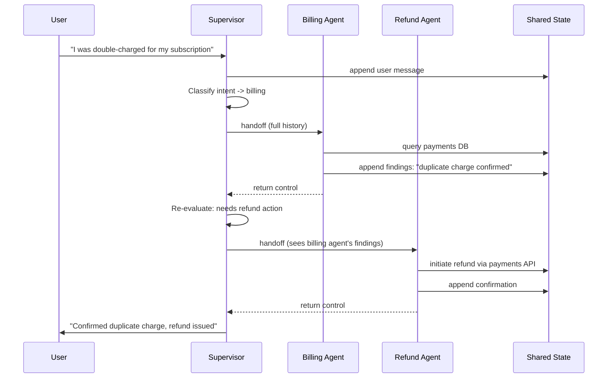

# Multi-Agent Coordination Patterns

*A central coordinator gives a plan that is easy to audit, but every routing decision it makes is another model call before any real work happens.*

◷ 10 min

Every coordination pattern answers one question: who decides which agent runs next. Pick the pattern from the shape of the work, after [When Multi-Agent Is Justified](01_When_Multi_Agent_Is_Justified.md) has confirmed that a split is worth it at all.

**Objectives:**

- name seven coordination patterns and who decides the next step in each;
- state the cost each pattern adds, per hop or per level;
- choose a pattern from the shape of the task, not from the framework.

---

## Ask Who Decides What Runs Next

In a graph-based system, each agent is a node with its own role, prompt, and tool set. The agents share state, and something decides who runs next. The patterns differ only in that "something".

The interview tutorial names four patterns. A **supervisor** is a dedicated router node that picks the next agent and gets control back afterwards. In a **handoff**, the agent currently running decides to transfer control to a peer. In **parallel** agents, nobody decides: every agent runs, and the results merge. A **hierarchy** has supervisors of supervisors: a top router chooses a team, and each team has its own router.

In the first chart, control returns to the supervisor after every agent; in a handoff, agents transfer control directly to each other.

In the second chart, parallel agents all run and meet at one merge node, while a hierarchy routes through a team before any agent works.

| Pattern | Who decides next | What it costs | Use it when |
|---|---|---|---|
| Supervisor | A dedicated router node | One extra model call per hop | Roles are distinct and a central plan helps |
| Handoff | The agent currently running | No extra call | The conversation should move, as in support tiers |
| Parallel | Nobody; all agents run | N calls, with the latency of the slowest | Subtasks are genuinely independent |
| Hierarchical | A supervisor at each level | The most expensive | Too many agents for one router to choose well |

## Price the Supervisor by the Hop

A supervisor adds one model call per hop. A five-hop task is five routing calls on top of five agent calls. That is where multi-agent cost goes, and an interviewer expects it named without prompting.

The payment buys a central plan that is easy to log and audit. A handoff skips the router call, so it is cheaper, but nothing holds the overall plan. The tutorial's one-liner is a fair summary: use a supervisor when someone needs to hold the plan, and use handoff when the conversation itself should move.

A hierarchy keeps each routing decision small. A router choosing between four agents routes well; a router choosing between twenty routes badly, because the prompt grows and the choices blur. But each level adds a routing call before any work happens. Under roughly five agents, stay flat. Add a level only when one router has too many choices to pick well.

## Run Agents in Parallel Only When They Are Independent

Parallel agents turn the latency of a run from the sum of the agents into the time of the slowest one. That is the whole reason to do it. The price is N calls at once, merge logic, and a decision about partial failure.

Sequential agents cost more time but let later agents see earlier results. Choose parallel only when no agent needs another's output. Otherwise the system pays for concurrency it cannot use. [Shared State, Routing, and Termination](03_Shared_State_Routing_and_Termination.md) covers the merge rules that make parallel writes safe.

## Add Orchestrator-Workers and Evaluator-Optimizer

The coordination-patterns guide adds two more shapes.

In **orchestrator-workers**, one orchestrator inspects the task and decides at runtime how many subtasks it needs. It dispatches each to a generic worker, in parallel or in sequence. Each worker gets only its own task-scoped payload: not the conversation history and not the other workers' outputs. The orchestrator then merges the results, resolving conflicts and duplicates. It may check the merged result and send follow-up work for any gaps. Workers have no lasting identity; they are created for one narrow task and discarded.

In **evaluator-optimizer**, a generator produces a draft and an evaluator scores it against explicit criteria. A failed draft goes back to the generator with specific, structured feedback. The generator revises the flagged parts instead of starting over. The loop ends on a pass or at an iteration cap.

The guide's comparison sets these beside the supervisor.

| Question | Orchestrator-workers | Supervisor | Evaluator-optimizer |
|---|---|---|---|
| How many roles? | One orchestrator plus N generic workers | Fixed specialists plus one router | Two fixed roles |
| When is the work split? | At runtime | At design time | Not split; one task refined in a loop |
| Is history shared? | No, each worker sees only its task | Yes, through shared state | Partly: the generator sees its draft and the critique |
| How does it loop? | Fan out and fan in, usually once | Route, act, route again | Generate, evaluate, revise |
| Best fit | Task size or shape is unpredictable | Known domains that need deep specialisation | Quality criteria are objective and checkable |

Orchestrator-workers fits when the decomposition cannot be known in advance. Evaluator-optimizer fits when a second reasoning pass can check a rubric better than the generator can check itself in one shot.

## Use a Blackboard When the Next Contributor Depends on the Board

Some work has no fixed order. A fact-checked article may need research twice before the writer can start. A routing table written in advance cannot know that.

The agent fundamentals tutorial adds the **blackboard** for this case. The state holds a shared workspace of named contributions. Before every turn, a controller reads the board and picks the next contributor from what is missing or weak, or declares the work done. The contributor reads the whole board, adds its piece, and hands back to the controller. The tutorial's notebook drafts a fact-checked article this way, with a researcher, a critic, and a writer.

The price is a controller model call before every contribution. That is more per unit of work than a supervisor with a fixed routing table. Choose a blackboard only when the sequence of contributors truly depends on the data.

The same tutorial calls peer handoff a **swarm**: specialists transfer control directly, with no central router. A swarm saves the round trip through a supervisor, so it is faster. It also loses the one place to see what happened, because the trace is now a chain of handoffs between peers. The tutorial's default follows from that: a supervisor for anything that needs an audit trail or a human approval gate, and a swarm for latency-sensitive handoffs between agents that trust each other.

## Choose What Each Agent Sees on Purpose

The sources disagree on what a supervisor passes to a specialist. The coordination-patterns guide describes the supervisor handing control and the full shared message history to each specialist. Its billing and refund agents read each other's findings straight from that history. The FDE Handbook and the interview tutorial both argue the opposite. Pass a small, defined package or a summary, because full history is expensive, dilutes focus, and leaks information an agent does not need.

Both describe real systems, so treat it as a choice rather than a fact. Shared history is simplest when specialists must build on each other's raw findings. A defined package is safer once cost, focus, or permissions matter. [Handoffs and Permission Scope](04_Handoffs_and_Permission_Scope.md) argues for the package.

> **Warning: a pattern does not fix an unjustified split.** Hierarchy multiplies routing cost invisibly, and a supervisor whose plan was predictable is pure overhead. If the decomposition never changes, hardcode it and drop the planning call.

## Worked Example: A Double Charge and a Broken Dashboard

A customer writes: "I was charged twice this month and now my dashboard won't load." A support system has three specialists. The Billing Agent's tools reach only the payments system. The Refund Agent can call the refund API. The Technical Agent can query logs.

The supervisor reads the message and finds two issues. It handles billing first and routes to the Billing Agent. That agent queries the payment ledger, confirms a duplicate charge, and appends the finding to shared state. Control returns to the supervisor. It sees that a refund is owed and routes to the Refund Agent. The Refund Agent reads the billing finding rather than re-deriving it, issues the refund, and appends a confirmation. The supervisor then routes the dashboard problem to the Technical Agent. Once both threads resolve, it writes one reply covering both issues.

The sequence shows control returning to the supervisor after each specialist, and each later specialist reading the earlier findings from shared state.

A supervisor fits because the three domains are known in advance, and each needs its own restricted tools. An orchestrator that invents subtasks at runtime would add nothing, because the roles never change shape. Contrast a request to migrate a 40-file Java payment module to Kotlin. The right number of file groups is unknown until the code is inspected, so orchestrator-workers fits there instead.

---

## Key Takeaways

- Each pattern is an answer to "who decides which agent runs next".
- A supervisor costs one model call per hop and buys an auditable central plan; a handoff is cheaper but holds no plan.
- A hierarchy keeps each routing decision small, at one routing call per level.
- Parallel agents cut latency to the slowest agent only when the subtasks are independent.
- Orchestrator-workers splits work at runtime; evaluator-optimizer refines one draft against a checkable rubric.
- A blackboard pays a controller call per contribution to handle data-dependent order; a swarm trades the central audit trail for speed.
- The sources disagree on full shared history versus a defined package, so choose what each agent sees on purpose.
- Match the pattern to the task: fixed domains suit a supervisor, and unpredictable decomposition suits orchestrator-workers.

## Check Yourself

1. **What is the honest cost of a supervisor, and what does it buy?**
   One extra model call per hop, so five hops mean five routing calls on top of five agent calls. It buys a central plan that is easy to log and audit.

2. **When does orchestrator-workers beat a supervisor?**
   When the number and shape of subtasks cannot be known until the task is inspected, such as grouping a codebase migration by dependencies. A supervisor suits roles that are fixed at design time.

3. **When is a hierarchy worth its cost?**
   When one router has too many agents to choose between well. Each level adds a routing call before any work, so under roughly five agents a flat design is better.

4. **When is a blackboard worth a controller call before every contribution?**
   When the right next contributor cannot be known in advance, such as needing research twice before writing. If the order is fixed, a supervisor's routing table or a hardcoded pipeline is cheaper.

## References

**Sources:** `07_multi_agent_systems_INTERVIEW_TUTORIAL.md`: "The one idea: agents are nodes, coordination is edges", §1.2 on supervisor cost, §1.3, §1.5, the §2 gotcha "Hierarchy multiplies routing cost invisibly", §3 "Supervisor versus handoff", "Parallel versus sequential" and "Flat versus hierarchical", and §4 question 7 on hardcoding a predictable decomposition. `multi_agent_coordination_patterns.md`: "Orchestrator-Workers Pattern", "Multi-Agent Supervisor Pattern", "Evaluator-Optimizer Pattern", and "Cross-Pattern Comparison Summary". `02_Reference_Architecture_Handoffs.md` (FDE Handbook, Multi-Agent Systems): "The handoff is the hard part". `agent_fundamentals_and_advanced_agentic_systems_INTERVIEW_TUTORIAL.md`: §1.6 "Multi-agent topology", §1.7 "Blackboard coordination", and §3 "Supervisor vs. swarm topology".
