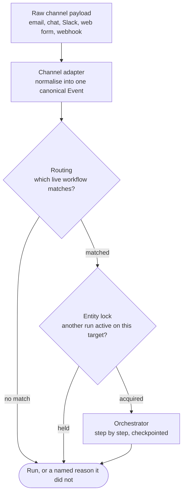

# Canonical Events and Routing

*Every channel wants its own logic, but letting that logic travel past the first layer makes every later component learn every channel forever.*

◷ 6 min

Channel handling is not a feature to spread through the system; it is a translation to finish at the edge. Normalise each payload into one event, then choose exactly one workflow with two independent checks, building on the layers named in [Why Workflow Automation Is a Trust Problem](01_Why_Workflow_Automation_Is_a_Trust_Problem.md).

**Objectives:**

- name the fields of the canonical event and what each one is for;
- explain how matching, priority, and the entity lock choose one workflow;
- argue why priority and the lock are two mechanisms, not one.

---

## Follow One Event Through the Platform

The same logical workflow must fire from email, chat, Slack, a web form, and a webhook. Each has a different payload shape and a different notion of "what is this about". The platform handles them in one pass.



This lesson covers the first three boxes. The orchestrator is in [Durability and Idempotency](04_Durability_and_Idempotency.md), and the per-step guardrail is in [Approvals and Spend Caps](05_Approvals_and_Spend_Caps.md).

## Normalise Into One Event Shape

The canonical event has six fields, and five of them carry the design.

```python
@dataclass
class Event:
    channel: Channel          # email | chat | slack | web_form | webhook
    event_type: str           # e.g. "ticket.created", "urgent_message"
    tenant_id: str
    target_entity_id: str     # the ticket, order, account this is about
    payload: dict             # the normalised content
    raw_ref: str              # pointer back to the original, for audit
```

`channel` and `event_type` are what triggers match on. `tenant_id` scopes everything downstream. `target_entity_id` is what the entity lock keys on. `raw_ref` keeps a pointer to the original, so normalisation is not destruction.

## Translate Once, at the Edge

Each channel gets one adapter function that produces an `Event`. The project builds three. The webhook adapter maps a Zendesk-shaped ticket. The Slack adapter maps message fields and classifies `urgent_message` against plain `message` from a raw flag. The email adapter maps sender, subject, and body.

Downstream of those three functions, nothing knows which channel an event came from except by reading `event.channel`. A component cannot depend on a payload shape it never sees. Routing, guardrails, the orchestrator, and the trace all work on one shape. Adding a sixth channel is one new adapter and no change anywhere else.

## Choose One Workflow in Three Steps

Routing turns one event into exactly one run, or none with a reason.

1. **Match.** Find every workflow whose tenant, status, and trigger fit. A trigger is `(channel, event_type, priority)`. Status matters: a `DRAFT` workflow never matches a real event, which is what makes drafts safe to author.
2. **Prioritise.** If several match, the highest priority wins. This is a design-time choice an admin makes on purpose: if two workflows both want this event, which is right?
3. **Lock.** Refuse if another run is already active on the same `target_entity_id`. This is a run-time safety property: can two workflows ever mutate the same ticket at once?

When nothing runs, routing returns a named reason, `no_trigger_match` or `entity_locked`. It never returns a silent no-op. An operator can always see why a message did not trigger anything.

## Keep Priority and the Lock Independent

Priority ordering and the entity lock answer different questions, so they are separate checks. Priority is configuration; the lock is safety.

The lock holds even if priority was misconfigured, or two workflows were given the same priority by accident. With only priority, a configuration mistake becomes a concurrent-mutation bug. With only the lock, nothing says which workflow should win. Build both, always. This is the same defence-in-depth instinct as the RAG platform's tenant partition plus pre-filter: a correctness mechanism and a safety mechanism that do not depend on each other.

> **Warning: a configuration setting is not a safety property.** If the only thing preventing two runs on one ticket is that an admin chose different priorities, one typo produces a double refund. Put the run-time lock underneath the design-time choice.

## Worked Example: Two Workflows Want the Same Ticket

A `ticket.created` event arrives on ticket TCK-5510 through the webhook adapter. Two live workflows trigger on `ticket.created` for this tenant: a triage workflow and a tagging workflow.

Matching returns both. A third workflow, still in `DRAFT`, also triggers on the same event type, but status excludes it. Priority picks triage, because the admin gave it the higher priority. Routing then tries the entity lock on TCK-5510.

Suppose a triage run from an earlier event is still active on TCK-5510. The lock is held, so routing returns `entity_locked`, and no second run starts. Without the lock, two triage runs could both reach the refund step on one ticket. The design-time choice picked the right workflow; the run-time check stopped it running twice at once.

## Name the Authoring Gap Honestly

Everything above is real and tested, including the routing-conflict and `entity_locked` cases. What is not built is the authoring surface. A non-technical user does not construct events or triggers. They would use a visual builder, or a compiler that turns natural language into a workflow spec. The project builds its specs directly in Python, standing in for what either would emit. The coverage map rates the visual builder as large, mostly a UI project. [Determinism Over Free Text](03_Determinism_Over_Free_Text.md) shows why the spec shape is already what a builder would serialise to.

---

## Key Takeaways

- One event passes through adapter, routing, and lock before any step runs.
- The canonical event's channel, event type, tenant, target entity, and raw reference each serve one downstream job.
- Adapters translate once at the edge, so nothing downstream knows about channels and a new channel is one new function.
- Routing matches live workflows only, picks the highest priority, then takes an entity lock, and names the reason when nothing runs.
- Priority is a design-time choice and the lock is a run-time safety property; the lock holds even when priority is wrong.
- Two workflows on one ticket resolve to one run, and a second concurrent run is refused with `entity_locked`.
- The authoring surface, a builder or natural-language compiler, is the honest gap at this layer.

## Check Yourself

1. **Why does a `DRAFT` workflow never match a real event?**
   Matching filters on status, and drafts are excluded. That rule is what makes it safe to author and edit a workflow without it acting on live traffic.

2. **Distinguish priority ordering from the entity lock in one sentence each.**
   Priority is a design-time choice about which matching workflow should run. The entity lock is a run-time guarantee that no two runs mutate the same target at once.

3. **What does routing return when nothing runs, and why does it matter?**
   A named reason, `no_trigger_match` or `entity_locked`. A silent no-op would leave operators unable to explain why a message did nothing.

## References

**Sources:** `02_Canonical_Events_And_Channels.md` (FDE Handbook, Agentic Workflow Platforms): "The 30,000-foot picture", "The canonical event", "Adapters: translate once, at the edge", "Routing: which workflow runs?", "Why two mechanisms, not one", "Where the honest gap is", and "Interview lens". `07_Coverage_Map.md`: "Reference architecture" and "Likely follow-ups".
