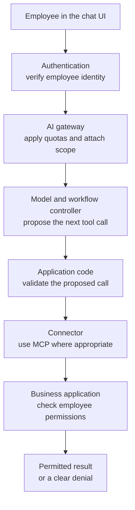
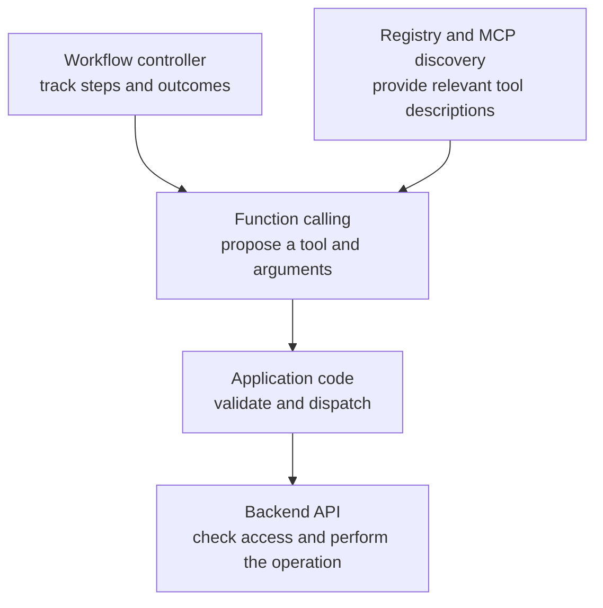
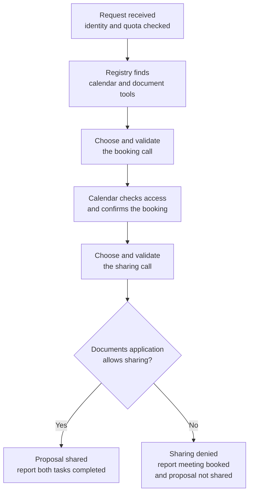

# Enterprise AI Assistant: Integration Layers at Scale

*More integrations make an assistant useful, but showing every available tool to the model makes each decision harder.*

◷ 13 min

## Understand the Customer Problem

In this scenario, a large company wants employees to complete everyday tasks across **100+ internal business applications** through one conversational assistant. Requests range from checking vacation balances to booking meetings and sharing proposals. The challenge is connecting these applications while preserving each employee's permissions and tracking tasks that span several systems. The customer needs an assistant that can grow with the organisation and clearly explain what succeeded, what failed, and what still needs attention.

Use the [twelve-part design framework](../T5.1_The_Design_Framework/01_The_Twelve_Part_Design_Framework.md) to connect REST APIs, function calling, Model Context Protocol (MCP), and workflow coordination.

---

## Ask the Five Questions That Reshape the Design

A vacation lookup, Jira ticket, sales report, and meeting-room booking need different tools and permissions. Ask five questions before drawing the architecture.

| Ask this                               | Answer in this case                                                   | What changes in the design                                                                  |
| -------------------------------------- | --------------------------------------------------------------------- | ------------------------------------------------------------------------------------------- |
| Read-only, or can it act?              | It must read **and** write.                                      | Validate proposed actions and check application permissions. |
| Do backends already speak REST?        | There is a mix of REST, GraphQL, SOAP, and legacy SQL.                | Put application-specific details behind connectors.                                         |
| Multi-step requests?                   | Yes: "schedule a meeting with John and send him the latest proposal". | Keep track of dependencies and the result of each step.                                     |
| Scale?                                 | 50,000 employees globally, with ~8,000 concurrent at peak.            | Spread requests across stateless services and limit work per user and application.          |
| Does every employee see the same data? | No. Finance and HR have separate access rules.                        | Carry trusted employee identity to every application call.                                  |

These figures are **scenario assumptions**, not measured capacity or product limits.

Keep services available and secure as integrations grow.

## Put Identity in Front of the Model

A tool name grants no application permission.

Authentication verifies identity. The AI gateway applies limits and attaches trusted identity and scope to the execution context.



The model proposes. Application code validates and dispatches. The business application decides whether the employee may act.

Use the appropriate scoped credential for each application. OAuth supports delegated access, not blind forwarding of one token everywhere. MCP's [security guidance](https://modelcontextprotocol.io/docs/2026-07-28/tutorials/security/security_best_practices) rejects unvalidated token passthrough.

Role-based access control (RBAC) uses roles. Attribute-based access control (ABAC) considers properties such as department, region, and document sensitivity. Preserve both checks.

> **Remember:** applications trust verified identity and their own permission rules. A model's request never overrides either.

## Stack the Integration Methods as Layers

| Question                                                    | Responsible part               | Plain-English explanation                                          |
| ----------------------------------------------------------- | ------------------------------ | ------------------------------------------------------------------ |
| What operation can this application perform?                | Application API, such as REST  | A defined interface for reading data or making a change.           |
| Which tool fits this request, and with what arguments?      | Function calling               | The model proposes a named operation with structured inputs.       |
| How does the assistant discover and invoke available tools? | MCP                            | A shared protocol between the assistant's client and tool servers. |
| What should happen first, and what remains unfinished?      | Workflow controller or planner | Code that coordinates steps and tracks their outcomes.             |

### Start With the Application's Existing Interface

A REST API might expose `GET /employees/123` or `POST /jira/ticket`. One reads; the other requests a change. Stable interfaces simplify testing and monitoring.

Keep GraphQL, SOAP, SQL, and legacy details inside connectors. Expose capabilities such as "create a ticket".

### Let Function Calling Propose the Operation

Function calling lets the model propose `createTicket()` or `getVacation()` with arguments. Application code validates, executes, and returns results, as the [function-calling guide](https://developers.openai.com/api/docs/guides/function-calling) explains.

The source contrasts twenty functions with **1,500 functions across 100 applications**. Treat this as a stress example, not a universal limit. Descriptions consume context; similar tools confuse selection. Evaluate actual employee requests.

### Use MCP to Standardise Tool Access

MCP standardises discovery through `tools/list` and invocation through `tools/call`, as its [tools specification](https://modelcontextprotocol.io/specification/2026-07-28/server/tools) explains. Servers may also expose resources and prompts.

Here, servers expose SAP, Jira, Salesforce, and HR capabilities over existing REST, SOAP, SQL, Kafka, or legacy interfaces.

MCP does not automatically select relevant tools or shrink the catalogue. A registry handles selective discovery.

### Coordinate Only the Steps the Request Needs

A controller tracks work using a fixed sequence or model-generated plan. An agent framework can implement that loop.



Coordination supplies the task; discovery supplies the capabilities. Application code controls execution.

## Separate REST From Function Calling by Who Decides

A vacation page calls `GET /employees/123/vacation` when it loads. Fixed code chooses the operation.

In chat, "How much vacation do I have left?" prompts `getVacation()`. After validation, code can call the same endpoint.

Adding an API endpoint does not automatically change the model context. Adding a model-visible function adds a description and selection work.

The API provides the operation. Function calling proposes it. MCP standardises access. Application permissions still apply.

## Reach for a Planner Only When the Task Needs One

Coordinate dependencies and outcomes. Several steps do not require several agents.

A Jira ticket may need one call. Booking a meeting and sharing a proposal spans two applications; one controller can handle both.

| Request                                              | What must be tracked                                                    | Reasonable starting point                                         |
| ---------------------------------------------------- | ----------------------------------------------------------------------- | ----------------------------------------------------------------- |
| Create a Jira ticket                                 | Whether the application created the ticket.                             | One tool call and its result.                                     |
| Book a meeting and share a proposal                  | The booking, the permitted document, and whether sharing succeeded.     | A short workflow across two applications.                         |
| Prepare a renewal report and email the managers      | Customer selection, CRM data, report, charts, stored PDF, and delivery. | A queued workflow with explicit dependencies.                     |
| Analyse sales, prepare a deck, and notify leadership | Analysis, presentation, and notification outcomes.                      | A coordinated workflow; specialists only if the separation helps. |

A planner can queue longer work for CRM, email, analytics, and calendar specialists. Split responsibilities when parallel work helps enough to justify coordination overhead.

Track partial success: booking may succeed while sharing is denied. Report both outcomes.

## Scale Discovery With a Tool Registry

At **500+ applications and 200,000 employees**, limit what each request loads. These remain the source's growth assumptions.

A tool registry catalogues servers and capabilities. Select calendar and documents for the meeting request; leave unrelated tools out.

The registry narrows discovery; MCP describes and invokes capabilities. Neither replaces application permissions.

### Keep Interactive Requests Short

Keep authentication, gateway handling, and model routing stateless where practical. Any server can handle the next request. Store workflow progress separately to survive worker restarts.

Queue long work and return "task accepted" with a job ID for progress checks. Acceptance does not mean completion.

Apply employee and application quotas and tool-call limits. A circuit breaker pauses calls to failing dependencies.

### Cache Carefully and Keep Data in Its Region

Cache holiday calendars, employee profiles, and the organisation hierarchy within access and freshness limits.

Place gateways and connectors near applications. Use regional token validation, caches, and read replicas. Run stateless services across regions with geographic DNS routing. Keep HR and financial records within required jurisdictions.

### Trace What Happened

Trace request IDs, prompt versions, tools, permissions, API results, latency, cost, and errors. Capture observable plans and decision summaries, not hidden model reasoning.

These records distinguish selection, permission, and execution failures. Redact sensitive content and protect the traces.

## Worked Example: One Request Through Every Layer

Follow the opening request: **"Schedule a meeting with John and send him the latest proposal."**

> **Added production guidance:** the clarification, payloads, and failure handling below extend the original case. The people, dates, IDs, and API contract are illustrative design choices.

### Resolve Missing Details Before Acting

Search only the directory and documents the employee may access. If several people or proposals match, ask instead of guessing. Confirm which accessible version counts as "latest".

**Assistant:** "Which John and proposal? What date, time, time zone, and meeting length?"

**Employee:** "John Patel from Sales. Use the Acme proposal, version 7. Book 30 minutes on 20 October 2026 at 10 am London time."

The booking example assumes resolved details and permission to schedule. Obtain any required confirmation or approval before dispatch. Clarifying intent grants no document-sharing permission.

### Follow the Resolved Request Through the Layers

After authentication and quota checks, the controller asks the registry for calendar and document capabilities.



Each application step includes a connector and backend API, with MCP where used. Backends enforce employee permissions.

The controller coordinated; the registry and MCP exposed tools; function calling proposed operations; application APIs executed them.

Report partial success. This case promises no automatic rollback across applications.

### Trace One Booking Call

The model proposes a booking using the resolved directory ID. This simplified JSON shows the application boundary, rather than a provider-specific API envelope.

**Model proposal:**

```json
{
  "tool": "bookMeeting",
  "arguments": {
    "attendee_ids": ["employee-317"],
    "starts_at": "2026-10-20T10:00:00+01:00",
    "time_zone": "Europe/London",
    "duration_minutes": 30,
    "title": "Proposal review"
  }
}
```

**Trusted context added by application code:**

```json
{
  "employee_id": "employee-123",
  "tenant_id": "tenant-demo",
  "request_id": "request-042",
  "operation_id": "request-042:book-1"
}
```

Employee and tenant identity come from the verified session. Application code creates the operation ID and validates the arguments. Model-supplied identity cannot override that context. The connector obtains the appropriate delegated credential; no credential appears in the proposal.

**Calendar response after checking access and creating the event:**

```json
{
  "operation_id": "request-042:book-1",
  "status": "confirmed",
  "event_id": "event-908"
}
```

An authoritative response confirms the booking. Sharing remains a separate operation with its own permission check.

### Handle Failures Without Repeating Writes

A timeout means the response is missing; the meeting may already exist. [HTTP retry guidance](https://www.rfc-editor.org/rfc/rfc9110.html#section-9.2.2) cautions against automatically repeating writes unless their semantics make that safe or the first request was never applied.

| What happened | Next step | Tell the employee |
| --- | --- | --- |
| Sharing denied | Stop sharing; preserve the confirmed booking. | "Meeting booked. Proposal sharing was denied." |
| Booking timed out; outcome unknown | Check status using a supported operation reference. Pause sharing until the dependency is resolved. | "Booking status is unconfirmed. I'm checking it." |
| Same booking submitted again | Reuse the operation ID under a supported deduplication contract. | Return the existing booking or pending status. |

Idempotency means repeating an operation has the same intended effect as performing it once. Here, require backend deduplication within tenant and employee scope, including simultaneous submissions. Reuse the operation ID within the application's retention window; reject changed arguments under that ID. A local request ID alone cannot prevent duplicate backend writes.

If the application offers neither safe retries nor authoritative status lookup, stop automatic retries and request manual reconciliation. Never turn an unknown outcome into a claim of failure or success.

## Weigh the Four Methods Honestly

Choose by responsibility. Technology names alone establish no scalability or security guarantee.

| If the concern is...                | Use this part for...                                                   | Remember its limit                                                               |
| ----------------------------------- | ---------------------------------------------------------------------- | -------------------------------------------------------------------------------- |
| Reliable application operations     | Existing REST or other application APIs.                               | The interface does not interpret a conversation or choose the user's task.       |
| Choosing from natural language      | Function calling with clear tool descriptions and validated arguments. | Tool choice still needs evaluation; a structured call is not an authorised call. |
| Discovering and adding integrations | MCP servers behind a selective registry.                               | Standardised discovery does not replace access checks or catalogue management.   |
| Coordinating several decisions      | A workflow controller, with an agent framework if useful.              | More planning and agents add state, latency, cost, and failure paths.            |

Separating these responsibilities lets new integrations reuse the same workflow and access controls.

This case covers integration, discovery, coordination, identity, and scale. It leaves retrieval-augmented generation (RAG), memory, detailed approval workflows, comprehensive guardrails, prompt-injection defence, and model-routing policy for separate designs.

Continue with [Customer Support Assistant: Knowledge, Actions, and Approval](02_Customer_Support_Assistant_Knowledge_Actions_and_Approval.md) for retrieval, memory, and approval policy.

## Explain the Design in 60 Seconds

Adapt this spoken outline to the interviewer's constraints.

> "I'd first clarify what the assistant can change, which applications it serves, the scale, and whose permissions apply. I'd authenticate the employee before the model sees tools. A registry would narrow the choices, with MCP standardising discovery and invocation. Function calling would propose an operation; application code would validate it, and the backend would enforce access.
>
> One controller could coordinate the meeting and proposal. It would resolve missing details, track each result, and report partial success. For growth, I'd use stateless services, queues, quotas, regional placement, scoped caching, and tracing. I'd reconcile uncertain writes before retrying and require a deduplication contract. Retrieval, memory, and detailed approval policy would be separate design decisions."

---

## Key Takeaways

- Start with the employee's task; clarify actions, backend interfaces, workflow complexity, scale, and permissions.
- Authenticate first; validate proposed calls and preserve each application's permission checks.
- Separate coordination, tool discovery, tool choice, and backend execution; they can work together in one request.
- Distinguish a fixed API call from a model-selected tool call by who chooses the operation.
- Start with one controller; add planning or specialists only when the workflow benefits.
- Use a registry to narrow tool discovery, then control quotas, asynchronous work, caching, regional placement, and tracing.
- Trace the booking and sharing results separately; partial completion is a real outcome.
- Choose technologies by responsibility, and name the retrieval, approval, and guardrail decisions this case leaves open.
- Rehearse the complete explanation in a minute, including permission checks and uncertain outcomes.

## Check Yourself

1. **Which five answers change the architecture before any boxes are drawn?**
   Whether the assistant reads or writes, the backend interfaces, whether requests need several steps, the expected scale, and whether employees have different permissions.
2. **Why is a valid tool call not enough to authorise an action?**
   It only shows that the request has the expected shape. The application must still check whether the verified employee may perform it.
3. **What does each integration layer contribute to the meeting-and-proposal request?**
   The controller coordinates, the registry and MCP expose relevant tools, function calling proposes operations, and application APIs execute authorised operations.
4. **Can function calling use the same REST endpoint as a normal application page?**
   Yes. Fixed code chooses the operation on the page; the model proposes it in chat. The backend operation may be identical.
5. **Does a multi-step request require a multi-agent framework?**
   No. One controller can coordinate several tools. Add specialised agents only when they improve the workflow enough to justify coordination overhead.
6. **Why does the tool registry matter at 500+ applications?**
   It narrows the tools loaded for the current task. MCP standardises discovery and invocation, but does not automatically make every tool relevant or cheap.
7. **What should the assistant say if the meeting is booked but sharing is denied?**
   Report both results clearly. Do not claim the full request succeeded or that the booking was automatically undone.
8. **What remains outside this case's scope?**
   RAG, conversation memory, a human-approval workflow, comprehensive guardrails, prompt-injection defence, and model-routing policy. The companion support-assistant lesson explores the other half.
9. **What must be resolved before booking the example meeting?**
   The intended John, proposal version, date, time, time zone, and duration, plus any required confirmation or approval.
10. **Who supplies identity in the booking call?**
    Application code uses the verified session. The model proposes business arguments, not trusted employee or tenant identity.
11. **Why not retry a timed-out booking immediately?**
    It may already exist. Check authoritative status or rely on a supported deduplication contract; otherwise reconcile manually.

## References

**Original case source:** `02_System_Design_Case_Studies/Classic_Design_Walkthroughs/Handbook_Casebook/01_Enterprise_AI_Assistant.md`: the prompt, problem space, architecture, integration methods, orchestration, scaling, trade-offs, summary, and scope limitations.

**Primary-source clarifications:** [Function calling](https://developers.openai.com/api/docs/guides/function-calling), [MCP tools](https://modelcontextprotocol.io/specification/2026-07-28/server/tools), and [MCP security guidance](https://modelcontextprotocol.io/docs/2026-07-28/tutorials/security/security_best_practices). Consulted on 15 October 2026 to clarify model proposals versus execution, discovery versus selective loading, and delegated access versus token passthrough.

**Added reliability guidance:** [HTTP Semantics, Section 9.2.2](https://www.rfc-editor.org/rfc/rfc9110.html#section-9.2.2), checked on 15 October 2026. The operation IDs and deduplication contract above are this lesson's design choices, not guarantees of an existing calendar API.
