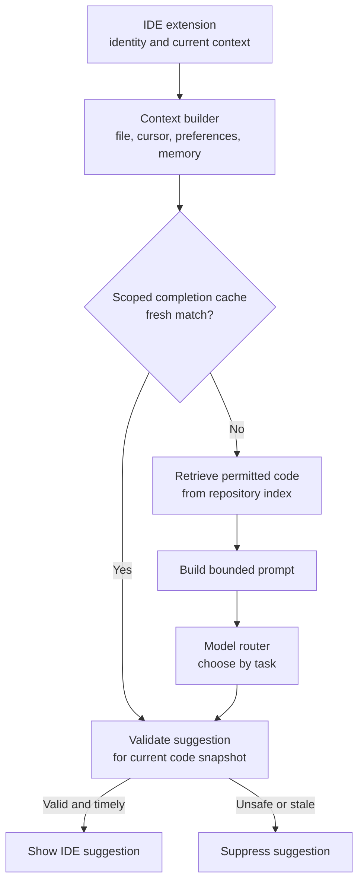
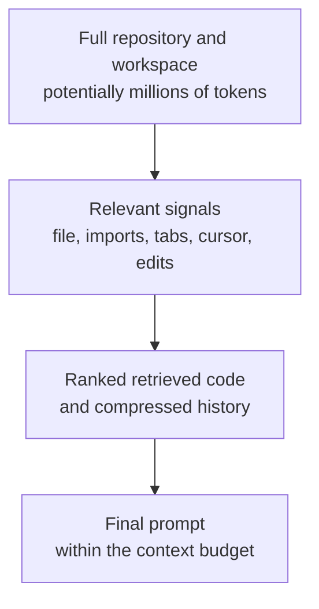

# Coding Assistant: Context Engineering Under 300 ms

*More repository context makes suggestions better, while every extra token and model hop eats a latency budget of 300 milliseconds.*

◷ 10 min

## Understand the Customer Problem

In this scenario, developers want useful suggestions without leaving their editor or waiting after every keystroke. The assistant must understand the repository's helpers and conventions, even when the codebase is too large to send to a model. The customer needs fast completions, deeper help on demand, and protection for private source code. Plausible code is not enough if it calls an API that does not exist.

Select relevant context, route by task, and validate before display. Use [the design framework](../T5.1_The_Design_Framework/01_The_Twelve_Part_Design_Framework.md) to connect those choices to latency and security.

---

## Let Two Requirements Set the Problem

The prompt asks for an assistant like GitHub Copilot inside the IDE. It does real-time completion, code explanation, unit-test generation, bug fixing, refactoring and developer Q&A. The design must show how context engineering, semantic retrieval, model routing, semantic caching and output validation keep suggestions fast, accurate and safe.

Two requirements pull against each other. Suggestions must feel instant, and they must understand the whole repository. Together they make this a context-engineering problem as much as a distributed-systems one.

| Question | Answer | What it decides |
|---|---|---|
| Cloud or local? | Both exist | Where inference happens; the privacy story |
| Real-time as the user types? | Yes | The latency budget is set before anything else: **< 300 ms** |
| Which IDEs and languages? | VS Code, IntelliJ, Visual Studio; mainstream languages | A thin, IDE-agnostic extension talking to a shared backend |
| Whole repository or current file? | The whole repo, within reason | Context engineering is the hard problem |
| Private models and on-prem for enterprise? | Yes | Security and deployment shaped from day one |

The functional list covers single- and multi-line completion, explanation, and test, doc and commit-message generation. It adds refactoring, error fixing, Q&A, codebase search, multiple languages and workspace awareness. The non-functional list starts with < 300 ms autocomplete. Accuracy, low hallucination, availability, enterprise security, millions of developers, personalisation and cost follow.

## Check the Cache First, Retrieve on a Miss, Route by Task



A valid completion-cache hit can skip retrieval and generation. Key it by tenant, repository, permissions, revision, prompt and model version, and nearby context. Measure the hit rate; do not assume it is the common case.

## Trace One Keystroke to an Accepted Suggestion

The user types `def calculate_total(items):`, and the extension detects the cursor position. Context collection gathers the current function, file, open tabs, imports and repo structure. It adds cursor location, language, recent edits and compiler errors. It selects only what is relevant, never the whole repository.

Semantic code search then finds similar functions, existing helpers, internal APIs and conventions. That can surface reusable helpers; it does not prove they fit the change. Prompt construction combines system instructions, the request, current code, retrieved snippets, language, framework, conventions and relevant docs. The router picks a model by task complexity, and the model generates.

Output validation runs next. It parses the code, checks syntax and formatting, and applies security filters. Check referenced symbols against the current codebase and flag unsafe patterns. These checks reduce risk; they cannot prove arbitrary code correct. Suppress invalid output. Regenerate only if the remaining budget allows it. Show validated suggestion units inline. The developer accepts, partially accepts, rejects or asks for alternatives, and that feedback drives personalisation.

> **Warning: a suggestion that compiles can still call an API that does not exist.** The model writes plausible code, not verified code. Validation must check calls against the real codebase and drop or regenerate anything that references invented functions.

## Engineer Context as a Funnel

Not every context signal is worth its token cost. Context engineering narrows in stages.



Include only what materially improves the response. Semantic search makes "calculate tax" retrieve `compute_gst()`. Keep prompt templates per task (completion, tests, bug fix, refactor, docs, explain) and version them for safe experimentation and rollback. Cache boilerplate, standard algorithms and popular API usage. Manage the window by retrieving only relevant files, chunking intelligently, compressing history and prioritising nearby code.

## Route Models by Task

Routing is the same trade as context collection: spend latency only where it buys accuracy.

| Task | Model |
|---|---|
| Next-word completion | Small, low-latency |
| Multi-line completion | Medium where the budget permits |
| Code explanation | Larger reasoning |
| Bug fixing | Larger reasoning |
| Refactoring | Larger reasoning |
| Architecture questions | Most capable |

## Decompose the Latency Budget

The source proposes ~10 ms for cache lookup, ~40 ms for context assembly, ~200 ms for streamed inference, and ~50 ms for validation. These allocations total 300 ms before extra network and queue overhead. Treat them as an illustrative budget, not proof of a **< 300 ms** end-to-end result.

Define whether the target measures first validated suggestion or full completion. Measure from the IDE under realistic load, including retrieval, queues, and network time. Leave headroom and discard stale completions when the user keeps typing.

For millions of developers, use stateless APIs, region/repository shards, autoscaled GPU inference, rate limits, and batching where latency permits. Index in the background. Streaming reduces time to first output; it does not erase generation time. Use regional deployment and a CDN for static assets.

## Protect Source Code From the First Question

Source code is the most sensitive asset in the pipeline. Never train foundation models on private enterprise code without explicit consent. Encrypt in transit and at rest. Enforce repository-level access control and respect organisational permissions during retrieval. Mask secrets and credentials before sending context. Support private deployment for regulated industries, and keep audit logs.

| Decision | Pros | Cons |
|---|---|---|
| Small model | Fast, inexpensive | Lower reasoning quality |
| Large model | Better suggestions | Latency and cost |
| Full repository context | Richer understanding | Token usage |
| Retrieved context only | Cheaper, faster | May miss relevant information |
| Cloud inference | Easy to scale | Privacy |
| Local inference | Privacy | Limited by local hardware |

## Prepare the Three Follow-Ups

**"How do we avoid leaking customer code?"** Isolate by tenant and never train on private repositories without permission. Retrieve only what the user may access, mask sensitive information before prompting, and offer private or on-prem deployment with strict access control and audit.

**"How do we get below 300 ms?"** Use a lightweight model for inline completion and stream tokens over persistent IDE connections. Cache embeddings and frequent completions, and index in the background. Run inference near users, limit retrieved context, and use speculative decoding where supported.

**"How do we personalise?"** Learn coding style and prioritise project-specific APIs. Feed accepted and rejected suggestions back, respect repository standards and lint rules, and tailor prompts to developer and team preferences. Keep raw source protected throughout, and refine retrieval on feedback.

## Worked Example: Completing `calculate_total`

> **Added production guidance:** the dialogue, payload, and failure choices below are illustrative. Source latency allocations are not benchmarks.

### Clarify the Requested Behaviour

For an explicit edit, ask: "Should totals include tax, and which rounding rule applies?" Inline completion should avoid inventing business rules. Discard requests when the relevant file or cursor context changes.

### Follow the Code Context

A developer types `def calculate_total(items):` in a repository that already has a tax helper. The cache check takes about 10 ms and misses, because this file is new. Context assembly takes about 40 ms. It keeps the current file, its imports and the open tabs, and drops unrelated files. Semantic search over the repository index surfaces the existing `compute_gst()` helper.

The task is a multi-line completion and the budget permits it, so the router picks the medium model. The illustrative inference allocation is roughly 200 ms; it is not a measured result. Validation spends about 50 ms parsing the code and confirming that `compute_gst()` really exists. The suggestion reuses the helper instead of writing a second tax function.

Each piece of the design paid for itself in one keystroke. The funnel found the helper, the router avoided the large model, and validation guarded against an invented API.

### Trace One Suggestion

```json
{
  "request": {"task": "complete", "prefix": "def calculate_total(items):"},
  "trusted_context": {"tenant": "tenant-a", "repo": "checkout", "revision": "rev-42"},
  "retrieved_symbol": "compute_gst",
  "result": {"status": "validated_suggestion", "applied": false}
}
```

The backend derives repository scope from the verified session. The model gets permitted snippets. Validation checks the referenced helper before the developer decides whether to accept the edit.

### Handle Misses and Stale Results

| Situation | Response |
| --- | --- |
| Cache hit belongs to another revision or scope | Use the authorised miss path. |
| Generated helper does not exist | Suppress it; retry only within budget. |
| File changed during generation | Discard the stale completion. |

A suggestion is not an applied change. Recheck permissions and freshness even on a cache hit.

## Explain the Design in 60 Seconds

> "I'd start with fast inline completions and slower, deeper help for explicit requests. The hard part is choosing useful repository context without sending the whole codebase. I'd collect nearby signals, check a scoped cache, and retrieve permitted helpers on a miss. A router would choose a model by task.
>
> I'd validate syntax, symbols, and safety before showing a suggestion, and discard results for stale file versions. The 300 ms allocation is a design budget, so I'd measure end-to-end latency with network and queue time included. I'd index in the background, scale by region and repository, protect private code, and use developer feedback without assuming permission to train on it."

---

## Key Takeaways

- "Instant" plus "whole repository" makes this a context-engineering problem with a < 300 ms budget.
- Check a scoped, fresh completion cache; validate hits before display.
- Collect relevant signals, retrieve permitted code, route, generate, and validate before display.
- Context engineering is a funnel from millions of tokens down to a prompt that fits the window.
- Route small models to inline completions, a medium model to multi-line completion where the budget permits, and larger reasoning models to explanation, bug fixing, refactoring and architecture.
- Split the budget into ~10 ms cache, ~40 ms context, ~200 ms streamed inference and ~50 ms validation.
- Treat source code as the most sensitive asset: no training without consent, permission-aware retrieval, secret masking and private deployment.
- Have answers ready on code leakage, getting under 300 ms, and personalisation.

## Check Yourself

1. **Why is the scoped exact-match cache placed before embedding and retrieval?**
   A valid, scoped hit can skip retrieval and generation. Start with exact matching; semantic matching raises the hit rate but can serve a wrong answer for a similar request. Measure hit rates and validate against the current code context.

2. **Decompose the 300 ms budget.**
   About 10 ms cache, 40 ms context, 200 ms inference, and 50 ms validation: 300 ms before extra overhead, not a measured end-to-end guarantee.

3. **Why does output validation check for hallucinated APIs?**
   The model produces plausible code, not verified code. A call to a function that does not exist would compile in the developer's head and fail in their build.

4. **What must be in the completion-cache scope?**
   Tenant, repository, permissions, revision, prompt and model version, and relevant code context; revalidate the result before display.

5. **Who decides whether a suggested edit is applied?**
   The developer. A validated suggestion is still only a proposal.

6. **What if the file changes during generation?**
   Discard the stale result instead of attaching it to a different code snapshot.

7. **Does streaming prove the full request met the latency target?**
   No. Measure the defined output boundary from the IDE, including network, queues, retrieval, and validation.

8. **What should an inline suggestion do with an unclear tax rule?**
   Avoid inventing it. An explicit edit request can ask for clarification before proposing the implementation.

## References

**Sources:** `02_System_Design_Case_Studies/Classic_Design_Walkthroughs/Handbook_Casebook/03_Coding_Assistant.md`: "The prompt", Steps 1 to 5 (problem space; cache first, retrieve on a miss, route by task; the request flow; context engineering and model routing; scaling under 300 ms), "Security", "Trade-offs", "Follow-ups to have ready" and "Summary".
