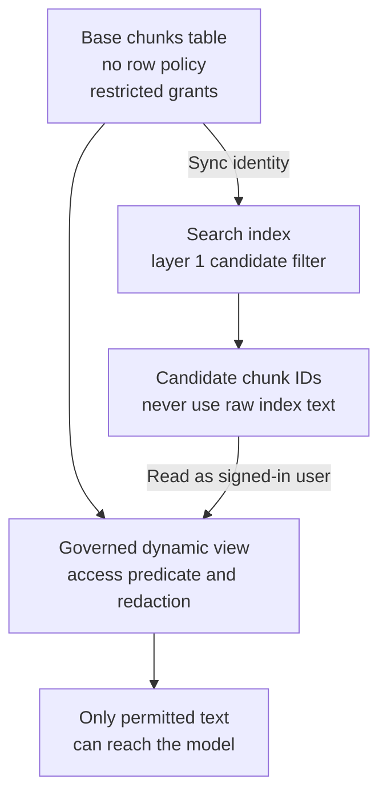

# Access-Controlled RAG on Databricks

*Letting the platform enforce access deletes code that had to be proven correct, but the vector index sits outside that enforcement and forces a split design.*

◷ 19 min

## Understand the Customer Problem

In this scenario, Meridian Cloud wants the permission-aware assistant from the previous case to run on Databricks. Support agents need useful answers without seeing engineering, commercial, or another tenant's restricted material. The customer already has a data platform and wants to reuse its governance. The challenge is keeping search candidates separate from the text that the signed-in user is actually allowed to read.

Reuse [the enterprise RAG design](06_Access_Controlled_Enterprise_RAG.md), then explain where Unity Catalog enforces access and where the application must still constrain search. The source calls the product Vector Search; current documentation calls it [AI Search](https://docs.databricks.com/aws/en/ai-search/ai-search/).

---

## Plant the Hook in the Framing Sentence

Use this version when the interviewer is a Databricks customer or asks how the design runs on their stack. The persona table, the scope and the generic failure table are the same as in [Access-Controlled Enterprise RAG](06_Access_Controlled_Enterprise_RAG.md). The framing sentence changes its ending. On Databricks, most of the access work is Unity Catalog's job rather than ours, with two specific exceptions that decide the physical architecture.

That last clause plants a hook. It signals knowledge of the sharp edge before anyone asks. The time plan shifts to match: 15–35 minutes go to the two Vector Search facts and the two-layer answer.

Add four Databricks-specific clarifying questions. Is Unity Catalog already the governance boundary, or is data still in a Hive metastore and external systems? If not, that migration is the first project, not the RAG. Are groups SCIM-synced from Okta or Entra? Hand-managed workspace groups break live revocation. Must source-system permissions be mirrored per document, or is a coarser model acceptable? Finally, is serverless available, and in which cloud and region? Residency is both a row-filter rule and a workspace-placement decision.

## Lead With the Two Vector Search Facts

Draw the naive design first, then break it. The naive claim is that Unity Catalog governs the table, so the index is governed too. It is not.

First fact: Databricks Vector Search does not enforce Unity Catalog row filters or column masks. The documentation says row- and column-level permissions are not supported, and points to application-level ACLs through the filter API. The index is a derived copy. The sync pipeline reads with its own identity and writes into a serving system with no concept of end users. With no query-time principal, `is_account_group_member()` has nobody to evaluate.

Second observation: the supplied reference build failed when creating an index over a source table with row/column security. Treat this as a recorded build result, not a new workspace test or a promise about every index configuration.

```text
BadRequest: Table main.meridian_rag.chunks cannot have both
            row/column security and online materialized views.
```

The [current limitations](https://docs.databricks.com/aws/en/ai-search/ai-search/) still say row- and column-level permissions are unsupported. Validate the target configuration before building on the reference observation.

## Split the Base Table From the Governed View

The platform forces a physical split.



Because the base table carries no policies, granting anyone `SELECT` on it bypasses the whole access model. Locking it to the pipeline identity stops being hygiene and becomes load-bearing. Write that rule down and audit it.

> **Warning: `CREATE OR REPLACE TABLE` does not detach an attached row filter.** A half-finished setup run can leave the table permanently un-indexable until the filter or the schema is dropped. Make the setup idempotent.

## Let Unity Catalog Be the Second Layer

The two-layer answer from the platform-agnostic design survives, but layer 2 changes owner. Layer 1 is the Vector Search filter. It runs as the service principal, compiled from the caller's groups and passed on every query. It narrows candidate results according to the endpoint filter semantics. It is not the authoritative user-access decision.

Layer 2 re-reads the returned chunk IDs from the governed view, on behalf of the user. Unity Catalog applies the row filter and column mask itself, and that is the authoritative decision. The text that reaches the model is what layer 2 returned, never what the index returned.

Layer 2 is not application code; it is the same engine that governs every dashboard in the company. The platform-agnostic build had to write that post-check in Python and prove it with tests. Here that code is deleted and the platform enforces it. That is the argument for building on Databricks rather than beside it.

## Write the Policy Once, in SQL

Express tenant, clearance, region, validity dates, group access, need-to-know, and external-user restrictions in a governed SQL policy. Keep the search source separate from the governed read. The following is an illustrative view over a trusted entitlement table; adapt and test the actual schema.

```sql
CREATE OR REPLACE VIEW kb.chunks_secure AS
SELECT c.chunk_id, c.doc_id,
       CASE WHEN NOT c.contains_pii
                 OR is_account_group_member('pii_readers')
            THEN c.content ELSE '[REDACTED]' END AS content
FROM kb.chunks c
WHERE EXISTS (
  SELECT 1 FROM security.user_entitlements e
  WHERE e.user_email = current_user()
    AND c.tenant_id = e.tenant_id
    AND c.sensitivity_lvl <= e.clearance_lvl
    AND (c.region = 'GLOBAL' OR c.region = e.region)
    AND (c.valid_from IS NULL OR c.valid_from <= current_date())
    AND (c.valid_until IS NULL OR current_date() <= c.valid_until)
    AND (c.need_to_know IS NULL OR c.need_to_know = e.compartment)
    AND arrays_overlap(c.allowed_groups, e.groups)
    AND (NOT e.is_external OR c.source_system NOT IN ('contract','pricing'))
);
```

This example assumes tenant-scoped entitlements with `groups` and `compartment` fields. A deployed policy needs deny precedence, validity semantics, and persona tests. The view redacts entire sensitive content; an email-only regex would not be a complete PII control. Grant readers `SELECT` on the view, not the base. Other governed tables can use `SET ROW FILTER` and column masks.

PII becomes a column mask keyed on `is_account_group_member('pii_readers')`. Draw the distinction for anyone who knows the platform. A Unity Catalog column mask is an access-control primitive. `ai_mask` is an AI transform, and it should never sit between a user and PII.

Revocation depends on identity synchronisation and query-time policy freshness. `is_account_group_member()` evaluates account membership; SCIM propagates changes from the identity provider. Measure propagation and invalidate scoped caches. Do not promise immediate revocation from an upstream change.

## Encode Groups for the Index Filter

The reference uses scalar group flags rather than assuming array-containment support in the index filter. Confirm the deployed endpoint's [filter operators](https://docs.databricks.com/aws/en/ai-search/filtering-guide). The governed SQL read can use richer predicates.

| Encoding | How | Cost |
|---|---|---|
| One boolean column per group (default for a bounded group set) | `tenant_id='meridian' AND sensitivity_lvl<=2 AND region IN ('GLOBAL','EU') AND (grp_public=true OR grp_support_t3=true OR grp_engineering=true)` | A column per group |
| One row per chunk and group | Filter `group_id IN (...)` | Handles unbounded groups, but multiplies vectors, the expensive thing |

The reference build hit a gotcha worth telling. On a Standard endpoint, filters are dictionaries, and a multi-column OR is positional. Its value must be an array with one element per OR clause.

```python
{"grp_a OR grp_b": True}          # 400: "input must be an array"
{"grp_a OR grp_b": [True]}        # 400: "length of value != number of clauses"
{"grp_a OR grp_b": [True, True]}  # works: grp_a = true OR grp_b = true
```

The array must be regenerated whenever the caller's group count changes. Build the clause and its value array from the same list so they cannot drift.

## Choose the Storage-Optimized Endpoint

The reference chooses Storage-Optimized for its SQL-like filter syntax. Standard uses dictionary filters. Build either form from trusted, allow-listed attributes, not raw model or user strings.

| | Standard | Storage-Optimized (choose) |
|---|---|---|
| Latency | 20–50 ms | 300–500 ms |
| Capacity | ~320M | 1B+ |
| Cost | Higher | ~7× lower |
| Filters | Dictionary | SQL string |

These are the source's illustrative comparison figures, not a benchmark or current price quote. A 300–500 ms retrieval still adds to a 2-second generation. Compare end-to-end latency, vector dimensions, update rate, and actual cost before choosing an endpoint.

Retrieval itself shrinks to parameters. Hybrid search is one parameter, replacing a hand-rolled BM25 index. It also removes the worst limitation of the platform-agnostic build, the per-request lexical index over the authorised pool. The source proposes managed reranking over the top ~50 candidates. Verify availability and where it runs. In this case, do not let a managed reranker read raw index content before the governed re-read.

```python
index.similarity_search(
    query_text=q,
    query_type="HYBRID",              # dense + BM25, managed
    filters=acl_filter,               # layer 1, on every call
    columns=["chunk_id", "doc_id"],   # fetch text only through the governed view
    num_results=20)
```

After the governed read, rerank only its permitted text. Multi-query, hypothetical-document embeddings (HyDE), decomposition, and Reciprocal Rank Fusion (RRF) remain orchestration choices to evaluate.

## Carry the User's Identity to the Governed Read

The governed read must run as the signed-in user, not the search sync principal. Validate that a user token exists, confirm the expected principal, and create the request-scoped client. Never silently fall back to a broadly privileged service identity.

The source discusses `x-forwarded-access-token` and `get_user_workspace_client()`. Choose the supported mechanism for the actual host. [Databricks Apps on-behalf-of-user authorisation is now generally available](https://www.databricks.com/blog/now-ga-building-permission-aware-databricks-apps-behalf-user-authorization); that is distinct from the source's agent-endpoint preview configuration. Check declared scopes and hosting-specific setup.

The source mentions a ~5-minute refresh lag. Treat it as a historical caveat, not a revocation guarantee. Measure identity propagation and cache freshness in the deployed environment.

## Test Leaks Where Enforcement Happens

For Meridian's support assistant, evaluation must cover retrieval, generation, and security. Zero observed leaks is a release gate, not proof against every possible disclosure.

```python
@scorer
def no_leak(inputs, outputs, expectations):
    leaked = set(expectations["forbidden_docs"]) & set(outputs["retrieved_doc_ids"])
    return {"value": 0.0 if leaked else 1.0}

mlflow.genai.evaluate(data=uc_dataset, predict_fn=ask_as_user,
                      scorers=[Correctness(), RetrievalGroundedness(), no_leak])
```

Never gate a release on an LLM judge. `Correctness` varies run to run, while `no_leak` is set arithmetic. In the platform-agnostic build, a security case flapped because the sufficiency verdict came from an LLM. There were zero leaks either way, but a flaky alarm trains people to ignore alarms.

On Databricks, the leak test does not even need the agent. It is a SQL assertion against the governed view, run as the Tier-1 identity, and it must return 0.

```sql
SELECT count(*) FROM kb.chunks_secure WHERE doc_id = 'CT-VTX-001';
```

That tests the enforcement point itself, not the code's use of it. Measure what reaches the model, not what the index proposed. Layer 1 overshoots by design, because embargo and need-to-know cannot be pushed into the index. Measuring the wrong layer produced 6 false leaks the first time. If pressed on evaluation maturity, mention MemAlign, which aligns a judge to SME labels through a labelling session, and `optimize_prompts()` with GEPA.

## Observe, Isolate Tenants, and Fail Closed

Platform logs help, but application correlation, redaction, retention, and access still need design.

| Question | Answered by |
|---|---|
| Why was this answer wrong? | MLflow Traces: spans, retrieved IDs, prompt version, tokens |
| Did this user ever read that document? | `system.access.audit` |
| Which tenant is burning budget? | `system.billing.usage` |
| What feeds this table? | `system.access.table_lineage` |

Volunteer the gap. `system.access.audit` covers the Delta read, but a Vector Search query is not a Unity Catalog table read, so it does not land there. Because layer 2 re-reads everything from the governed table, the governed read has an audit trail. Correlate it with model inputs, returned citations, cache hits, and the application response; SQL logs alone do not prove what was displayed. Log the index's raw return separately anyway. Rows the index returned that the view then dropped are the staleness signal, and on Databricks that becomes an alertable metric.

For multi-tenancy, use a catalog per tenant, with explicit grants, workspace placement, and customer-managed encryption keys (CMEK) where required. A catalog name alone is neither isolation nor residency. Add a `tenant_id` predicate in the row filter too, for defence in depth. Per-tenant AI Gateway rate limits handle noisy neighbours, and tagged endpoints and warehouses let billing attribute cost per tenant.

The failure table follows the platform-agnostic one with Databricks names. The model endpoint falls back through AI Gateway. A down Vector Search endpoint falls back to keyword search over the governed view, flagged as degraded. A lagging sync serves what is fresh, and layer 2 keeps it safe, just less complete. One row is different in kind. If the SQL warehouse or Unity Catalog is unavailable, fail closed and refuse. Never serve layer 1's results because layer 2 is down; that is a leak with a good excuse.

Scale and cost change shape. Delta Sync uses Change Data Feed for incremental updates. Verify when the configured embedding pipeline recomputes vectors. Decouple ACL updates from content updates: a permission change is a cheap column write, while a content change means re-embedding. The reference sizes Storage-Optimized beyond 1B vectors; verify current limits for the configured dimensions. Cost shifts from per-token to per-hour, because endpoints and warehouses bill while provisioned. The source reports ~20× faster index sync and lower cost at scale for Storage-Optimized. These are reference comparisons, not guarantees. Benchmark the workload and account for provisioned idle cost.

## Separate What Ran From What Was Designed

"I designed this" and "I ran this" are different claims, and interviewers hear the difference. The supplied source reports a build against a live workspace with a Unity Catalog metastore, a serverless SQL warehouse and an existing Vector Search endpoint. Its notebook ran end to end on serverless in ~12 minutes, built the index and passed its own leak gate.

On that workspace, the seven-rule policy was enforced: Tier-1 saw 2 of 8 rows, and the contract, post-mortem, pricing policy and advisory each returned zero. The index-and-governance conflict was confirmed by hitting it. A clearance change with no DDL and no reindex surfaced restricted rows on the next query. The embargo held even at restricted clearance with the right compartment. External principals were blocked from commercial sources despite maximum clearance. The column mask redacted only where `contains_pii` was true.

Vector Search ABAC filters matched exactly for 6 personas, including a cross-tenant principal returning zero rows despite every group and top clearance. Hybrid search and the dictionary operators `=`, `IN`, `>=` and `NOT` worked, and SQL-string filters were correctly rejected on a Standard endpoint.

Two things were not verified. The managed reranker accepted the parameter shape, but the workspace reported a configuration preventing access to the reranker model. Treat its availability as something to confirm per workspace. The source did not run its on-behalf-of-user path, which it described as preview and admin-enabled. The design depends on verifying that path in the target hosting environment. Being precise about that line is worth more than pretending everything is battle-tested.

## Worked Example: A Tier-1 Agent Asks About Vertex

> **Added production guidance:** these clarification and payload examples are illustrative. No Databricks workspace was queried during this editorial pass.

### Confirm the Principal and Incident

Ask: "Which Vertex incident? Is this the support explanation or a contractual credit question?" Resolve tenant and account groups from trusted identity. Confirm token scope before any governed read.

### Follow the Governed Evidence

A Tier-1 support agent asks in the app. The handler builds a Vector Search filter from their groups, such as `grp_public` and the Tier-1 support group, and calls `similarity_search` for candidate IDs. Reranking waits for authorised text. The index runs as the service principal and returns ranked chunk IDs, possibly including some the agent may not see.

The handler then reads those IDs from `kb.chunks_secure` with the agent's forwarded token. Unity Catalog evaluates the row filter as that user. The contract, post-mortem, pricing policy and advisory drop out, and any PII in what remains is masked. Only that result reaches the model, and the answer is the platform backlog.

The rows dropped between index and view are logged as the staleness signal, and the MLflow trace records the run. Application code still validates scope and selects the governed read; Unity Catalog evaluates that read as the user. The physical split, forced by two platform facts, is what made that possible.

### Trace the Two Results

```json
{
  "trusted_scope": {"tenant": "meridian", "persona": "tier-1"},
  "index_candidate_ids": ["chunk-public", "chunk-contract"],
  "governed_result_ids": ["chunk-public"],
  "model_context_ids": ["chunk-public"],
  "credit_action": "not_supported"
}
```

Log the candidate-to-governed difference in a protected trace. Do not reveal denied IDs in the customer response.

### Handle a Missing Authority

| Situation | Response |
| --- | --- |
| User token missing or wrong principal | Refuse; do not substitute the service identity. |
| SQL warehouse or policy authority unavailable | Refuse; never send raw index text to the model. |
| Membership changed but index is stale | Governed read applies current effective policy; monitor propagation. |

### Explain the Design in 60 Seconds

> "I'd reuse the permission-aware RAG design and make Unity Catalog the authority for the final read. The search index would return filtered candidate IDs, not trusted answer text. A governed view would re-read those IDs as the signed-in user, applying access rules and redaction. Only that result could reach reranking and generation.
>
> I'd restrict the base table, validate user credentials at request time, and test the same document as different personas. If the governed read failed, the assistant would refuse. I'd correlate search, SQL, model, and response traces. Endpoint cost, filter syntax, identity propagation, and managed features would be verified in the target environment rather than assumed from the reference build."

## Close on Unity Catalog and SCIM

Summarise in three sentences. This is multi-source RAG on the Lakehouse, with Unity Catalog as the authority on access. A compiled ACL filter makes Vector Search cheap, and an on-behalf-of-user re-read from the governed view makes it correct. Hybrid retrieval is managed; reranking must use only governed text. Trace each run and gate releases on deterministic security assertions.

| Decision | Chose | Would revisit if |
|---|---|---|
| Two-layer enforcement | Vector Search filter plus OBO governed re-read | Vector Search ships real row-level security; then collapse to one layer |
| Storage-Optimized endpoint | Yes: cost and SQL filters | A sub-100 ms interactive SLA; then Standard |
| Boolean column per group | Yes: bounded group set | Thousands of groups; then fan-out rows or a per-request authorisation service |
| Catalog per tenant | Yes | Hundreds of small tenants; then schema per tenant plus a row filter |

The forward-deployed close changes too. Week one is getting Unity Catalog and SCIM right, landing one source, writing the row filter, and proving the model for three personas with SQL assertions. If Unity Catalog and SCIM are not in place, that is the project, and saying so on day one beats discovering it in week three. The artefact to bring is a persona-by-document visibility matrix from running the same `SELECT count(*)` as each identity, with every cell decided by Unity Catalog.

---

## Key Takeaways

- Reuse the platform-agnostic design, but end the framing on the two Databricks exceptions and add four platform questions.
- The index does not enforce source row filters or masks; the reference also observed a governed-source creation conflict.
- Keep an ungoverned base table locked to the sync principal and a governed view for every human and agent.
- Layer 1 is the index filter; layer 2 is Unity Catalog on a re-read as the user, and only layer 2's text reaches the model.
- Governed SQL owns access and masking; `ai_mask` is not access control. Verify SCIM propagation and revocation latency.
- Encode groups as boolean columns and beware the Standard endpoint's positional OR.
- Compare endpoint cost and filter syntax; rerank only after the governed user read.
- On-behalf-of-user identity makes layer 2 real; verify the hosting-specific setup and effective principal.
- Gate on a deterministic leak check, ideally a SQL assertion against the governed view.
- Log index-versus-view drops as staleness, isolate tenants by catalog, and fail closed if Unity Catalog is down.
- State plainly what ran on a live workspace and what did not.
- Close on Unity Catalog and SCIM as week-one work.

## Check Yourself

1. **Why can the index not simply read the governed table?**
   The index does not enforce source row filters or masks. The supplied build also recorded a creation conflict; revalidate the target configuration.

2. **What happens if someone is granted `SELECT` on the ungoverned base table?**
   They bypass the entire access model, because that table carries no policies. Locking it to the sync principal is load-bearing.

3. **What should the system do if the SQL warehouse is down but Vector Search is up?**
   Fail closed and refuse. Serving layer 1's results without layer 2 is a leak with a good excuse.

4. **Which text may reach reranking and generation?**
   Only text returned by the governed read as the signed-in user, never raw index content.

5. **What if the user token is absent?**
   Refuse. Do not silently fall back to a service identity with broader access.

6. **Does a group removal upstream guarantee immediate revocation?**
   No. Verify identity propagation, effective policy state, token freshness, and scoped caches.

7. **Are source latency and price comparisons current benchmarks?**
   No. They are historical reference comparisons; measure the target configuration.

8. **Was the reference workspace rerun for this rewrite?**
   No. Historical results remain source reports; the new trace is illustrative.

9. **Why is a non-empty SQL test result not enough?**
   Run it as the intended principal, assert the expected visibility, and also verify what reaches the model and response.

## References

**Sources:** `02_System_Design_Case_Studies/Classic_Design_Walkthroughs/Handbook_Casebook/whiteboard_scripts/02_Enterprise_RAG_On_Databricks.md`: "Before you start", Step 1 (Databricks-specific questions), Step 2, Step 3, Step 4A (the two facts, the split, the two-layer answer), Step 4B (the policy in SQL), Step 4C (ACL encoding, the positional OR war story, endpoint choice), Step 4D, Step 5 (identity, evaluation, observability, multi-tenancy, failure modes, scale), Step 6, the cheat sheet, "Questions to ask them", "The one artefact to bring" and "What I can say I actually ran".
