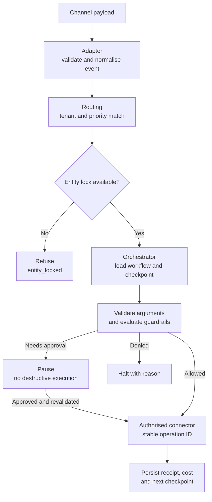
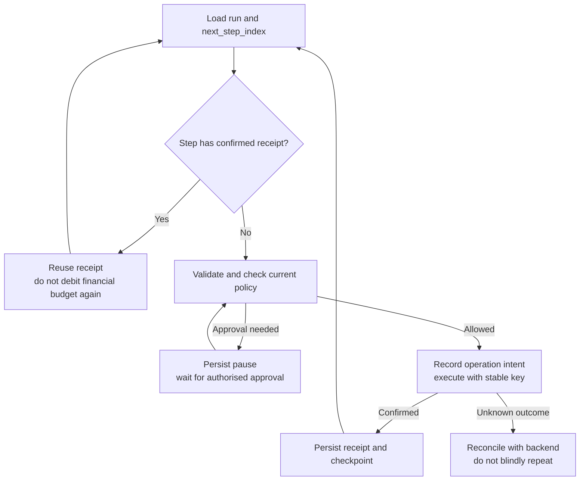

# Safe Workflow Automation for Non-Technical Users

*Letting non-technical users configure automations that take real actions widens who can build, while every dangerous decision must stay deterministic and out of the model's hands.*

◷ 12 min

## Understand the Customer Problem

In this scenario, Cascade Robotics wants support staff to configure ticket and escalation automations without writing code. A workflow may draft a reply, request approval, or move real money through a refund. The customer needs clear limits on what each automation can do, plus a record of why it acted. A crash, repeated webhook, or vague model instruction must not silently cause another payment.

Keep risky decisions in deterministic application controls. Use [the whiteboard clock](../T5.2_The_60_Minute_Whiteboard_Method/01_The_Six_Step_Whiteboard_Clock.md) to explain routing, typed calls, guardrails, and recovery.

---

## Frame the Round on Who Decides

Start with the user's ability and the cost of a mistake. Can they read a decision tree, or do they need a natural-language builder? Which channels and integration owners are involved? Email threading and webhook deduplication need explicit contracts.

Ask whether workflows read or write, what a bad action could cost, and whether the platform is multi-tenant. Scope this case to versioned, declarative workflows and a guarded runtime. The visual builder and natural-language compiler are separate projects; both must produce the same validated specification.

## Anchor on a Refund Cap

Cascade handles Tier-1 support through Zendesk webhooks and Slack escalations. A high-priority ticket gets a drafted reply; a billing complaint may request a refund.

The handbook source's introduction describes an approval threshold, while its runtime demonstrates a hard spend cap. Keep those separate: approval may permit an otherwise eligible action, but cannot override a hard budget. A cap change needs its own authorised configuration change.

Track event, channel, workflow version, trigger, step, tool, run, guardrail, and principal. Route one event, lock its ticket, and checkpoint each step. Destructive actions need validated arguments, policy permission, application authorisation, and an authoritative receipt.

## Route With Two Independent Checks



Routing is two checks on purpose. Priority answers a configuration question: which workflow is supposed to win. The entity lock answers a safety question: can two workflows ever mutate the same ticket at once. The lock holds even if priority was misconfigured, which turns a wrong priority into merely wrong instead of dangerous.

The checkpoint is one mechanism for both fresh runs and crash recovery. There is no separate recovery path with its own bugs. `next_step_index` is the single source of truth for where a run is.

## Type the Call So the Model Never Shapes It

Design the tool schema before runtime. The source illustrates `issue_refund(order_id: str, amount_usd: float)` and `validate_args()`. Reject missing fields, wrong types, invalid ranges, and unknown tools before dispatch.

The model may propose a refund and its arguments. The schema constrains their shape; policy and business applications decide whether the action is permitted. Valid JSON is not proof that an amount is correct or authorised.

## Order the Guardrail Rules So Deny Wins

The script introduces its guardrail as "five ordered rules, deny overrides", then draws a seven-line ladder. Count the full set as seven rules: five deny, two allow. Draw the five deny rules in order. A non-destructive step runs once it passes the two budget checks; a destructive step must clear all five deny rules and then match one of the two allows.

| # | Rule | Outcome |
|---|---|---|
| 1 | Step budget exceeded? | Deny and halt; do not loop |
| 2 | Spend cap exceeded? | Deny and halt; do not loop. Uses the real dollar amount for a refund |
| 3 | Shadow mode? | Deny destructive execution; drafts and simulation only |
| 4 | Below live status? | Deny; destructive steps disabled entirely |
| 5 | Destructive, not allow-listed, no approver? | Deny and pause for a real human with the right role |
| 6 | Autonomous and allow-listed? | Allow; auto-approved |
| 7 | Approved by a human with the right role? | Allow |

Autonomous status raises the ceiling on which actions can skip approval. It never removes the ceiling. A destructive tool not explicitly allow-listed still needs a human on a fully autonomous workflow, and the spend cap applies at every status.

Rules 1 and 2 are not two severities of one check; they count different things. The step budget counts how many steps a run has taken, so it catches a run looping forever however cheap each step is. The spend cap counts the dollars one step is about to spend, so it catches one expensive action however few steps came first. A run can break one without touching the other.

## Count the Real Money, Not a Nominal Fee

The reference build found a bug worth telling. A $500 refund on a test workflow with a $5 spend cap, a separate story from Cascade's $50 policy, passed authorisation. Every tool shared one cost function that charged a flat, nominal fee per call. That suits drafting a reply, which spends no real money. But the refund used the same flat fee, so the cap checked against a few cents every time, whatever the refund's size.

Two quantities were conflated: the operational cost of running a step, and the dollars the step spends on the customer's behalf. A cap cannot limit money it never measures. The fix makes a financial tool's cost the real amount in its own arguments. It is the same family of bug as the false leak alarm in [Access-Controlled Enterprise RAG](06_Access_Controlled_Enterprise_RAG.md): a check that looks protective but measures the wrong quantity.

> **Warning: idempotency must cover every effect of a step, including its cost.** The reference build's second bug came from a redelivered refund event. The idempotency guard correctly skipped the second refund, but the retry still went through the budget check and added its cost again. A safe, blocked retry then pushed a legitimate run over its cap. After verifying caller and tenant access, check whether the exact action already completed. Return its protected receipt without applying the financial effect or its budget debit again. An in-progress or unknown operation is not a completed replay.

## Make Runs Durable and Retries Harmless



There is no separate crash-recovery path. `resume()` and a fresh run call the same loop, which always starts at `next_step_index`, whether that is 0 or mid-workflow. One loop means one set of bugs to find, not two.

The key identifies a particular action, not just a run or tool name. Key it as `{tenant_id}:{run_id}:{step_name}:{args_hash}`, so a workflow with repeated refund steps keeps a stable step identity and unchanged arguments in every key.

## Raise Tenancy, Security, and Failure Unprompted

Every event, workflow and policy carries a `tenant_id`, and guardrail caps are per tenant. Routing only ever matches a tenant's own workflows against its own events.

Every tool call is typed and scoped. A tool's `scopes` list is what a real deployment would check against the connector credential in use: least privilege, not an agent with admin on everything. Destructive versus non-destructive is a first-class flag on the tool, not inferred. A guardrail cannot reason about risk it is not told about.

Name the honest gaps. There is no real secrets vault for connector credentials yet. There is no PII redaction on step outputs before a human sees them for approval, though the RAG design's `redact_pii()` could be reused directly. Every guardrail decision, allowed or denied and why, lands on the run's event log as it happens, so each run is a replayable record.

| Fails | Behaviour |
|---|---|
| A step's arguments do not validate | Rejected before execution; the run halts with a named reason |
| A destructive step's approval never comes | The run stays `PAUSED_FOR_APPROVAL` indefinitely; it never silently expires into either action |
| A workflow runs away through a self-trigger | Halts at the step budget instead of looping until noticed |
| Process crashes mid-run | Load durable checkpoint; reconcile any effect whose receipt was not persisted |
| Event is redelivered | Deduplicate intake and each effect; rely on a supported backend contract |

Scale has one honest limit. Every lock and idempotency key in the reference build lives in an in-process dictionary: useful for demonstrating control flow, insufficient for crash durability or multiple workers. At real volume, that becomes a distributed lock, such as Redis or a unique-constraint row, plus a durable idempotency store shared across workers. `acquire_lock` and `release_lock` stay the same two functions; only their backing changes.

## Close on Determinism and a Narrow Week One

The runtime owns workflow selection, destructive-action permission, and replay handling. Workflows are declarative and versioned; promotion through shadow and live modes never removes caps or application permissions.

| Decision | Chose | Revisit when |
| --- | --- | --- |
| Fixed step list | Deterministic and testable | Open-ended tasks need model planning inside the same guardrails. |
| Priority plus entity lock | Separate configuration and concurrency checks | Verify distributed lock ownership and recovery. |
| In-process state | Reference demo only | Every real deployment needs durable shared state. |

Start with one channel, one non-destructive workflow, and tested guardrails. The source reports 21 deterministic tests; this editorial pass does not rerun that reference runtime. Ask who owns policy, how autonomy is earned, and how cross-channel actions share one durable run.

## Worked Example: A $500 Refund on a $50 Cap

> **Added production guidance:** the clarification, payload, and recovery contract below are illustrative extensions to the reference runtime.

### Clarify the Financial Boundary

Ask: "Is $50 a hard budget or an approval threshold? Who may change it? Which refund operation is this, and does the payment backend deduplicate requests?" Approval alone cannot make a $500 action fit a $50 hard cap.

### Follow the Blocked Refund

A billing complaint arrives through the Zendesk webhook. Routing picks the highest-priority live workflow and takes the entity lock on the ticket. Step 0 drafts a reply: non-destructive, so it runs and checkpoints.

Step 1 proposes `issue_refund(order_id, amount_usd=500)`. The arguments validate. The step budget is fine. The spend cap compares $500, the real amount, against Cascade's $50 cap and halts the step with a named reason. Under the buggy cost function, the cap would have seen a few cents and approved it.

Now suppose the tenant raises the cap, the workflow is autonomous, but `issue_refund` is not allow-listed. Rule 5 denies it, so the run pauses for a human with the right role. Approval an hour later resumes at step 1, never re-running step 0, and records the key `cascade:run-42:refund:<args_hash>`. A redelivered event passes the caller and tenant access check, then hits the idempotency check and becomes a free no-op. No refund repeats, and no cost is counted twice.

| Line that carries the round | Point it makes |
|---|---|
| The model decides that; a typed signature decides how | Where determinism lives |
| Autonomy raises the ceiling, never removes it | Guardrail ordering |
| One execution loop, not two | Durability |
| The idempotency key is on the action, not the run | Safe retries |
| Priority says which should run; the lock says whether two can | Routing |
| A halted run with a named reason beats a silent loop | Failure behaviour |

### Trace the Guardrail Result

```json
{
  "trusted_scope": {"tenant": "cascade", "run": "run-42"},
  "proposal": {"tool": "issue_refund", "amount_usd": 500},
  "policy": {"spend_cap_usd": 50, "version": "v3"},
  "decision": "halt_spend_cap_exceeded",
  "payment_status": "not_started"
}
```

The application derives scope and checks policy. The guardrail rejection is the outcome: no payment API call occurred. If an eligible call later times out, reconcile it before retrying. Durable checkpoints alone cannot close the gap between a remote payment and a local receipt.

## Explain the Design in 60 Seconds

> "I'd separate workflow authoring from the guarded runtime. Each event would be normalised, matched within its tenant, and checked against an entity lock. A versioned workflow would run through one checkpointed execution loop.
>
> The model could propose arguments, but schemas, hard budgets, tool allow-lists, and approval roles would control execution. A $500 refund under a $50 cap would halt, even with approval. I'd persist operation intent and receipts, reconcile uncertain payments, and deduplicate both the business effect and financial budget debit. The reference's in-memory stores demonstrate the shape; production needs durable shared state and backend idempotency support. I'd begin with one channel and non-destructive work."

---

## Key Takeaways

- Frame the round on deterministic control, and ask about users, channels, write actions, blast radius and tenancy.
- Anchor on a refund cap: autonomy up to the point where a mistake costs real money.
- Route with a priority match and an independent entity lock; one checkpointed loop serves fresh and resumed runs.
- Typed tools constrain model proposals; policy and backend authorisation control money movement.
- Order the seven guardrail rules (five deny, two allow) so deny wins; budget counts steps and the cap counts dollars.
- A spend cap must measure the real money a step spends, not a nominal fee.
- Resume and fresh runs share one loop; idempotency belongs to the action and must cover cost too.
- Tenant IDs, scoped tools and a destructive flag carry security; failures halt or pause with a named reason.
- Close on determinism, three revisitable trade-offs and a narrow week one.

## Check Yourself

1. **Why are priority and the entity lock separate checks?**
   Priority answers which workflow should run, a configuration question. The lock answers whether two can mutate one ticket at once, a safety question that holds even when priority is misconfigured.

2. **How did a $500 refund pass a $5 spend cap?**
   Every tool shared a flat nominal cost function, so the refund counted as a few cents. A financial tool's cost must be the real amount in its arguments.

3. **Why must the idempotency check run before authorisation?**
   Otherwise a replayed action is skipped but its cost is still counted, and a safe retry can push a run over budget. After caller access checks, a confirmed replay returns the existing receipt without another financial debit. Unknown outcomes need reconciliation.

4. **Can manager approval override a hard spend cap?**
   No. An authorised policy change is separate from approving an eligible action.

5. **Do checkpoints alone prevent duplicate remote payments?**
   No. Reconcile the gap between remote execution and local receipt persistence, with a supported backend contract.

6. **What needs to identify a repeated action?**
   Tenant, run, stable step identity, and the same arguments, keyed as `{tenant_id}:{run_id}:{step_name}:{args_hash}`. A tool name alone may identify several legitimate steps.

7. **Can a replay skip caller access checks?**
   No. Verify caller and tenant before returning an existing protected receipt; do not apply its financial debit again.

8. **Are the reference in-memory dictionaries production durability?**
   No. Multiple workers and crash recovery need shared durable state and tested concurrency behaviour.

## References

**Sources:** `02_System_Design_Case_Studies/Classic_Design_Walkthroughs/Handbook_Casebook/whiteboard_scripts/03_Agent_Platform_For_Non_Technical_Users.md`: "Before you start", Step 1 (questions, scope, case study), Step 2, Step 3, Step 4A (constrained schemas, the guardrail rules, both bug stories), Step 4B, Step 5 (multi-tenancy, security, observability, failure modes, scale), Step 6, the cheat sheet, "Questions to ask them" and "If you have a laptop".
