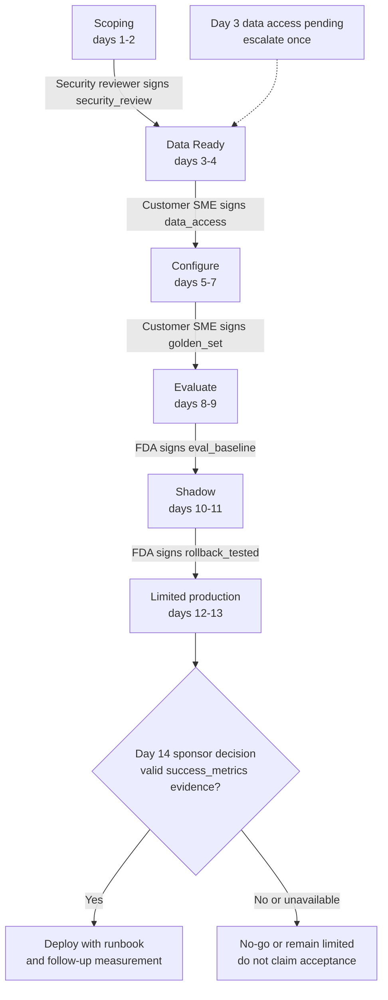

# Delivering an Agent in Two Weeks with Enforced Gates

*A two-week delivery clock rewards speed, while every gate that can be ticked by whoever is in a hurry turns speed into unverified risk.*

◷ 12 min

## Understand the Customer Problem

In this illustrative scenario, Northwind Logistics wants a Tier-1 support triage agent using Zendesk, Confluence, and Salesforce. The delivery team has a two-week target, but the customer needs more than a launch date. It needs measurable acceptance criteria, authorised security and data approvals, a tested rollback, and a clear owner for release. The framework must show when delivery is ready and when it must stop.

Treat delivery as an operating model with enforced evidence gates. Use [the whiteboard clock](../T5.2_The_60_Minute_Whiteboard_Method/01_The_Six_Step_Whiteboard_Clock.md) to connect readiness, reuse, and a narrow release.

---

## Frame the Round on Gates, Not Boxes

Ask whether two weeks is a target or an SLA, who owns go/no-go, and what reusable assets actually exist. Establish what happens when a security gate fails and whether the framework serves one team or many.

Scope a state machine with named roles, required evidence, and versioned accelerator assets. The delivery lead is called the FDA in the source. A customer subject-matter expert (SME) owns domain evidence. Neither seniority nor deadline pressure grants permission to sign another role's gate.

## Refuse What Cannot Be Measured

Northwind agrees two scenario targets before day 1: first response under 5 minutes for the top 3 ticket categories, and 60% zero-edit sends among eligible tickets by week 4. Define the eligible population, data source, baseline, and observation window. Refuse intake without measurable criteria or an assigned SME.

The week-4 target cannot be proved on day 14. Agree a separate limited-release acceptance rule and an owner for the later measurement. If the sponsor requires week-4 evidence before any release, the two-week launch must wait.

Intake starts the clock only after readiness. Each stage needs its authorised gate and evidence. The FDA cannot sign the security review; the sponsor owns go/no-go. Deployment includes a runbook, dashboards, and a tested rollback.

## Label Every Gate With Who Signs It



This is the same decision shape as the RAG design's ABAC engine: a named rule, a role check, deny overrides and an explicit reason. A gate sign-off and a document-access decision are the same kind of problem. Is the person asking actually authorised to say this is true?

No code path jumps a stage. `advance_stage()` only ever moves to the immediate next one, just as the RAG design has no path that queries the vector store without the ACL filter. The state machine rejects skipped transitions. Production must also protect state storage, permissions, and administrative mutation paths.

## Make a Gate a Decision, Not a Checkbox

A stage is ready only when its evidence supports the named acceptance rule. Time passed is not evidence.

A naive gate is a checkbox, "security review complete", that anyone can tick. An enforced gate is `sign_off(gate, signer, evidence)` with three conditions. The signer's role must be in the gate's allowed roles, with deny overrides. Evidence must be non-empty and valid for the criterion, run, and version. A filled string alone proves nothing. And every earlier gate must already be passed, so nothing is signed out of order.

A checkbox is a status; a gate is a decision with a named authority behind it. An FDA closing their own security gate is the delivery version of an LLM enforcing its own access control. The person closest to the work is not automatically the person authorised to certify it is safe.

Risk mitigation becomes automatic too. The plan's rule "data access delays: start day 1, escalate day 3" is not a tracker note. `check_escalation_triggers()` runs a real check: if the data-access gate is still pending on day 3, the system raises the escalation once. It lands in the engagement's permanent event log whether anyone was watching or not.

> **Warning: a status anyone can set is not a control.** If the person under deadline pressure can mark a gate passed, the gate measures honesty, not readiness. Bind each gate to an allowed role and to evidence, and block every later stage until it passes.

## Measure Reuse to Prove the Process Is Productised

Every stage needs assets: a connector, a prompt template, a guardrail policy. Pulling one from the library records it as reused. Building one because it is missing records it as custom, and logs it. The reuse rate is reused pulls divided by total pulls.

A reuse number makes the process inspectable; it does not prove that reused assets meet this customer's requirements. On Northwind the rate is 83%: 5 of 6 assets came straight from the library, and one guardrail policy was custom. Tracked across engagements, that ratio shows whether the framework works or is quietly sliding back to bespoke code.

Be honest about what the library is. It is a list of names. Its entries are named assets, such as `zendesk_connector` and `golden_set_harness`, not the connector code or the eval harness itself. A real harness exists in the RAG design and could be wired into the Evaluate stage instead of asserting a score. That wiring is not done yet. The gate mechanism is real; the number behind one piece of evidence currently is not.

## Name Which Mitigations Are Real

The plan names four risks. The reference build implements some and not others.

| Risk | Mitigation | Built? |
|---|---|---|
| Data access delays | Escalate automatically on day 3 | Yes, a real check |
| Scope creep | Change control on the signed scope | No; would reuse the sign-off pattern as a `request_scope_change()` needing the sponsor role |
| Unmeasurable success criteria | Refuse to start | Yes, in `intake()` |
| No customer SME | Contractual prerequisite | Yes, in `intake()` |

The sources disagree with themselves here. The table marks three of four as built, while the closing summary says two of four mitigations are automatic checks in code. One reading is that two are automatic and one is an intake refusal, but the script does not say so. Either way, showing three real and naming the fourth gap beats claiming four and being caught out on a follow-up.

## Treat a Stall as a Visible Outcome

| Fails | Behaviour |
|---|---|
| A hard gate is genuinely denied, not late | The engagement stays at its stage; the failure is a first-class logged event, not a silent stall |
| The wrong person attempts a sign-off | Denied and logged; state unchanged, with no partial progress |
| The golden set never gets customer sign-off | Evaluate is permanently blocked; this is a customer-side failure the framework surfaces, not routes around |
| Day-14 acceptance evidence missing or failed | Do not pass go/no-go; week-4 outcomes remain pending their real observation window |

The framework targets 14 days but records the exact blocking gate when readiness is missing. Some engagements should not be two weeks at all, and knowing which to reject is part of the design.

Scale is about the portfolio, not chunks. The equivalent of "10 million chunks" here is one FDA running six engagements at once. The state machine does not change with portfolio size; it is the same gates per engagement. The hard part is capacity: how many engagements one person carries before gates queue behind their calendar rather than the customer. That needs real engagement-duration data before designing it, just as embedding-cache hit rates need real query logs.

## Close on a Narrow Rollout

Summarise in three sentences. A seven-stage pipeline blocks every transition behind a named, role-gated decision, not a status field. Reusable assets are pulled before anything is built custom, and that ratio is tracked as the measure of repeatability. Named risk mitigations run as checks in code, not reminders, and the gaps are stated plainly.

| Decision | Chose | Would revisit if |
|---|---|---|
| Role-gated sign-off over self-certification | Six named gates with authorised signer roles | A single-person delivery team where role separation is impossible; then gates compress, not disappear |
| Hard refusal at intake over "start and hope" | Refuse unmeasurable or no-SME requests | A strategic customer where the business accepts the risk; then intake needs an explicit override with its own sign-off |
| Automatic escalation over manual tracking | Day-3 auto-escalation on data access | Mitigations multiply and a dashboard becomes clearer; then a rules engine, not hard-coded checks |

For the forward-deployed close, rolling this out internally does not start with all seven stages. Pick the two gates most often skipped under deadline pressure, which in the author's experience are the golden-set sign-off and the rollback test. Make just those structurally unskippable first. Test these controls before expanding the rollout.

Questions for the interviewer's company: is the accelerator library code, templates or tribal knowledge? Where has the two-week target actually broken down, and at which gate? Who owns go/no-go in practice? How many engagements does one forward-deployed person carry at once? The artefact to show is the gate-failure demo: the same senior person, in the wrong role, is denied, not warned. The source reports 17 deterministic tests; they were not rerun for this editorial pass.

## Worked Example: Day 3 at Northwind

> **Added production guidance:** the evidence record and release-window clarification below extend the source's illustrative Northwind engagement.

### Clarify Acceptance Before Starting

Ask: "What can be measured by day 14, and what needs four weeks? Who signs each criterion? Which evidence version is accepted, and who can authorise a scope change?" Keep later outcomes separate from launch readiness.

### Follow the Blocked Gate

Northwind passes intake: both metrics are measurable and an SME is assigned. Days 1 to 2 are Scoping, and the security reviewer signs `security_review` with evidence attached. Data Ready begins, but on day 3 the `data_access` gate is still pending with the customer SME.

`check_escalation_triggers()` fires once and writes the escalation to the event log, with nobody needing to remember. Impatient, the FDA tries to sign `data_access`. The role check denies it, logs it and leaves the state unchanged. The engagement has not slipped silently; it is visibly stuck at a named gate for a named reason.

When the SME signs, Configure pulls five of six assets from the library and builds one guardrail policy custom: 83% reuse. On day 14, the sponsor checks the agreed limited-release evidence. The week-4 zero-edit target remains pending. Release requires a valid day-14 acceptance rule; otherwise the gate stays blocked. Either way, the outcome traces to gates and evidence, not to time passed.

| Line that carries the round | Point it makes |
|---|---|
| A gate is a decision with a named authority | Role-gated sign-off |
| No code path skips a stage | Structural enforcement |
| Refuse an engagement with no measurable metric | Readiness drives the clock |
| The reuse ratio measures a productised process | Accelerator library |
| An automatic escalation beats a tracker reminder | Risk mitigation |
| A day-14 no-go is a legitimate outcome | Failure behaviour |

### Trace One Sign-Off Attempt

```json
{
  "engagement": "northwind-42",
  "stage": "data_ready",
  "gate": "data_access",
  "trusted_signer_role": "FDA",
  "required_role": "customer_sme",
  "decision": "denied_role_mismatch",
  "state_changed": false
}
```

The authenticated role comes from application identity, not the submitted sign-off text. Deny and audit the attempt. Duplicate valid submissions need one transition and one stable evidence record; concurrent requests must not advance twice.

## Explain the Design in 60 Seconds

> "I'd treat two-week delivery as a repeatable readiness process. Intake would require measurable criteria and a customer SME. Each stage would have a named gate, authorised signer, and evidence tied to the engagement version. A delivery lead could not self-certify security or customer data access.
>
> I'd escalate late dependencies automatically and show blocked stages clearly. Reused assets would be versioned and tested, with custom work recorded. Day-14 release would use evidence available then; a week-4 outcome would remain a later measurement. Missing evidence would mean no-go, not an invented pass. I'd start with a narrow rollout, a tested rollback, and portfolio metrics showing where people or approvals become the bottleneck."

---

## Key Takeaways

- Frame the round as an operating-model question: are the gates enforced, or just reported?
- Refuse engagements without measurable metrics or an SME; readiness drives the clock.
- Each gate names who signs it, and `advance_stage()` cannot skip a stage.
- A sign-off needs the right role, real evidence and every earlier gate passed; escalations fire automatically.
- The reuse rate, 83% on Northwind, measures whether the process is productised.
- State which mitigations are built, and note that the source counts them inconsistently.
- Denials, stalls and a no-go are logged, visible outcomes; scale is portfolio capacity, not data volume.
- Close by making the two most-skipped gates unskippable first.

## Check Yourself

1. **Why can the FDA not sign the security gate?**
   The person closest to the work is not automatically authorised to certify it is safe. Each gate allows only named roles, with deny overrides.

2. **What does the 83% reuse rate measure on Northwind?**
   5 of 6 assets came from the accelerator library and one guardrail policy was custom. Tracked across engagements, it shows whether delivery stays productised.

3. **Is a day-14 no-go a failure of the framework?**
   No. It is a legitimate outcome; the framework's job is to show exactly which gate stopped the engagement and why.

4. **Can day 14 prove the week-4 zero-edit target?**
   No. Agree a separate limited-release rule or wait until the required evidence exists.

5. **Is a non-empty evidence string sufficient for sign-off?**
   No. Evidence must match the criterion, observation window, engagement, and accepted version.

6. **Who supplies the signer role?**
   The application derives it from authenticated identity. Submitted role text cannot grant sign-off authority.

7. **How should concurrent sign-offs behave?**
   They must create one valid state transition, with idempotent recording and no skipped gate.

8. **Does 83% asset reuse prove readiness?**
   No. It records five of six reused assets; each still needs verification for this customer.

## References

**Sources:** `02_System_Design_Case_Studies/Classic_Design_Walkthroughs/Handbook_Casebook/whiteboard_scripts/04_Scoping_Doc_To_Deployed_Agent_In_Two_Weeks.md`: "Before you start", Step 1 (questions, scope, case study), Step 2, Step 3, Step 4A (gates as authority, automatic risk mitigation), Step 4B (the accelerator library), Step 5 (risk mitigation table, failure modes, scale), Step 6 (summary, trade-offs, forward-deployed close), the cheat sheet, "Questions to ask them" and "If you have a laptop".
