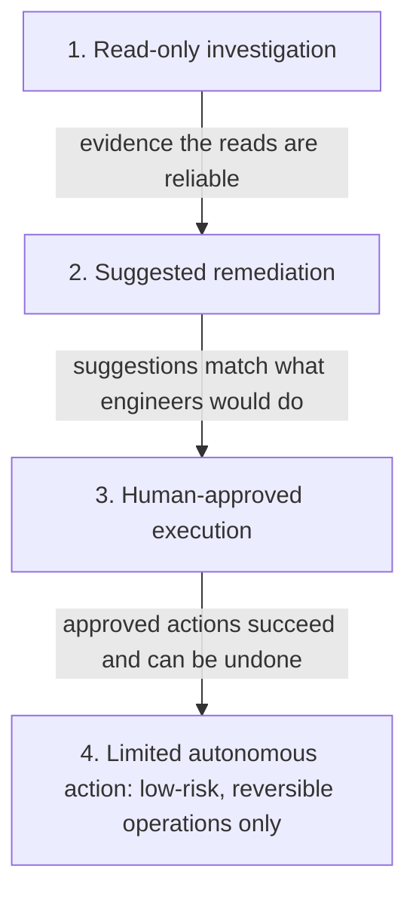

## Start with the demo that never shipped

Penhallow Bank, a fictional retail bank, ran an internal competition for AI ideas. The winning demo was an agent that read a complaint, decided on compensation and paid it into the customer's account. The board loved it, and it became the first project.

It spent five months in review. Risk wanted evidence on decisions that moved money. Legal wanted an audit trail that did not exist. The data team found that a third of past complaints had no recorded outcome to evaluate against. Meanwhile a dull runner-up, an assistant that summarised complaint histories for case handlers, could have been live in weeks with a person reading every output. Call this **the demo-first pick**: choosing the first use case by how impressive it looks rather than by whether it can ship.

> **What you'll learn**
>
> - Rank candidate use cases on value, feasibility and risk rather than on demo appeal.
> - Narrow a risky, high-value use case instead of rejecting it.
> - Climb an autonomy ladder from read-only help to limited action.
> - Check whether the data can support a measurable improvement before choosing a model.

## Rank use cases on more than value

The first use case is not the most impressive demo on the list. It is the one with a measurable outcome, available data and a risk the customer can live with, chosen after the metrics in [success metrics and evaluation data](03_Success_Metrics_and_Evaluation_Data.md) are clear.

An executive hands over 30 possible AI use cases and asks which to build first. Use a prioritisation matrix with ten columns:

- **Why it matters:** business value, user pain, time to value, adoption likelihood and reusability.
- **Whether it can be built:** feasibility, data availability and integration complexity.
- **What could go wrong:** risk and evaluation difficulty.

Value is one column of ten. A use case with high value but no data, no integration path or no way to evaluate it will stall. So the winner needs six things together: a measurable outcome, a realistic path to adoption, manageable risk, available data, a practical integration path and a credible evaluation strategy. Avoid selecting the most impressive demo.

## Narrow the risky use case instead of dropping it

The common follow-up is "the highest-value use case is also the riskiest. What do you recommend?" Dropping it gives up the value. Building it whole risks the customer. The middle path shrinks the exposure while keeping the use case.

The levers:

- Narrow the initial scope.
- Add human approval.
- Start with decision support rather than automation.
- Limit the user population.
- Run in shadow mode.
- Define explicit go/no-go gates.
- Expand only after measured evidence.

Each lever reduces the cost of a mistake without changing what the system is for.

The same levers answer the regulated-industry version: "the business wants to skip the governance review for the MVP." Keep both speed and safety by narrowing the scope, using synthetic or masked data where possible, starting read-only or assistive, defining explicit approval gates, and getting security and legal review before any production exposure.

> **Warning:** "We'll add governance after the MVP" is how sensitive data reaches production unreviewed. Narrow the MVP until the review is cheap enough to do now. Never skip the review to protect the date.

## Climb the autonomy ladder one rung at a time

Autonomy is earned, not configured. An incident-response case asks whether an agent should restart production services automatically. The safe progression has four rungs, shown in Figure 1.

*Figure 1: The autonomy ladder. Each rung is reached only with evidence from the rung below, and the top rung covers only low-risk, reversible operations.*

The same shape appears in a claims case, which starts with extraction, triage, summarisation and missing-information detection before any automated adjudication. It also appears in a support case, where the trade-offs include assistive copilot versus autonomous agent, read-only versus write-capable tools, and automation rate versus customer-impact risk. When a customer asks for 80% autonomous resolution in six months, these rungs are the basis for challenging the target.

## Check whether the data can support the outcome

Sometimes the right first step is not a use case at all. When the customer's data is incomplete, inconsistent and poorly documented, do not begin with model selection. First find out whether the available data can support a measurable workflow improvement.

That investigation has its own checklist:

- Profile data quality and find the owners.
- Measure missingness and duplicates.
- Look for schema inconsistencies, poor labels and stale records.
- Then consider data contracts, human-in-the-loop correction and a narrower first use case.

Keep open the possibility that AI is not the right solution.

## Worked example: choosing between three candidates

Suppose three of the executive's 30 ideas survive a first pass. Score them on the matrix. The switcher shows how each one scores and what happens to it.

Three candidates survive the first pass. Compare how each scores on the matrix and what the decision is.

<button type="button" data-mode="refund" aria-pressed="false" aria-controls="refund-result">Autonomous refund agent</button>
<button type="button" data-mode="brief" aria-pressed="false" aria-controls="brief-result">Account-brief assistant</button>
<button type="button" data-mode="incident" aria-pressed="false" aria-controls="incident-result">Incident-diagnosis assistant</button>

<section id="refund-result" class="mode-panel" data-announcement="Refund agent selected. Narrowed, not dropped."><h4>Autonomous refund agent</h4><ul><li>Value: high.</li><li>Risk: high, because it writes money.</li></ul>
Decision: not dropped. Narrowed to suggesting refunds for human approval, on one product line, in shadow mode, with a go/no-go gate before it acts.
</section>
<section id="brief-result" class="mode-panel" data-announcement="Account-brief assistant selected. Goes first."><h4>Account-brief assistant</h4><ul><li>Data: reads CRM, email, usage and support data.</li><li>Metrics: clear, such as preparation time and brief accuracy.</li><li>Risk: errors are caught by a seller before a meeting.</li></ul>
Decision: goes first. Measurable outcome, available data, manageable risk and a reader in the loop.
</section>
<section id="incident-result" class="mode-panel" data-announcement="Incident assistant selected. Strong value, heavy integration."><h4>Incident-diagnosis assistant</h4><ul><li>Value: strong.</li><li>Integration: needs logs, traces and topology joined across many systems.</li></ul>
Decision: not first. The integration path is the longest of the three.
</section>

The matrix chose the order, and the narrowing levers kept the high-value idea alive.

## Limits of this lesson

- **Scores are judgements.** A matrix makes the reasoning visible. It does not make it objective, so record who scored each column.
- **Priorities move.** A new regulation or a failed integration can reorder the list. Re-score at each gate.
- **Illustrative story.** Penhallow Bank is fictional.

## Interview angle

Each answer is an outline to say in about two minutes. Open each question and try it aloud before reading.

Interview question 1. An executive gives you 30 AI ideas and asks which to build first. How do you decide?

- **Answer:** Score each on a ten-column matrix: business value, user pain, feasibility, data availability, integration complexity, risk, time to value, adoption likelihood, reusability and evaluation difficulty. Pick the one with a measurable outcome, an adoption path, manageable risk, available data, a practical integration path and a credible evaluation, not the best demo.
- **Trade-off:** Scoring 30 ideas takes days. A quick first pass on data and risk cuts the list to a few.
- **Follow-up to expect:** "The CEO prefers another one." Show the scores and offer it as the second release.

Interview question 2. The most valuable use case is also the riskiest. What do you recommend?

- **Answer:** Keep it, but narrow it. Limit the scope and the users, add human approval, start with decision support, run in shadow mode, and set go/no-go gates. Expand only after measured evidence. Each lever cuts the cost of a mistake without changing what the system is for.
- **Trade-off:** Narrowing delays the full value. Dropping the use case gives it up altogether.
- **Follow-up to expect:** "How long in shadow mode?" Until the agreed metrics hold over enough cases to pass the gate.

Interview question 3. A regulated client wants to skip the governance review to hit the MVP date. What do you say?

- **Answer:** Keep the review and make it cheap. Narrow the scope, use synthetic or masked data, start read-only or assistive, define approval gates, and get security and legal review before any production exposure.
- **Trade-off:** A narrower MVP shows less. An unreviewed one can put sensitive data in production.
- **Follow-up to expect:** "The review takes two months." Ask what makes it long, and cut the MVP until the review covers less.

Interview question 4. The customer wants 80% of support requests resolved autonomously within six months. How do you respond?

- **Answer:** Use the autonomy ladder to challenge the target. Start read-only, then suggest resolutions, then execute with approval, and allow autonomy only for low-risk, reversible actions once evidence supports it. Offer a target per rung and a measured automation rate, weighed against customer-impact risk.
- **Trade-off:** A slower climb delays savings. Skipping rungs turns model errors into customer harm.
- **Follow-up to expect:** "Which requests could be autonomous first?" Low-value, reversible ones with clear policy.

Interview question 5. The customer's data is incomplete and poorly documented. Which use case do you start with?

- **Answer:** None yet. First test whether the data can support a measurable improvement: profile quality, find owners, measure missingness and duplicates, and check schemas, labels and staleness. Then consider data contracts, human correction and a narrower use case, and keep open that AI may not fit.
- **Trade-off:** A data investigation delays the visible build. Skipping it builds on data that cannot be evaluated.
- **Follow-up to expect:** "The sponsor wants a model this quarter." Offer a narrow use case on the cleanest data source.

## References

1. *FDE Problem Decomposition Question Bank* (the author's own question bank): cases 2 "Customer-Support Agent" (trade-offs and the 80% follow-up), 3 "Claims-Processing Assistant", 4 "AI-Powered Sales or Account-Research Assistant", 12 "Deploying AI in a Highly Regulated Industry", 14 "AI-Powered Operations or Incident-Response Assistant", 16 on prioritising AI use cases for a large enterprise, and 18 "Build an AI System When the Customer's Data Is Poor".
2. NIST, [AI Risk Management Framework](https://www.nist.gov/itl/ai-risk-management-framework), accessed 17 November 2026. A voluntary framework for managing AI risk across design, development and use.
3. The site's [observing the work](06_Observing_the_Work.md) lesson, for ranking bottlenecks by frequency, cost and reach.

## Key takeaways

- Rank use cases on a ten-column matrix. Value is one column, and the most impressive demo is a trap.
- Narrow a risky, high-value use case with approval, decision support, limited users, shadow mode and gates.
- Earn autonomy rung by rung, from read-only help to limited reversible action.
- With poor data, test whether the data can support a measurable improvement before choosing any model.

## Check yourself

1. What six properties should the first use case have?

A measurable outcome, a realistic adoption path, manageable risk, available data, a practical integration path and a credible evaluation strategy.

2. The business wants to skip the governance review for the MVP. What do you propose?

Narrow the scope, use synthetic or masked data, start read-only or assistive, define approval gates, and get security and legal review before production exposure.

3. Should an operations agent restart production services on its own?

Not at first. Move from read-only investigation to suggested remediation to human-approved execution. Allow autonomy only for low-risk, reversible operations, and only after evidence.

