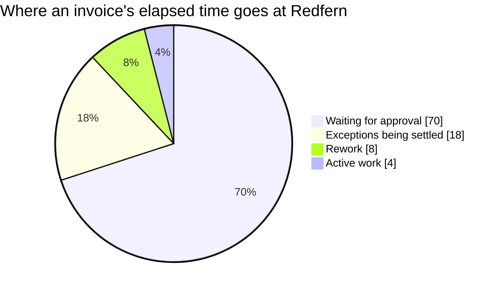

## Start with the invoices nobody was waiting on

Redfern Health, a group of three hospitals, brought in an FDE to put AI on supplier invoices. The finance director's brief was clear: accounts payable keys 3,000 invoices a month by hand, and late payments are costing the group penalty fees. The FDE asked to sit with the team for a morning before agreeing anything. Keying an invoice took about two minutes, yet invoices were spending ten days in the system, and the penalties did not line up with the keying at all. Call this gap between the described work and the done work **the stated pain**.

> **What you'll learn**
>
> - Explain what watching people work shows that interviews miss.
> - Run a short observation session and record what you see.
> - Reach frontline users when you are only offered managers.
> - Split elapsed time into active work, waiting, rework and exceptions.
> - Find the rare exceptions that cause most of the losses.

## What interviews miss

An interview gives you the process as the speaker understands it. Managers describe the process as designed. Experienced staff describe it as they remember it, and they leave out the steps they no longer notice: the spreadsheet they keep on the side, the colleague they message for a missing code, the case they park until Friday.

Observation fills those gaps. **Contextual inquiry**, a method from user research, pairs the two: you watch someone do their real work in their own setting and ask about it as it happens. Nielsen Norman Group describes it as a way to learn about tasks and context that people cannot easily recall in an interview.

Three things are almost always missing from interviews:

- **Workarounds.** Side spreadsheets, sticky notes and personal checklists that hold the process together.
- **Waiting.** People report their own effort, not the hours a case spends in a queue.
- **Exceptions.** The odd cases feel unusual to staff, so they leave them out of "how it works", even when they take most of the time.

## Running an observation session

An observation session needs a few hours and permission, not a research team. A plan that works in most engagements:

1. **Ask for real work, not a demo.** Sit beside someone working their live queue. A demonstration shows the happy path.
2. **Cover each role once.** Watch at least one person in each role that touches the case, for two or three hours each.
3. **Note times and events.** Write down when a case starts, waits, moves to someone else, gets sent back or is parked.
4. **Ask "what are you waiting for?"** Whenever someone stops, ask what they need and from whom.
5. **Collect the artefacts.** Ask for a copy of the side spreadsheet, the checklist and the template email.
6. **Do not fix anything.** Offering a fix mid-session changes what people show you. Note the idea and keep watching.

Afterwards, read the system's own records for the same cases. Timestamps in the ticket or invoice system show how long the waiting lasts across hundreds of cases, which a morning of watching cannot.

> **Pitfall:** Treating one morning as the whole picture. Observation tells you what to measure. The system data tells you how often it happens.

## When you are only offered managers

Many customers offer the FDE a meeting with managers and keep frontline staff away, out of worry about workload, union agreements or what staff might say. Push for access, because the people who do the work hold the facts you need.

Ways to get access without a fight:

- **Explain the risk in the sponsor's terms.** "If we build from the manager view only, we may automate the wrong step and the money is wasted."
- **Make it small.** Ask for two hours with two people, not a week with the team.
- **Invite the manager.** A manager in the room often relaxes the request, though you will hear less about workarounds.
- **Offer other channels.** A screen recording of a real shift, a short anonymous survey or a review of the ticket history.
- **Respect the rules.** Where a works council or union must agree, go through it. A blocked session costs less than a broken relationship.

If access is still refused, say what the design will be missing and record the risk in the scope.

## Where the time goes

Every minute a case spends in a process falls into one of four kinds. Keep them separate, because each one has a different fix.

| Kind | What it looks like at Redfern | Usual fix |
| --- | --- | --- |
| Active work | Keying the invoice, checking the purchase order | Automation, better tools |
| Waiting | The invoice sits in a budget holder's approval queue | Change the rule, add reminders, delegate authority |
| Rework | An invoice keyed with the wrong cost code is sent back | Validate at entry, fix the source data |
| Exceptions | Price or quantity does not match the purchase order | A dedicated path with an owner and a deadline |

*Table 1: The four kinds of elapsed time. AI mostly helps with active work, which is often the smallest share.*

At Redfern, most of an invoice's ten days went on waiting for a budget holder to approve it. Figure 1 shows how the ten days split across the four kinds, averaged over a month of invoices. The figures are illustrative.

*Figure 1: Share of elapsed time by kind, in per cent. Active work, the only part invoice-reading AI would speed up, is the smallest slice.*

**Lean** practitioners draw the same split in a value-stream map, which records the process time and the waiting time between steps. The idea carries over directly: measure the waiting before deciding what to automate.

## The rare exceptions that cost the most

Exceptions are easy to dismiss because they are rare. Count them by cost, not by frequency. A simple product does the work: how often an exception happens, multiplied by what each one costs in staff time, penalties or customer harm.

At Redfern, about 6% of invoices did not match their purchase order on price or quantity, about 180 a month. Each took around 25 minutes of emails and calls to settle: 75 hours of staff time, close to the 100 hours spent on keying. Because they sat in inboxes past the due date, they also caused nearly all the penalty fees. A small group of cases held most of the loss.

The switcher compares the problem as Redfern described it with the problem the FDE observed.

Redfern asked for invoice-reading AI. Compare the problem as described in meetings with the problem seen at the desk.

<button type="button" data-mode="told" aria-pressed="false" aria-controls="told-result">What we were told</button>
<button type="button" data-mode="seen" aria-pressed="false" aria-controls="seen-result">What we saw</button>

<section id="told-result" class="mode-panel" data-announcement="What we were told selected. Keying is the problem."><h4>What we were told</h4><ul><li>Keying 3,000 invoices a month is slow and tedious.</li><li>Late payments cause penalty fees.</li><li>Proposed fix: AI that reads invoices.</li></ul>
Expected result: faster keying. Penalties barely change, because keying was never what delayed payment.
</section>
<section id="seen-result" class="mode-panel" data-announcement="What we saw selected. Approval waits and mismatches are the problem."><h4>What we saw</h4><ul><li>Invoices wait about seven days for budget-holder approval.</li><li>180 mismatched invoices a month take 75 hours and cause nearly all penalties.</li><li>Proposed fix: auto-approve matched invoices under a set value, and route mismatches to one owner with a due-date alert.</li></ul>
Expected result: fewer penalties within a month, with no AI in the first release.
</section>

AI may still earn a place later, for example in matching invoice lines to purchase orders. Observation decided the order.

## Choosing which bottleneck to solve

Observation usually turns up more problems than one engagement can fix. Rank each candidate on four questions:

- **How often does it happen?** Use the system data, not memory.
- **What does each occurrence cost?** Staff time, money, risk or customer harm.
- **Can the engagement change it?** A delay caused by a supplier you cannot reach is a poor first target.
- **Does the data exist to measure it?** Without a baseline you cannot show the fix worked.

The best first target is frequent or costly, within reach, and measurable. This ranking picks which problem to work on. [Choosing the first use case](04_Choosing_the_First_Use_Case.md) then ranks the possible solutions to it, adding risk, data readiness and evaluation difficulty.

## Limits of this lesson

- **Observation changes behaviour.** People work more carefully when watched. Check what you saw against the system records.
- **A morning is a sample.** Month-end, holidays and seasonal peaks look different. Ask what a bad week looks like.
- **Composite engagement.** Redfern Health and its figures are illustrative, not a real customer.

## Interview angle

Each answer is an outline to say in about two minutes. Open each question and try it aloud before reading.

Interview question 1. Why would you observe users at work when you can interview them?

- **Answer:** Interviews give the process as people believe it runs. Watching shows the workarounds, waiting and exceptions they no longer notice. I sit with each role for a couple of hours on their live queue, note when work starts, waits and moves, and ask what they are waiting for. Then I check the system records to see how often it happens.
- **Trade-off:** Observation costs the customer staff time and can feel intrusive. Skipping it risks automating a step that was never the problem.
- **Follow-up to expect:** "What did observation change for you once?" Give a case where the stated pain was not the costly one.

Interview question 2. How do you find the bottlenecks, manual work and exceptions worth solving?

- **Answer:** Split elapsed time into active work, waiting, rework and exceptions, using observation to find them and system timestamps to size them. Then rank candidates by frequency, cost per occurrence, whether we can change them and whether we can measure them.
- **Trade-off:** Ranking takes a week of data work. Picking the loudest complaint is faster and often wrong.
- **Follow-up to expect:** "Which kind does AI help with?" Mostly active work and some exceptions. Waiting usually needs a rule or ownership change.

Interview question 3. Users describe one pain, but what you observe is different. Whose version do you build for?

- **Answer:** Neither, until the data settles it. Show both versions to the sponsor with the evidence: what was said, what was seen and what the records show. Build for the pain that costs the most and that we can change, and tell the users why their pain comes second, with a plan for it.
- **Trade-off:** Overriding the stated pain risks the users feeling unheard. Building only for it risks no measurable result.
- **Follow-up to expect:** "The sponsor insists on the stated pain." Agree a small version of it alongside the observed fix, with a metric for each.

Interview question 4. An exception affects 5% of cases. Why might it deserve the first release?

- **Answer:** Because cost matters more than frequency. If each exception takes ten times the effort of a normal case, or causes penalties or customer harm, 5% of cases can hold most of the loss. I multiply frequency by cost per case for each candidate before deciding.
- **Trade-off:** An exception path helps fewer users and looks less impressive in a demo. It can still return more value than speeding up the common case.
- **Follow-up to expect:** "How do you measure the cost?" Staff time from observation, money from finance records, harm from complaints or audit findings.

Interview question 5. The customer only lets you speak to managers. What do you do?

- **Answer:** Explain the risk to the sponsor: a design built from the manager view may automate the wrong step. Ask for something small, such as two hours with two staff, with the manager present if needed, or a screen recording or ticket history. If access is still refused, record the gap as a risk in the scope.
- **Trade-off:** Pushing for access uses goodwill. Building blind uses budget.
- **Follow-up to expect:** "A union agreement prevents it." Go through the agreed channel, and use system data meanwhile.

## References

1. Nielsen Norman Group, [Contextual inquiry](https://www.nngroup.com/articles/contextual-inquiry/), accessed 17 November 2026. Observing and asking about work in its real setting.
2. Lean Enterprise Institute, [Value-stream mapping](https://www.lean.org/lexicon-terms/value-stream-mapping/), accessed 17 November 2026. Recording process time and waiting between steps.
3. The site's [discovery conversation](01_The_Discovery_Conversation.md) lesson, for the interview questions that come before observation.
4. The author's own field experience, the basis for the session plan and the access tactics.

## Key takeaways

- Interviews give the process as believed. Observation shows the workarounds, waiting and exceptions.
- Watch each role on live work, note times and waits, and do not fix anything during the session.
- When you only get managers, ask small, offer other channels and record the gap if refused.
- Split elapsed time into active work, waiting, rework and exceptions. Each has a different fix.
- Rank exceptions by frequency times cost. Rare cases can hold most of the loss.

## Check yourself

1. At Redfern, why would invoice-reading AI have left the penalties almost unchanged?

The penalties came from approval waits and mismatched invoices. Reading invoices faster sped up active work, which was the smallest share of elapsed time.

2. Why check observation notes against the system records?

A session is a small sample and people work differently when watched. The records show how often each pattern happens across all cases.

3. Which kind of elapsed time does a rule change usually fix best?

Waiting. Approval thresholds, delegated authority and reminders shorten queues that no amount of faster active work can.

