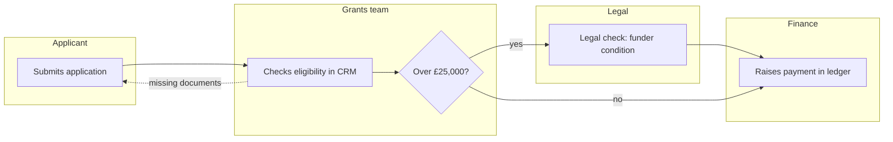

## Start with the step that looked redundant

Halden Council, a fictional local authority, pays small-business grants. An FDE team was asked to cut the time from application to payment, then six weeks.

The workflow had a legal review for every grant above £25,000. Legal had approved every one of the last 200 such grants without change. The team proposed removing the step, and the grants manager agreed. Two days before the change went live, the council's finance officer stopped it. The grants were part-funded by a national scheme whose conditions required a legal check above that value. Skipping it would have put the council's funding at risk.

Nobody had lied. The grants manager owned the process but not that rule, and nobody had asked who did. Call this **the invisible owner**: a person or rule with authority over a step, missing from the map.

> **What you'll learn**
>
> - Map stakeholders by role and by what they can decide.
> - Draw current and proposed workflows with handoffs, exceptions and controls.
> - Give every step one owner across teams.
> - Decide which system is the source of truth when two disagree.
> - Handle conflicting requirements and approval steps that look redundant.

## Who is in the room, and what they decide

A stakeholder map lists everyone who affects or is affected by the change, and what each can decide. Titles do not tell you that. Ask each person what they approve, what they can block and who they answer to.

| Role | Typical person at Halden | What they decide or know |
| --- | --- | --- |
| Sponsor | Director of economic development | Budget, priorities, what counts as success |
| Process owner | Grants manager | How the grants process runs day to day |
| Users | Grants officers | How the work is done, including workarounds |
| Control owners | Legal, finance, audit | Which steps the rules require, and what evidence they need |
| System owners | IT, the CRM administrator | Changes to the systems, access, data |
| Affected groups | Applicants, the funding scheme | Whether the result is acceptable from outside |

*Table 1: A stakeholder map by role. The control owners row is the one teams most often leave empty.*

Two cautions. One person can hold several roles. One role can sit with someone nobody mentioned, such as the external funder at Halden. When you meet a new person, ask, "Who else needs to agree to a change here?"

The **RACI** convention names who is responsible, accountable, consulted and informed for each activity. Use it as a checklist, not a deliverable: the goal is one accountable person per decision.

## Current and proposed workflow maps

A workflow map shows the path of one case through people and systems. Draw it in **swimlanes**, one lane per team, so every handoff crosses a line and stands out. BPMN, the standard notation for business processes, uses the same idea of lanes, though a whiteboard sketch is usually enough.

Mark four things on the current map:

- **Handoffs**, where a case moves between teams or systems. Delays and losses cluster here.
- **Exceptions**, the side paths for cases that do not fit, with how often each happens.
- **Controls**, the steps that exist because a rule, policy or audit requires them, with the rule named.
- **Systems of record** for each step, so you know where each fact is written.

Figure 1 is Halden's current map, simplified.

*Figure 1: Halden's current grants workflow. The dotted line is the most common exception: an application sent back for missing documents. The legal step is a control, labelled with its rule.*

The proposed map uses the same lanes and shows only what changes. Halden's kept the legal check and changed what fed it: a pre-filled evidence pack and a five-day service level, agreed with legal. Showing current and proposed side by side lets each stakeholder see what moves in their lane.

## One owner per step, across teams

Most delays sit at handoffs, because each team owns its own lane and nobody owns the line between them. Give every step and every handoff one named owner. Where a step has no owner, the case waits until someone notices.

When the process has no owner at all, which is common in work that grew across teams, do not appoint one yourself. Name the gap to the sponsor, propose an interim owner for the engagement, and make a permanent owner part of the handover.

The walkthrough shows how the Halden team could have built the map in four short sessions.

Build Halden's map before proposing any change. Each step shows the session, who joins and what it catches.

<button type="button" data-step="0" aria-pressed="false" aria-controls="map-step-0">1. Roles</button><button type="button" data-step="1" aria-pressed="false" aria-controls="map-step-1">2. Trace</button><button type="button" data-step="2" aria-pressed="false" aria-controls="map-step-2">3. Controls</button><button type="button" data-step="3" aria-pressed="false" aria-controls="map-step-3">4. Owners</button>

<section id="map-step-0" class="step-panel" aria-labelledby="map-heading-0"><h4 id="map-heading-0">1. List the roles</h4><dl><dt>Session</dt><dd>Ask the sponsor and grants manager who can approve, block or change the process.</dd><dt>Who joins</dt><dd>Sponsor, grants manager.</dd><dt>Catches</dt><dd>Roles held by people outside the team, such as finance and the funder.</dd></dl></section><section id="map-step-1" class="step-panel" aria-labelledby="map-heading-1"><h4 id="map-heading-1">2. Trace three real cases</h4><dl><dt>Session</dt><dd>Follow one simple, one large and one returned application from start to payment.</dd><dt>Who joins</dt><dd>Two grants officers.</dd><dt>Catches</dt><dd>Handoffs, the missing-documents loop and how long each wait lasts.</dd></dl></section><section id="map-step-2" class="step-panel" aria-labelledby="map-heading-2"><h4 id="map-heading-2">3. Name the rule behind each check</h4><dl><dt>Session</dt><dd>For every approval or check, ask which rule requires it and who owns that rule.</dd><dt>Who joins</dt><dd>Legal, finance, audit.</dd><dt>Catches</dt><dd>The funder's condition behind the legal check, before anyone proposes removing it.</dd></dl></section><section id="map-step-3" class="step-panel" aria-labelledby="map-heading-3"><h4 id="map-heading-3">4. Agree an owner per step</h4><dl><dt>Session</dt><dd>Walk the map and confirm one owner for every step and handoff.</dd><dt>Who joins</dt><dd>All leads, with the sponsor deciding any disputes.</dd><dt>Catches</dt><dd>Handoffs nobody owns, such as chasing missing documents.</dd></dl></section>

<button type="button" data-walk="previous">Previous</button>

<button type="button" data-walk="next">Next step</button>

The walkthrough is a scripted illustration. Step 3 would have found the funder's condition in week one instead of two days before go-live.

## When two systems disagree

At Halden the CRM showed some grants as paid that the finance ledger showed as pending, because officers marked them paid when they sent the request to finance. Each team trusted its own system.

Decide the **source of truth** per fact, not per system:

- **Name the system of record for each field.** Payment status belongs to the ledger, because it records the money moving. Applicant details belong to the CRM.
- **Copy facts one way only.** Other systems read from the system of record. Nobody edits a copy.
- **Reconcile and report.** Run a regular comparison and send mismatches to a named owner.
- **Agree it in writing** with both system owners, because changing a field's home changes their work.

Never pick the truth by which system is easier to integrate with. That choice moves the disagreement into your build.

## Conflicting requirements

Stakeholders often want incompatible things. At Halden the sponsor wanted payment in two weeks, legal wanted five working days per review, and officers wanted fewer forms. Handle conflicts in three moves:

1. **Trace each requirement to its reason.** A law, a contract, a policy or a preference.
2. **Sort by how fixed it is.** A law or funding condition is a constraint. A preference can be traded.
3. **Take open conflicts to the person who can decide.** Usually the sponsor, with the options and their costs.

The two-week target survived, because the grants team cut the missing-documents loop with a better form. The legal step stayed, made faster but not removed.

## An approval that looks redundant

An approval that always says yes looks like waste. Before proposing to remove it, find out why it exists. Ask for the rule, the owner of the rule and the evidence the approver checks. If the rule is real, make the step cheaper instead: prepare the evidence automatically, batch reviews, or agree a service level. If nobody can name a rule, take the proposal to the control owner, not the process owner.

## Limits of this lesson

- **Maps age.** A process changes after go-live. Keep the map with the runbook and update it.
- **Politics is real.** A map that shows a team causing delays can feel like blame. Show waits as system facts, not personal ones.
- **Fictional data.** Halden Council and its figures are illustrative.

## Interview angle

Each answer is an outline to say in about two minutes. Open each question and try it aloud before reading.

Interview question 1. How do you work out who the stakeholders are on a new engagement?

- **Answer:** Map them by role: sponsor, process owner, users, control owners such as legal and audit, system owners and affected groups outside. For each, ask what they can approve or block. Ask everyone, "Who else needs to agree to a change here?", because some owners sit outside the team.
- **Trade-off:** A wide map takes more meetings. A narrow one finds the missing owner at go-live.
- **Follow-up to expect:** "Which role is most often missed?" Control owners, because their authority comes from rules, not the org chart.

Interview question 2. How do you map a current workflow and propose a new one?

- **Answer:** Trace real cases through swimlanes, one per team, and mark handoffs, exceptions with their frequency, controls with their rule and the system of record per step. Draw the proposed map on the same lanes showing only what changes, and walk each lane's owner through their part.
- **Trade-off:** Detailed maps take time and age fast. Keep them at the level where decisions are made.
- **Follow-up to expect:** "What do you look at first?" The handoffs, because waits and lost cases cluster there.

Interview question 3. Two stakeholders give you requirements that cannot both be met. What do you do?

- **Answer:** Trace each to its reason: law, contract, policy or preference. Fixed constraints win. For the rest, put options with their costs to the person who can decide, usually the sponsor, and record the decision.
- **Trade-off:** Escalating feels slower than splitting the difference. A quiet compromise often satisfies nobody and hides a broken constraint.
- **Follow-up to expect:** "Both say theirs is a legal requirement." Ask for the rule and get the control owner to confirm it.

Interview question 4. A workflow crosses four teams and work keeps getting stuck between them. How do you fix ownership?

- **Answer:** Map the handoffs and confirm one named owner for every step and handoff, agreed with all the leads. Where nobody owns the process end to end, raise it with the sponsor, propose an interim owner for the engagement and make a permanent owner part of the handover.
- **Trade-off:** Assigning owners can feel like extra work to the teams. Unowned handoffs cost more in waiting.
- **Follow-up to expect:** "Two teams refuse a handoff." The sponsor decides. One owner per step is the point.

Interview question 5. Two systems both claim to hold the true value of a field. How do you decide?

- **Answer:** Decide per field, by which system records the real event. Payment status belongs to the ledger that moves the money. Other systems read from it, nobody edits copies, and a regular reconciliation sends mismatches to an owner. Agree it in writing with both system owners.
- **Trade-off:** Moving a field's home changes someone's daily work. Leaving it ambiguous moves the disagreement into your integration.
- **Follow-up to expect:** "The true system is hard to integrate with." Integrate with it anyway, or read a governed copy, not the convenient system.

## References

1. Object Management Group, [Business Process Model and Notation 2.0.2](https://www.omg.org/spec/BPMN/2.0.2/), accessed 17 November 2026. Lanes and pools for process maps.
2. Atlassian, [RACI chart](https://www.atlassian.com/work-management/project-management/raci-chart), accessed 17 November 2026. Responsible, accountable, consulted and informed roles.
3. The site's [observing the work](06_Observing_the_Work.md) lesson, for tracing real cases.
4. The author's own field experience, the basis for the mapping sessions and the source-of-truth rules.

## Key takeaways

- Map stakeholders by what they can decide. Control owners are the role most often missed.
- Draw workflows in swimlanes and mark handoffs, exceptions, controls with their rule, and systems of record.
- Give every step and handoff one owner. Raise a missing process owner with the sponsor.
- Decide the source of truth per field, by which system records the real event.
- Before removing an approval, find its rule. If the rule is real, make the step cheaper instead.

## Check yourself

1. Why did the grants manager agree to remove a step they did not have the authority to remove?

They owned the process but not the funder's rule behind the legal check, and nobody had mapped who owned that rule.

2. At Halden, which system should hold payment status, and why?

The finance ledger, because it records the money moving. The CRM's "paid" flag recorded only that a request had been sent.

3. Why draw the proposed map on the same lanes as the current one?

So each owner can see exactly what changes in their lane, and agree to it, instead of reading a new diagram from scratch.

